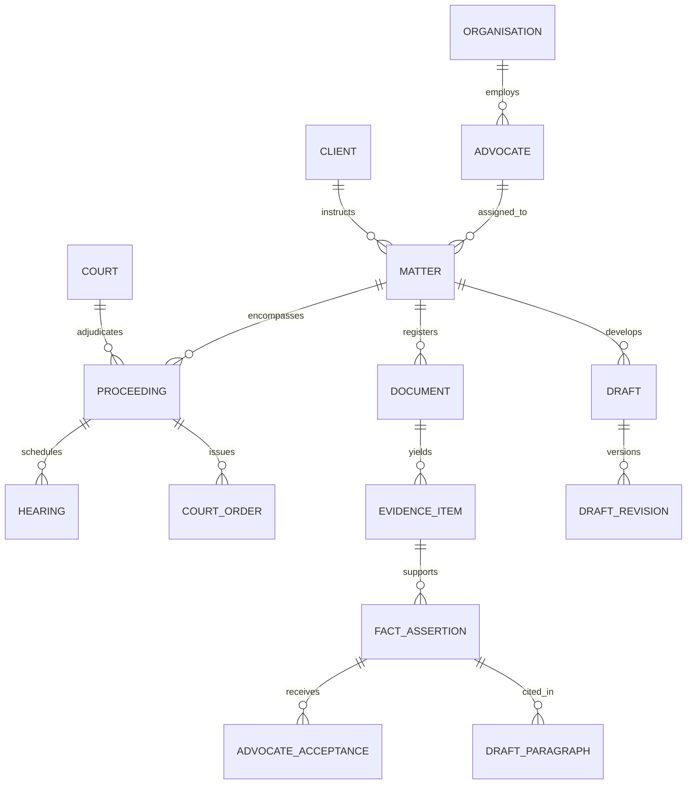

# 02. Domain Design, Ownership Map, and Core Contracts

## 1. Executive Summary

This document defines the domain architecture for the greenfield rewrite of Open Advocate. It establishes a modular monolith with bounded domains, explicit data ownership, and strict dependency rules.

The central rule of this architecture is:
**One fact has one canonical owning domain. No domain modifies another domain's database records directly.**

---

## 2. Domain Entities and Core Relationships

In Indian litigation practice, legal concepts must not be conflated:
1. **Matter**: The advocate's professional engagement with a client. A matter represents the legal dispute, advice, or representation. A matter is not a court case.
2. **Proceeding**: An individual judicial or quasi-judicial case before a specific court, tribunal, or authority. One matter may encompass multiple proceedings across different courts and procedural stages (for example, a trial suit, an interim injunction appeal, and a Special Leave Petition).
3. **Court File**: The formal record of a proceeding maintained by or submitted to a court (including pleadings, orders, diary numbers, and indexation).
4. **Document**: A registered digital asset (PDF, DOCX, scan) stored immutably by its cryptographic hash. A document contains raw bytes and extracted text layers.
5. **Evidence Record**: A legally significant excerpt, annexure, or exhibit derived from a document. An evidence record has strict provenance and verification status. A document is not automatically evidence.
6. **Factual Record**: The structured collection of factual propositions asserted in a matter. Facts transition through explicit, auditable states. A candidate fact extracted by an LLM is never an accepted working fact until an advocate explicitly accepts it.



---

## 3. Domain Ownership Map (Deliverable B)

The table below defines the bounded domains, their canonical records, owned rules, exposed operations, dependencies, and explicit exclusions.

| Domain | Canonical Records | Rules Owned | Operations Exposed | Dependencies | Explicit Exclusions |
|---|---|---|---|---|---|
| **A. Advocate & Organisation** | Advocate profile, enrolment details, chambers/firm records, practice preferences. | Professional credentials format, firm membership rules, user access rights. | `registerAdvocate`, `updatePreferences`, `verifyEnrolment`, `listMembers`. | Shared Foundation. | No matter management or billing/time tracking. |
| **B. Matter Management** | Matter identity, client instructions, assigned advocates, matter status, fee agreements (metadata only). | Matter lifecycle state transitions, conflict checks, matter-level isolation rules. | `createMatter`, `closeMatter`, `assignAdvocate`, `recordInstruction`, `getMatterContext`. | Shared Foundation, Advocate & Organisation. | Not a court proceeding. Does not store court case numbers or court orders. |
| **C. Proceedings** | Court proceeding record, CNR number, diary number, case type, court identifier, procedural stages, hearing history, judicial orders. | Stage transitions per court rules, appeal connection rules, limitation timeline tracking. | `createProceeding`, `recordHearing`, `recordOrder`, `linkConnectedProceeding`, `transitionStage`. | Shared Foundation, Matter Management, Courts & Adapters. | Does not own client billing or physical document files. |
| **D. Courts & Court Adapters** | Court metadata, capability declarations, rule specifications, compliance checklists. | Capability discovery, rate limits, schema validation for e-filing payloads. | `getCourtCapabilities`, `validateFilingRules`, `checkLimitationRule`, `fetchPublicDocket`. | Shared Foundation. | Does not store credentials, solve CAPTCHAs, or own legal records. |
| **E. Documents** | Document identity, content-addressed blob registry (SHA-256), versions, raw OCR text layers, page layouts. | Immutability of original files, deduplication by SHA-256, format validation (PDF/A). | `registerDocument`, `extractTextLayer`, `renderPageImage`, `getDocumentStream`, `verifyHash`. | Shared Foundation, Infrastructure (Storage). | Does not determine legal admissibility or evidential weight. |
| **F. Evidence** | Evidence items, annexure markers, exhibits, chain-of-custody provenance, source coordinate anchors. | Strict anchor validation (bounding boxes, page/line verification), exhibit numbering rules. | `createEvidenceItem`, `verifyAnchorIntegrity`, `indexAnnexures`, `getProvenanceChain`. | Shared Foundation, Documents. | Does not determine whether a fact is legally accepted. |
| **G. Factual Record** | Candidate facts, proposed facts, facts under review, accepted working facts, disputed facts, judicial findings, contradiction records. | Evidential burden rules, fact state transitions, mandatory advocate acceptance, contradiction detection. | `proposeFact`, `acceptFact`, `disputeFact`, `supersedeFact`, `detectContradictions`, `listAcceptedFacts`. | Shared Foundation, Evidence, Matter Management. | Cannot be mutated directly by agent prompts or automated pipelines. |
| **H. Research & Knowledge** | Research queries, authorities, judgments, statutory provisions, verified citations, legal propositions. | Citation verification rules, binding precedent hierarchy, statutory currency rules. | `searchAuthorities`, `verifyCitation`, `retrieveStatuteSection`, `linkAuthorityToIssue`. | Shared Foundation. | Research outputs do not automatically become accepted working facts. |
| **I. Drafting** | Pleading drafts, document sections, revisions, template instances, inline citation anchors. | Pleading structure compliance, revision tracking, redline calculation, attestation checking. | `createDraft`, `createRevision`, `linkFactToParagraph`, `linkAuthorityToParagraph`, `exportDraft`. | Shared Foundation, Matter Management, Factual Record, Research. | Does not own court submission authority or final filing. |
| **J. Work Management & Workflows** | Tasks, assignments, procedural deadlines, review queues, workflow execution traces. | Workflow step sequencing, gate validation, human approval enforcement. | `startWorkflow`, `recordStepExecution`, `pauseAtGate`, `resumeWorkflow`, `listPendingApprovals`. | Shared Foundation, all functional domains (via orchestration). | Coordinates domains but owns none of their domain records. |

---

## 4. The Shared Foundation (Shared Kernel)

The Shared Foundation contains only domain-agnostic technical contracts and value objects.

### 4.1 What Belongs in the Shared Foundation
- **Stable Identifiers**: Strongly-typed UUIDv7 identifiers (time-ordered, unique).
- **Actor Identity**: Strongly-typed representations of system actors (`AdvocateActor`, `SystemActor`, `AgentActor`).
- **Scope Context**: `OrganisationId`, `MatterId`, `ProceedingId`.
- **Temporal & Versioning Primitives**: ISO-8601 timestamps, version vectors, cryptographic hashes.
- **Audit Token**: Hash-chained event record contract (`AuditRecord`).
- **Result & Error Contracts**: `Result<T, E>` monads, standard legal error hierarchies (`DomainError`, `PermissionDeniedError`, `ValidationError`).

### 4.2 What Is Explicitly Excluded from the Shared Foundation
- No domain business logic or database queries.
- No court rules or statutory logic.
- No UI components or Electron dependencies.
- No agent framework SDK imports.

---

## 5. Core Domain Contracts (Deliverable D)

The contracts below define the system boundaries in TypeScript.

### 5.1 Matter and Proceeding Contracts

```typescript
// Shared primitives
export type MatterId = string & { readonly __brand: "MatterId" };
export type ProceedingId = string & { readonly __brand: "ProceedingId" };
export type DocumentId = string & { readonly __brand: "DocumentId" };
export type EvidenceId = string & { readonly __brand: "EvidenceId" };
export type FactId = string & { readonly __brand: "FactId" };
export type ActorId = string & { readonly __brand: "ActorId" };

export interface Actor {
  readonly id: ActorId;
  readonly kind: "advocate" | "assistant" | "agent" | "system";
  readonly name: string;
}

export type MatterStatus = "intake" | "active" | "stayed" | "disposed" | "archived";

export interface Matter {
  readonly id: MatterId;
  readonly title: string;
  readonly clientId: string;
  readonly practiceArea: "civil" | "criminal" | "constitutional" | "commercial" | "arbitration" | "tax" | "family" | "other";
  readonly status: MatterStatus;
  readonly leadAdvocateId: ActorId;
  readonly assignedAdvocateIds: readonly ActorId[];
  readonly instructions: string;
  readonly createdAt: string;
  readonly updatedAt: string;
}

export interface Proceeding {
  readonly id: ProceedingId;
  readonly matterId: MatterId;
  readonly courtId: string; // e.g. "in.sc", "in.hc.delhi", "in.dc.saket"
  readonly cnrNumber?: string;
  readonly diaryNumber?: string;
  readonly caseType: string; // e.g. "Special Leave Petition (Civil)", "Writ Petition (Civil)", "Commercial Suit"
  readonly caseNumber?: string;
  readonly filingYear?: number;
  readonly currentStage: string;
  readonly forumRole: "petitioner" | "respondent" | "appellant" | "defendant" | "plaintiff";
  readonly parties: readonly ProceedingParty[];
  readonly parentProceedingId?: ProceedingId; // For appeals, revisions, or transfer petitions
  readonly createdAt: string;
}

export interface ProceedingParty {
  readonly name: string;
  readonly roleInProceeding: string;
  readonly contactId?: string;
}
```

### 5.2 Document and Evidence Contracts

```typescript
export interface DocumentBlob {
  readonly sha256: string;
  readonly sizeBytes: number;
  readonly mimeType: "application/pdf" | "application/vnd.openxmlformats-officedocument.wordprocessingml.document" | "image/png" | "image/tiff";
  readonly storagePath: string;
}

export interface Document {
  readonly id: DocumentId;
  readonly matterId: MatterId;
  readonly proceedingIds: readonly ProceedingId[];
  readonly originalFileName: string;
  readonly blob: DocumentBlob;
  readonly registeredBy: Actor;
  readonly registeredAt: string;
  readonly pageCount: number;
  readonly ocrStatus: "none" | "queued" | "completed" | "failed";
}

export interface SourceCoordinateAnchor {
  readonly documentId: DocumentId;
  readonly documentSha256: string;
  readonly pageNumber: number;
  readonly lineNumber?: number;
  readonly boundingBox?: {
    readonly x: number;
    readonly y: number;
    readonly width: number;
    readonly height: number;
  };
  readonly exactText: string;
}

export interface EvidenceItem {
  readonly id: EvidenceId;
  readonly matterId: MatterId;
  readonly documentId: DocumentId;
  readonly anchor: SourceCoordinateAnchor;
  readonly exhibitNumber?: string;
  readonly description: string;
  readonly evidentialCategory: "pleading" | "judicial_order" | "statutory_record" | "private_document" | "witness_statement" | "electronic_record";
  readonly verificationStatus: "unverified" | "verified_against_original" | "disputed" | "certified_copy";
  readonly verifiedBy?: Actor;
  readonly verifiedAt?: string;
}
```

### 5.3 Factual Record and Advocate Acceptance Contracts

```typescript
export type FactStatus = 
  | "extracted_candidate"    // Proposed by model or OCR pipeline
  | "proposed_by_agent"      // Proposed during agent reasoning
  | "under_review"           // In advocate review queue
  | "accepted_working_fact"  // Formally accepted by advocate as true for proceedings
  | "admitted_by_opponent"   // Formally admitted in opponent's pleadings
  | "judicial_finding"       // Established by a binding court order/judgment
  | "disputed"               // Contested by client or opposing party
  | "rejected"               // Explicitly rejected by advocate
  | "superseded";            // Replaced by a more specific or newer finding

export interface FactAssertion {
  readonly id: FactId;
  readonly matterId: MatterId;
  readonly proceedingId?: ProceedingId;
  readonly statement: string;
  readonly factDate?: string; // ISO date or date range
  readonly status: FactStatus;
  readonly supportingEvidenceIds: readonly EvidenceId[];
  readonly opposingEvidenceIds: readonly EvidenceId[];
  readonly assertionSource: {
    readonly type: "model_extraction" | "agent_proposal" | "human_entry" | "court_order";
    readonly creator: Actor;
    readonly createdAt: string;
  };
  readonly acceptanceRecord?: AdvocateAcceptance;
}

export interface AdvocateAcceptance {
  readonly acceptedBy: Actor; // Must have kind === "advocate"
  readonly acceptedAt: string;
  readonly notes?: string;
  readonly boundEvidenceIds: readonly EvidenceId[];
  readonly decision: "accept" | "reject" | "dispute";
}
```

### 5.4 Court Adapter Contracts

```typescript
export interface CourtCapabilityDeclaration {
  readonly courtId: string;
  readonly courtName: string;
  readonly jurisdictionTier: "supreme_court" | "high_court" | "district_court" | "tribunal";
  readonly supportedCaseTypes: readonly string[];
  readonly capabilities: {
    readonly publicDocketLookup: boolean;
    readonly orderDownload: boolean;
    readonly causeListLookup: boolean;
    readonly eFilingPreparation: boolean;
    readonly directFilingSubmission: boolean; // Almost universally false (human-only)
  };
  readonly filingRules: {
    readonly marginPoints: { top: number; bottom: number; left: number; right: number };
    readonly paperSize: "A4" | "Legal";
    readonly fontRequirements: { family: string; minSizePoints: number; lineSpacing: number };
    readonly pdfStandardRequired: "PDF/A-1a" | "PDF/A-1b" | "PDF/A-2b" | "Standard";
    readonly maxFileSizeBytes: number;
  };
  readonly authenticationType: "none" | "captcha_gated" | "otp_gated" | "digital_signature_token";
}

export interface CourtAdapter {
  readonly declaration: CourtCapabilityDeclaration;
  validateFilingSet(documents: readonly Document[]): Promise<ValidationReport>;
  lookupCaseDocket?(query: DocketQuery): Promise<DocketInformation>;
  fetchPublicOrder?(orderNumber: string, date: string): Promise<Uint8Array>;
}

export interface ValidationReport {
  readonly isCompliant: boolean;
  readonly violations: readonly {
    readonly ruleId: string;
    readonly severity: "error" | "warning";
    readonly message: string;
    readonly targetDocumentId?: DocumentId;
  }[];
}
```

### 5.5 Capability, Agent Execution, and Workflow Contracts

```typescript
export type CapabilityAccessLevel = "read" | "propose" | "execute" | "human_only";
export type ExecutionRiskLevel = "low" | "medium" | "high" | "critical";

export interface CapabilityDeclaration<TInput = unknown, TOutput = unknown> {
  readonly id: string;
  readonly domain: "matter" | "proceeding" | "document" | "evidence" | "facts" | "research" | "drafting" | "court";
  readonly description: string;
  readonly accessLevel: CapabilityAccessLevel;
  readonly riskLevel: ExecutionRiskLevel;
  readonly requiresHumanApproval: boolean;
  readonly inputSchema: object;  // TypeBox or JSON Schema
  readonly outputSchema: object;
  readonly sideEffects: readonly ("disk_write" | "database_write" | "network_request" | "court_portal_mutation")[];
  execute(input: TInput, context: ExecutionContext): Promise<TOutput>;
}

export interface ExecutionContext {
  readonly actor: Actor;
  readonly matterId: MatterId;
  readonly proceedingId?: ProceedingId;
  readonly auditToken: string;
  readonly signal?: AbortSignal;
}

export interface WorkflowDefinition {
  readonly id: string;
  readonly version: string;
  readonly name: string;
  readonly description: string;
  readonly stages: readonly WorkflowStage[];
}

export interface WorkflowStage {
  readonly id: string;
  readonly name: string;
  readonly steps: readonly WorkflowStep[];
  readonly gateRequired: boolean; // Requires advocate approval before advancing to next stage
}

export interface WorkflowStep {
  readonly id: string;
  readonly capabilityId: string;
  readonly inputMapping: Record<string, unknown>;
  readonly humanApprovalBeforeExecution: boolean;
}
```
