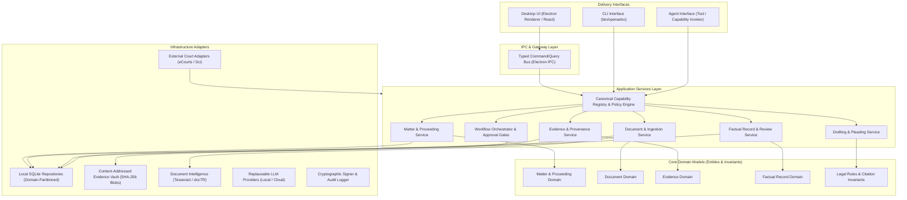

# 03. System Architecture, Runtime, and Interfaces

## 1. Executive Summary

This document specifies the system architecture, agent execution framework, CLI delivery strategy, and repository module structure for the greenfield rewrite of Open Advocate.

The architecture enforces a strict inward dependency rule:
**Delivery interfaces (Desktop UI, CLI, and Agent Runtime) are peer consumers of a unified Application Service layer.**

---

## 2. System Architecture (Deliverable C)

Open Advocate is structured as a Modular Monolith following Ports and Adapters (Hexagonal Architecture).



### 2.1 Layer Responsibilities and Dependency Rules
1. **Domain Layer**:
   - Contains pure business logic, entities, value objects, and domain invariants.
   - Has zero dependencies on databases, file systems, network libraries, Electron, React, or LLM SDKs.
2. **Application Services Layer**:
   - Coordinates domain activities to execute user use cases.
   - Owns transactions, unit of work, permission enforcement, and human approval verification.
   - Exposes typed Command and Query handlers.
3. **Infrastructure Layer**:
   - Implements ports declared by the Application and Domain layers.
   - Manages SQLite persistence, content-addressed disk storage, PDF/OCR processing, and external network calls.
4. **Delivery Interfaces**:
   - Translate user input (from terminal flags, UI clicks, or agent tool calls) into Application Service commands.
   - Contains no business rules and no direct database access.

---

## 3. Agent Architecture Decision (Deliverable E)

### 3.1 Comparison of Candidate Agent Runtimes

| Criteria | 1. Current Pi SDK (`@earendil-works/pi-coding-agent`) | 2. DeepAgents / LangGraph | 3. Custom OpenAdvo-Owned Agent Interface (Recommended) |
|---|---|---|---|
| **Architectural Role** | Monolithic framework that tries to own file IO, tool registration, session storage, and coding extensions. | Workflow DAG graph frameworks. Heavy dependency tree; primarily designed for multi-agent Python or heavy Node runtimes. | Minimal abstraction layer owned by OpenAdvo. Delegates LLM calls to a stateless model adapter. |
| **State Ownership** | Tries to store session files (`messages.json`, `plan.json`) in its own internal directories. | Tries to own memory checkpoints inside graph state stores. | OpenAdvo Application Services own 100% of canonical state. Chat history is an event log in SQLite. |
| **Human Approval & Gates** | Requires ad-hoc UI interrupts or extension cards. | Built-in interrupt-and-resume mechanisms, but tightly coupled to graph nodes. | Native Application Service approval gates. The agent framework cannot proceed without an signed approval token. |
| **Crash Recovery & Resume** | Brittle; chat JSON and database state drift upon ungraceful shutdown. | Complex checkpoint serialization; migrations between schema versions are fragile. | Deterministic event sourcing; workflows resume by loading the latest approved state from SQLite. |
| **Dependency Footprint** | Large (accumulates coding agent dependencies, AST parsers, bash shims). | Heavy abstractions, steep learning curve, frequent breaking changes. | Extremely small. Depends only on standard model completion endpoints. |
| **Replacement Cost** | High: `agent.ts` reached 3,118 lines tightly coupled to Pi SDK APIs. | High: Entire workflow must be rewritten if the graph engine is deprecated. | **Zero**: The runtime adapter is a single interchangeable class (~200 lines). |

### 3.2 Recommendation: OpenAdvo-Owned Agent Execution Adapter
OpenAdvo must adopt an **Application-Owned Agent Interface**.

#### What OpenAdvo Must Own Independently:
- **Canonical Legal Truth**: Matter data, proceeding records, evidence items, and accepted facts reside strictly in domain repositories.
- **Permission & Policy Enforcement**: The policy engine runs in the Application Service before any capability is invoked. The LLM prompt is never trusted for security or data isolation.
- **Approval Tokens**: Actions requiring human authority (such as fact acceptance, pleading sign-off, or filing preparation) require a cryptographic or database-verified token signed by an advocate actor.
- **Workflow State**: Execution progress and task dependencies are tracked in OpenAdvo's workflow store.

#### What the Agent Framework Does:
- The agent framework acts solely as a **reasoning loop**. It receives a scoped context package, predicts the next action, and issues a structured tool call.
- If the agent crashes, restarts, or is swapped for another model provider, no legal records are lost.

---

## 4. CLI-First Delivery Strategy (Deliverable F)

Building CLI-first guarantees that the application services are fully decoupled from the Electron renderer and React lifecycle.

### 4.1 Architectural Rules for the CLI
1. **Zero Logic in CLI**: The CLI parser parses arguments, passes them to the Application Service, formats the returned `Result<T, E>`, and exits.
2. **Machine-Readable JSON Mode**: Every command supports `--json`. Agents and automated scripts can consume standard JSON envelopes:
   ```json
   {
     "success": true,
     "data": { ... },
     "error": null
   }
   ```
3. **Stable Error Codes**: Errors return structured exit codes and standard error identifiers (e.g. `ERR_TITLE_REQUIRED`, `ERR_UNAUTHORIZED_APPROVAL`, `ERR_ANCHOR_NOT_FOUND`).
4. **Service Parity**: Any action possible in the desktop UI is first possible via the CLI.

### 4.2 Initial Command Surface

```text
openadvo
├── matter
│   ├── create --title <string> --client <string> [--practice <area>]
│   ├── list [--status <active|all>] [--json]
│   ├── show <matter-id> [--json]
│   └── assign --matter <id> --advocate <id>
├── proceeding
│   ├── create --matter <id> --court <court-id> --case-type <type>
│   ├── list --matter <id> [--json]
│   ├── record-hearing --proceeding <id> --date <YYYY-MM-DD> --directions <text>
│   └── link --proceeding <id> --parent <parent-proceeding-id>
├── doc
│   ├── register --matter <id> --file <path> [--proceeding <id>]
│   ├── list --matter <id> [--json]
│   ├── ocr --doc <id> [--engine <tesseract|doctr>]
│   └── show-text --doc <id> --page <n>
├── evidence
│   ├── add --matter <id> --doc <id> --page <n> --line <n> --text <string>
│   ├── list --matter <id> [--json]
│   └── verify --evidence <id>
├── fact
│   ├── propose --matter <id> --statement <text> --evidence <id>
│   ├── list --matter <id> [--status <status>] [--json]
│   ├── accept --fact <id> --notes <text> (advocate only)
│   ├── dispute --fact <id> --reason <text>
│   └── contradictions --matter <id> [--json]
├── draft
│   ├── create --matter <id> --kind <kind> --title <text>
│   ├── link-fact --draft <id> --paragraph <n> --fact <fact-id>
│   └── export --draft <id> --format <docx|pdf> --out <path>
└── workflow
    ├── list [--json]
    ├── run --workflow <id> --matter <id> [--auto-approve-low-risk]
    └── status --run <run-id> [--json]
```

---

## 5. Desktop UI Architecture

The desktop UI is an Electron application that interacts with the backend strictly through typed messages.

### 5.1 Presentation Decoupling
1. **No Backend Database Access**: The renderer process has no filesystem access, no SQLite bindings, and no network access to external portals.
2. **Feature Workspace Modules**: The monolithic `App.tsx` is replaced by modular workspace containers:
   - `MattersWorkspace`: Manages matter selection, profile forms, and assigned teams.
   - `ProceedingsWorkspace`: Displays court dockets, hearing chronologies, and connected appeals.
   - `DocumentWorkspace`: Split-view PDF/A viewer with page anchors and OCR highlighting.
   - `FactReviewWorkspace`: Dedicated triage board for reviewing candidate facts, contradictions, and advocate acceptance.
   - `DraftingWorkspace`: Pleading editor with linked evidence margin cards.
   - `AgentDock`: Collapsible conversational assistant that inspects active workspace context and issues permitted service calls.
3. **Global Workspace Context**: A lightweight UI context provider holds only the `activeMatterId` and `activeProceedingId`. Individual workspace views query their own data through dedicated React hooks that call the Command/Query bus.

---

## 6. Repository and Module Structure (Deliverable G)

The repository layout establishes clear module boundaries and enforces single-direction imports:

```text
c:/dev/openadvo/
├── bin/
│   └── openadvo.ts                  # CLI Entry point
├── src/
│   ├── domain/                      # PURE DOMAIN LAYER (Zero external deps)
│   │   ├── shared/                  # Strongly-typed IDs, Value Objects, Audit Token
│   │   ├── advocate/                # Advocate profile & permissions
│   │   ├── matter/                  # Matter entities, client instructions
│   │   ├── proceeding/              # Court proceeding, hearings, orders
│   │   ├── court/                   # Court capabilities, rules, limitation specifications
│   │   ├── document/                # Document metadata, content-addressed blob invariants
│   │   ├── evidence/                # Evidence anchors, exhibit numbering
│   │   ├── factual-record/          # Candidate facts, acceptance invariants, contradictions
│   │   └── drafting/                # Pleading structure, paragraph citations
│   ├── application/                 # APPLICATION SERVICES (Use Cases)
│   │   ├── common/                  # Command/Query Bus, Unit of Work interfaces
│   │   ├── capability/              # Canonical Capability Registry & Policy Engine
│   │   ├── services/
│   │   │   ├── MatterService.ts
│   │   │   ├── ProceedingService.ts
│   │   │   ├── DocumentService.ts
│   │   │   ├── EvidenceService.ts
│   │   │   ├── FactualRecordService.ts
│   │   │   ├── DraftingService.ts
│   │   │   └── WorkflowCoordinator.ts
│   │   └── ports/                   # Interfaces implemented by infrastructure
│   │       ├── IStorageRepository.ts
│   │       ├── IDocumentVault.ts
│   │       ├── IOcrEngine.ts
│   │       ├── ICourtAdapter.ts
│   │       └── IModelRuntime.ts
│   ├── infrastructure/              # INFRASTRUCTURE ADAPTERS
│   │   ├── persistence/
│   │   │   ├── sqlite/              # SQLite implementations (isolated table schemas)
│   │   │   └── vault/               # Local filesystem content-addressed vault
│   │   ├── ocr/                     # Tesseract & docTR workers
│   │   ├── court-adapters/          # Standard court capability implementations (eCourts, SC)
│   │   ├── llm/                     # Stateless model adapters (Anthropic, OpenAI, Local)
│   │   └── security/                # Policy validator & SafeStorage wrapper
│   ├── interfaces/                  # DELIVERY INTERFACES
│   │   ├── cli/                     # CLI Command definitions & formatting
│   │   ├── agent/                   # Agent reasoning adapter & capability bridge
│   │   └── desktop/                 # Electron Main, Preload, and IPC Gateway
│   └── renderer/                    # REACT UI (Astryx Components, Workspaces)
│       ├── src/
│       │   ├── workspaces/          # Feature view modules
│       │   ├── components/          # Astryx component wrappers
│       │   ├── hooks/               # Query/Command bus hooks
│       │   └── main.tsx             # UI entry point
├── tests/
│   ├── domain/                      # Pure unit tests (no mocks, zero IO)
│   ├── application/                 # Service tests with in-memory repositories
│   ├── architecture/                # Dependency-cruiser boundary verification tests
│   └── integration/                 # CLI and End-to-End verification suites
└── package.json
```

### 6.1 Architectural Boundary Rules (Enforced by Linter and Tests)
- `src/domain` must NEVER import from `src/application`, `src/infrastructure`, `src/interfaces`, or `src/renderer`.
- `src/application` must NEVER import from `src/infrastructure`, `src/interfaces`, or `src/renderer`.
- `src/interfaces` and `src/renderer` must communicate with `src/application` via typed Request/Response DTOs.
- `src/renderer` must NEVER import `electron`, `node:*`, or direct database packages.
