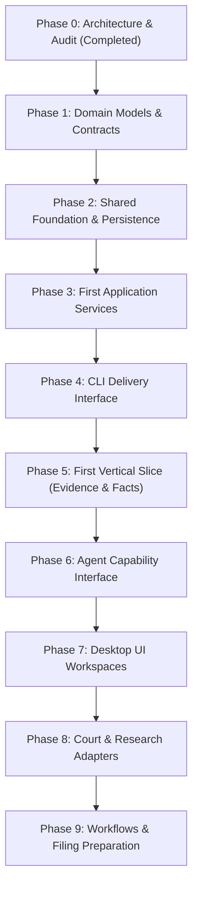

# 04. Scenario Validation, Implementation Plan, Rules, and Final Assessment

## 1. Executive Summary

This document completes the architecture planning for the greenfield rewrite of Open Advocate. 

It tests the architecture against twelve realistic Indian litigation scenarios. It defines a dependency-aware, phased implementation plan starting with a complete vertical slice. It establishes short, enforceable architecture rules for future coding agents. It records open technical decisions and concludes with a formal engineering assessment.

---

## 2. Realistic Litigation Scenario Validation

To prove that the architecture survives real-world legal practice before code is written, each of the twelve mandatory scenarios is evaluated step-by-step against the proposed domain boundaries.

### Scenario 1: One Matter with Several Proceedings
- **Litigation Context**: An advocate handles a commercial contract dispute. The advocate files a Civil Suit in Delhi District Court, files an interim application before the High Court of Delhi under Section 9 of the Arbitration and Conciliation Act, and later petitions the Supreme Court under Article 136 (Special Leave Petition).
- **Architectural Handling**:
  - The client engagement is represented by a single `Matter` entity (`MatterId: M-101`).
  - Three distinct `Proceeding` entities are created under `M-101`:
    1. `ProceedingId: P-1`: Court `in.dc.delhi`, Case Type `Commercial Suit`.
    2. `ProceedingId: P-2`: Court `in.hc.delhi`, Case Type `O.M.P. (I) (COMM)`.
    3. `ProceedingId: P-3`: Court `in.sc`, Case Type `Special Leave Petition (Civil)`.
  - `P-3` references `P-2` as its `parentProceedingId`.
  - Documents, client instructions, and fee agreements remain scoped to `M-101`, while court-specific hearing dates, orders, and limitation timelines remain strictly scoped to each respective proceeding.

### Scenario 2: One Proceeding Involving Several Documents
- **Litigation Context**: A Special Leave Petition proceeding requires a certified copy of the impugned High Court judgment, the trial court decree, multiple contractual annexures, an affidavit of service, and a vakalatnama.
- **Architectural Handling**:
  - Each file is registered independently in the `Document` domain with its own immutable SHA-256 hash.
  - The `Document` records hold a foreign relation `proceedingIds: [P-3]`.
  - The `DocumentService` converts and processes each document (PDF/A normalization, OCR extraction).
  - The original files remain unmodified in the content-addressed blob vault.

### Scenario 3: A Shared Document Used in Several Proceedings
- **Litigation Context**: The original loan agreement is filed as an exhibit in the District Court civil suit and later attached as an annexure to the Section 9 petition in the High Court and the SLP in the Supreme Court.
- **Architectural Handling**:
  - The agreement is stored exactly once in the Document Vault (`sha256: 3a7b...`).
  - Its `Document` record links to all three proceedings: `proceedingIds: [P-1, P-2, P-3]`.
  - Each proceeding derives its own `EvidenceItem` records with proceeding-specific exhibit numbers (e.g. `Exhibit P-1` in the trial suit, `Annexure P-4` in the SLP) referencing the exact same underlying document anchor.
  - Updating metadata in one proceeding does not corrupt the document or other proceedings.

### Scenario 4: Conflicting Facts Extracted from Different Sources
- **Litigation Context**: The police First Information Report (FIR) records the incident date as 2024-03-12. The client's hospital admission certificate records the incident date as 2024-03-14.
- **Architectural Handling**:
  - Automated ingestion or agent extraction creates two candidate `FactAssertion` records in the `FactualRecord` domain:
    1. `Fact-1`: "Incident occurred on 2024-03-12" (Status: `extracted_candidate`, Supporting Evidence: `Evidence-FIR`).
    2. `Fact-2`: "Incident occurred on 2024-03-14" (Status: `extracted_candidate`, Supporting Evidence: `Evidence-Hospital`).
  - The `FactualRecordService` runs contradiction detection across temporal anchors. It identifies overlapping temporal predicates and creates a `ContradictionRecord` linking `Fact-1` and `Fact-2`.
  - Neither assertion is promoted to an `accepted_working_fact`. Both appear on the advocate's review triage board with the detected discrepancy highlighted.

### Scenario 5: A Lawyer Accepting or Rejecting a Proposed Fact
- **Litigation Context**: An LLM agent proposes: "The defendant admitted receipt of the legal notice on 2024-04-01." The advocate reviews the opposing party's reply and discovers that the defendant explicitly denied receipt.
- **Architectural Handling**:
  - The fact is currently in status `proposed_by_agent`.
  - The advocate executes `rejectFact(factId, { reason: "Opposing reply paragraph 4 explicitly denies receipt", actor: advocateActor })`.
  - The `FactualRecordService` transitions the status to `rejected`.
  - The transition requires an authorized advocate actor token. The agent runtime cannot execute this operation.
  - Any pleading draft referencing this fact is flagged with a blocking validation error.

### Scenario 6: Several Advocates Working on One Matter
- **Litigation Context**: A Senior Advocate, an Advocate-on-Record (AoR), and a junior associate collaborate on a writ petition. The junior drafts the petition; the AoR verifies filings; the Senior settles the grounds.
- **Architectural Handling**:
  - The `Matter` record assigns roles: `leadAdvocateId: AoR-1`, `assignedAdvocateIds: [Senior-1, Junior-1]`.
  - The junior creates draft revisions and proposes candidate facts (`assertionSource.creator = Junior-1`).
  - The `DraftingService` records revision authorship per paragraph.
  - The Capability Registry restricts filing approval and fact acceptance to users holding the role `lead_advocate` or `advocate`. The junior cannot trigger formal court filing preparation.

### Scenario 7: An Advocate Working Across Different Practice Areas
- **Litigation Context**: A single practitioner handles a criminal bail petition in the morning, a commercial arbitration hearing in the afternoon, and drafts a trademark opposition in the evening.
- **Architectural Handling**:
  - Practice areas are not hard-coded application forks or separate database installations.
  - Each `Matter` specifies its `practiceArea` (`criminal`, `commercial`, `intellectual_property`).
  - The `ApplicationService` activates relevant compliance packs, limitation calculators, and drafting templates dynamically based on the active proceeding's `caseType` and `courtId`.
  - The core application remains unified, local-first, and lightweight.

### Scenario 8: Different Court Adapters with Different Capabilities
- **Litigation Context**: The Supreme Court adapter supports digital PDF/A verification and structured checklist validation. A local District Court adapter has no public API and only provides paper-format rules.
- **Architectural Handling**:
  - The `CourtAdapter` interface requires every adapter to declare a static `CourtCapabilityDeclaration`.
  - Supreme Court Adapter declares: `eFilingPreparation: true`, `publicDocketLookup: true`, `pdfStandardRequired: "PDF/A-1b"`.
  - District Court Adapter declares: `eFilingPreparation: false`, `publicDocketLookup: false`, `pdfStandardRequired: "Standard"`.
  - The Application Services query these capabilities. If an agent or workflow attempts to invoke automated docket fetching on the District Court, the Capability Registry safely refuses the command with `ERR_CAPABILITY_NOT_SUPPORTED` before making any network calls.

### Scenario 9: An Agent Working on One Matter While Another Matter Is Open
- **Litigation Context**: An advocate is reading documents for Matter B in the UI while an agent executes a 10-minute research and extraction workflow for Matter A in the background.
- **Architectural Handling**:
  - The agent executes within an isolated `ExecutionContext` bound immutably to `MatterId: M-A`.
  - All capability calls made by the agent pass `M-A` in their execution token.
  - The Application Services enforce matter isolation at the database repository level: queries and mutations are parameterized by `WHERE matter_id = ?`.
  - Browser sessions used by the agent run in an isolated partition `persist:oa-matter-M-A`. They never share cookies, history, or active sessions with the UI's active view for `M-B`.

### Scenario 10: A Failed Workflow That Must Resume
- **Litigation Context**: A 7-step document ingestion, OCR, entity extraction, and chronology-building workflow encounters an operating system power interruption at step 4.
- **Architectural Handling**:
  - Steps 1 through 3 committed their outputs (document registration, OCR extraction, anchor generation) inside transactional SQLite units of work with step completion events in the workflow log.
  - Upon restart, the advocate selects `resumeWorkflow(runId)`.
  - The `WorkflowCoordinator` loads the run record, verifies that steps 1–3 are `completed` with immutable output hashes, and resumes execution directly from step 4. No steps are repeated; no duplicate facts or documents are generated.

### Scenario 11: A Court Document Retrieved and Later Found to Be Incorrect
- **Litigation Context**: A public court portal initially provided an interim order with a typographical error in the date. The court registry later uploads a corrected certified copy.
- **Architectural Handling**:
  - The original document (`Doc-1`, `sha256: 1111...`) is never deleted or overwritten, maintaining the audit trail.
  - The new document (`Doc-2`, `sha256: 2222...`) is registered with a relation `supersedes: Doc-1`.
  - Evidence items derived from `Doc-1` are marked `superseded`.
  - Any candidate facts derived solely from `Doc-1` transition to `superseded` status, and the advocate is notified to confirm whether previous arguments require revision.

### Scenario 12: A Filing Prepared but Not Approved or Submitted
- **Litigation Context**: An agent prepares a complete filing package for a Special Leave Petition, including formatted petitions, annexures, and limitation calculations. The advocate discovers an omitted ground and decides not to file.
- **Architectural Handling**:
  - The filing set is created in status `draft_prepared`.
  - The system enforces a strict state invariant: a filing set cannot transition to `submitted` without an explicit, cryptographically verifiable `AdvocateApprovalToken` signed by the advocate.
  - The agent capability `prepareFilingPackage` has access level `propose`. The capability `submitFiling` is classified as `human_only`.
  - The filing set remains unfiled in the database. No court portal network requests are initiated.

---

## 3. Phased Implementation Plan (Deliverable H)

The rewrite proceeds through ten dependency-aware phases. Each phase builds a vertical capability that can be verified by automated tests and realistic legal briefs.

### Phase 0: Repository Audit and Architectural Planning (Completed)
- **Objective**: Identify all architectural failures in the legacy codebase and specify the greenfield architecture.
- **Scope**: Repository audit, domain boundaries, interface design, core contracts.
- **Deliverables**: Reports 01, 02, 03, and 04 in `docs/GeminiAUDIT/`.

---

### Phase 1: Domain Models and Contracts
- **Objective**: Implement pure TypeScript domain entities, value objects, and domain errors with zero external dependencies.
- **Scope**: `src/domain/` (Matter, Proceeding, Document, Evidence, FactualRecord, Court).
- **Dependencies**: None.
- **Files/Modules**: `src/domain/**/*`.
- **Tests**: Pure unit tests verifying state transitions, entity validation, and domain invariants.
- **Acceptance Criteria**: 100% test coverage on domain rules. No imports of Node IO, SQLite, Electron, React, or LLM packages.
- **Out of Scope**: Database queries, file writing, UI components.

---

### Phase 2: Shared Foundation and Persistence
- **Objective**: Build local persistence adapters using domain-partitioned SQLite schemas and the content-addressed blob vault.
- **Scope**: `src/infrastructure/persistence/` (SQLite repositories, Blob storage vault, SHA-256 verifier).
- **Dependencies**: Phase 1.
- **Files/Modules**: `src/domain/shared/`, `src/infrastructure/persistence/**/*`.
- **Tests**: Integration tests checking database transactions, foreign key constraints, blob deduplication, and crash recovery.
- **Acceptance Criteria**: Saving a document stores raw bytes by SHA-256; re-importing the same bytes returns the existing record without duplicate storage.

---

### Phase 3: First Application Services
- **Objective**: Implement Application Services for Matter, Proceeding, Document, and Evidence management.
- **Scope**: `src/application/services/` (`MatterService`, `ProceedingService`, `DocumentService`, `EvidenceService`).
- **Dependencies**: Phase 2.
- **Files/Modules**: `src/application/**/*`.
- **Tests**: Application service use case tests using in-memory or temporary SQLite databases.
- **Acceptance Criteria**: A client matter can be created with multiple child proceedings, and documents can be registered with verified coordinate anchors.

---

### Phase 4: CLI Delivery Interface
- **Objective**: Expose Application Services through a robust command-line interface.
- **Scope**: `bin/openadvo.ts`, `src/interfaces/cli/**/*`.
- **Dependencies**: Phase 3.
- **Files/Modules**: `bin/openadvo.ts`, `src/interfaces/cli/**/*`.
- **Tests**: CLI execution tests verifying stdout formatting, `--json` serialization envelopes, and exit error codes.
- **Acceptance Criteria**: An advocate or automated test can execute `openadvo matter create`, `openadvo proceeding create`, and `openadvo doc register` with machine-readable outputs.

---

### Phase 5: The First Complete Vertical Slice (Evidence and Factual Review)
- **Objective**: Implement the end-to-end factual review pipeline from document import to advocate fact acceptance.
- **Sequence**:
  $$\text{Matter} \longrightarrow \text{Proceeding} \longrightarrow \text{Document Import} \longrightarrow \text{Vault Storage} \longrightarrow \text{OCR Extraction} \longrightarrow \text{Candidate Facts} \longrightarrow \text{Contradiction Check} \longrightarrow \text{Advocate Acceptance} \longrightarrow \text{Accepted Factual Record}$$
- **Scope**: Document OCR worker integration (Tesseract/docTR), candidate fact extraction rules, contradiction engine, advocate acceptance commands.
- **Dependencies**: Phase 4.
- **Files/Modules**: `src/application/services/FactualRecordService.ts`, `src/infrastructure/ocr/**/*`.
- **Tests**: End-to-end slice tests verifying that raw scanned PDFs yield candidate facts that cannot be accepted without an advocate actor token.
- **Acceptance Criteria**: Full vertical slice passes on a realistic multi-page Indian court order fixture.

---

### Phase 6: Agent Capability and Execution Interface
- **Objective**: Implement the application-owned Agent Interface, Canonical Capability Registry, and fail-closed Policy Engine.
- **Scope**: `src/application/capability/`, `src/interfaces/agent/`, `src/infrastructure/llm/`.
- **Dependencies**: Phase 5.
- **Files/Modules**: `src/application/capability/**/*`, `src/interfaces/agent/**/*`, `src/infrastructure/llm/**/*`.
- **Tests**: Security tests verifying that:
  - Agent cannot call unlisted tools.
  - Agent cannot bypass human approval for `propose` or `human_only` capabilities.
  - Corrupted policy configuration halts execution (fail closed).
  - LLM model adapter can be swapped with zero changes to domain state.
- **Acceptance Criteria**: Agent reasons over matter documents and proposes facts via typed capability invocations without direct file or database access.

---

### Phase 7: Desktop UI Workspaces
- **Objective**: Build the Electron desktop UI using modular feature workspaces and typed IPC Command/Query bus.
- **Scope**: `src/interfaces/desktop/` (Electron main, preload bus), `src/renderer/` (React workspaces using Astryx components).
- **Dependencies**: Phase 6.
- **Files/Modules**: `src/interfaces/desktop/**/*`, `src/renderer/**/*`.
- **Tests**: UI unit tests, component tests, and Playwright desktop workflow tests.
- **Acceptance Criteria**: The desktop app boots with zero business logic in React components, rendering the active matter, document viewer, and fact triage board.

---

### Phase 8: Court and Research Adapters
- **Objective**: Implement external court adapter definitions and citation verification services.
- **Scope**: `src/infrastructure/court-adapters/` (Supreme Court, High Court, eCourts), `src/infrastructure/research/` (statute lookup, citation validator).
- **Dependencies**: Phase 7.
- **Files/Modules**: `src/infrastructure/court-adapters/**/*`, `src/infrastructure/research/**/*`.
- **Tests**: Court adapter capability tests, limitation calculation tests, citation attestation tests.
- **Acceptance Criteria**: Court adapters declare capabilities accurately; no scraping or CAPTCHA bypass logic is included.

---

### Phase 9: Additional Litigation Workflows and Filing Preparation
- **Objective**: Implement pleading drafting, annexure compilation, limitation tracking, and filing set preparation.
- **Scope**: `src/application/services/DraftingService.ts`, `src/application/services/WorkflowCoordinator.ts`.
- **Dependencies**: Phase 8.
- **Files/Modules**: `src/application/services/DraftingService.ts`, `src/infrastructure/export/**/*`.
- **Tests**: Verification of generated DOCX/PDF pleadings, limitation alerts, and final filing manifest hash binding.
- **Acceptance Criteria**: Pleading drafts cleanly reference accepted facts and verified authorities; final filing package is prepared and awaits advocate approval.

---

## 4. Architecture Rules for Future Coding Agents (Deliverable I)

These ten rules are mandatory for all future agents working in this repository:

1. **One Canonical Owner**: Every piece of data belongs to exactly one bounded domain. Never write to another domain's database table directly.
2. **Strict Layering**: Dependencies point inward only: $\text{Interfaces} \rightarrow \text{Application} \rightarrow \text{Domain}$. The Domain layer imports nothing from outside `src/domain/`.
3. **No Direct UI/Agent Database Access**: UI components and Agent tools must never import SQLite or access files directly. All operations invoke Application Services.
4. **Service Parity**: Every capability exposed in the Desktop UI or Agent Interface must exist as a typed Application Service command accessible via CLI.
5. **Fail-Closed Security**: Missing, corrupted, or unverified permission policies must immediately halt execution and deny the operation. Never default to permissive access.
6. **Human Authority Is Inviolable**: An LLM agent may propose facts, drafts, or filing packages. Only an authenticated advocate actor can accept facts, approve pleadings, or authorize filings.
7. **Originals Are Immutable**: Never mutate or overwrite an imported document blob. Derived formats (text, OCR, PDF/A) are stored separately and reference the source SHA-256.
8. **Evidence Requires Verified Anchors**: Arbitrary text strings are not valid evidence anchors. Every anchor must specify a valid document SHA-256, page number, and coordinate/line boundary.
9. **Isolated Browser Sessions**: Every matter browser session must run in a dedicated, isolated partition (`persist:oa-matter-<id>`). Never share cookies or sessions across matters.
10. **Chat History Is Not Legal Truth**: Conversational logs and chat traces are ephemeral interaction records. Formal legal facts, evidence, and proceedings exist only in domain repositories.

---

## 5. Open Technical Decisions and Risks (Deliverable J)

| ID | Topic | Trade-off / Options | Preferred Option | Risk if Wrong |
|---|---|---|---|---|
| **D-1** | SQLite Driver Selection | Built-in Node `node:sqlite` vs `better-sqlite3`. `node:sqlite` avoids native C++ compilation issues on Windows, but is marked experimental in Node 22. | Use `better-sqlite3` or test `node:sqlite` stability in Phase 2. | Native build failures on client machines or API breaking changes in future Node releases. |
| **D-2** | Local OCR Strategy | Bundled Tesseract.js (WASM) vs native system Tesseract/docTR binary. WASM is cross-platform but slower on multi-hundred-page briefs. | Hybrid: WASM baseline with native background worker optimization where available. | Slow ingestion of large trial court records causing UI freezing. |
| **D-3** | Rich Text Editing Format | Euro-Office integration vs embedded TipTap/ProseMirror web editor for drafting. | Keep official Euro-Office as an external editor adapter while providing web-based structured drafting. | Incompatibility with complex court petition DOCX templates. |
| **D-4** | Local Model Support | Local ONNX/GGUF models via llama.cpp vs cloud API completions (Anthropic/OpenAI/Gemini). | Stateless model adapter supporting both local endpoints (Ollama/OpenAI-compatible) and cloud providers. | High memory consumption or lack of GPU acceleration on advocate laptops. |

---

## 6. Final Engineering Assessment

### 6.1 Evaluation Questions

1. **Is the problem being solved real?**
   - **Yes**. Indian litigation involves complex procedural hierarchies across District Courts, High Courts, and the Supreme Court. The current codebase failed because it conflated a client's overarching legal matter with individual court proceedings, hardcoded Supreme Court rules into the application core, and allowed the agent runtime to accumulate uncontrolled responsibilities.
2. **Are the proposed domain boundaries correct?**
   - **Yes**. Separating Matter, Proceeding, Document, Evidence, and Factual Record directly mirrors legal reality. It prevents a document from being confused with evidence, and prevents an LLM model extraction from masquerading as an accepted working fact.
3. **Is there unnecessary abstraction?**
   - **No**. The design rejects microservices, external databases, cloud containers, and complex DAG execution frameworks. It uses a single local Modular Monolith with plain TypeScript interfaces and local SQLite storage.
4. **Does each type of truth have one owner?**
   - **Yes**. Matter owns client relationships; Proceeding owns court dockets; Documents owns immutable bytes; Evidence owns coordinate provenance; Factual Record owns legal assertions.
5. **Are dependencies pointing in the correct direction?**
   - **Yes**. Delivery interfaces (Desktop, CLI, Agent) depend on Application Services, which depend on Domain models. The Domain layer has zero external dependencies.
6. **Can the agent runtime be replaced without rewriting legal records?**
   - **Yes**. Legal records reside exclusively in OpenAdvo domain repositories. The agent interface is a stateless consumer of the Capability Registry. Swapping the agent runtime requires zero database migrations.
7. **Can CLI and desktop UI use the same application services?**
   - **Yes**. Both interfaces execute the same Command and Query handlers through the Application Service layer.
8. **Can a court adapter be replaced without changing domain rules?**
   - **Yes**. Court adapters implement a clean `CourtAdapter` port declaring capability specifications. Replacing or updating an adapter changes zero domain entities.
9. **Are permissions and human approvals enforced outside the LLM?**
   - **Yes**. The Policy Engine and Application Services evaluate actor permissions and cryptographic approval tokens deterministically before executing any capability.
10. **What remains unverified?**
    - The processing throughput of large scanned trial court paper-books (500+ pages) through local OCR workers on typical advocate hardware requires empirical measurement in Phase 2.

### 6.2 Definitive Recommendation

**RECOMMENDATION: ADOPT**

#### Architectural Rationale
The proposed architecture directly resolves every failure identified in the audit. It eliminates the 3,118-line God file (`agent.ts`), decouples the 1,060-line main wiring (`index.ts`), collapses the 357-method preload bridge, secures the fail-open policy vulnerability, eliminates cross-matter portal contamination, and establishes a robust, extensible foundation for Indian litigation practice across all courts and tribunals.
