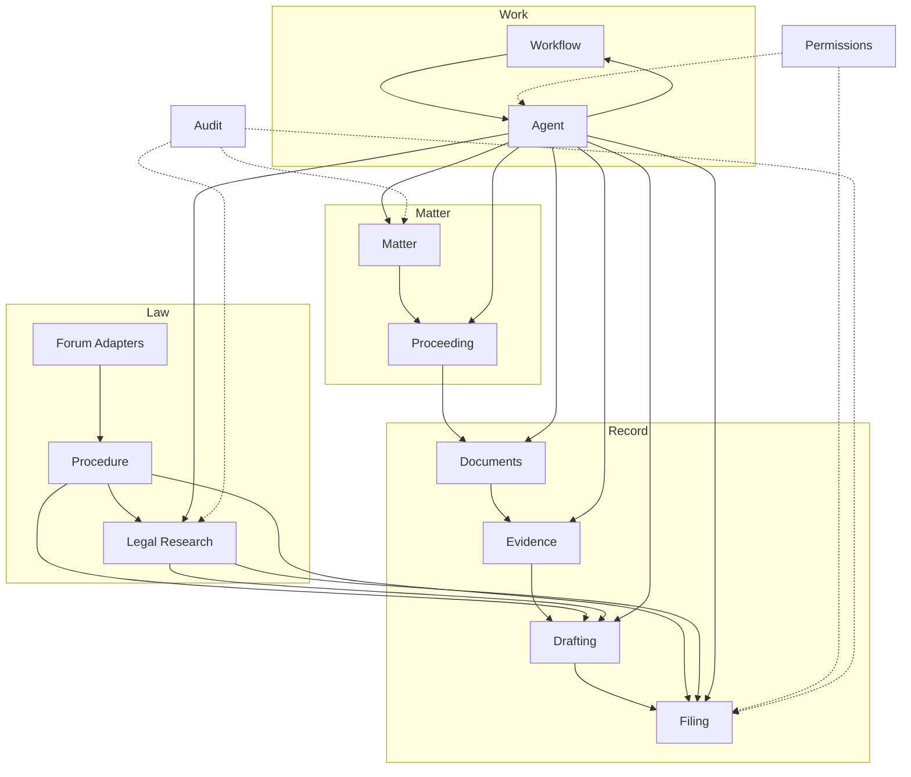
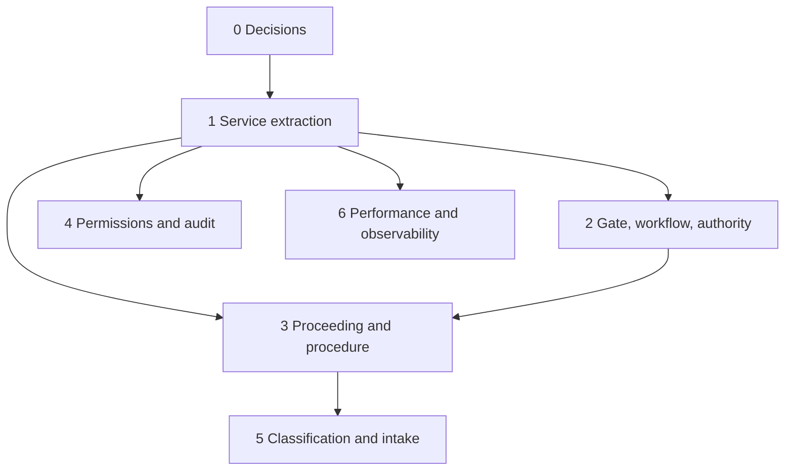

# Systems design report: capabilities, boundaries and contracts

Status: architecture review and target design, 20 November 2026. It records the current system, the relationships between capabilities, and the boundaries to put in place before the next feature. It does not change code.

Scope: the fourteen capability areas named by the owner:

1. Matter Management
2. Proceeding Management
3. Matter Classification
4. Document Management
5. Evidence Management
6. Procedural Intelligence
7. Legal Research
8. Drafting
9. Filing
10. Workflow
11. Permissions
12. Audit and provenance
13. Agent runtime
14. Court adapters

Method: code-first review of the working tree at commit `9168f6a`, the tests, and the data schemas. The report treats code as the evidence of what is implemented. Documents are used only to explain intent or to record a mismatch.

Recommendation: **refactor boundaries, do not rewrite.** The application is a strong modular monolith with deep legal capabilities. Its main problem is not missing features. It is that several capabilities have no explicit owner, several have more than one authority, and the service layer is bypassed by direct store access.

How to use this report: section 3 is the feature inventory; section 4 is the ownership map; section 5 is the relationship analysis; section 6 is the principles review; section 7 is the risk register; sections 8 and 9 are the target and the plan; section 10 is the acceptance suite.

---

## Contents

1. Executive summary
2. What "implemented" means in this report
3. Capability inventory
4. Ownership and contracts
5. Relationship analysis
6. Systems-design principles
7. Findings and risk register
8. Target architecture
9. Migration and phases
10. Acceptance tests
11. Conclusion
Appendix A. Evidence map
Appendix B. Contract catalogue
Appendix C. State machines
Appendix D. Open decisions

---

## 1. Executive summary

### 1.1 What is strong

The application is not a prototype. Several capabilities are deep and well tested.

- **Documents** have content-addressed blobs, page and line anchors, OCR with an optional second reading, document parts, marks, duplicates, document operations, mail and browser capture, and a case-document import.
- **Evidence** has dated events, facts, evidence records, contradictions, source relations, a matter edge graph, a record table with quote-on-line verification, matter memory, forum clauses and a jurisdiction report.
- **Drafting** has 67 document kinds, generation from confirmed records, DOCX revisions, an external editor, tracked changes, paragraph links, citation insertion, and a check pipeline for grounding, statutes, structure, prayer, victim identity and markers.
- **Filing** has a document set, compliance rows, limitation computation and confirmation, annexures, PDF/A conversion, a SHA-256 manifest with an Ed25519 signature, two confirmations bound to the payload, portal upload and submission guards, receipts and reconciliation.
- **Legal research** has a law store with versions and in-force dates, a judgment index with paragraphs and treatments, seven retrieval scopes, quote verification, binding effect, a citation validator, research plans, arguments, dissents and memoranda.
- **Audit** has append-only hash chains in every canonical store, refusal records, an Inspector, a Find index, signed filing manifests, capture provenance and citation checks.
- **The agent runtime** has a Matter Agent, a Firm Agent, scoped skill runs, helpers, side questions, plans, approvals, budgets, context compaction, traces and cost records.
- **Court adapters** are data-only, tiered, host-restricted, quote-verified, versioned and freshness-aware.

### 1.2 What is weak

The weaknesses are architectural, not feature-level.

1. **There is no proceeding entity.** "Proceeding" is a string on the matter profile. The case number, court, stage, relief, impugned judgment, limitation and jurisdiction are all matter-level. One matter cannot hold a suit, an appeal and an SLP as separate legal processes.
2. **Procedural intelligence has no owner.** It is spread across practice packs, court adapters, the stage library, the filing service, the trigger table and the court directory. The same limitation or proceeding can exist in more than one place.
3. **There are two workflow models.** One is a saved text instruction. The other is a structured chain of skills. They share a word, not a contract. They are stored in four places: a JSON file, `advocate.db`, `matter.db` and `plan.json`.
4. **There are four "can this proceed?" gates.** The draft gate, the filing blockers, the progress stages and the review inbox each compute a different answer from overlapping records.
5. **There are two authority write paths.** `Research` and `ArgumentStudio` both write authorities, with different checks.
6. **The facade is bypassed.** `Matters` describes itself as the only caller of the matter store, but the bridge and several services call `store.work`, `store.evidence` and `store.studio` directly. There are 44 direct sub-store matches in `src/main`; 38 are outside `Matters` itself.
7. **The modules are god modules.** `agent.ts` is 3,270 lines and exposes 87 tools. `matter-store/index.ts` is 1,967 lines with many internal store modules. `bridge.ts` is 1,314 lines. `index.ts` is 1,102 lines.
8. **Permissions are strong for one advocate and weak for a firm.** The tool policy defaults to allow, a malformed policy file falls back to allow, and the `confidential` matter flag is stored but not enforced.
9. **Audit has gaps.** Classification proposals, pack choices and rule decisions are not recorded as decisions. The provenance library is tested but not wired to the product. The corpus chain is not shown in the store-chain view.
10. **Ingestion is globally serialized.** One queue chain serves every matter. A large PDF in one matter delays ingestion in every other matter.

### 1.3 The target in one page

Keep the modular monolith. Make the boundaries explicit.

```text
UI / preload
    ↓ commands and queries
Bridge (thin, typed, trusted)
    ↓
Application services
  MatterService · ProceedingService · DocumentService · EvidenceService
  ClassificationService · ProcedureService · ResearchService · DraftingService
  FilingService · WorkflowService · PermissionService · AuditService
  AgentService · ForumAdapterService
    ↓ domain contracts and ports
Domain model
    ↓ repositories and adapters
Stores: matter.db · corpus.db · intel.db · advocate.db · blobs · chat files
```

Rules:

- A service owns one capability and one set of tables.
- A service never reads another service's tables. It calls the other service's contract.
- The bridge calls services, not stores.
- The agent calls tools that call services, not stores.
- A capability has one public contract, one data owner and one audit trail.
- One gate service answers "can this move?" for drafts, filing, progress and the inbox.
- One workflow model covers both saved instructions and structured chains.
- One authority service owns authority records and citation checks.
- One procedure service owns rule text, versions, applicability, obligations and limitation.
- One procedure model owns proceeding types, forums, case identities and stage sets.
- Permissions fail closed, and confidentiality is enforced, not stored.
- Audit records every decision that changes a legal record, not only every write.

### 1.4 Recommendation

**Refactor boundaries, do not rewrite.** The capabilities are worth keeping. A rewrite would lose the document, evidence, drafting, filing, research and audit work. The correct move is a strangler refactor:

1. Extract services behind the current bridge.
2. Remove direct store access.
3. Unify gates, workflows and authority.
4. Introduce the proceeding and procedure model.
5. Harden permissions and audit.
6. Then change the classification and intake experience.

Each step keeps the application working. Each step has an exit test.

---

## 2. What "implemented" means in this report

A feature is **implemented** when the code path works end to end and has a test. It is **partial** when it works for a subset, a format, a court or a path. It is **library-only** when the code and tests exist but no product path uses it. It is **emergent** when several modules together produce the behaviour but no module owns it. It is **missing** when there is no code path.

The report uses these statuses in the inventory:

| Status | Meaning |
|---|---|
| Implemented | End-to-end path, with tests, used by the product |
| Partial | Works for a subset, or one direction of the contract is missing |
| Emergent | Behaviour exists through several modules; no owner or contract |
| Library-only | Code and tests exist; no product consumer |
| Missing | No code path |

The report does not claim a full test run. The unit and end-to-end suites were not executed for this review. The evidence is the code, the schemas and the tests that exist.

---

## 3. Capability inventory

### 3.1 Matter Management

**Purpose.** Create, open, name, archive, export and list the advocate's work records. Hold the matter folder, the per-matter database, the client and party links, the matter memory, the docket and the proposals.

**Current owner.** `src/main/matters.ts` (`Matters`), `src/lib/matter-store/index.ts` (`MatterStore`), `src/lib/matter-store/practice.ts`, and the bridge `matters:*` and `matter:*` handlers.

**Canonical data.** One folder per matter, `matter.db`, `blobs/<sha256>`, `chat/`, `filing/`, `memory.md`. The matter list is the folder list.

| Feature | Status | Evidence | Note |
|---|---|---|---|
| Create a matter from a title | Implemented | `Matters.create`, `matter-store/index.ts:330` | Title only at creation |
| Create from a folder | Implemented | `intake:folder`, `Matters.addFolder` | Walks up to 1,000 files |
| Create from a CNR and court | Implemented | `intake:cnr` | Stores CNR and court as text |
| Create from an email | Implemented | `intake:email`, `Mail.importEmlFiles` | Supported attachments only |
| Create from OneDrive or Google Drive | Implemented | `intake:storage`, `lib/storage` | Uses the synced local folder |
| Create from a portal case list | Implemented | browser case-list path, `propose_matter` | Advocate ticks each case |
| Agent proposes a matter | Implemented | `MatterProposals`, `propose_matter` | Advocate creates it |
| Rename | Implemented | `matters:rename` | Event recorded |
| Archive and restore | Implemented | `matters:archive`, `ARCHIVED_FILE` | Nothing deleted |
| Export one ZIP | Implemented | `Matters.exportMatter` | `matter.db`, blobs, filing sets, memory, chat, signed `record-chain.json` |
| Matter memory | Implemented | `Matters.memory`, `setMemory` | Markdown, advocate-only |
| Parties and contacts | Implemented | `party` table, `addParty` | Role, name in record, counsel |
| Hearings and reminders | Implemented | `hearing`, `reminder` tables | Matter-level, no proceeding id |
| Compliance tasks | Implemented | `task_proposal` | From a hearing, advocate decides |
| Outcomes | Implemented | `outcome` table | Advocate records what the court did |
| Docket and progress | Implemented | `main/practice.ts`, `main/progress.ts` | O(matters) reads |
| Related matters | Implemented | `related_matter` table | Matter-to-matter, text relation |
| Extend a matter | Implemented | `matter:extend` | Creates a new matter, copies parties |
| Delete a matter | Missing | No path | Archive only |
| Merge two matters | Missing | No path | No merge record |
| Multi-user or firm roles | Missing | Single `advocate.db` profile | No team or RBAC |
| Retention and legal hold | Missing | No path | No retention policy |
| Conflict check | Missing | No path | No ethical wall |

**Consumers.** Every other capability. The matter is the root of the data model.

**Maturity.** Implemented and broad. The matter is the correct aggregate root for the current product. The weakness is that it is also the only aggregate: proceeding, evidence, filing and research all hang from it.

---

### 3.2 Proceeding Management

**Purpose.** Represent the legal process before a forum: its type, court, case number, parties, relief, stage, decisions and rules.

**Current owner.** No single owner. `MatterProfile` and `MatterDetails` hold the proceeding as strings. `src/lib/stages/index.ts` holds the stage lists. `src/lib/matter-store/practice.ts` holds the profile, hearings and related matters. `src/main/practice.ts` opens the final-order review.

**Canonical data.** One `matter_profile` row, one `matter_details` row, one `limitation` pointer, one `jurisdiction_report`, `hearing` rows without a proceeding id, and `related_matter` edges.

| Feature | Status | Evidence | Note |
|---|---|---|---|
| Record a proceeding label | Implemented | `matter_profile.proceeding` | Free string |
| Record a court, bench, case type and case number | Implemented | `matter_profile`, `matter_details` | Court is free text or id |
| Record a stage | Implemented | `matter_profile.stage`, `stageListFor` | Fixed keyword lists |
| Per-proceeding stage list | Partial | `lib/stages` | 12 fixed lists; pack stages unused |
| Hearings | Partial | `hearing` table | No proceeding id |
| One impugned judgment | Implemented | `matter_details.impugnedEventId` | One event for the whole matter |
| Limitation | Partial | `limitation` table, latest row | Latest computation wins; no proceeding |
| Jurisdiction report | Partial | `jurisdiction_report` single row | No proceeding |
| Related proceeding | Partial | `related_matter` edges | Matter-to-matter, not proceeding-to-proceeding |
| Next-step review after a judgment | Implemented | `finalOrderNextStep` | Matter-level, directory route |
| Multiple proceedings in one matter | Missing | No proceeding entity | An appeal becomes a new matter |
| Proceeding lifecycle | Missing | No `status`, `institutionState` | No proposed/filed/disposed state |
| Case identity grammar | Missing | Free text | No parse or validation |
| Structured impugned decision | Missing | One event id | No court below, case number, outcome |
| Per-proceeding parties and relief | Missing | Matter-level party and relief | Role changes not representable |

**Consumers.** Matter Management, Classification, Procedural Intelligence, Drafting, Filing, Research, Progress.

**Maturity.** **Emergent / partial.** The application has a proceeding label, not a proceeding model. This is the largest domain gap.

---

### 3.3 Matter Classification

**Purpose.** Propose the practice area, case type, court, proceeding, stage and parties from the available record.

**Current owner.** `src/lib/classification/index.ts` and the bridge `matter:classification` / `matter:applyClassification`.

**Canonical data.** No classification table. The proposal exists only in the renderer. Applying it writes `matter_profile` and `matter_details`. The document type proposals live on `source.docType`.

| Feature | Status | Evidence | Note |
|---|---|---|---|
| Propose practice area, case type, court, proceeding, stage, parties | Implemented | `proposeClassification` | One flat proposal |
| Show a basis for each field | Partial | `basis: string[]` | Sentences, not evidence refs |
| Apply the proposal | Implemented | `matter:applyClassification` | All fields at once |
| Document type proposal | Implemented | `classifyDocument` | First page, fixed rules |
| Stage proposal | Partial | `stageListFor` | Defaults to first stage |
| Pack selection | Emergent | `packForMatter` | Keyword/fuzzy, order-dependent |
| Related matter suggestions | Implemented | `detectRelatedMatters` | CNR, FIR, parties, impugned order |
| Agent classification skill | Implemented | SK-001 | Model proposes; flat fields |
| Evidence references per field | Missing | `basis` only | No source id, page, line, quote |
| Field-level confidence and status | Missing | One value | No ambiguity or conflict |
| Conflict detection | Missing | No path | Advocate vs document not compared |
| Field-level confirmation | Missing | Apply all | A confirmed field can be overwritten |
| Iterative questions | Missing | No path | One shot |
| Classification audit | Missing | No table | Only `matter.profile_set` event |
| Multiple proceeding candidates | Missing | One proceeding string | No candidate set |
| Case-number parsing | Missing | Free text | No grammar |
| Pack default guard | Missing | SLP default | Unknown becomes SLP |

**Consumers.** Matter Management (writes profile), Procedural Intelligence (pack choice), Filing (case type), UI (proposal), Agent (SK-001).

**Maturity.** **Partial and low-confidence.** It is a keyword proposal, not an evidence-based identification.

---

### 3.4 Document Management

**Purpose.** Bring files into a matter, store them once, read them, anchor every page and line, and make the text available to evidence, drafting, filing and research.

**Current owner.** `MatterStore` for blobs, sources, origins, pages and anchors; `src/main/ingest.ts` for the queue; `src/lib/document-intelligence/` for parsing and OCR; `src/main/document-ops.ts` for derived documents; `Mail`, `Portal` and `Browser` for capture.

**Canonical data.** `blobs/<sha256>`, `source`, `origin`, `page`, `anchor`, `ocr_reading`, `ingest_job`, `page_quality`, `capture`.

| Feature | Status | Evidence | Note |
|---|---|---|---|
| Content-addressed storage | Implemented | `source.sha256`, `blobPath` | One blob per hash |
| Origin and provider | Implemented | `origin` table | Local, OneDrive, Google Drive |
| Integrity check | Implemented | `checkIntegrity`, `Matters.openMatter` | Re-hashes every blob |
| PDF text layer | Implemented | `processPdf` | pdfjs |
| OCR for scans | Implemented | `ocrPage`, tesseract | English only |
| Second OCR reading | Partial | `secondReading` | PP-OCR when installed; dispute when readings differ |
| Page, line and box anchors | Implemented | `page`, `anchor` | PDF points |
| Page quality and marks | Implemented | `page_quality`, `page_mark` | Signature, stamp, seal, handwriting |
| DOCX, TXT, PNG, JPEG | Implemented | `formats.ts` | Only these plus PDF |
| DOC, ODT, XLSX, CSV, PPTX, MSG, HTML, ZIP | Missing | `detectMediaType` refuses | Docs claim more than code does |
| Document type proposal | Implemented | `classifyDocument` | Candidate until confirmed |
| Duplicate detection | Implemented | `possibleDuplicates`, `duplicate_pair` | Same text, not merged |
| Extract, split, merge, reorder | Implemented | `document-ops.ts` | Derives a new source |
| Annotate, highlight, redact | Implemented | `page_mark`, `document-ops` | Marks, not always bytes |
| Mail EML import | Partial | `mail.ts` | Supported attachments only |
| Browser download into a matter | Implemented | `Browser.captureDownload` | URL and page recorded |
| Court portal PDF capture | Implemented | `Portal.capture` | PDF only, origin recorded |
| Case document import | Implemented | `case-import.ts` | Public web, no sign-in |
| Cross-matter document search | Missing | No path | Matter-bound search only |

**Consumers.** Evidence, Drafting, Filing, Research, Agent, Audit.

**Maturity.** **Implemented for the supported formats.** The main risks are the format gap and the global ingest queue.

---

### 3.5 Evidence Management

**Purpose.** Turn the record into dated events, facts, evidence, contradictions, relations, a timeline, a jurisdiction report and a record table.

**Current owner.** `MatterStore.evidence` (`src/lib/matter-store/evidence.ts`) for the data; `src/lib/evidence/` for the analyzers; `src/main/evidence.ts` for the analysis pipeline; `src/main/notebook.ts` for event extraction; `src/main/record-table.ts` for the table.

**Canonical data.** `notebook_event`, `event_decision`, `date_conflict`, `fact`, `evidence`, `document_part`, `source_relation`, `matter_edge`, `memory`, `page_mark`, `document_operation`, `forum_clause`, `jurisdiction_report`.

| Feature | Status | Evidence | Note |
|---|---|---|---|
| Dated event extraction | Implemented | `notebook_event`, `findDates` | Explicit, inferred, range |
| Event decisions | Implemented | `event_decision` | Advocate only |
| Date conflicts | Implemented | `date_conflict` | Open until resolved |
| Facts | Implemented | `fact` table | Type, status, source, anchor, date, amount, parties, relief |
| Evidence records | Implemented | `evidence` table | Exhibit, witness, authenticity, admissibility |
| Document parts | Implemented | `document_part` | Title, parties, facts, grounds, prayer, etc. |
| Source relations | Implemented | `source_relation` | Annexure, reply, certified copy, version |
| Contradictions | Implemented | `detectContradictions` | Recomputed from facts and events |
| Matter edge graph | Implemented | `matter_edge` | Supports, contradicts, admits, denies, etc. |
| Record table | Implemented | `record-table.ts` | Quote must be on the named line |
| Matter memory | Implemented | `memory` table | Proposed, confirmed, superseded |
| Jurisdiction report | Implemented | `jurisdiction_report` | One per matter |
| Forum clauses | Implemented | `forum_clause` | Exclusive, seat, venue |
| Timeline | Implemented | `buildTimeline` | From events and facts |
| Related matter detection | Implemented | `detectRelatedMatters` | Fingerprints, not legal links |
| Per-proceeding evidence scope | Missing | No proceeding id | All evidence is matter-level |
| Element and burden matrix | Partial | `propose_elements`, theory | Not a full element table |
| Privilege and confidentiality | Missing | No field | The confidential flag is not enforced |

**Consumers.** Drafting, Research, Filing, Progress, Agent, Classification (not yet).

**Maturity.** **Implemented and deep.** The gap is scope: evidence belongs to the matter, not to a proceeding.

---

### 3.6 Procedural Intelligence

**Purpose.** Know which procedural rules, stages, forms and time limits apply to a proceeding, and what they require.

**Current owner.** No single owner. It is **emergent** across:

- `packs/*.json` (practice, proceeding, limitation, documents, workflow, stages);
- `src/lib/stages/index.ts` (stage lists);
- `src/lib/court-adapters/` and `adapters/*` (checklists, rules lists, limitation lists, format checks, defects);
- `src/main/court-intel.ts` and `src/lib/intel-store/` (list building, freshness, versioning);
- `src/main/filing.ts` and `src/lib/filing/` (compliance, limitation, filing target);
- `src/main/practice.ts` (final-order next step);
- `src/lib/triggers/` (stage and deadline events).

**Canonical data.** `packs/*.json`; `adapters/*`; `intel.db` (`source`, `pack_list`, `pack_item`, `proceeding`); `matter.db` (`filing_target`, `limitation`, `jurisdiction_report`, checklist states, defect rows).

| Feature | Status | Evidence | Note |
|---|---|---|---|
| Court directory and appeal route | Implemented | `court-directory/index.ts` | Offline data |
| Stage lists | Partial | `lib/stages` | 12 fixed lists |
| Practice pack limitation | Partial | `packs/*.json` | One number; no version |
| Practice pack required documents | Implemented | `pack.documents` | Used by filing |
| Practice pack workflow | Implemented | `pack.workflow` | Text steps with skills |
| Adapter checklist | Implemented | `filing.*` lists | Quote-verified |
| Adapter rules list | Partial | `rules.*` lists | Extracted text, not rule records |
| Adapter limitation list | Partial | `limitation.*` lists | Three items for SLP(C); no version |
| Format checks | Implemented | `runFormatCheck` | PDF/A, size, bookmarks, page size |
| Defect classes | Implemented | `matchDefects`, `defect` table | Registry text matched to classes |
| Freshness | Implemented | `source.checkDays`, `freshness` | Stale lists are marked |
| Rule versions and effective dates | Missing | No rule record | Packs/adapters have no dates |
| Applicability engine | Missing | No path | Pack/adapter selection only |
| Obligations | Missing | No obligation table | Tasks are hearing-level |
| Limitation branches and exclusions | Partial | `copyExclusion`; pack one number | SLP 60-day branch lost |
| Rule interpretation links | Missing | No path | No rule-to-judgment link |
| Per-proceeding applicability | Missing | One matter target | No proceeding |
| Conflict resolution | Missing | No path | Pack and adapter can disagree |

**Consumers.** Classification, Filing, Drafting (rules context), Research (rules context), Skills (pack/forum gate), UI.

**Maturity.** **Emergent.** It is a checklist-and-pack system, not a procedural rules system.

---

### 3.7 Legal Research

**Purpose.** Retrieve public law and judgments, verify quotes, assess authority, and record the issues, authorities and memoranda of a matter.

**Current owner.** Split, but with clear layers:

- `src/lib/law-store/` and `corpus.db` for instruments, provisions, versions, events, judgments and treatments.
- `src/lib/knowledge/` for the seven-scope retrieval registry, fusion, policy, coverage and quote verification.
- `src/main/studio.ts` (`ResearchHub`, `ArgumentStudio`) for discovery, retrieval, saving, arguments, treatments and dissents.
- `src/main/research.ts` for issues, authorities, memoranda, citation checks and legal blockers.
- `src/lib/ulos/` for the external citation validator.
- `src/lib/library/` and `advocate.db` for the Knowledge Library and precedents.
- `src/lib/authority/binding.ts` for binding effect.

**Canonical data.** `corpus.db` for law and judgments; `matter.db` for issues, authorities, memoranda, citation checks, attestations, research plans and provisions; `advocate.db` for the library and advocate memory.

| Feature | Status | Evidence | Note |
|---|---|---|---|
| Law store with versions and events | Implemented | `statute_act`, `statute_provision`, `statute_event` | `validFrom`, `validUntil` |
| In-force by date | Implemented | `LawStore.inForce` | With basis |
| India Code import | Implemented | `law-import`, `statutes/indiacode` | Ten-instrument first wave |
| Judgment index | Implemented | `judgment_para`, AWS SC/HC | Not all courts or years |
| Paragraphs and anchors | Implemented | `judgment_para` | Page, line, paragraph |
| Treatment graph | Implemented | `legal_edge` | Follows, distinguishes, overrules, etc. |
| Seven retrieval scopes | Implemented | `KNOWLEDGE_SCOPES` | advocate, firm, statute, procedure, matter, research, session |
| FTS, vector and graph fusion | Implemented | `knowledge/index.ts` | RRF, timeouts, coverage |
| Quote verification | Implemented | `verifyQuote`, `locateQuote` | Hash and offsets |
| Binding effect | Implemented | `authority/binding.ts` | Court, bench, date, treatment |
| Citation validator | Implemented | `ulos` | Neutral citations; reporter-only reported |
| Research plans | Implemented | `research-plan.ts` | Steps, coverage |
| Issues and authorities | Implemented | `work.ts` | Candidate, accepted, adopted, rejected |
| Memoranda | Implemented | `writeResearchMemo` | Verified quotes, adverse, coverage |
| Adverse search | Implemented | `adverseQueries` | Overruled, doubted, distinguished, contrary |
| Argument studio | Implemented | `ArgumentStudio` | Theories, elements, treatments, dissent |
| Knowledge Library | Implemented | `advocate.db`, `library` | Precedents and templates |
| Provenance display | Library-only | `verification/provenance.ts` | Tested, not wired to UI |
| Research workspace outside a matter | Missing | `ResearchPage.tsx` is a shared search | No workspace store, notes or project history |
| Complete citator coverage | Partial | Index-dependent | Many HCs and years absent |
| Automatic research plan runner | Partial | Plan and tools exist | Largely agent-directed |

**Consumers.** Drafting, Filing, Agent, UI, Audit.

**Maturity.** **Implemented and deep, with partial coverage.** The main risks are corpus coverage, the split ownership of authority records, and the unwired provenance layer.

---

### 3.8 Drafting

**Purpose.** Generate, edit, revise, check and approve the documents of a matter from its confirmed records.

**Current owner.** `src/main/drafts.ts` (`Drafts`), `src/lib/drafting/` (catalogue, parts, structured generation, DOCX), `MatterStore` drafts/revisions, and `editor-host`/Euro-Office for the editor.

**Canonical data.** `draft`, `revision`, `revision_approval`, `paragraph_link`, `agent_changes` (inside revision data), and the DOCX blobs.

| Feature | Status | Evidence | Note |
|---|---|---|---|
| 67 draft kinds | Implemented | `DRAFT_KINDS`, `CATALOGUE` | Records, pleadings, applications, submissions |
| Generate from confirmed records | Implemented | `Drafts.generate`, `lib/drafting` | Events, facts, parties, provisions |
| Structured DOCX | Implemented | `generateStructured` | Headings, paragraphs, tables |
| Court formats | Implemented | `COURT_FORMATS` | Page size and margins |
| Editor | Implemented | `editor-host`, Euro-Office | External editor with working copy |
| Revisions | Implemented | `revision` table | Append-only, hashes |
| Advocate approval | Implemented | `approveRevision` | Human-only |
| Agent tracked changes | Implemented | `proposeRevision`, `pendingChanges` | Advocate decides |
| Paragraph links | Implemented | `paragraph_link` | Draft paragraph to event/fact/evidence |
| Citation insertion | Implemented | `insertCitation` | From saved authority |
| Grounding check | Implemented | `checkGrounding` | Quote must match a line |
| Statute check | Implemented | `checkStatutes` | In-force date |
| Structure check | Implemented | `checkStructure` | Headings, parts, markers, page format |
| Prayer and party checks | Implemented | `checkDraft` | Case number, date, party, prayer |
| Victim identity check | Implemented | `protectedNamesIn` | Names not to appear |
| Reviewer note and gate | Implemented | `buildReviewerNote`, `gateState` | Severity and reasons |
| Memo and conference documents | Implemented | `memoDocument`, `conferenceBlocks` | DOCX |
| Multi-proceeding drafts | Missing | Matter-level | No proceeding id |
| Court form XML or e-filing fields | Missing | No path | DOCX/PDF only |

**Consumers.** Filing, Research, Evidence, Agent, UI.

**Maturity.** **Implemented and deep.** The gap is the same as everywhere: one matter, one proceeding.

---

### 3.9 Filing

**Purpose.** Turn approved drafts and annexures into a filing-ready set, check compliance, compute limitation, sign the manifest, and support portal filing with the advocate's confirmations.

**Current owner.** `src/main/filing.ts` (`Filing`), `src/lib/filing/`, `MatterStore` filing tables, `src/main/portal.ts`, `src/main/signing.ts` and the converter.

**Canonical data.** `filing_target`, `limitation`, `annexure`, `filing_set`, `filing_confirmation`, `capture` (receipt), `defect`, checklist states.

| Feature | Status | Evidence | Note |
|---|---|---|---|
| Required documents from the pack | Implemented | `requiredDocuments` | Pack or adapter |
| Compliance rows | Implemented | `checkCompliance` | P-1 to P-9 |
| Limitation computation | Implemented | `computeLimitation` | Calendar days; honest exclusions |
| Advocate confirmation | Implemented | `confirmLimitation` | Human-only |
| Annexures | Implemented | `annexure` table | Source and label |
| PDF/A conversion | Implemented | `convertFile`, `isPdfA` | Via x2t |
| Manifest with SHA-256 | Implemented | `filing_set`, `manifestDigest` | Per file |
| Ed25519 signature | Implemented | `signing.ts` | Key encrypted by OS |
| Two confirmations bound to payload | Implemented | `filing_confirmation` | Step 1 and 2 |
| Portal upload | Implemented | `uploadFilingFile` | Only the confirmed set |
| Portal submit guard | Implemented | `submitFiling` | Refuses a direct click |
| Portal receipt | Implemented | `saveReceipt` | PDF capture |
| Uncertain submission reconciliation | Implemented | `reconcile` | Human-only |
| Paper book | Implemented | `paperBook` | Reading copy |
| Format checks | Implemented | `runFormatCheck` | Court adapter |
| Defect import | Implemented | `importDefects` | Registry text |
| Rule versions and applicability | Missing | Pack/adapter only | No rule record |
| Court fee calculation | Missing | No path | Not sourced |
| E-filing for all courts | Partial | Portal origins | SC and eCourts |
| Filing set idempotency | Partial | No guard | Repeated approval creates a new set |
| Filing set immutability | Implemented | Append-only triggers | Confirmations append-only |

**Consumers.** Portal, Progress, Agent, Audit, UI.

**Maturity.** **Implemented and strong for the supported path.** The legal correctness depends on the pack/adapter, which is the weak link.

---

### 3.10 Workflow

**Purpose.** Coordinate a sequence of work: a saved instruction, a structured chain of skills, a plan, or an event-triggered proposal.

**Current owner.** Split across four mechanisms:

1. `src/lib/workflows/index.ts` — saved text instructions, six built-ins, custom entries in a JSON file.
2. `src/lib/builders/index.ts` + `src/main/workflow-runs.ts` — structured workflows with skills, inputs, conditions and gates, stored in `advocate.db`.
3. `src/main/plan.ts` — a plan in the chat, with approval, stored in `plan.json`.
4. `src/lib/triggers/index.ts` + `advocate.db trigger` — event triggers that propose skills or responses.

**Canonical data.** JSON for text workflows; `advocate.db` `workflow`, `agent`, `trigger`, `trigger_fire`; `matter.db` `workflow_run`; `chat/plan.json`; `workflow_run` and `skill_run`.

| Feature | Status | Evidence | Note |
|---|---|---|---|
| Built-in text workflows | Implemented | `lib/workflows` | Six |
| Custom text workflows | Implemented | `workflows:save` | JSON file |
| Structured workflows | Implemented | `WorkflowDefinition`, `advocateStore.saveWorkflow` | Versioned |
| Workflow runner | Implemented | `executeWorkflow` | Conditions, gates, failure policy |
| Workflow run record | Implemented | `workflow_run` | Per matter |
| Named agents | Implemented | `AgentProfile`, `run_agent` | Skills in order |
| Plan | Implemented | `plan.ts`, `/plan` tools | Approval required |
| Triggers | Implemented | `trigger`, `trigger_fire` | Proposals only |
| Trigger start | Implemented | `decideTriggerFire` | Human-only |
| One workflow model | Missing | Two models | Text vs structured |
| One workflow store | Missing | JSON + advocate.db + matter.db + plan.json | Four stores |
| Workflow scheduling | Missing | No queue | Runs on request |
| Per-proceeding workflow | Missing | Matter-level | No proceeding |
| Resume a structured workflow | Partial | Skill resume exists | Workflow resume not explicit |
| Trigger deduplication | Partial | No uniqueness | Repeated events create fires |

**Consumers.** Agent, Skills, UI, Audit, Progress.

**Maturity.** **Implemented but fragmented.** The product has four ways to say "do these steps", and they do not share a contract.

---

### 3.11 Permissions

**Purpose.** Decide what the agent may do, what only the advocate may do, what the browser may reach, and what the filing path may submit.

**Current owner.** `src/main/tool-policy.ts` for agent tools; `src/main/bridge.ts` for trusted renderer calls; `MatterStore.human()` and `store-chain.humanOnly()` for human-only writes; `Browser` and `Portal` for isolation and submission; `safeStorage` for secrets.

**Canonical data.** `tool-policy.json`, `logs/tool-policy.jsonl`, `settings.json`, `enrolment.bin`, `mail-secret.bin`, `manifest-signing.key`, browser partitions, portal session.

| Feature | Status | Evidence | Note |
|---|---|---|---|
| Allow, ask, deny per tool | Implemented | `ToolPolicy`, `decide` | Default allow |
| Fixed denial of Pi built-ins | Implemented | `ALWAYS_DENIED` | read, bash, edit, etc. |
| Credential-path denial | Implemented | `CREDENTIAL` regex | Refuses args naming secrets |
| MCP server rules | Implemented | `ruleFor` | `mcp__server__*` |
| Party rule for web | Implemented | `partyIn`, `PARTY_TOOLS` | Ask when a party name appears |
| Approval queue and timeout | Implemented | `policyExtension` | One at a time; fail closed |
| Policy log | Implemented | `PolicyStore.log` | Deny and ask, not all allows |
| Human-only store writes | Implemented | `human()`, `humanOnly()` | Actor check |
| Trusted renderer only | Implemented | `trusted()` | Dev URL or file URL |
| Browser partitions | Implemented | `persist:oa-browser` vs per-agent | Hidden agent pages |
| Portal origin allowlist | Implemented | `Portal.allowed` | Default SC/eCourts |
| Submit control refused to click | Implemented | `Portal.click` | Only `submitFiling` |
| Two confirmations | Implemented | `confirmedSet` | Bound to payload |
| Secret storage | Implemented | `safeStorage` | Mail, enrolment, signing key |
| Role-based access | Missing | One local advocate | No firm RBAC |
| Confidentiality enforcement | Missing | Flag stored, not used | Decision 24 removed the check |
| Fail-closed policy read | Missing | `PolicyStore.read` falls back to allow | Corrupt file allows |
| Full tool-call audit | Partial | Trace and policy log | Allows not all logged |
| Per-field permissions | Missing | No path | Record-level only |

**Consumers.** Agent, Bridge, Stores, Browser, Portal, Filing, UI.

**Maturity.** **Strong for a single advocate on a local machine; weak for a firm.** The least-privilege gaps are material.

---

### 3.12 Audit and provenance

**Purpose.** Record who did what, when, on which record, with which source and version. Make the record verifiable and reversible.

**Current owner.** `src/lib/store-chain/` for the generic chain; `src/lib/matter-store/audit.ts` for the matter chain, refusals, Inspector and Find; `src/main/audit.ts` for the Find index and files; `src/main/signing.ts` for manifest signatures; `src/lib/verification/provenance.ts` for provenance (library-only); each store's `verifyChain`.

**Canonical data.** `event` in each store, `refusal`, `filing_set.manifest`, `record-chain.json`, `trace.jsonl`, `citation_check`, `shared_citation_check`, `capture`.

| Feature | Status | Evidence | Note |
|---|---|---|---|
| Matter hash chain | Implemented | `event`, `eventHash`, `verifyChain` | Append-only |
| Advocate/intel/corpus chains | Implemented | `CHAIN_SCHEMA`, `appendChained` | Each store |
| Refusal log | Implemented | `refusal` table | Append-only |
| Inspector | Implemented | `inspect` | Record, events, links |
| Find index | Implemented | `find_fts`, `ensureFindIndex` | Derived, rebuildable |
| Filing manifest digest | Implemented | `manifestDigest` | Canonical JSON |
| Manifest signature | Implemented | `KeyFileSigner`, `signatureValid` | Ed25519 |
| Export record chain | Implemented | `record-chain.json` | Signed head |
| Capture provenance | Implemented | `capture` table | Portal, browser, email, receipt |
| Citation checks | Implemented | `citation_check`, `shared_citation_check` | Validator record |
| Agent trace | Implemented | `trace.jsonl` | Tool, policy, usage, skill end |
| Usage events | Implemented | `agent.usage` | Per matter |
| Provenance model | Library-only | `provenance.ts` | Tested, not surfaced |
| Classification decision audit | Missing | No table | Only profile write |
| Pack choice audit | Missing | No event | Recomputed at read |
| Rule applicability audit | Missing | No rule system | No record |
| Obligation audit | Missing | No obligation table | No record |
| Cross-store correlation | Partial | Stable ids | No trace id |
| Corpus chain in UI | Missing | StoreChainsView only advocate/intel | No corpus row |
| Retention and legal hold | Missing | No path | Archive only |

**Consumers.** Every store, Filing, Research, Agent, UI.

**Maturity.** **Strong for writes and filing; incomplete for legal decisions.** The chain proves the record was not changed. It does not prove why a classification or a rule was chosen.

---

### 3.13 Agent runtime

**Purpose.** Run the Matter Agent, the Firm Agent, skill runs, helpers, side questions, plans and approvals over the matter's records.

**Current owner.** `src/main/agent.ts` (`Agent`), `src/main/skill-runner.ts`, `src/main/helpers.ts`, `src/main/side-questions.ts`, `src/main/context-assembly.ts`, `src/lib/context-package/`, `src/main/plan.ts`, `src/main/firm-agent.ts`, `src/main/pi-extensions.ts`.

**Canonical data.** `chat/` session files, `messages.json`, `conversations.json`, `trace.jsonl`, `plan.json`, `handoffs.json`, `matter.db` `skill_run`, `context_package`, usage events.

| Feature | Status | Evidence | Note |
|---|---|---|---|
| Matter Agent | Implemented | `Agent`, `open` | Per matter |
| Firm Agent | Implemented | `firm-agent.ts` | Cross-matter, read-only, handoffs |
| Pi session per conversation | Implemented | `sessionDir`, `conversations.json` | Persistent |
| Skill runs | Implemented | `SkillRunner` | Scoped tools, context, gate, retries |
| Helpers | Implemented | `HelperManager` | Max 4, timeout, results |
| Side questions | Implemented | `SideQuestions` | Separate thread |
| Plan and approval | Implemented | `plan.ts`, `Approve plan` | Plan card |
| Tool policy | Implemented | `policyExtension` | Allow/ask/deny |
| Context package | Implemented | `context-assembly`, `context-package` | Retrieval, budget, record |
| Context compaction and recall | Implemented | `agent-context.ts`, `recall_result` | Summaries with refs |
| Model roles | Implemented | `MODEL_ROLES`, `roleModels` | Drafting, extraction, critic |
| Cost and usage | Implemented | `trace.jsonl`, `agent.usage` | Per run and matter |
| Extensions and MCP | Implemented | `pi-extensions`, `pi-extensions.ts` | Pi extensions load |
| 87 agent tools | Implemented | `AGENT_TOOLS` | Large surface |
| Bounded concurrency across skills | Partial | Several runs can start | No global limit |
| Durable job queue | Missing | In-process runs | Restart interrupts |
| Deterministic replay | Missing | No path | Trace only |
| Firm-wide analytics | Missing | Firm Agent reads | No team model |

**Consumers.** UI, every service through tools, Workflow, Audit.

**Maturity.** **Implemented and deep.** The risk is size: one 3,270-line module and 87 tools.

---

### 3.14 Court adapters

**Purpose.** Describe a court's identity, sources, lists, format checks, defects and proceedings, and build a verified list from the court's own documents.

**Current owner.** `adapters/*/adapter.json` (data), `src/lib/court-adapters/` (checks, quote matching, format, defects), `src/main/court-intel.ts` (`CourtIntel`), `src/lib/intel-store/` (`intel.db`), `src/lib/court-directory/` (offline identity).

**Canonical data.** Adapter JSON; `intel.db` `source`, `doc`, `doc_line`, `pack_list`, `pack_item`, `bench`, `proceeding`; `matter.db` checklist states, defect rows, filing target.

| Feature | Status | Evidence | Note |
|---|---|---|---|
| Adapter schema check | Implemented | `checkAdapter` | Data-only |
| Three tiers | Implemented | built-in, vendored, advocate | Higher version wins |
| Host allowlist | Implemented | `allowedUrl`, `hosts` | No arbitrary fetch |
| Source document storage | Implemented | `doc`, `doc_line` | Page and line |
| List build | Implemented | `buildList` | Downloads named documents |
| Quote verification | Implemented | `findQuote` | 0.85 threshold |
| Versioned lists | Implemented | `pack_list`, `pack_item` | Old versions kept |
| Freshness | Implemented | `source.checkDays`, `freshness` | Stale marked |
| Format checks | Implemented | `runFormatCheck` | PDF/A, size, bookmarks, page size |
| Defect matching | Implemented | `matchDefects` | Registry text to class |
| Bench rows | Implemented | `bench` | Manual or sourced |
| Adapter proceedings | Implemented | `proceeding` table | Duplicates pack proceedings |
| Fork and add adapter | Implemented | `forkAdapter`, `addAdapter` | Advocate can extend |
| Case-list import via browser | Implemented | `browser.proposeCaseList` | Advocate ticks each case |
| Case status refresh | Missing | No `case_status` code path | The portal is read manually |
| Only three adapters | Partial | in-sc, in-hc-delhi, in-dj-delhi | Coverage gap |
| Adapter as legal source | Emergent | `Filing` target pack | Boundary violation |
| Effective dates | Missing | No field | No rule versions |
| Playwright portal automation | Missing | No path | Browser only |

**Consumers.** Filing, Procedural Intelligence, Classification (directory only), Research (rules context), UI, Agent.

**Document/code mismatch.** `docs/specs/advocate-matters-browser.md` section 8 describes a `case_status` capability through the browser. The code has case-list import (`browser.proposeCaseList`) and a generic page reader, not a `case_status` capability. The report treats case status refresh as missing.

**Maturity.** **Framework implemented; coverage partial.** The core boundary problem is that the adapter is used as a legal rule source.

---

### 3.15 Inventory summary

| Capability | Maturity | Main gap |
|---|---|---|
| Matter Management | Implemented | No proceeding container; five missing lifecycle operations |
| Proceeding Management | Emergent | A label, not an entity; one proceeding per matter |
| Matter Classification | Partial | Keyword proposal; no evidence, conflict or field decision |
| Document Management | Implemented | Five supported formats; global ingest queue |
| Evidence Management | Implemented | Matter-scoped evidence; no per-proceeding scope |
| Procedural Intelligence | Emergent | Three rule sources; no rule record or applicability |
| Legal Research | Implemented / partial | Corpus coverage; two authority writers; provenance unwired |
| Drafting | Implemented | Matter-level drafts; no per-proceeding draft |
| Filing | Implemented | Rule correctness depends on pack/adapter |
| Workflow | Fragmented | Two models; four stores; no scheduler |
| Permissions | Strong single-user | Default allow; confidentiality inert |
| Audit and provenance | Strong writes | Legal decisions not audited; provenance unwired |
| Agent runtime | Implemented | 3,270 lines; 87 tools; no durable queue |
| Court adapters | Framework implemented | Three adapters; used as a legal source |

## 4. Ownership and contracts

### 4.1 The ownership matrix

The table names the current owner and the target owner. A capability with no current owner is a design gap, not a missing file.

| Capability | Current owner | Canonical data | Public contract | Main consumers | Target owner |
|---|---|---|---|---|---|
| Matter Management | `Matters` + `MatterStore` | `matter.db`, matter folder, blobs, chat | `Matters` methods, `MatterSummary`, bridge `matters:*` | All | `MatterService` |
| Proceeding Management | None; profile fields | `matter_profile`, `matter_details`, `hearing`, `related_matter` | `MatterProfile`, `MatterDetails`, `RelatedMatter` | Classification, Filing, Research, Drafting | `ProceedingService` |
| Matter Classification | `lib/classification` + bridge | None persisted | `ClassificationProposal`, `applyClassification` | UI, Pack selection | `ClassificationService` |
| Document Management | `MatterStore` + `Ingest` + `document-intelligence` | Blobs, `source`, `origin`, `page`, `anchor`, `ingest_job` | `Matters.addFiles`, `SourceRecord`, `PageRecord`, `AnchorRecord` | Evidence, Drafting, Filing, Research | `DocumentService` |
| Evidence Management | `MatterStore.evidence` + `lib/evidence` | `notebook_event`, `fact`, `evidence`, `matter_edge`, `memory`, `jurisdiction_report` | `FactRecord`, `EvidenceRecord`, `Contradiction`, `MatterEdge`, `TimelineEntry` | Drafting, Research, Filing, Progress | `EvidenceService` |
| Procedural Intelligence | Diffuse: packs, adapters, stages, filing, triggers | Pack JSON, adapter JSON, `intel.db`, `matter.db` | `PackChoice`, `MatterChecklist`, `FilingState`, `StageList` | Classification, Filing, Skills, Research | `ProcedureService` |
| Legal Research | `LawStore`, `KnowledgeRegistry`, `ResearchHub`, `Research` | `corpus.db`, research tables in `matter.db`, `advocate.db` library | `KnowledgeHit`, `RetrievalResult`, `IssueRecord`, `AuthorityRecord`, `CitationCheck` | Drafting, Filing, Agent, Audit | `ResearchService` |
| Drafting | `Drafts` + `lib/drafting` | `draft`, `revision`, `paragraph_link`, DOCX blobs | `DraftRecord`, `RevisionRecord`, `DraftCheck` | Filing, Agent, UI | `DraftingService` |
| Filing | `Filing` + `lib/filing` + `Portal` | `filing_target`, `limitation`, `annexure`, `filing_set`, `filing_confirmation` | `FilingState`, `FilingSetRecord`, `ManifestCheck` | Portal, Progress, Agent, Audit | `FilingService` |
| Workflow | Four mechanisms | JSON + `advocate.db` + `matter.db` + `plan.json` | `Workflow`, `WorkflowDefinition`, `Plan`, `TriggerFire` | Agent, Skills, UI | `WorkflowService` |
| Permissions | `tool-policy`, bridge, stores, browser, portal | Policy JSON, logs, settings, secrets | `ToolPolicy`, `Decision`, `WriteContext`, `Approval` | Agent, Stores, Portal, Filing | `PermissionService` |
| Audit and provenance | `store-chain`, matter audit, signing, provenance | `event` per store, `refusal`, manifest, traces | `ChainCheck`, `Inspection`, `ManifestCheck`, `Provenance` | All, UI | `AuditService` |
| Agent runtime | `Agent` + Pi + skills + helpers | Chat files, `skill_run`, `context_package`, traces | `AgentHost`, `ChatState`, `ReportCard` | UI, all services | `AgentService` |
| Court adapters | `CourtIntel` + `intel.db` + adapter JSON | Adapter JSON, `intel.db` sources/lists | `AdapterDefinition`, `AdapterSummary`, `MatterChecklist` | Filing, Procedure, UI, Research | `ForumAdapterService` |

### 4.2 What a contract must contain

A capability contract has four parts:

1. **Commands.** The writes the capability accepts, with their preconditions and their actor.
2. **Queries.** The reads other capabilities may make, with their scope and their freshness.
3. **Events.** The facts the capability publishes when its state changes.
4. **Data ownership.** The tables and files it alone writes.

The contract is not a TypeScript interface alone. It includes the allowed transitions, the error codes, the audit event and the idempotency rule.

A contract returns a typed result, not an exception that hides state:

```ts
type Result<T> =
  | { state: "ok"; value: T; reasons: string[]; sources: SourceRef[] }
  | { state: "blocked"; reasons: string[]; blockers: Blocker[] }
  | { state: "ambiguous"; candidates: T[]; reasons: string[] }
  | { state: "unresolved"; missing: Missing[]; reasons: string[] };
```

The UI renders the state. A service does not catch a failure and return a default.

### 4.3 The dependency rule

```text
renderer → preload → bridge → application service → domain + port → store/adapter
```

- The renderer imports only `shared` types and calls the bridge.
- The bridge is thin. It validates the caller, converts the request and calls one service.
- A service imports the domain and the ports it needs. It does not import another service's store.
- A store imports the domain types and the generic store utilities. It does not import a service.
- An adapter implements a port. It does not call a service.
- `shared` imports no `lib` module. Today `shared/api.ts` imports `ClassificationProposal` and `DirectoryCourt` from `lib`, which breaks the rule.

The current code follows this direction in most places. The exceptions are the subject of section 7.

---

## 5. Relationship analysis

### 5.0 The target context map



The arrows are calls or reads, not data ownership. The ownership is in section 4.1 and the register below.

### 5.1 The relationship register

The register lists every material relationship between capabilities. The detailed cards in section 5.2 cover the relationships that create the most coupling or the most risk of duplicate authority.

| ID | Relationship | Owner | Consumer | Contract | Information | Coupling | Duplicate risk |
|---|---|---|---|---|---|---|---|
| R-01 | Matter → Document | Document Management | Matter Management | `Matters.addFiles`, `SourceRecord` | Path, bytes, hash, media type, origin | High: documents live in the matter store | Low: one add path for folder, mail, browser and portal |
| R-02 | Matter → Evidence | Evidence Management | Matter Management | `MatterStore.evidence`, `Notebook` | Events, facts, evidence, edges | High: evidence tables are in `matter.db` | Medium: notebook and evidence both produce dated records |
| R-03 | Matter → Proceeding | None (profile label) | Classification, Filing | `MatterProfile`, `MatterDetails` | Court, case type, proceeding, stage, relief, impugned event | High: one row for all proceedings | High: proceeding exists as a string, a pack and a stage list |
| R-04 | Matter → Classification | Classification | Matter Management | `proposeClassification`, `applyClassification` | Title, source names, profile, parties | High: the profile is input and output | High: classification and pack selection both infer the type |
| R-05 | Matter → Drafting | Drafting | Matter Management | `DraftRecord`, `RevisionRecord` | Drafts, revisions, approvals | High: drafts live in `matter.db` | Low |
| R-06 | Matter → Filing | Filing | Matter Management | `FilingState`, `FilingSetRecord` | Details, annexures, limitation, filing set | High: filing tables in `matter.db` | Medium: details and limitation are matter-level |
| R-07 | Matter → Audit | Audit | Matter Management | `appendEvent`, `verifyChain` | Actor, action, subject, data | Low: audit is a dependency, not a peer | None: one chain |
| R-08 | Matter → Permissions | Permissions | Matter Management | `WriteContext`, `human()` | Actor, role | Low | Low: human-only checks repeated in stores |
| R-09 | Classification → Procedural | Procedural Intelligence | Classification | `PackSubject`, `PackChoice` | Proceeding, case type, practice, court | High: a string chooses a pack | High: two classifiers, two vocabularies |
| R-10 | Classification → Forum | Missing | Classification | None | Court directory, case-number grammar | Missing | High: court is a free string |
| R-11 | Document → Evidence | Evidence Management | Document Management | `PageRecord`, `AnchorRecord`, `EventInput` | Pages, lines, anchors, events | High: both parse the same source | High: notebook and evidence extraction both read text |
| R-12 | Document → Drafting | Drafting | Document Management | `SourceRecord`, `AnnexureRecord` | Source text, anchors, annexures | Medium | Low |
| R-13 | Document → Filing | Filing | Document Management | `AnnexureRecord`, `filingFiles` | Annexure labels, source hashes | Medium | Low |
| R-14 | Evidence → Drafting | Drafting | Evidence Management | `FactRecord`, `NotebookEvent`, `DraftCheck` | Facts, events, contradictions, anchors | High: drafting reads and recomputes evidence | High: `Drafts.check` recomputes contradictions and case numbers |
| R-15 | Evidence → Research | Legal Research | Evidence Management | `IssueRecord`, `AuthorityRecord` | Facts, issues, authorities | Medium | Low |
| R-16 | Evidence → Filing | Filing | Evidence Management | `MatterDetails`, `JurisdictionReport`, `LimitationRecord` | Parties, court, impugned event, limitation | High | Medium: filing reads one matter-level view |
| R-17 | Procedural → Filing | Filing | Procedural Intelligence | `FilingPack`, `ComplianceResult` | Required documents, limitation, checklist | High | High: pack and adapter both supply rules |
| R-18 | Procedural → Skills | Agent/Skills | Procedural Intelligence | `skillPackRefusal`, `forumRefusal` | Pack, court, proceeding | High | High: skill `proceedings` is not enforced |
| R-19 | Procedural → Research | Legal Research | Procedural Intelligence | `rulesContext`, `KnowledgeHit` | Rule text, source, freshness | Medium | High: pack limitation vs adapter list vs law store |
| R-20 | Court adapter → Procedural/Filing | Court Adapter | Filing | `AdapterDefinition`, `MatterChecklist` | Lists, limitation, required parts, defects | Very high | High: adapter is used as law |
| R-21 | Court adapter → Intel/UI | Court Adapter | Intel store | `AdapterSummary`, `PackList` | Sources, freshness, lists | Medium | Low |
| R-22 | Legal research → Drafting | Drafting | Legal Research | `AuthorityRecord`, `CitationCheck` | Authorities, citations, paragraphs, support | High | High: `Research` and `Studio` both write authorities |
| R-23 | Legal research → Filing | Filing | Legal Research | `CitationCheck` | Disclosure citations, attestations | Medium | Low |
| R-24 | Legal research → Agent | Agent | Legal Research | `KnowledgeHit`, `RetrievalResult` | Hits, coverage, quotes, binding | High | Low |
| R-25 | Drafting → Filing | Filing | Drafting | `DraftRecord`, `RevisionRecord` | Approved revisions, PDFs, hashes | High | Low |
| R-26 | Drafting → Agent/Editor | Agent | Drafting | `AgentDraft`, `DraftCheck`, `OpenDocMeta` | Draft text, anchors, changes | High | Low |
| R-27 | Filing → Portal | Portal | Filing | `FilingSetRecord`, `payloadSha256`, `confirmations` | Files, hashes, confirmations | High | Medium: portal rechecks confirmations |
| R-28 | Filing → Progress/Audit | Progress | Filing | `FilingState.blockers`, `FilingSetRecord` | Blockers, set, confirmations | High | High: four gates |
| R-29 | Workflow → Agent/Skills | Workflow | Agent | `WorkflowDefinition`, `ReportCard` | Steps, skills, gates, outputs | High | High: two workflow models |
| R-30 | Workflow → Triggers/Plan | Workflow | Trigger table | `TriggerFire`, `Plan` | Event, skills, responses, plan items | Medium | High: trigger, plan and workflow overlap |
| R-31 | Permissions → Agent/Stores/Portal | Permissions | Agent, stores, portal | `ToolPolicy`, `WriteContext`, `Approval` | Rules, decisions, confirmations | High | Low: one policy, but repeated checks |
| R-32 | Audit → All stores | Audit | Every store | `CHAIN_SCHEMA`, `appendChained`, `verifyChain` | Actor, action, data, hash | Low direction; high coverage | None: one chain primitive |
| R-33 | Agent → All services | Agent | All | `AgentHost`, tool definitions | Requests, results, context | Very high | Medium: tools duplicate service calls |
| R-34 | Court adapter → Browser | Court Adapter | Browser | Browser case-list import | Portal page, case list | Medium | Low |

### 5.2 Detailed relationship cards

#### R-01: Matter Management ↔ Document Management

1. **Owner.** Document Management owns the source record, the blob, the origin, the page and the anchor. Matter Management owns the matter folder and the matter lifecycle.
2. **Consumer.** Evidence, Drafting, Filing, Research and the Agent read `SourceRecord` and `PageRecord`. Matter Management consumes `AddFileResult` to update the matter.
3. **Contract.** `Matters.addFiles(matterId, paths, ctx)` and `MatterStore.addFile`; `SourceRecord`, `PageRecord`, `AnchorRecord`; `Matters.sourceFile` for a read-only view.
4. **Information.** Path, bytes, SHA-256, media type, origin, provider, pages, lines, boxes, OCR confidence and quality.
5. **Coupling.** High. Documents live inside `matter.db` and the matter folder. A document cannot exist without a matter. This is acceptable for a local-first product, but it means the document service cannot be extracted without a repository port.
6. **Duplicate logic or authority.** Low for adding files: folder, mail, browser and portal all call `Matters.addFiles`. The duplication is in reading: the notebook extractor and the evidence analyzer both parse the same pages and can produce different dated records.

**Recommendation.** Keep the matter-bound document store. Extract `DocumentService` with a repository port. Make `EvidenceService` the only consumer that turns pages into events and facts. The notebook extractor becomes an internal part of evidence, not a parallel path.

#### R-02: Matter Management ↔ Evidence Management

1. **Owner.** Evidence Management owns the event, fact, evidence, contradiction, edge, memory and jurisdiction tables.
2. **Consumer.** Drafting, Research, Filing, Progress, Classification (not yet) and the Agent.
3. **Contract.** `MatterStore.evidence` is the current contract, but it is an internal sub-store. The intended contract is `EvidenceService` with `listFacts`, `proposeFact`, `decideFact`, `listEvents`, `decideEvent`, `contradictions`, `timeline`, `jurisdiction`, `memory`.
4. **Information.** Dated events, fact status and type, source anchors, evidence authenticity, contradictions, relations and edges.
5. **Coupling.** High. Evidence is the semantic layer over documents. Every legal output depends on it.
6. **Duplicate logic or authority.** Medium. The notebook and the evidence analyzer both create dated records. `Drafts.check` recomputes contradictions rather than asking the evidence service. That is duplicate logic and a possible disagreement.

**Recommendation.** One `EvidenceService` owns event extraction, fact/evidence decisions and contradiction detection. Drafting asks it for the current contradictions. The notebook becomes a read model, not a second writer.

#### R-03: Matter Management ↔ Proceeding Management

1. **Owner.** There is no proceeding owner. Matter Management owns the profile row that holds the proceeding label.
2. **Consumer.** Classification, Filing, Research, Drafting and Progress.
3. **Contract.** `MatterProfile` and `MatterDetails`. Both are matter-level.
4. **Information.** One court, one bench, one case type, one proceeding, one stage, one case number, one relief, one impugned event.
5. **Coupling.** Very high. Every capability assumes the matter has one current proceeding.
6. **Duplicate logic or authority.** Very high. "Proceeding" exists as a profile string, a pack proceeding, an adapter proceeding and a stage list. The same case can have four representations.

**Recommendation.** Introduce `ProceedingService` and a proceeding entity. The matter becomes the container. The profile row becomes a compatibility view during migration. This is the foundational change in section 8.

#### R-04: Matter Management ↔ Classification

1. **Owner.** Classification owns the proposal. Matter Management owns the profile it writes.
2. **Consumer.** The UI shows the proposal; the pack registry consumes the result; Filing consumes the case type.
3. **Contract.** `proposeClassification(input)` and `applyClassification(proposal)`. The input includes the title, source names, profile and parties. The output is one flat proposal with a `basis` list.
4. **Information.** Practice area, case type, court, proceeding, stage, parties and basis sentences.
5. **Coupling.** High and circular. The profile is an input to classification and the output of applying it. A previous guess becomes evidence for the next guess.
6. **Duplicate logic or authority.** High. `packForMatter` is a second classifier. `classifyDocument` is a third, for document type. The model skill SK-001 is a fourth proposal path.

**Recommendation.** One `ClassificationService` with field-level assertions, evidence refs, conflicts and decisions. It reads the profile only as `existing`, never as evidence. The pack registry stops classifying; it consumes a confirmed proceeding type.

#### R-09: Classification ↔ Procedural Intelligence

1. **Owner.** Procedural Intelligence owns the pack registry and the proceeding definitions.
2. **Consumer.** Classification asks for a pack/ proceeding; Filing asks for the filing plan.
3. **Contract.** `PackSubject` and `PackChoice`; `packForMatter`, `filingPlan`, `skillPackRefusal`.
4. **Information.** Practice area, case type, proceeding, court, pack id, proceeding key, documents, limitation, workflow.
5. **Coupling.** High. A string from classification chooses a legal workflow.
6. **Duplicate logic or authority.** High. The pack is both a classifier and a legal source. It selects itself from the same strings it later supplies.

**Recommendation.** Reverse the direction. Classification confirms a proceeding type. The procedure resolver loads the rules and the filing profile for that type. The pack no longer selects a proceeding.

#### R-10: Classification ↔ Forum Intelligence

1. **Owner.** There is no forum intelligence service. The court directory is offline data; the adapter registry is separate.
2. **Consumer.** Classification needs the forum to choose a proceeding type and a case-number grammar.
3. **Contract.** None. The profile carries a free-text court.
4. **Information.** Court id, name, kind, seat, benches, territory, appeal route, case-type labels, case-number grammar.
5. **Coupling.** Missing. This is a missing relationship, not a weak one.
6. **Duplicate logic or authority.** High. The classification uses a court string; the evidence report tries to match it to the directory; `packForMatter` uses a third matching rule; the filing target uses a fourth.

**Recommendation.** Add `ForumService` as the single source of court ids, case-type labels and case-number grammars. Classification consumes it. Filing consumes it. The pack stops matching courts.

#### R-11: Document Management ↔ Evidence Management

1. **Owner.** Document Management owns pages, lines and anchors. Evidence owns events, facts, evidence, contradictions and edges.
2. **Consumer.** Drafting, Research, Filing, Progress.
3. **Contract.** `PageRecord`, `AnchorRecord`, `EventInput`, `FactRecord`, `EvidenceRecord`.
4. **Information.** Text, page, line, box, OCR confidence, event date, fact status, evidence authenticity.
5. **Coupling.** High and correct. Evidence is built on documents. The coupling is acceptable if the direction is one way: documents do not depend on evidence.
6. **Duplicate logic or authority.** Medium. Two extractors read the same text. The document type classifier and the event extractor both use fixed rules.

**Recommendation.** Keep documents below evidence. Make the extraction pipeline one service with two outputs: document type and dated events. The evidence service owns both outputs.

#### R-14: Evidence Management ↔ Drafting

1. **Owner.** Evidence owns facts, events, contradictions and anchors. Drafting owns the draft, the paragraph links and the checks.
2. **Consumer.** The advocate reads the draft; Filing reads the approved revision.
3. **Contract.** `FactRecord`, `NotebookEvent`, `ParagraphLinkRecord`, `DraftCheck`.
4. **Information.** Fact text and status, event date, source anchor, contradiction, paragraph anchor, defect.
5. **Coupling.** High. Drafting is only as good as the evidence. A change to fact status must change the draft gate.
6. **Duplicate logic or authority.** High. `Drafts.check` re-runs contradiction detection, case-number extraction and grounding. The evidence service already holds contradictions and edges. Two computations can disagree.

**Recommendation.** Drafting consumes `EvidenceService.currentContradictions()` and `EvidenceService.anchors()`. It does not recompute them. The draft check remains a drafting concern, but its inputs come from evidence.

#### R-17: Procedural Intelligence ↔ Filing

1. **Owner.** Procedural Intelligence owns the pack/adapter rule content. Filing owns the filing set and the compliance rows.
2. **Consumer.** The advocate approves the filing; the portal submits it.
3. **Contract.** `FilingPack` (required parts, limitation, documents, workflow), `MatterChecklist`, `ComplianceResult`.
4. **Information.** Required documents, limitation days, checklist items, format checks, defect classes.
5. **Coupling.** High. Filing cannot decide what to file without procedure.
6. **Duplicate logic or authority.** High. Pack limitation, adapter limitation, `lib/filing` limitation and the matter limitation record can disagree. Pack documents and adapter required parts can disagree. The filing target prefers the adapter, but the pack still supplies a fallback.

**Recommendation.** One `ProcedureService` returns a `FilingRequirementSet` with rule ids and versions. `FilingService` consumes it. The pack and adapter become data sources, not filing authorities.

#### R-20: Court Adapters ↔ Procedural Intelligence and Filing

1. **Owner.** Court Adapters own the forum identity, sources, lists and technical capabilities. Procedural Intelligence should own the rule.
2. **Consumer.** Filing consumes the checklist, format checks and defects. Research consumes the rules context.
3. **Contract.** `AdapterDefinition`, `AdapterSummary`, `PackList`, `MatterChecklist`, `FormatCheckResult`, `DefectRow`.
4. **Information.** Court id, hosts, sources, list items, quotes, page/line, freshness, format results, defect classes.
5. **Coupling.** Very high. The adapter is both a retrieval mechanism and a legal source. A court with no adapter has no procedure.
6. **Duplicate logic or authority.** High. The adapter has a `proceedings` array, a `limitation` list and a `requiredParts` array. The pack has the same. The law store has the instrument text. Three sources can disagree.

**Recommendation.** Strip legal content from the adapter. It keeps court identity, source URLs, hosts, capabilities, case-status paths and case-type labels. The rule text and the rule record live in the procedure system. The adapter may fetch the document that contains a rule; it does not interpret it.

#### R-22: Legal Research ↔ Drafting

1. **Owner.** Research owns issues, authorities, citation checks and treatment. Drafting owns citations inserted into paragraphs and the draft check.
2. **Consumer.** The advocate reads the draft; Filing reads the citation disclosure.
3. **Contract.** `IssueRecord`, `AuthorityRecord`, `CitationCheck`, `insertCitation`, `legalBlockers`.
4. **Information.** Citation, parties, date, paragraph, proposition, role, support, voice, treatment, outcome, attestation.
5. **Coupling.** High. A draft cannot be approved with an unchecked or unattested citation.
6. **Duplicate logic or authority.** High. `Research.addAuthority` and `ResearchHub.saveJudgment` both write the `authority` table. They have different duplicate checks and different roles. The `Studio` also writes provisions and treatments.

**Recommendation.** One `AuthorityService` owns the authority record, the duplicate rule, the citation check and the support/voice assessment. `Research` and `Studio` call it. The draft check asks it for blockers.

#### R-25: Drafting ↔ Filing

1. **Owner.** Drafting owns drafts and revisions. Filing owns the filing target, annexures, limitation and filing set.
2. **Consumer.** The portal submits the set; Progress reports readiness.
3. **Contract.** `DraftRecord`, `RevisionRecord`, `FilingState`, `FilingSetRecord`.
4. **Information.** Approved revision, DOCX, PDF, SHA-256, role, annexure, limitation, confirmations.
5. **Coupling.** High and correct. Filing needs an approved revision. Drafting does not need filing.
6. **Duplicate logic or authority.** Medium. Filing re-checks some draft conditions (P-1, P-5, P-8) that the draft gate already knows. The two gates can disagree. Filing also computes limitation from a pack, while the draft check uses a different governing date.

**Recommendation.** One `ReadinessService` or `GateService` computes the blockers. Drafting and Filing consume it. Filing adds only the filing-specific requirements (format, manifest, confirmations).

#### R-27: Filing ↔ Portal

1. **Owner.** Filing owns the filing set and the confirmations. Portal owns the visible browser and the submit control.
2. **Consumer.** The advocate submits; the portal shows the receipt.
3. **Contract.** `FilingSetRecord`, `payloadSha256`, `FilingConfirmation`, `Portal.resultState`.
4. **Information.** File names, hashes, PDF/A status, role, confirmation step and time, submission result, receipt.
5. **Coupling.** High. The portal must not submit anything the filing set did not produce.
6. **Duplicate logic or authority.** Medium. Portal rechecks the confirmations and the payload hash. Filing also checks them. That is a deliberate defence in depth, but the two checks must use the same rule and the same error codes.

**Recommendation.** Keep the double check. Move the confirmation rule into `FilingService` and let `Portal` call it. One rule, two callers.

#### R-29: Workflow ↔ Agent and Skills

1. **Owner.** There are two owners: `lib/workflows` for text instructions and `lib/builders`/`workflow-runs` for structured workflows.
2. **Consumer.** The Agent runs structured workflows through `run_workflow`; the UI runs text workflows as chat instructions.
3. **Contract.** `Workflow` (id, title, body, builtIn) and `WorkflowDefinition` (id, version, inputs, steps, gates). They share no fields beyond id and title.
4. **Information.** Text instructions vs skill ids, requests, conditions, gates and outputs.
5. **Coupling.** High. The agent has two ways to start work, two run records and two failure models.
6. **Duplicate logic or authority.** High. A "workflow" can be a saved prompt, a skill chain, a plan or a trigger. The same word means four things.

**Recommendation.** Rename the text model to `SavedInstruction` and keep it as a prompt shortcut. Keep `WorkflowDefinition` as the only workflow. Make triggers produce a proposed workflow or a proposed skill, not a parallel response model. Make the plan a view of a workflow's steps, not a fourth model.

#### R-31: Permissions ↔ Agent, Stores and Portal

1. **Owner.** Permissions own the policy and the approvals. The Agent, the stores and the Portal enforce them.
2. **Consumer.** The advocate sees the approval card; the store rejects a non-advocate write; the portal refuses a submit without two confirmations.
3. **Contract.** `ToolPolicy`, `Decision`, `WriteContext`, `Approval`, `FilingConfirmation`.
4. **Information.** Tool name, arguments, rule, reason, actor, approval choice, payload hash.
5. **Coupling.** High. Every tool call and every legal write passes through a permission decision.
6. **Duplicate logic or authority.** Low for the decision itself; medium for the checks. Human-only checks are repeated in each store, and the bridge hardcodes `{ actor: "advocate" }`. The portal and filing duplicate the confirmation check.

**Recommendation.** One `PermissionService` owns the policy, the actor rule, the confidential rule and the confirmation rule. Stores ask it; they do not reimplement `human()`. The bridge passes the authenticated principal, not a hardcoded actor.

#### R-32: Audit ↔ All Stores

1. **Owner.** Audit owns the chain primitive and the inspection. Each store owns its own event table and writes its events in the same transaction.
2. **Consumer.** The UI, Filing, Research and the Agent read the chain and the events.
3. **Contract.** `CHAIN_SCHEMA`, `appendChained`, `verifyChain`, `Inspection`, `ManifestCheck`.
4. **Information.** Actor, action, subject, session, data, previous hash, hash.
5. **Coupling.** Low direction: stores depend on audit, audit does not depend on the domain. Today `store-chain` imports `eventHash` from `matter-store/audit`, which reverses the direction.
6. **Duplicate logic or authority.** Low. One chain implementation. The gaps are coverage, not duplication: classification, pack choice and rule decisions are not audited.

**Recommendation.** Move `eventHash` and `verifyChain` into `store-chain`. Make `store-chain` independent of any domain. Add a correlation id and a cross-store decision index. Audit classification, pack choice and rule applicability as decisions.

#### R-33: Agent ↔ All Services

1. **Owner.** The Agent owns the session, the model, the tool loop and the approvals. Each service owns its data.
2. **Consumer.** The advocate through the chat; skills through the runner; helpers through the parent.
3. **Contract.** `AgentHost` (one large interface) and the 87 tools in `AGENT_TOOLS`.
4. **Information.** Matter id, request, tool arguments, tool result, context package, usage.
5. **Coupling.** Very high. The Agent knows every service and every tool. A change to a service often changes the Agent.
6. **Duplicate logic or authority.** Medium. Tools often wrap a service method and then format text. That is acceptable. The risk is that the same operation exists as a bridge function, an agent tool and a service method, with slightly different validation.

**Recommendation.** Keep one tool per service command. Generate the tool catalogue from the service contracts, or keep a thin adapter per service. Do not let `agent.ts` grow. Split the tools into domain modules (`matter-tools`, `document-tools`, `research-tools`, `filing-tools`, `workflow-tools`).

## 6. Systems-design principles

### 6.1 The principle table

The table assesses the current system against each principle. "Material" means the principle changes the target design, not only the code style.

| Principle | Current assessment | Material? | Design rule |
|---|---|---|---|
| System boundaries | Weak in the matter store and the agent; strong in law and filing | Yes | One capability, one service, one data owner. The bridge does not call stores. |
| Domain-driven design | Partial. Matter is an aggregate; proceeding and procedure are not | Yes | Explicit bounded contexts and ubiquitous language. No string as a domain object. |
| High cohesion, low coupling | Uneven. Documents/evidence/drafting are cohesive; matter store and agent are not | Yes | Split god modules. A service changes for one reason. |
| Information hiding | Weak. `MatterStore.work/evidence/studio` are public | Yes | Publish contracts, not sub-stores. Hide tables behind repositories. |
| Single source of truth | Partial. Matter facts and law text are single; procedure, workflow and gates are not | Yes | One owner per fact. No parallel rule, workflow, gate or authority. |
| Explicit contracts | Partial. Types exist; IPC and several inputs are `Record<string, unknown>` | Yes | Typed commands, queries, events and results. Validate at the boundary. |
| Dependency direction | Mostly good; three inversions | Yes | UI → service → domain → port → store. `shared` imports no `lib`. |
| Feedback loops | Strong: progress, inbox, triggers, checks | Yes | Loops must be bounded and idempotent. A proposal never writes a confirmed record. |
| State machines | Strong for jobs, runs, approvals and filing; absent for matter, proceeding and classification | Yes | Define transitions. Enforce them in one place. |
| Data flow and provenance | Strong for documents, citations and filing; weak for classification and rules | Yes | Every legal output names its source, version and decision. |
| Idempotency | Strong for file hashes, law versions and filing confirmations; weak for triggers, filing sets and case-list import | Yes | Every command has an idempotency key or a documented reason it is not idempotent. |
| Temporal modelling | Strong for law; weak for procedure and proceedings | Yes | Effective dates, version ranges and as-of queries for every rule. |
| Bottleneck analysis | Not done. Ingest is globally serial; docket and related-matter reads are O(n) | Yes | Per-matter queues, bounded concurrency, read models, measured budgets. |
| Failure propagation | Mostly good; policy read fails open; `Filing.state` can throw on freshness | Yes | Fail closed for permission; fail visible for data; isolate optional sources. |
| Observability | Good traces, events and cost; no correlation id, metrics or health | Yes | One trace id, structured logs, latency and error metrics. |
| Least privilege | Good fixed denials and human-only writes; default allow and inert confidentiality | Yes | Default deny or ask for high-impact tools. Enforce data scopes. |
| Human-in-the-loop | Strong | Yes | Every legal decision is an advocate action. The agent proposes. |
| Offline-first | Strong core; network for discovery and updates | Yes | Core works offline. A missing source says so. |
| Evolutionary architecture | Versioned data and skills; god modules resist change | Yes | Strangler refactor, contract tests, no big-bang rewrite. |
| Reversibility | Strong append-only stores and archive; profile overwrite is weak | Yes | Supersede, do not overwrite. Keep the old value and the reason. |

### 6.2 Boundaries and domain-driven design

The application has a good instinct for boundaries: separate stores, one writer per store, plain libraries, typed shared records. The boundaries are not complete.

- `MatterStore` is one database with several internal store modules: work, evidence, studio, practice, research plans, skill runs, outcomes, foreign elements, notebook corrections, authority and filing checks. It is the aggregate for every capability.
- `Agent` knows every service and 87 tools. It is an orchestrator, a tool registry, a session manager and a context manager in one file.
- `shared/work.ts` mixes matter identity, related matters, proposals, issues, authorities, memoranda, citation checks, annexures, limitation, filing, research, workflows, the record table, progress and the inbox. It is a shared kernel with no boundary.
- `shared/api.ts` imports `ClassificationProposal` and `DirectoryCourt` from `lib`. The shared layer is not independent.

The target uses bounded contexts with a small shared kernel. The shared kernel holds ids, dates, result types, status vocabularies and the event envelope. Everything else belongs to a context.

### 6.3 Cohesion, coupling and information hiding

The highest-cohesion modules are `lib/drafting`, `lib/filing`, `lib/document-intelligence`, `lib/evidence`, `lib/knowledge` and `lib/statutes`. They have a clear job and few dependencies.

The lowest-cohesion modules are `main/agent.ts`, `main/bridge.ts`, `main/index.ts`, `lib/matter-store/index.ts` and `main/studio.ts`. They combine IO, orchestration, domain rules and presentation.

The information-hiding problem is concrete. `MatterStore` exposes `work`, `evidence` and `studio` as public fields. The bridge, `Filing`, `Research`, `RecordTables`, `Portal` and `Studio` call them directly. A change to a table or a sub-store method breaks callers across the main process.

The target hides every table behind a repository or a service. A caller may ask `EvidenceService.listFacts`, not `store.evidence.facts`.

### 6.4 Single source of truth and explicit contracts

The single-source picture is mixed.

**Strong single sources:**

- Matter facts: `matter.db` per matter.
- Original files: `blobs/<sha256>`.
- Public law text: `corpus.db`.
- Court sources and lists: `intel.db`.
- Advocate profile, library and preferences: `advocate.db`.
- Skills: `skills/` and the registry.

**Duplicated or contested sources:**

- **Proceeding**: profile string, pack proceeding, adapter proceeding, stage list.
- **Stage**: profile string, `lib/stages`, pack `stages`, adapter `stages`.
- **Limitation**: pack field, adapter list, matter `limitation` row, filing compliance row.
- **Rule text**: adapter list, pack `source` string, law-store provision.
- **Workflow**: text workflow JSON, structured workflow in `advocate.db`, plan in `plan.json`, trigger in `advocate.db`.
- **Authority**: `Research.addAuthority` and `ResearchHub.saveJudgment`.
- **Readiness**: draft gate, filing blockers, progress stages, inbox blocks.

A single source of truth is not a slogan. It means one table, one writer and one contract. The target makes each of these a single owner.

### 6.5 Feedback loops and state machines

The application has useful feedback loops:

- New document → ingest → events/facts → progress → inbox → agent.
- Draft check → review items → gate → approval → filing.
- Research → citation check → legal blockers → draft gate.
- Trigger → proposal → advocate decision → skill or workflow.
- Filing → portal result → receipt or reconcile.

The loops are mostly bounded by a human decision. The risks are:

- A loop can create duplicate review items on every run (`Drafts.check` opens items each time; `fireTriggers` writes a fire each time).
- A loop can disagree with another loop (four readiness gates).
- A loop can change a confirmed record if a service writes directly.

The state machines are uneven. Ingest jobs, review items, draft approvals, skill runs, workflow runs, filing confirmations and trigger fires have explicit states and database checks. Matter, proceeding, classification, pack choice, adapter lifecycle and integration lifecycle have no state machine.

The target defines a state machine for every legal record that changes over time. A transition has a named command, an allowed-from state, an actor and an audit event.

### 6.6 Data flow, provenance, temporal modelling and idempotency

**Data flow.** The legal data flow is:

```text
Source file → page/line anchor → event/fact/evidence → issue → draft paragraph
    → check → approved revision → filing set → portal receipt
```

The research flow is:

```text
Official source → instrument/provision version → rule record → applicability
    → obligation/limitation → research context → authority → draft
```

Both flows are traceable in principle. The first is traceable in practice. The second is not, because the rule record and applicability layer do not exist.

**Temporal modelling.** The law store is strong: `validFrom`, `validUntil`, `StatuteEvent`, `inForce`, `checkedAt`, `stale`. The rest is weak: packs and adapters have no effective dates; the matter has one `governingDate`; classification has no history; proceeding has no lifecycle.

**Idempotency.** File addition, law import and filing confirmations are idempotent or hash-bound. Triggers, filing-set creation and case-list import are not. A repeated event can create duplicate proposals; a repeated approval can create a second filing set; a repeated case-list import can create duplicate matters.

The target gives every command an idempotency key. The key is either a content hash, a natural key (matter + source + event) or an explicit client key. A command that cannot be idempotent says so in its contract.

### 6.7 Bottlenecks, failure propagation and observability

**Bottlenecks.**

- `Ingest` uses one global promise chain for all matters. One large PDF blocks every other matter's ingestion.
- `docket`, `relatedFor` and `allOutcomes` open every matter and read its stores. They are O(matters) and run on the main process.
- `MatterStore` uses synchronous `node:sqlite` calls. A large query blocks the event loop.
- `CourtIntel.buildList` downloads and parses documents on demand. It has no queue or concurrency limit.
- `Filing.approveForFiling` converts every document through x2t. It is heavy and synchronous from the UI's point of view.
- `Agent` can start several skill runs and helpers. Helper concurrency is capped at four; skill concurrency is not globally capped.
- `verifyChain` reads the entire event table. It is fine for a single matter, not for a frequent global check.

**Failure propagation.**

- Good: ingest catches per job and continues; research adapters report coverage; court list failures become a reason; skill runs have timeout and retry; policy hook fails closed.
- Bad: `PolicyStore.read` falls back to allow on a parse error. `Filing.state` calls `packFreshness` without a catch; a failing adapter can break the filing view and progress. `approveForFiling` can leave a partial folder if a conversion fails mid-way.
- Missing: a circuit breaker for a failing court source; a retry policy for model calls; a dead-letter queue for ingest.

**Observability.**

- Good: `trace.jsonl`, `event`, `skill_run`, `workflow_run`, `context_package`, `report card`, policy log, usage, diagnostics.
- Missing: a correlation id across bridge → service → store → model; latency metrics; error rates; queue depth; a health view for every store; a central audit of classification and rule decisions.

### 6.8 Least privilege, human-in-the-loop and offline-first

**Least privilege.** The strongest controls are the fixed denial of Pi built-ins, the credential-path denial, human-only store writes, the trusted renderer, browser partitions, portal origin allowlists, the submit guard and the two filing confirmations.

The gaps are material:

- The tool policy defaults to allow. A new tool or MCP server is allowed until a rule says otherwise.
- A malformed policy file falls back to allow.
- The `confidential` flag is stored but not enforced. Decision 24 says there is no confidential distinction "for now"; the field and the UI should say that, or be removed.
- The policy log records deny and ask, not every allow. A full tool-call audit is not available.
- The party rule is a substring check on names of three characters or more. It is a useful heuristic, not a data-loss control.

**Human-in-the-loop.** This is the strongest cultural feature of the product. The advocate approves drafts, facts, evidence, issues, authorities, preferences, filing sets, portal submissions and trigger fires. The agent proposes. Keep it. Every new capability must state which action is human-only.

**Offline-first.** The core works offline: matter store, documents, OCR, evidence, drafting, filing set, law first wave, directory and audit. Network is needed for new court sources, new judgments, India Code updates, portal filing and the model. A missing source is reported, not faked. This is the right design.

### 6.9 Evolutionary architecture and reversibility

The data model is largely evolutionary: append-only events, revisions, versioned skills, workflows and adapters, archive instead of delete, signed manifests. The obstacle is the god modules. A change to the matter store or the agent touches many capabilities, so the cost of change is high.

Reversibility is strong in the stores and weak in the profile. `setProfile` overwrites the row; the event holds the new profile, not the old value. `matter:applyClassification` overwrites all fields. A classification decision should supersede, not overwrite.

The target keeps the append-only model and extends it to classification, pack choice and rule decisions. A change is a new decision with a reason, not an update in place.

---

## 7. Findings and risk register

The findings are ordered by impact on the next feature. Each has evidence, effect and a design response.

### F-01: The matter store is a shared database, not a set of bounded contexts

**Evidence.** `src/lib/matter-store/index.ts` is 1,967 lines and composes `WorkStore`, `EvidenceStore`, `StudioStore` and `ResearchPlanStore`, plus function modules for practice, outcomes, foreign elements, notebook corrections, authority and skill runs. Every main service opens it through `Matters.store()`.

**Effect.** A change to one sub-store can break another capability. The "one writer" rule is true at the database level and false at the service level. There is no clear aggregate boundary.

**Response.** Split the public surface into `MatterService`, `DocumentService`, `EvidenceService`, `DraftingService`, `FilingService` and `ResearchService`. Keep one SQLite file during migration; hide the sub-stores behind repositories. Split the file later only if measured.

### F-02: There is no proceeding entity

**Evidence.** `MatterProfile` has `proceeding`, `stage`, `court`, `caseType`, `caseNumber`, `relief`; `MatterDetails` has one `impugnedEventId` and repeats `court`, `caseNumber` and `cnr`; `limitation()` returns the latest row; `jurisdiction_report` is one row; `hearing` has no proceeding id; `related_matter` is matter-to-matter.

**Effect.** A suit, an appeal and an SLP cannot be represented as separate legal processes. The application treats an appeal as a new matter. Per-proceeding parties, relief, decisions, rules and limitation are impossible.

**Response.** Introduce `ProceedingService` and a proceeding entity. Migrate the current profile into one proceeding per matter. Make the matter the container. This is the highest-priority domain change.

### F-03: Procedural intelligence has three rule authorities

**Evidence.** `packs/*.json` holds limitation, required documents, stages and workflow. `adapters/*/adapter.json` holds proceedings, limitation lists, required parts and checklists. `corpus.db` holds the instrument text. `intel.db` holds built lists. `Filing` chooses the adapter target first, then the pack. The stage library is a fourth source.

**Effect.** The same rule can have four versions. A pack and an adapter can disagree. A stale pack can outlive a court rule. The agent can be gated by a pack that no longer matches the proceeding.

**Response.** One `ProcedureService` owns rule records, versions, applicability and obligations. Packs and adapters become data sources. The rule text stays in `corpus.db`; the applied record is in `intel.db`. The stage set belongs to the proceeding type, not to the pack or the adapter.

### F-04: There are two workflow models and four stores

**Evidence.** `shared/work.ts` defines `Workflow` as an id, title, body and `builtIn`. `shared/builders.ts` defines `WorkflowDefinition` with inputs, steps, conditions, gates and failure policy. Text workflows are saved through `saveWorkflows` to a JSON file; structured workflows are saved in `advocate.db`; runs are in `matter.db`; plans are in `plan.json`. Triggers add a fourth coordination model.

**Effect.** The advocate sees "workflows" in two places with different behaviour. The agent has `run_workflow` for structured workflows and plain chat for text workflows. The audit has two run records. The same intent can be represented four ways.

**Response.** Rename text workflows to `SavedInstruction`. Keep `WorkflowDefinition` as the only workflow. Make plans a view of a workflow. Make triggers propose a workflow or a skill. Store definitions in `advocate.db`, runs in `matter.db`.

### F-05: Four readiness gates can disagree

**Evidence.** `Drafts.check` returns `DraftCheck.gate` from `gateState`. `Filing.state` returns `blockers` from `checkCompliance` and `procedureRules`. `Progress.progress` computes eight stages from sources, events, details, research, drafts, filing blockers and the filing set. `Progress.inbox` marks items as `blocks` with its own rules.

**Effect.** A draft can be "ready for advocate review" while Filing says "blocked", or the inbox says "no blockers" while the draft gate says "blocked pending legal review". The advocate cannot tell which answer is authoritative.

**Response.** One `GateService` returns a `Readiness` object with blockers, scope, severity and source. Drafting, Filing, Progress and the Inbox consume it. They may add their own presentation, not their own rule.

### F-06: Two authority write paths

**Evidence.** `src/main/research.ts` adds authorities through `work.addAuthority` with citation checks and attestations. `src/main/studio.ts:556` saves a judgment through `work.addAuthority` with a duplicate check on `sourceRef`. `Studio` also writes provisions and treatments. The `authority` table has one schema but two services.

**Effect.** Duplicate authorities can be created with different roles or checks. A citation check may attach to one row while the draft uses another. The support and voice assessments can diverge.

**Response.** One `AuthorityService` owns the record, the duplicate rule, the citation check and the support/voice assessment. `Research` and `Studio` call it. The draft check asks it for blockers.

### F-07: Classification is circular and not persisted

**Evidence.** `proposeClassification` reads `profile.proceeding` and `profile.court` into the text it classifies, then proposes the proceeding and court from that text. `applyClassification` writes all fields at once. There is no classification table. The proposal exists only in the renderer.

**Effect.** A previous guess becomes evidence for the next guess. A confirmed value can be overwritten by an empty proposal. There is no audit of why a field changed.

**Response.** One `ClassificationService` with field assertions, evidence refs, status, conflicts and per-field decisions. It persists the run and the decision. It reads confirmed values as `existing`, never as evidence.

### F-08: Pack selection is order-dependent and default-driven

**Evidence.** `packForMatter` loops packs and proceedings, uses `includes` on normalized strings, ignores `proceeding.courts`, and falls back to the default SLP pack. The production order is alphabetical; the unit test uses a different order. `skillPackRefusal` returns a notice, not a refusal, when the matter is unknown or the default applies.

**Effect.** Unknown → SLP. `Appeal` → administrative statutory appeal. `Review` → immigration. `SLP(Cr)` → SLP(C). A skill for another pack can run on an unknown matter.

**Response.** No default. Exact proceeding resolution. A skill with a type scope refuses when the type is unknown or different. The pack stops selecting.

### F-09: The facade is bypassed

**Evidence.** `Matters` says it is "the only caller of the matter store library". The main process calls `(await matters.store(id)).work`, `.evidence` and `.studio` directly in at least 38 places outside `Matters`: the bridge, `Filing`, `Research`, `RecordTables`, `Portal` and `Studio`.

**Effect.** The service layer is nominal. Table and sub-store changes ripple through the main process. Human-only checks are repeated. A service can write another capability's data.

**Response.** Make `Matters.store()` private to the services. Publish `MatterService`, `DocumentService`, `EvidenceService`, `DraftingService`, `FilingService` and `ResearchService`. Add an architecture test that forbids `matters.store(...).work/evidence/studio` outside the owning service.

### F-10: The generic store chain depends on a specific store

**Evidence.** `src/lib/store-chain/index.ts:7` imports `eventHash` and `verifyChain` from `../matter-store/audit.ts`.

**Effect.** A generic utility cannot be reused without the matter store. The dependency direction is inverted: the abstract layer depends on the concrete domain.

**Response.** Move `eventHash`, `verifyChain` and `ChainRow` into `store-chain`. Have `matter-store/audit` import them. This is a small, safe refactor.

### F-11: The shared layer is not independent

**Evidence.** `src/shared/api.ts:64-65` imports `DirectoryCourt` from `../lib/court-directory` and `ClassificationProposal` from `../lib/classification`. `shared/work.ts` mixes ten capabilities.

**Effect.** The renderer and the shared contracts depend on domain modules. A change to classification or the court directory changes the shared API. The shared kernel is not a kernel.

**Response.** Move the types the shared layer needs into `shared` or a `contracts` module. Keep `lib` behind the bridge. Split `shared/work.ts` by capability.

### F-12: Permissions are strong for one advocate, weak for a firm

**Evidence.** `DEFAULT_POLICY` is `{ default: "allow" }`. `PolicyStore.read` returns `DEFAULT_POLICY` on a parse error. `cleanPolicy` falls back to the default for unknown values. `matter_policy.confidential` is stored; `studio.ts:680` says "Decision 24 removed the confidential check." The policy log records deny and ask, not every allow. The party rule is a substring check.

**Effect.** A corrupt policy allows. A new tool is allowed until someone writes a rule. The confidentiality flag does not protect anything. There is no full tool-call audit.

**Response.** Default ask for tools that write, fetch, or reach a court. Fail closed on a policy parse error. Enforce or remove the confidentiality flag. Log every tool call with its decision. Keep the party rule as an extra signal, not the control.

### F-13: Audit covers writes, not legal decisions

**Evidence.** The event chains cover every store. Classification is a transient proposal. Pack choice is recomputed at read. The rule applicability and obligation layers do not exist. The provenance library is tested but not used by the UI. `StoreChainsView` shows advocate and intel, not corpus.

**Effect.** The record shows that a profile changed, not why. It cannot reconstruct which pack or rule was used at a filing. The provenance of a citation or a fact is computed in a library but not visible.

**Response.** Audit classification decisions, pack choices, rule applicability, obligations and limitation as first-class decisions with reasons and source versions. Wire provenance into the draft and filing views. Add the corpus chain to the store health view.

### F-14: Hot paths are O(n) or globally serial

**Evidence.** `Ingest` has one `chain` for all matters. `docket`, `relatedFor` and `allOutcomes` open every matter. `MatterStore` uses synchronous SQLite. `CourtIntel.buildList` downloads and parses on demand. `Filing.approveForFiling` converts every document in one call.

**Effect.** A large matter blocks ingestion for every matter. The docket slows as matters grow. The UI can freeze during a build, conversion or large query.

**Response.** Per-matter ingest queues with a bounded global concurrency. Read models for the docket and related matters. Move heavy work to a worker with progress. Add budgets and measurements before optimizing.

### F-15: Idempotency is uneven

**Evidence.** File addition is hash-based. Law import is hash-based. Filing confirmations are payload-bound. `fireTriggers` inserts a new fire on every event with no dedupe. `approveForFiling` creates a new set on every call. Case-list import can create duplicate matters. `buildList` creates a new list version on every build.

**Effect.** A repeated event creates duplicate proposals. A repeated approval creates multiple sets. A repeated import creates duplicate matters. The advocate sees noise and the audit has duplicates.

**Response.** Add idempotency keys. Trigger fire: `(triggerId, matterId, event, subject, day)` or a content hash. Filing set: the hash of the payload and the approved revision ids. Case-list import: the CNR or case number. List build: the source hash and adapter version.

### F-16: Schema and migration discipline is uneven

**Evidence.** `MatterStore` has ad-hoc migrations and a `schema_version` row. `advocate.db`, `intel.db` and `corpus.db` have no schema version or migration path. `matter-store/index.ts` creates tables with `IF NOT EXISTS` and alters a few columns in place.

**Effect.** An older store can open with missing columns or fail at runtime. A downgrade is not supported. A schema change is hard to test.

**Response.** One migration runner with a schema version per store. A migration test from the previous release. A backup before migration. No in-place alter without a version.

### F-17: The document format claim is wider than the code

**Evidence.** `docs/specs/advocate-matters-browser.md` lists PDF, DOCX, DOC, ODT, XLSX, CSV, PPTX, images, scans, EML, MSG, HTML and ZIP. `formats.ts` accepts PDF, DOCX, TXT, PNG and JPEG. `detectMediaType` refuses the rest.

**Effect.** The advocate adds a file the product says it accepts and gets a refusal. The evidence pipeline has no text for it.

**Response.** State the supported formats in the UI and the docs. Add a converter for the next format only when a real brief needs it. Do not claim a format the parser cannot read.

### F-18: The agent is a god module with 87 tools

**Evidence.** `agent.ts` is 3,270 lines and `AGENT_TOOLS` has 87 entries. The same file owns sessions, model selection, prompts, tools, policy, helpers, side questions, plans, skills, context, cost and traces.

**Effect.** A change to one tool can break the session. The file is hard to test in isolation. The tool surface is large for the model and for the permission review.

**Response.** Split the tools by capability. Keep `Agent` as the session and model runtime. Put tool definitions in `tools/matter.ts`, `tools/documents.ts`, `tools/research.ts`, `tools/filing.ts`, `tools/workflow.ts`. Keep one tool per service command.

### F-19: The proceeding and procedure vocabulary is inconsistent

**Evidence.** "Matter", "case", "proceeding", "pack", "workflow", "stage", "adapter" and "rule" are used in overlapping ways in code and docs. `MatterProfile.proceeding` is a label; `PackProceeding` is a content row; `AdapterProceeding` is a court row; `Proceeding` in `intel.db` is an adapter pack row.

**Effect.** A new developer or a new agent cannot tell which object owns the legal process. The same word causes wrong selections and wrong tests.

**Response.** Adopt the vocabulary from the matter-intelligence report: Matter, Proceeding, ProceedingType, Forum, ForumCaseType, CaseIdentity, Stage, Rule, Applicability, Obligation. Rename the adapter and pack rows that misuse "proceeding".

### F-20: The route and next step are inferred twice

**Evidence.** `finalOrderNextStep` uses the directory's appeal route and the matter's `details.court` to propose an appeal, review or no action. `packForMatter` and `classifyDocument` also infer the route/type from strings. `SK-003` and `SK-004` propose assessments.

**Effect.** The final-order review and the classification can disagree. The advocate sees two next-step proposals with different bases.

**Response.** One `ProceedingService` proposes the next proceeding from the current proceeding, the impugned decision and the directory route. The final-order review and the classifier consume that proposal. They do not re-infer.

### F-21: Two matter memories

**Evidence.** `Matters.memory` and `setMemory` store `memory.md` as free text. `EvidenceStore.memory`, `proposeMemory` and `decideMemory` store typed memory records in the `memory` table. The UI has `MemoryEditor` and a separate `MemoryPanel`. The agent reads `memory.md` as reference text and the typed records as records.

**Effect.** Both are called "matter memory". They have different lifecycle, retrieval and authority. The advocate can write the same fact in two places. The agent can read one and miss the other.

**Response.** Keep the two purposes but name them separately: `AdvocateNote` for the free-text brief, and `MatterMemoryRecord` for the typed, confirmed memory. Or put both behind one `MemoryService` with two kinds. Do not call both "memory" in the UI or the agent prompt.

### 7.1 The risk heat map

| Risk | Likelihood | Impact | Priority |
|---|---|---|---|
| No proceeding model | High | High | 1 |
| Procedural authority split | High | High | 2 |
| Four gates disagree | High | High | 3 |
| Facade bypass / god modules | High | High | 4 |
| Permissions default allow / confidentiality inert | Medium | High | 5 |
| Classification circular and unverified | High | High | 6 |
| Two workflow models | High | Medium | 7 |
| Two authority write paths | Medium | High | 8 |
| Audit gaps for legal decisions | High | Medium | 9 |
| Ingest global serialization | Medium | Medium | 10 |
| Idempotency gaps | Medium | Medium | 11 |
| Schema migration gaps | Medium | High | 12 |
| Document format claim | High | Low | 13 |
| Agent god module | High | Medium | 14 |
| Two matter memories | Medium | Medium | 15 |

## 8. Target architecture

### 8.0 Capability decisions

| Capability | Decision | Reason | First action |
|---|---|---|---|
| Matter Management | Keep and extract | It works and is the correct root | `MatterService` behind the bridge |
| Proceeding Management | Build | It is a label, not an entity | `ProceedingService` and a proceeding table |
| Matter Classification | Replace | Keyword proposal, no evidence or conflict | `ClassificationService` with field assertions |
| Document Management | Keep and extract | Deep and well anchored | `DocumentService`; isolate the ingest queue |
| Evidence Management | Keep and scope | Deep, but matter-level | Add proceeding scope; remove duplicate extraction |
| Procedural Intelligence | Build | Three rule authorities, no applicability | `ProcedureService` and a rule record |
| Legal Research | Keep and unify | Deep corpus and retrieval | One `AuthorityService`; wire provenance |
| Drafting | Keep and scope | Deep catalogue and checks | Add proceeding scope; consume one gate |
| Filing | Keep and harden | Strong manifest and portal path | Consume `ProcedureService`; add an idempotency guard |
| Workflow | Consolidate | Two models, four stores | Rename text model; one executable model |
| Permissions | Harden | Default allow, inert confidentiality | Fail-closed policy; one `PermissionService` |
| Audit and provenance | Extend | Strong writes, missing decisions | Decision events, correlation id, provenance UI |
| Agent runtime | Keep and split | Deep but a god module | Split tools by capability; keep the runtime |
| Court adapters | Narrow | Framework is good; it is used as law | Keep technical data; remove legal content |

### 8.1 The shape

Keep a modular monolith. It matches the product: one advocate, one machine, local-first, one matter open at a time, strong audit. A microservice split would add operational cost with no benefit.

The target has five layers:

```text
Renderer (React)
    ↓ typed bridge calls
Preload + Bridge (thin, trusted, validated)
    ↓ commands and queries
Application services (one per capability)
    ↓ domain contracts, ports and events
Domain model (entities, value objects, policies, state machines)
    ↓ repositories and adapters
Stores (matter.db, corpus.db, intel.db, advocate.db, blobs, chat)
```

The bridge does not contain legal logic. A service does not contain UI logic. A store does not contain a legal rule. An adapter does not contain a legal rule.

### 8.2 Bounded contexts

| Context | Owns | Canonical data | Public contract | Forbidden dependency |
|---|---|---|---|---|
| Matter & Proceeding | Matter, proceeding, party, relief, stage, link, decision, date context | `matter.db` matter/proceeding tables | `MatterService`, `ProceedingService` | Direct access to drafts, evidence or filing tables |
| Documents | Blobs, sources, origins, pages, anchors, OCR, capture, document ops | `matter.db` source/page/anchor tables, blobs | `DocumentService` | Reading evidence or drafting tables |
| Evidence | Events, facts, evidence, contradictions, edges, timeline, jurisdiction, memory, record table | `matter.db` evidence tables | `EvidenceService` | Writing drafts or filing records |
| Drafting | Drafts, revisions, approvals, paragraph links, checks | `matter.db` draft tables, DOCX blobs | `DraftingService` | Writing filing sets or evidence records |
| Filing | Filing target, limitation, annexures, filing set, confirmations, portal result | `matter.db` filing tables, filing folder | `FilingService` | Writing drafts or procedure rules |
| Legal Research | Law text, judgments, retrieval, issues, authorities, memoranda, citation checks | `corpus.db`, research tables in `matter.db`, library in `advocate.db` | `ResearchService` | Writing drafts, filing sets or matter facts |
| Procedure | Instruments, versions, rules, applicability, obligations, limitation rules, filing requirements | `corpus.db` text, `intel.db` applied rules | `ProcedureService` | Writing matter facts or drafts |
| Practice & Workflow | Practice configurations, proceeding definitions, workflows, plans, triggers | Checked data files, `advocate.db` | `PracticeService`, `WorkflowService` | Writing matter facts or legal rules |
| Agent | Sessions, model calls, tools, skills, helpers, side questions, context packages | Chat files, `matter.db` run/usage tables | `AgentService` | Writing legal records directly; it calls services |
| Permissions & Audit | Policy, principal, approvals, event chain, decisions, traces | Policy files, `event` per store, logs | `PermissionService`, `AuditService` | Owning legal data |
| Forum Adapters | Court directory, adapter data, sources, lists, case-type labels, case status | `intel.db`, adapter files | `ForumAdapterService` | Owning legal rules or filing requirements |

### 8.3 Service contracts

Each service is a command/query boundary. The table gives the minimum contract. The full catalogue is Appendix B.

Contracts are versioned. A command or an event carries a schema version. A new optional field is additive. A breaking change is a new command or a new event type, not a silent change to an old one. The bridge rejects an unknown major version. The event log keeps old events readable. A command that can be repeated carries an idempotency key: a content hash, a natural key or a client key.

| Service | Commands | Queries | Events |
|---|---|---|---|
| `MatterService` | `create`, `rename`, `archive`, `export`, `setMemory`, `linkParty`, `addHearing`, `addReminder` | `get`, `list`, `docket`, `parties`, `hearings`, `reminders`, `memory` | `matter.created`, `matter.renamed`, `matter.archived`, `matter.exported` |
| `ProceedingService` | `create`, `update`, `addParty`, `setRelief`, `enterStage`, `link`, `addDecision`, `setDate`, `setForum`, `setCaseIdentity` | `get`, `list`, `stage`, `parties`, `relief`, `decisions`, `links`, `timeline` | `proceeding.created`, `proceeding.updated`, `stage.entered`, `decision.added`, `link.confirmed` |
| `DocumentService` | `add`, `addFolder`, `capture`, `operate`, `setType`, `checkIntegrity` | `list`, `read`, `pages`, `anchors`, `origins`, `searchLines` | `source.added`, `source.captured`, `source.type_set`, `source.operation` |
| `EvidenceService` | `extractEvents`, `decideEvent`, `proposeFact`, `decideFact`, `addEvidence`, `decideEvidence`, `resolveConflict`, `setJurisdiction`, `proposeMemory`, `decideMemory` | `events`, `facts`, `evidence`, `contradictions`, `edges`, `timeline`, `jurisdiction`, `memory`, `recordTable` | `event.proposed`, `event.confirmed`, `fact.decided`, `evidence.decided`, `contradiction.opened`, `jurisdiction.recorded` |
| `ClassificationService` | `classify`, `decideField`, `reclassify`, `lock` | `run`, `history`, `candidates` | `classification.proposed`, `classification.decided`, `classification.superseded` |
| `ProcedureService` | `publishRule`, `verifyRule`, `selectApplicable`, `confirmApplicability`, `proposeObligations`, `computeLimitation`, `confirmLimitation` | `rules`, `versions`, `applicable`, `excluded`, `conflicts`, `obligations`, `limitation` | `rule.published`, `rule.verified`, `rule.stale`, `applicability.decided`, `obligation.opened`, `limitation.computed` |
| `ResearchService` | `addIssue`, `decideIssue`, `plan`, `retrieve`, `saveAuthority`, `decideAuthority`, `verifyQuote`, `checkCitation`, `attest`, `writeMemo`, `recordAdverse` | `issues`, `authorities`, `plans`, `hits`, `coverage`, `memoranda`, `citations`, `blockers` | `issue.proposed`, `issue.decided`, `authority.saved`, `citation.checked`, `memo.written` |
| `DraftingService` | `generate`, `saveRevision`, `proposeChanges`, `decideChanges`, `approve`, `insertCitation`, `check` | `list`, `read`, `revision`, `paragraphSource`, `check`, `gate` | `draft.generated`, `revision.saved`, `revision.approved`, `draft.checked` |
| `FilingService` | `setTarget`, `setDetails`, `setAnnexures`, `computeLimitation`, `confirmLimitation`, `approveForFiling`, `confirm`, `verifyManifest`, `submit`, `saveReceipt`, `reconcile` | `state`, `required`, `blockers`, `filingSet`, `manifest`, `result` | `filing.target_set`, `filing.set_made`, `filing.confirmed`, `filing.submitted`, `filing.receipt` |
| `WorkflowService` | `save`, `remove`, `run`, `stop`, `resume`, `decideTrigger` | `list`, `read`, `runs`, `plan`, `triggers`, `fires` | `workflow.saved`, `workflow.started`, `workflow.step`, `workflow.finished`, `trigger.fired` |
| `PermissionService` | `setPolicy`, `ask`, `decide`, `setPartyRule` | `policy`, `decision`, `log` | `permission.asked`, `permission.decided`, `permission.refused` |
| `AuditService` | `append`, `recordDecision`, `verify` | `inspect`, `chain`, `decisions`, `refusals` | `audit.appended`, `audit.verified`, `audit.broken` |
| `AgentService` | `send`, `stop`, `newConversation`, `switchConversation`, `runSkill`, `startHelper`, `sideAsk` | `chat`, `conversations`, `context`, `cost`, `tools` | `agent.message`, `agent.tool`, `agent.skill_run`, `agent.usage` |
| `ForumAdapterService` | `buildList`, `editList`, `addBench`, `fork`, `add`, `setTarget` | `adapters`, `overview`, `lists`, `checklist`, `formats`, `defects`, `caseTypes` | `adapter.list_built`, `adapter.list_stale`, `adapter.defect_recorded` |

### 8.4 Data ownership

| Data | Owner | Readers |
|---|---|---|
| Matter row, folder, title, status | `MatterService` | All services by contract |
| Proceeding, party in proceeding, relief, stage instance, decision, link | `ProceedingService` | Matter, Drafting, Filing, Research |
| Source, page, anchor, blob, origin, capture | `DocumentService` | Evidence, Drafting, Filing, Research |
| Event, fact, evidence, contradiction, edge, memory, jurisdiction | `EvidenceService` | Drafting, Research, Filing |
| Draft, revision, approval, paragraph link | `DraftingService` | Filing, Agent |
| Filing target, limitation, annexure, set, confirmation | `FilingService` | Portal, Progress, Audit |
| Instrument, version, provision, judgment, treatment | `ResearchService` / `corpus.db` | Procedure, Drafting, Agent |
| Rule record, applicability, obligation | `ProcedureService` | Filing, Research, Drafting |
| Workflow, plan, trigger | `WorkflowService` | Agent, UI |
| Policy, approval, chain, decision record | `PermissionService`, `AuditService` | All by contract |
| Adapter, list, source freshness, bench | `ForumAdapterService` | Procedure, Filing, UI |

A service may read another service only through its query contract. It may not open its tables.

### 8.5 One readiness model

The current four gates become one.

```ts
interface Readiness {
  state: "ready" | "needs_review" | "blocked" | "incomplete";
  blockers: Array<{
    id: string;
    kind: string;
    severity: "note" | "correction" | "blocker";
    scope: "draft" | "filing" | "proceeding" | "matter";
    title: string;
    detail: string;
    action: string;
    sourceRef: string | null;
  }>;
  reasons: string[];
  computedAt: string;
}
```

`ReadinessService` computes from:

- draft defects and gate state;
- citation and authority blockers;
- evidence contradictions and unconfirmed facts;
- proceeding identity and date context;
- procedure applicability and obligation status;
- filing compliance, format and manifest;
- permissions and confirmations.

Drafting, Filing, Progress and the Inbox consume the same object. They may filter by scope. They do not recompute a blocker.

### 8.6 One workflow model

Recommendation: keep `WorkflowDefinition` as the only workflow. Rename the text model to `SavedInstruction`.

| Concept | Current | Target |
|---|---|---|
| Saved instruction | `Workflow` with body text | `SavedInstruction` in `advocate.db` or a checked data file |
| Structured workflow | `WorkflowDefinition` | `Workflow` |
| Plan | `Plan` in `plan.json` | A `WorkflowRun` with no skill steps, or a `Plan` view over the run |
| Trigger | `TriggerDefinition` with skills and responses | A trigger proposes a `Workflow` or a `Skill` with inputs |
| Run record | `workflow_run` + `skill_run` | `workflow_run` with step records; skill runs remain child records |

One store: definitions in `advocate.db`; built-in definitions in checked data; runs in `matter.db`. No JSON file for executable workflows. A saved instruction is content, not a run.

### 8.7 One authority owner

`ResearchService` owns:

- the `authority` record and its duplicate rule;
- citation checks, attestations and shared checks;
- support and voice assessments;
- treatment edges and challenges;
- the saved provisions that relate to the matter.

`Studio` and `Research` call it. The draft check asks it for blockers. The filing disclosure asks it for the citation set. No other module writes `authority`.

### 8.8 One procedure owner

`ProcedureService` owns:

- instrument and version records;
- provisions and anchors (with `corpus.db`);
- rule records and interpretations;
- applicability and conflicts;
- obligations;
- limitation rules and computations;
- filing requirement sets.

`ForumAdapterService` owns court identity, sources, lists and case types. `FilingService` consumes a `FilingRequirementSet`. `DraftingService` and `ResearchService` consume the applicable rules. Packs and adapters do not own law.

### 8.9 Permissions and audit as cross-cutting services

`PermissionService` owns the policy, the principal, the approval and the confidential rule. The default is:

- allow read-only local tools;
- ask for write, fetch, court and model tools that can change a legal record;
- deny the fixed dangerous tools and credential paths;
- fail closed on a policy error;
- enforce the confidential rule, or remove the flag and say it is not enforced.

`AuditService` owns the event envelope and the decision record. Every service emits a decision event with:

- `correlationId`;
- `actor`;
- `action`;
- `subject`;
- `before` and `after` for a changed field;
- `reason`;
- `sourceRefs`;
- `version`.

The per-store hash chain remains. A cross-store decision index is derived for the UI.

### 8.10 Observability and performance

- One `correlationId` per advocate request, carried through bridge, service, store, agent and skill.
- Structured logs with `matterId`, `proceedingId`, `correlationId`, `service`, `action`, `durationMs`, `outcome`.
- Per-matter ingest queue, global concurrency 2 to 4.
- Background worker for OCR, PDF conversion, indexing and list building; progress events.
- Read models for docket, related matters and all outcomes. No O(n) store opening on the UI path.
- Query budgets and indexes for event, fact, authority and draft tables.
- Skill concurrency cap; model rate-limit handling.
- Health view for every store, chain, queue and adapter source.

### 8.11 State machines

| Entity | States | Enforcement |
|---|---|---|
| Matter | open, on_hold, concluded, archived | Service commands and event audit |
| Proceeding | proposed, active, disposed, transferred, merged, abated | Proceeding service |
| Institution | considered, drafted, filed, registered, pending, decided, executed | Proceeding service |
| Source | ok, missing, changed | Document service and integrity check |
| Ingest job | queued, running, done, failed | Store check + queue |
| Event | candidate, confirmed, rejected, excluded | Evidence service |
| Fact | candidate, confirmed, disputed, rejected, superseded | Evidence service |
| Draft revision | generated, agent_proposed, advocate_saved, approved | Drafting service |
| Skill run | running, done, needs_review, failed, stopped, interrupted, refused | Skill runner |
| Workflow run | running, done, failed, stopped | Workflow service |
| Trigger fire | proposed, started, dismissed | Workflow service |
| Filing | draft, set_made, confirmed_1, confirmed_2, submitted, receipt, reconciled | Filing service |
| Rule | draft, under_review, published, superseded, withdrawn | Procedure service |
| Applicability | proposed, confirmed, conflicting, unresolved | Procedure service |
| Obligation | proposed, open, done, waived, not_applicable, superseded | Procedure service |

### 8.12 Target repository shape

Keep the current `src/lib` and `src/main` split. Do not move every file. Add boundaries inside them.

```text
src/shared/contracts/        ids, result, status, event envelope
src/lib/matter-model/        matter, proceeding, decision, stage, link
src/lib/documents/           source, page, anchor, OCR, operations
src/lib/evidence/            events, facts, evidence, contradictions, edges
src/lib/drafting/            catalogue, parts, structured, checks
src/lib/filing-model/        filing profile, requirements, manifest
src/lib/research/            issues, plans, authorities, citations
src/lib/procedure/           instruments, rules, applicability, obligations
src/lib/practice/            practice configurations, proceeding definitions
src/lib/workflow/            definitions, runs, plans, triggers
src/main/services/           one file per service
src/main/adapters/           court adapters, portal, browser
src/main/stores/             store factories and repositories
src/renderer/                screens; no legal logic
data/                        checked practice, proceedings, rules, filing, workflows
```

The physical move can be gradual. The dependency rule matters more than the folder.

---

## 9. Migration and phases

### 9.1 Why a strangler refactor

A rewrite would discard working legal capabilities and repeat the same boundary mistakes. A strangler refactor keeps the application working while the boundary moves.

Each phase:

- changes one layer;
- keeps the public bridge behaviour;
- has an exit test;
- can be reverted by restoring the previous service wiring.

### 9.2 Phase table

| Phase | Builds | Depends on | Exit test | Not in scope |
|---|---|---|---|---|
| 0. Decisions and baseline | ADRs for proceeding, procedure source, workflow, gate, permission default; dependency rules; baseline metrics | None | Owner signs the decisions; the metrics are recorded | Code |
| 1. Service extraction | `MatterService`, `DocumentService`, `EvidenceService`, `DraftingService`, `FilingService`, `ResearchService`; bridge calls services; no direct store access | 0 | The same behaviour; architecture tests pass; no `matters.store(...).work/evidence/studio` outside services | New features |
| 2. Gate, workflow, authority | `ReadinessService`; one workflow model; `AuthorityService` | 1 | One gate result consumed by Draft, Filing, Progress and Inbox; one workflow model; one authority writer | Proceeding model |
| 3. Proceeding and procedure | `ProceedingService`; proceeding entity; rule records; applicability; obligations; limitation per proceeding | 1, 2 | A suit, an appeal and an SLP in one matter; SLP(C)/SLP(Cr) separate; no default; rules versioned | Classification UX |
| 4. Permissions and audit | Default ask, fail-closed policy, confidential rule, correlation id, decision audit, full tool log | 1 | Policy parse fails closed; confidential enforced or removed; every legal decision audited | Performance |
| 5. Classification and intake | Evidence-based classification; per-field decisions; progressive intake; no default | 3 | The ten scenarios pass; unknown is valid; a confirmed field is not overwritten | Full UI redesign |
| 6. Performance and observability | Per-matter ingest queue, worker, read models, metrics, health | 1 | 100 matters docket under 2s; one large ingest does not block another matter; queue depth visible | New legal content |

### 9.3 Dependencies



The critical path is 0 → 1 → 2 → 3 → 5. Phase 4 can run in parallel with phase 2 or 3. Phase 6 can start after phase 1.

### 9.4 Phase 1 in detail

1. Create `src/main/services/` with one file per service.
2. Move the bridge handlers to call the service, not `matters.store(...)`.
3. Move the direct sub-store calls from `Filing`, `Research`, `RecordTables`, `Portal` and `Studio` into the owning service.
4. Keep the existing return types so the renderer does not change.
5. Add architecture tests:
   - `src/main/bridge.ts` imports services only.
   - no `matters.store(...).work/evidence/studio` outside `src/main/services`.
   - no service imports another service's store.
   - `src/shared` imports no `src/lib`.
6. Measure the current docket, ingest and filing times before the move. Compare after.

### 9.5 Phase 2 in detail

1. `ReadinessService.compute(matterId, scope)` returns one `Readiness`.
2. Replace `Drafts.check` gate construction with a call to `ReadinessService`.
3. Replace `Filing.state.blockers` with a filtered `Readiness`.
4. Replace `Progress.progress` and `Progress.inbox` blocker logic with a filtered `Readiness`.
5. Rename text workflows to `SavedInstruction`; keep `WorkflowDefinition` as `Workflow`.
6. `AuthorityService` owns authority writes; `Research` and `Studio` call it.
7. Add a test that creates a draft and asserts the same blocker set from all four views.

### 9.6 Phase 3 in detail

Follow the matter-intelligence report ([01-matter-proceeding-classification.md](01-matter-proceeding-classification.md)) for the ontology, classification and rule schema. The minimum for this phase:

1. `Proceeding` table and `ProceedingService`.
2. Migrate each matter's profile to one proceeding.
3. Per-proceeding parties, relief, stage, decision, limitation and jurisdiction.
4. `RuleRecord`, `InstrumentVersion`, `RuleApplicability`, `Obligation`, `LimitationComputation`.
5. `ProcedureService` selects rules by forum, type and date.
6. `SLP(C)` and `SLP(Cr)` separate; `W.P.(C)` in the Supreme Court is Article 32, not the Delhi Article 226 type.
7. No default pack. An unknown proceeding returns `unresolved`.

### 9.7 Phase 4 in detail

1. `PermissionService` with `principal`, `action`, `resource`, `decision`.
2. Default `ask` for writes, fetches, court tools and model calls that can change a legal record.
3. `PolicyStore.read` fails closed.
4. Confidential: either enforce it or remove the flag and the UI. Do not keep an inert control.
5. `AuditService.recordDecision` for classification, pack, rule, obligation, limitation and filing.
6. Correlation id in the event envelope and the trace.
7. Full tool-call log: allow, ask, deny, outcome.
8. Tests: corrupt policy; confidential matter; denied party call; filing confirmation.

### 9.8 Phase 5 in detail

1. `ClassificationService` with field assertions, evidence refs and decisions.
2. Document role first.
3. Deterministic validators for case number, CNR, cause title, statutory invocation, relief and impugned subject.
4. Model reading with quotes, not a final classification.
5. One question at a time.
6. Per-field confirmation and lock.
7. No SLP default, no first proceeding, no closest court.
8. The ten scenarios from the matter-intelligence report.

### 9.9 Phase 6 in detail

1. Per-matter ingest queue; global concurrency 2 to 4.
2. Worker for OCR, PDF conversion, list building and judgment indexing.
3. Read models for docket, related matters and outcomes.
4. Query budgets and indexes.
5. Correlation id and structured logs.
6. Health view for stores, chains, queues and sources.
7. Skill concurrency cap and model retry.

### 9.10 Rollback

Each phase keeps the previous service wiring behind a flag or a branch. The data migrations are additive: add a table or a column, backfill, switch reads, keep the old read path for one release. No destructive migration.

---

## 10. Acceptance tests

### 10.1 Architecture tests

| ID | Test | Pass |
|---|---|---|
| A-01 | Renderer imports | Only `shared` and preload types; no `lib` or `main` |
| A-02 | Shared imports | `src/shared` imports no `src/lib` |
| A-03 | Bridge store access | No `matters.store(...).work/evidence/studio` in the bridge |
| A-04 | Service store access | A service reads only its own tables |
| A-05 | Single writer | Each table has one writing service |
| A-06 | Gate | One `ReadinessService`; no second blocker calculation |
| A-07 | Workflow | One `Workflow` model; no second executable model |
| A-08 | Authority | One authority writer |
| A-09 | Procedure | One rule/applicability source; no rule text in packs or adapters |
| A-10 | Policy | A malformed policy denies, not allows |
| A-11 | Confidential | The flag is enforced or absent |
| A-12 | Idempotency | Every command has a key or a documented exception |
| A-13 | Audit | Every legal decision has an audit event |
| A-14 | Migration | Every store has a schema version and a migration test |
| A-15 | Correlation | A request can be traced from bridge to model to store |

### 10.2 Contract tests

Each service has:

- a command test with a valid input, an invalid input and a blocked precondition;
- a query test with a matter scope and a cross-matter refusal;
- an event test that asserts the audit payload;
- an idempotency test where the command is repeatable;
- a failure test that asserts the result state, not an unhandled exception.

### 10.3 Capability scenarios

| Capability | Scenario | Pass |
|---|---|---|
| Matter | Create, rename, archive, restore, export | Every action is audited; export verifies |
| Proceeding | One matter with a suit and an appeal | Two proceedings, separate parties, relief, stage and rules |
| Classification | A judgment and an SLP instruction | The judgment is the impugned decision; SLP(C) and SLP(Cr) are separate; no default |
| Documents | Add a PDF, a DOCX and a scan | Pages, anchors, OCR and integrity pass |
| Evidence | Confirm a fact, resolve a contradiction | Fact status and conflict history are kept |
| Procedure | SLP(C) and SLP(Cr) | Different rule sets; no civil rule copied to criminal |
| Research | Retrieve, quote, verify, adverse | Verified quote; coverage; adverse search recorded |
| Drafting | Generate, check, approve | Defects block; approval is human-only |
| Filing | Approve, confirm twice, submit | Manifest verifies; no submit without both confirmations |
| Workflow | Run a structured workflow and stop it | Steps and gates recorded; stop is final |
| Permissions | Deny a tool, ask for a party web call | Deny is final; ask is logged; timeout refuses |
| Audit | Tamper with an event | `verifyChain` fails at the right sequence |
| Agent | Run a skill with a budget | Gate, report card, usage and trace |
| Court adapter | Build a list and let it go stale | Quote verified; stale is marked |

### 10.4 Non-functional tests

| Area | Test | Pass |
|---|---|---|
| Performance | 100 matters open the docket | Under 2 seconds on the owner's machine |
| Performance | Two matters ingest at once | One large file does not block the other |
| Reliability | Court source fails | Filing and progress still load; the source says stale or unavailable |
| Reliability | Model call fails | The skill returns `failed` or `needs_review`; no silent default |
| Security | Policy file corrupted | Every ask/deny tool is refused; no allow fallback |
| Security | Confidential matter | No web, model or external call if the rule is enforced |
| Privacy | Matter adapter asked for another matter | Refused before any query |
| Offline | No network | Matter, documents, evidence, drafting, filing set and audit work |
| Audit | Export and verify | Chain and manifest verify outside the application |
| Migration | Open the previous release's stores | All data reads; no loss; no invented record |

### 10.5 Definition of done

The refactor is done when:

1. The bridge calls services, not stores.
2. Every table has one writing service.
3. One readiness model serves draft, filing, progress and inbox.
4. One workflow model serves instructions, skills, plans and triggers.
5. One authority service serves research, studio and drafting.
6. One procedure service serves filing, research and drafting.
7. A proceeding is a first-class entity.
8. Policy fails closed; confidentiality is enforced or removed.
9. Every legal decision is audited with a correlation id.
10. The architecture tests pass on every commit.

---

## 11. Conclusion

### 11.1 The assessment

OpenAdvo is a strong modular monolith with deep legal capabilities. The document, evidence, drafting, filing, research, audit and agent work is real. The product has a clear human-in-the-loop culture and a credible local-first design. Those are the assets to protect.

The architecture problem is boundary erosion. The matter store became the database for every capability. The agent became the orchestrator for every service. Procedure became a pack, an adapter, a stage list and a filing rule. Workflow became four mechanisms. Readiness became four gates. Authority became two writers. Permissions became a strong single-user guard with two material gaps.

### 11.2 The recommendation

**Refactor boundaries, do not rewrite.**

The order is:

1. Extract services and remove direct store access.
2. Unify the gate, the workflow and the authority owner.
3. Introduce the proceeding and procedure model.
4. Harden permissions and audit.
5. Rebuild classification and intake on the new contracts.
6. Measure and optimize the hot paths.

### 11.3 What to protect

- Content-addressed documents and anchors.
- The evidence and contradiction model.
- The drafting catalogue and check pipeline.
- The filing manifest, signature and two confirmations.
- The quote-first research and verification dimensions.
- The append-only audit chains.
- The advocate-decides rule.
- The offline-first core.

### 11.4 What remains unverified

- The actual unit and end-to-end test status. No full suite was run for this report.
- The performance of the docket, ingest and filing at the owner's real volume.
- The completeness of the law and judgment corpus.
- The accuracy of the court adapters beyond the three that exist.
- The security of the model provider and the Pi extension path.
- The advocate's acceptance of a service-layer refactor with no visible feature change.
- The migration cost for existing matters.
- Whether a firm will need multi-user roles, and therefore a different permission model.
- Whether the `confidential` flag should be enforced or removed.
- Whether the text workflow should be renamed or merged.

---

## Appendix A. Evidence map

### A.1 Module sizes

| File | Lines | What it shows |
|---|---:|---|
| `src/main/agent.ts` | 3,270 | Agent, tools, sessions, skills, helpers, policy, context, cost |
| `src/lib/matter-store/index.ts` | 1,967 | Many internal store modules in one database |
| `src/main/bridge.ts` | 1,314 | IPC surface and direct store access |
| `src/main/index.ts` | 1,102 | Wiring and main-process services |
| `src/main/drafts.ts` | 1,064 | Draft generation, revisions, checks |
| `src/main/studio.ts` | 989 | Research hub and argument studio |
| `src/shared/api.ts` | 937 | Bridge contract; imports `lib` types |
| `src/main/filing.ts` | 522 | Filing state, set, manifest, confirmations |
| `src/main/matters.ts` | 587 | Matter facade |
| `src/lib/matter-store/evidence.ts` | 678 | Facts, evidence, edges, memory, jurisdiction |
| `src/lib/matter-store/practice.ts` | 439 | Profile, parties, hearings, reminders |
| `src/shared/work.ts` | 368 | Mixed matter, research, filing and workflow types |
| `src/shared/law.ts` | 697 | Law, research, verification and retrieval contracts |

### A.2 Key evidence

| Finding | Evidence |
|---|---|
| Facade bypass | `src/main/bridge.ts:719` calls `(await matters.store(id)).evidence`; `src/main/filing.ts:121` calls `(await this.work(matterId))`; 44 grep matches, 38 outside `Matters` |
| Generic chain inversion | `src/lib/store-chain/index.ts:7` imports from `../matter-store/audit.ts` |
| Shared layer inversion | `src/shared/api.ts:64-65` imports `lib/court-directory` and `lib/classification` |
| Default allow policy | `src/main/tool-policy.ts:23`; `read()` fallback at `:130-135`; `cleanPolicy` at `:39-43` |
| Confidential flag inert | `src/main/bridge.ts:336` stores it; `src/main/studio.ts:680` says decision 24 removed the check |
| Global ingest chain | `src/main/ingest.ts:18, 29-35` |
| O(n) docket | `src/main/practice.ts:80-104` |
| O(n) related matters | `src/main/matters.ts:106-120` |
| O(n) outcomes | `src/main/matters.ts:309-320` |
| Four gates | `src/main/drafts.ts:845-979`; `src/main/filing.ts:176-268`; `src/lib/progress/index.ts:35-170`; `src/main/progress.ts:74-114` |
| Two workflows | `src/shared/work.ts:305-311`; `src/shared/builders.ts:32-42`; `src/main/index.ts:134-153`; `src/lib/advocate-store/index.ts:574-597` |
| Two authority writers | `src/main/research.ts:81-87`; `src/main/studio.ts:556-575` |
| Three procedural sources | `packs/*.json`; `adapters/*/adapter.json`; `src/lib/law-store/index.ts` |
| Classification circular | `src/lib/classification/index.ts:27, 58-70` |
| Classification not persisted | `src/main/bridge.ts:1004-1027`; no classification table |
| Pack default | `packs/slp.json:7`; `src/lib/packs/index.ts:221-223`; `:250-256` |
| Adapter as law | `src/main/index.ts:740-758`; `adapters/in-sc/adapter.json` |
| Document formats | `src/lib/document-intelligence/formats.ts:8-14, 28-43` |
| Trigger no dedupe | `src/lib/advocate-store/index.ts:685-696` |
| Filing set no guard | `src/main/filing.ts:390` |
| Provenance unwired | `src/lib/verification/provenance.ts`; no consumer in `src/main` or `src/renderer` |

### A.3 Tests that exist

The unit suite includes 80+ files. The most relevant to this report:

`tool-policy.test.ts`, `v5-audit.test.ts`, `filing-manifest.test.ts`, `provenance.test.ts`, `stores.test.ts`, `matter-store.test.ts`, `matter-profile.test.ts`, `packs.test.ts`, `filing-target.test.ts`, `final-order.test.ts`, `court-adapters.test.ts`, `court-intel.test.ts`, `knowledge.test.ts`, `rag-skeleton.test.ts`, `research-workflow.test.ts`, `drafting.test.ts`, `drafts-store.test.ts`, `gate.test.ts`, `grounding.test.ts`, `compliance.test.ts`, `skill-runner.test.ts`, `workflows.test.ts`, `triggers.test.ts`, `plan.test.ts`, `helpers.test.ts`, `side-questions.test.ts`, `firm-agent.test.ts`.

The end-to-end suite includes the phase specs that exist (`phase1` to `phase4`, `phase6` to `phase8`, `phase10` and `phase11`), `steps6to10`, `v1` to `v5`, `native-policy`, `native-plan`, `native-context`, `native-helpers`, `firm`, `voice`, `dist` and `app`.

The report does not claim that all of them pass. They are evidence of intended coverage.

---

## Appendix B. Contract catalogue

### B.1 MatterService

These are the target contracts. The current implementation uses the classes and functions named in section 3. The method names may change; the command/query/event split is the requirement.

```ts
create(input: { title: string; client?: string; source?: IntakeSource }): Promise<MatterSummary>
rename(matterId: string, title: string): Promise<MatterSummary>
archive(matterId: string, archived: boolean): Promise<void>
export(matterId: string): Promise<{ path: string; files: number; bytes: number }>
setMemory(matterId: string, text: string): Promise<string>
addParty(matterId: string, input: PartyInput): Promise<Party>
addHearing(matterId: string, input: HearingInput): Promise<Hearing>
addReminder(matterId: string, text: string, dueAt: string): Promise<Reminder>
get(matterId: string): Promise<MatterSummary>
list(): Promise<MatterSummary[]>
docket(): Promise<DocketRow[]>
```

### B.2 ProceedingService

```ts
create(matterId: string, input: { typeId: string; forumId: string | null; caseNature: CaseNature }): Promise<Proceeding>
update(proceedingId: string, input: ProceedingPatch): Promise<Proceeding>
addParty(proceedingId: string, input: PartyInProceedingInput): Promise<PartyInProceeding>
setRelief(proceedingId: string, input: ReliefInput): Promise<Relief>
enterStage(proceedingId: string, stageKey: string, source: SourceRef): Promise<StageInstance>
link(fromId: string, toId: string, relation: ProceedingRelation, decisionId?: string): Promise<ProceedingLink>
addDecision(proceedingId: string, input: ImpugnedDecisionInput): Promise<ImpugnedDecision>
setForum(proceedingId: string, forumId: string, bench?: string): Promise<Proceeding>
setCaseIdentity(proceedingId: string, input: CaseIdentityInput): Promise<CaseIdentity>
get(proceedingId: string): Promise<ProceedingView>
list(matterId: string): Promise<ProceedingView[]>
```

### B.3 DocumentService

```ts
add(matterId: string, paths: string[], ctx: WriteContext): Promise<AddFileResult[]>
addFolder(matterId: string, folder: string, ctx: WriteContext): Promise<AddFileResult[]>
capture(matterId: string, input: CaptureInput): Promise<SourceRecord>
operate(matterId: string, input: DocumentOperationInput): Promise<DocumentOperationResult>
setType(matterId: string, sourceId: string, type: DocType): Promise<SourceRecord[]>
list(matterId: string): Promise<SourceRecord[]>
pages(matterId: string, sourceId: string, from?: number, to?: number): Promise<PageRecord[]>
anchors(matterId: string, query: string, limit?: number): Promise<AnchorRecord[]>
checkIntegrity(matterId: string): Promise<SourceRecord[]>
```

### B.4 EvidenceService

```ts
extractEvents(matterId: string): Promise<{ added: number; status: NotebookSourceStatus[] }>
decideEvent(matterId: string, eventId: string, decision: EventDecision): Promise<Notebook>
proposeFact(matterId: string, input: FactInput, ctx: WriteContext): Promise<FactRecord>
decideFact(matterId: string, factId: string, status: FactStatus): Promise<FactRecord>
addEvidence(matterId: string, input: EvidenceInput, ctx: WriteContext): Promise<EvidenceRecord>
decideEvidence(matterId: string, evidenceId: string, status: EvidenceStatus): Promise<EvidenceRecord>
resolveConflict(matterId: string, conflictId: string, resolution: string): Promise<Notebook>
setJurisdiction(matterId: string, report: JurisdictionReport): Promise<JurisdictionReport>
proposeMemory(matterId: string, input: MemoryInput, ctx: WriteContext): Promise<MemoryRecord>
decideMemory(matterId: string, memoryId: string, status: MemoryStatus): Promise<MemoryRecord>
facts(matterId: string, filter?: FactFilter): Promise<FactRecord[]>
evidence(matterId: string, filter?: EvidenceFilter): Promise<EvidenceRecord[]>
contradictions(matterId: string): Promise<Contradiction[]>
edges(matterId: string, filter?: EdgeFilter): Promise<MatterEdge[]>
timeline(matterId: string): Promise<TimelineEntry[]>
jurisdiction(matterId: string): Promise<JurisdictionReport | null>
recordTable(matterId: string): Promise<RecordTable>
```

### B.5 ClassificationService

```ts
classify(input: { matterId: string; sourceIds?: string[]; instruction?: string }): Promise<ClassificationRun>
decideField(runId: string, field: string, decision: FieldDecision): Promise<ClassificationDecision>
reclassify(matterId: string, reason: string): Promise<ClassificationRun>
lock(matterId: string, field: string, locked: boolean): Promise<void>
history(matterId: string): Promise<ClassificationDecision[]>
```

### B.6 ProcedureService

```ts
publishRule(input: RuleRecordInput, ctx: WriteContext): Promise<RuleRecord>
verifyRule(ruleId: string, check: VerificationCheck): Promise<RuleRecord>
selectApplicable(input: ProceedingContext): Promise<ApplicabilityResult>
confirmApplicability(input: ApplicabilityDecision): Promise<RuleApplicability>
proposeObligations(input: ProceedingContext): Promise<ObligationProposal[]>
computeLimitation(input: LimitationInput): Promise<LimitationComputation>
confirmLimitation(input: LimitationConfirmation): Promise<LimitationComputation>
rules(filter: RuleFilter): Promise<RuleRecord[]>
versions(ruleId: string): Promise<RuleRecord[]>
obligations(proceedingId: string): Promise<Obligation[]>
limitation(proceedingId: string): Promise<LimitationComputation | null>
```

### B.7 ResearchService

```ts
addIssue(matterId: string, text: string, ctx: WriteContext): Promise<IssueRecord>
decideIssue(matterId: string, issueId: string, decision: "accepted" | "rejected", reason: string): Promise<IssueRecord>
plan(matterId: string, input: ResearchPlanInput): Promise<ResearchPlan>
retrieve(matterId: string | null, query: string, options: RetrieveOptions): Promise<RetrievalResult>
saveAuthority(matterId: string, input: AuthorityInput, ctx: WriteContext): Promise<AuthorityRecord>
decideAuthority(matterId: string, authorityId: string, decision: "adopted" | "rejected"): Promise<AuthorityRecord>
verifyQuote(hitId: string, quote: string, matterId?: string | null): Promise<QuoteCheck>
checkCitation(matterId: string, citation: string): Promise<CitationCheck>
attest(matterId: string, citation: string, reason: string): Promise<Attestation>
writeMemo(matterId: string, input: MemoInput): Promise<MemorandumRecord>
recordAdverse(matterId: string, input: AdverseInput): Promise<AdverseReview>
blockers(matterId: string, draftId: string): Promise<string[]>
```

### B.8 DraftingService

```ts
generate(matterId: string, kind: DraftKind): Promise<GeneratedDraft>
saveRevision(matterId: string, draftId: string, docx: Buffer, baseRevisionId: string): Promise<RevisionRecord>
proposeChanges(matterId: string, draftId: string, docx: Buffer, baseRevisionId: string): Promise<RevisionRecord>
decideChanges(matterId: string, draftId: string, docx: Buffer, baseRevisionId: string): Promise<RevisionRecord>
approve(matterId: string, revisionId: string): Promise<DraftRecord>
insertCitation(matterId: string, input: CitationInput): Promise<ProposedCorrection>
check(matterId: string, draftId: string): Promise<DraftCheck>
list(matterId: string, kind?: DraftKind): Promise<DraftRecord[]>
read(matterId: string, draftId: string): Promise<AgentDraft>
paragraphSource(matterId: string, anchor: string): Promise<ParagraphSource | null>
```

### B.9 FilingService

```ts
setTarget(matterId: string, courtId: string, caseType: string): Promise<MatterChecklist>
setDetails(matterId: string, input: Partial<MatterDetails>): Promise<MatterDetails>
setAnnexures(matterId: string, input: AnnexureInput[]): Promise<AnnexureRecord[]>
computeLimitation(matterId: string): Promise<LimitationRecord>
confirmLimitation(matterId: string, limitationId: string): Promise<LimitationRecord>
approveForFiling(matterId: string): Promise<FilingSetRecord>
confirm(matterId: string, filingSetId: string, payloadSha256: string, step: 1 | 2): Promise<FilingSetRecord>
verifyManifest(matterId: string): Promise<ManifestCheck | null>
submit(matterId: string, selector: string): Promise<string>
saveReceipt(matterId: string): Promise<string>
reconcile(matterId: string, outcome: "submitted" | "not_submitted", diary: string): Promise<{ state: string }>
state(matterId: string): Promise<FilingState>
```

### B.10 WorkflowService

```ts
save(input: WorkflowDefinition): Promise<WorkflowDefinition>
remove(workflowId: string): Promise<void>
run(matterId: string, workflowId: string, inputs: Record<string, string>): Promise<WorkflowRun>
stop(runId: string): Promise<WorkflowRun>
resume(runId: string): Promise<WorkflowRun>
decideTrigger(fireId: string, decision: "started" | "dismissed"): Promise<TriggerFire>
list(): Promise<WorkflowDefinition[]>
read(workflowId: string): Promise<WorkflowDefinition | null>
runs(matterId: string): Promise<WorkflowRun[]>
```

### B.11 PermissionService

```ts
setPolicy(policy: ToolPolicy, partyRule: boolean): Promise<ToolPolicy>
ask(input: PermissionRequest): Promise<PermissionDecision>
decide(input: PermissionDecision): Promise<void>
policy(): Promise<ToolPolicy>
log(filter?: LogFilter): Promise<PermissionLogEntry[]>
```

### B.12 AuditService

```ts
append(input: AuditEvent): Promise<void>
recordDecision(input: DecisionEvent): Promise<void>
verify(store: StoreName): Promise<ChainCheck>
inspect(matterId: string, id: string): Promise<Inspection | null>
decisions(filter: DecisionFilter): Promise<DecisionRecord[]>
refusals(matterId: string, limit?: number): Promise<Refusal[]>
```

### B.13 AgentService

```ts
send(matterId: string, text: string): Promise<void>
stop(matterId: string): Promise<boolean>
newConversation(matterId: string): Promise<ChatState>
switchConversation(matterId: string, conversationId: string): Promise<ChatState>
runSkill(matterId: string, input: SkillRunInput): Promise<ReportCard>
startHelper(matterId: string, input: HelperInput): Promise<string>
sideAsk(matterId: string, threadId: string | null, question: string, view: string): Promise<SideThread>
chat(matterId: string): Promise<ChatState>
context(matterId: string): Promise<string>
cost(matterId: string): Promise<string>
```

### B.14 ForumAdapterService

```ts
buildList(adapterId: string, key: string): Promise<PackList>
editList(listId: string, change: ListChange): Promise<PackList>
addBench(input: BenchInput): Promise<BenchRow>
fork(adapterId: string): Promise<AdapterSummary>
add(path: string): Promise<AdapterSummary>
setTarget(matterId: string, courtId: string, caseType: string): Promise<MatterChecklist>
adapters(): Promise<AdapterSummary[]>
overview(): Promise<CourtOverview[]>
checklist(matterId: string): Promise<MatterChecklist>
formats(matterId: string): Promise<{ results: FormatCheckResult[]; reason: string | null }>
defects(matterId: string, text: string): Promise<DefectRow[]>
caseTypes(courtId: string): Promise<ForumCaseType[]>
```

---

## Appendix C. State machines

| Entity | States | Allowed transitions | Enforced by |
|---|---|---|---|
| Matter | open, on_hold, concluded, archived | open ↔ on_hold; open → concluded; concluded → archived; archived → open | `MatterService` |
| Proceeding | proposed, active, disposed, transferred, merged, abated | proposed → active; active → disposed/transferred/merged/abated; disposed → archived | `ProceedingService` |
| Institution | considered, drafted, filed, registered, pending, decided, executed | considered → drafted → filed → registered → pending → decided → executed; filed → abandoned | `ProceedingService` |
| Source | ok, missing, changed | ok → changed/missing; changed → ok; missing → ok | Document service + integrity check |
| Ingest job | queued, running, done, failed | queued → running → done/failed; failed → queued on retry | `MatterStore` |
| Event | candidate, confirmed, rejected, excluded | candidate → confirmed/rejected/excluded; confirmed → excluded | Evidence service |
| Fact | candidate, confirmed, disputed, rejected, superseded | candidate → confirmed/disputed/rejected; confirmed → superseded | Evidence service |
| Review item | open, resolved, skipped | open → resolved/skipped | `MatterStore` |
| Draft revision | generated, agent_proposed, advocate_saved, approved | generated → agent_proposed → advocate_saved → approved; any → superseded | Drafting service |
| Skill run | running, done, needs_review, failed, stopped, interrupted, refused | running → done/needs_review/failed/stopped/interrupted; interrupted → running | Skill runner |
| Workflow run | running, done, failed, stopped | running → done/failed/stopped | Workflow service |
| Trigger fire | proposed, started, dismissed | proposed → started/dismissed | Workflow service |
| Filing | draft, set_made, confirmed_1, confirmed_2, submitted, receipt, reconciled | draft → set_made → confirmed_1 → confirmed_2 → submitted → receipt/reconciled | Filing service |
| Rule | draft, under_review, published, superseded, withdrawn | draft → under_review → published → superseded/withdrawn | Procedure service |
| Applicability | proposed, confirmed, conflicting, unresolved | proposed → confirmed/conflicting/unresolved | Procedure service |
| Obligation | proposed, open, done, waived, not_applicable, superseded | proposed → open; open → done/waived/not_applicable/superseded | Procedure service |

The implemented machines are Source, Ingest job, Event, Fact, Review item, Draft revision, Skill run, Workflow run, Trigger fire and Filing. Matter is partial: it has an archive marker, not a status column. Proceeding, Institution, Rule, Applicability and Obligation are target machines.

---

## Appendix D. Open decisions

| ID | Decision | Recommended default | Consequence if changed |
|---|---|---|---|
| D-01 | Is a matter the container for the whole litigation family, or one matter per court case? | One matter per client engagement or dispute, with many proceedings | If one matter per case, the proceeding entity still exists but the family view must link matters |
| D-02 | Is the FIR/investigation a proceeding or a stage of the criminal case? | A `pre_institution` stage of the criminal case, with no forum until the court is seised | A separate investigation entity changes the criminal scenario tests |
| D-03 | Does rule text live in `corpus.db` with applied records in `intel.db`, or all in `intel.db`? | Text in `corpus.db`; applied record in `intel.db` | The pointer direction changes; the domain and UI do not |
| D-04 | Should the text workflow be renamed `SavedInstruction` or merged into `Workflow`? | Rename; keep one executable workflow model | A merge adds a `mode` field and one store; no domain change |
| D-05 | Should the tool policy default to allow or ask? | Ask for write, fetch, court and model tools; allow local read-only tools | Default allow keeps speed but weakens least privilege |
| D-06 | Should the confidential flag be enforced or removed? | Enforce it or remove it; do not keep an inert control | Enforcement blocks model, web and external calls for that matter |
| D-07 | Should the four gates become one? | Yes, one `ReadinessService` | Keeping four preserves disagreement and duplicate logic |
| D-08 | Should the proceeding and procedure model be built before or after the service extraction? | After service extraction, before classification UX | Building it first increases coupling to the god store |

---

*End of report.*


