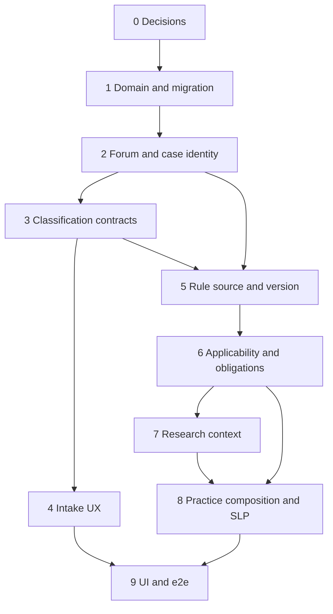

# Matter intelligence, identification and procedural rules

Status: planning report for owner decision, 20 November 2026. It does not govern the build until the owner accepts it. Accepted parts move into the owning specifications.

Scope: a greenfield design for Indian litigation across the Supreme Court, High Courts, district courts, tribunals and other forums. The report covers matter and proceeding identity, classification, intake, procedural rules, research context, practice composition, repository structure, phases and acceptance tests.

Evidence base: the code in this repository at commit `26ac806`, the working tree on 20 November 2026, the tests, and targeted read-only probes. The report treats code as primary evidence. Documents are cited to show intent or to report a mismatch. No code was changed.

Planning discipline: this report is a map, not a build order. It specifies the ontology and the shared contracts because every module depends on them. It does not specify the internals of every module. Each phase specifies its module at the depth its work needs and builds it in the same piece of work. The report does not scaffold code or create empty folders. Lesson L1 is a constraint on this plan, not only on the old one.

Recommendation: **ADOPT WITH LIMITATIONS**. Section 13 gives the assessment and the conditions.

---

## Contents

1. Executive summary
2. Audit method and evidence
3. Current-state audit
4. Matter and proceeding ontology
5. Classification architecture
6. Matter creation experience
7. Procedural rules intelligence
8. Research integration
9. Practice, proceeding, court and workflow composition
10. Repository structure
11. Implementation phases
12. Acceptance tests
13. Final technical assessment
14. Owner decisions
Appendix A. Evidence log
Appendix B. Glossary
Appendix C. Proceeding families and examples
Appendix D. Relationship vocabulary
Appendix E. Schema sketches

### Deliverable map

| Required deliverable | Section |
|---|---|
| A. Current-state audit | 2 and 3 |
| B. Matter and proceeding ontology | 4 |
| C. Classification architecture | 5 |
| D. Matter creation UX | 6 |
| E. Procedural rules intelligence | 7 |
| F. Research integration | 8 |
| G. Pack and workflow redesign | 9 |
| H. Repository structure | 10 |
| I. Implementation phases | 11 |
| J. Acceptance tests | 12 |

---

## 1. Executive summary

The current application does not identify a matter. It labels a folder.

The label is a set of free strings: `practiceArea`, `caseType`, `proceeding`, `court` and `stage`. One rule file reads the title, the file names and those strings, and returns one flat proposal. A second rule file turns the strings into a practice pack. When no pack matches, it selects the Supreme Court SLP pack. When a pack matches only by practice area or court, it selects the first proceeding in that pack. A skill for a different pack still runs when the matter is unknown, with a notice instead of a refusal.

That design produces six failures:

1. **A keyword is treated as a legal fact.** A judgment whose filename says "bail order" becomes a bail application. A first appeal becomes criminal because the word "first" contains "fir". A quashing petition whose title also says bail becomes a bail application.
2. **A pack is treated as law.** The SLP pack owns the court, the proceeding, the limitation, the filing set, the workflow and the skills. The court adapter also owns a proceeding and a limitation list. Neither owns a versioned rule with an effective date.
3. **An unknown matter is given a default.** The default is the SLP pack. A matter with no proceeding receives SLP documents, an SLP limitation rule, and the SLP skill is allowed to run. The tests assert this as correct behaviour.
4. **One matter can hold only one current proceeding.** The profile is one row. The details are one row. The jurisdiction report is one row. The limitation is the latest row, globally. Parties and events have no proceeding. An appeal, a review and an SLP become separate matters linked by a text label.
5. **The matter pane is an accretion, not an information architecture.** The Matter tab stacks fourteen sections. The notebook adds fifteen tabs. A field for a certified copy, a victim's identity and an interim prayer appears for every matter, including a civil suit that needs none of them.
6. **Research is not tied to the proceeding.** The agent may search procedure without a court or a governing date. The procedure scope searches instrument text, not applied rules. The issue and authority records have no proceeding.

The greenfield design replaces the flat label with a small legal model:

- A **Matter** is the advocate's work record for one client engagement or one dispute. It holds the client relationship, shared facts, shared documents and the audit.
- A **Proceeding** is one legal process before a forum. It has its own type, forum, case identity, parties, relief, stage, decisions and applicable rules. A matter may hold many proceedings, including proposed, pending and disposed ones.
- A **Court case** is not a synonym for a proceeding. It is a proceeding with a court-issued case identity. A proposed SLP, an arbitration, a tribunal application and an FIR-based criminal case are proceedings without a court case number, or with a different identity.
- A **Forum** is the court, tribunal, commission, regulator or arbitral tribunal that hears the proceeding. A court adapter is a technical reader of that forum. It is not a source of law.
- A **Proceeding type** is the unit that has its own lifecycle, forms and rules: `SLP (civil)`, `SLP (criminal)`, `writ petition (High Court)`, `first appeal (civil)`, `bail`, `quashing`, `execution`, `section 34 application`. It is generic across courts. A court's label is a **Forum case type** that maps to it.
- **Practice area**, **legal subject**, **nature**, **relief**, **stage** and **governing date** are separate dimensions. They are not one enum.
- A **Rule** is a versioned operational interpretation of a provision, with a source anchor, a date range and a reviewer. A **checklist** is a view of a filing profile. A **pack** is not law.
- **Unknown** is a valid result. A resolver returns `unresolved` with the missing information. It never returns the closest pack.

The report proposes seven composable parts in place of the current pack: practice configuration, proceeding definition, forum profile, procedural rule pack, workflow, skill and filing profile. The SLP is the first test of the composition, not the default design.

The report also proposes a staged classification process: document role first, deterministic validators second, model-assisted reading third, evidence aggregation fourth, one useful question fifth, and an advocate decision recorded per field. No single prompt decides a matter.

The design is sound, but it depends on four owner decisions and on source verification that does not exist yet. It is therefore recommended with limitations, not adopted outright.

---

## 2. Audit method and evidence

### 2.1 What was inspected

The audit read the code and tests named in the brief, plus the stores and data that the call graph reaches:

| Area | Files inspected |
|---|---|
| Matter identity | `src/shared/work.ts`, `src/lib/matter-store/practice.ts`, `src/lib/matter-store/index.ts`, `src/lib/matter-store/work.ts`, `src/lib/matter-store/evidence.ts`, `src/main/matters.ts`, `src/main/matter-proposals.ts` |
| Classification | `src/lib/classification/index.ts`, `src/lib/document-intelligence/classify.ts`, `src/lib/stages/index.ts`, `src/main/bridge.ts` |
| Packs | `src/shared/packs.ts`, `src/lib/packs/index.ts`, `src/main/packs.ts`, all 21 files in `packs/`, `src/lib/packs/slp.ts` |
| Court intelligence | `src/shared/intel.ts`, `src/main/court-intel.ts`, `src/lib/court-adapters/index.ts`, `src/lib/court-directory/index.ts`, `adapters/in-sc/adapter.json`, `adapters/in-hc-delhi/adapter.json`, `adapters/in-dj-delhi/adapter.json`, `src/lib/intel-store/index.ts` |
| Law and research | `src/shared/law.ts`, `src/lib/law-store/index.ts`, `src/lib/knowledge/adapters.ts`, `src/lib/knowledge/index.ts`, `src/lib/authority/binding.ts`, `src/main/research.ts`, `src/lib/research/index.ts`, `src/lib/research-workflow/index.ts`, `src/lib/research-sources/*`, `src/lib/statutes/*` |
| Filing | `src/main/filing.ts`, `src/lib/filing/index.ts`, `src/lib/filing/v5.ts` |
| Skills and agent | `src/lib/skills/index.ts`, `src/main/skill-runner.ts`, `src/main/agent.ts`, `src/lib/context-package/index.ts`, `skills/sk-001`, `sk-003`, `sk-004`, `sk-005`, `sk-006`, `sk-013`, `sk-304`, `sk-308` |
| Interface | `src/renderer/src/App.tsx`, `MatterProfile.tsx`, `Intake.tsx`, `MatterAdminViews.tsx`, `Notebook.tsx`, `Work.tsx`, `Studio.tsx`, `ResearchPage.tsx` |
| Tests | `tests/unit/matter-profile.test.ts`, `tests/unit/packs.test.ts`, `tests/unit/filing-target.test.ts`, `tests/unit/final-order.test.ts`, `tests/unit/court-adapters.test.ts`, `tests/e2e/phase8.spec.ts` |
| Documents | `docs/architecture.md`, `docs/specs/practice-packs.md`, `docs/specs/advocate-matters-browser.md`, `docs/specs/law-research-authority.md`, `docs/specs/new-matter-flow.md`, `docs/decisions.md`, `docs/skills.md` |

### 2.2 Probes

Two read-only probes were run with Node and the repository's own TypeScript modules. The temporary scripts were deleted. They used the production pack loader order: `readdirSync(...).sort()` on `packs/`.

**Probe 1: pack and proceeding selection**

| Input to `packForMatter` | Result |
|---|---|
| No practice area, case type, proceeding or court | `slp / default / slp_civil` (Special leave petition (civil)) |
| Case type `Appeal` | `administrative / proceeding / statutory_appeal` (Statutory appeal) |
| Case type `Other proceeding` | `slp / default / slp_civil` |
| Proceeding `Special leave petition` only | `slp / proceeding / slp_civil` |
| Case type `Review` | `immigration / proceeding / foreigners_tribunal` (Foreigners Tribunal record) |
| Practice area `criminal`, no case type | `criminal / practice / bail` (Regular bail) |
| Court `in.sc`, no type | `slp / court / slp_civil` |
| Practice area `constitutional`, court `in.hc.bombay` | `slp / practice / slp_civil` |

**Probe 2: court and case-type collisions**

| Input | Result |
|---|---|
| `W.P.(C)` in `in.sc` (Article 32) | `writ / writ_226 / W.P.(C)`, whose courts are `in.hc.delhi` |
| `W.P.(C)` in `in.hc.bombay` (Article 226) | `writ / writ_226 / W.P.(C)`, whose courts are `in.hc.delhi` |
| `SLP(Cr)` in `in.sc` | `slp / slp_civil / SLP(C)` |
| `Bail application` in `in.sc` | `criminal / bail / Bail application` |

**Probe 3: classification from title and source names**

| Title | Practice area | Case type | Stage |
|---|---|---|---|
| "Asha v. State — SLP against the judgment of the High Court in W.P.(C) 12/2023" | *(empty)* | Special leave petition | Appeal filed |
| "Asha v. State — judgment in a writ petition against a bail order" | criminal | Bail application | Application filed |
| "Judgment: bail application rejected; now appeal" | criminal | Bail application | Application filed |
| "Asha v. State — first appeal from the decree in the civil suit" | criminal | Appeal | Plaint filed |
| "Asha v. State — quashing petition after bail" | criminal | Bail application | Application filed |

The probes do not prove that every input is wrong. They prove that the selection is order-dependent, substring-based, court-blind and default-driven. The test suite does not catch these cases because its fixture order differs from production, and because the default is asserted as intended.

### 2.3 Evidence standard

The report separates three kinds of statement:

- **Verified defect**: the code, data or test shows the behaviour. The report gives the path and line.
- **Design concern**: the code behaves as written, but the harm depends on use, scale or legal context. The report says why.
- **Assumption**: the design needs a fact that the repository does not establish, such as the availability of official rule text. The report names it as unverified.

The report does not claim a green test run. No full unit or end-to-end suite was run. The probes are behavioural evidence, not a regression baseline.

---

## 3. Current-state audit

### 3.1 The current architecture in one page

The matter store is the single writer of matter facts. It holds one `matter_profile` row and one `matter_details` row. The profile carries `court`, `bench`, `practice_area`, `case_type`, `proceeding`, `side`, `case_number`, `cnr`, `filing_date`, `institution_date`, `governing_date`, `stage` and `relief`. The details carry petitioner, respondent, case number, CNR, court, one impugned event, interim relief, victim protection and certified-copy dates.

Classification is a pure function. It joins the title, the source file names, the profile's proceeding and court, and the parties into one lower-case string. It applies ordered regular expressions. It returns `practiceArea`, `caseType`, `court`, `proceeding`, `stage`, `parties` and a list of basis sentences. The interface applies the whole proposal in one action.

Stages are a separate library of twelve fixed lists. `stageListFor` chooses one by keyword. An SLP is mapped to the generic `appeal` list. The pack's own `stages` field is parsed but not used.

Practice packs are 21 JSON files. A pack has `practice`, `courts`, `proceedings`, `acts`, `templates` and `terms`. A proceeding has `key`, `title`, `caseType`, `courts`, `provisions`, `limitation`, `requiredParts`, `documents`, `annexureParts`, `unmappedParts`, `lateDocuments`, `workflow`, `stages`, `intakeQuestions`, `skills`, `recordColumns`, `evidence` and `terms`. The pack registry selects a pack and a proceeding from the profile strings. The filing service asks the pack for the document set and the limitation rule.

Court adapters are JSON files with `courts`, `sources`, `lists`, `formatChecks`, `defects` and `proceedings`. An adapter proceeding has `caseType`, `provisions`, an optional `limitation`, `requiredParts`, a checklist key, a workflow key, stages, intake questions and skills. The court intelligence service downloads only the documents a list names, verifies each item's quote, stores the list with a freshness date, and uses the list as a compliance checklist. The filing target path prefers the adapter proceeding over the practice pack.

The law store holds instruments and provisions. An instrument has a kind (`act`, `rules`, `regulation`, `notification`, `practice_direction`), a jurisdiction, commencement and repeal dates, a source and a check interval. A provision has a version, `validFrom`, `validUntil`, a status, an anchor and a text hash. The knowledge registry has seven scopes: `advocate`, `firm`, `statute`, `procedure`, `matter`, `research`, `session`. The procedure scope searches provisions whose instrument kind is `rules`, `practice_direction` or `regulation`, with an optional court filter. It does not search an applied rule record, because there is none.

Research is a set of matter records: issues, authorities, memoranda, citation checks, attestations and an adverse review. A research plan has steps and coverage. The quote gate verifies a selected quote against the source text. The authority binding function uses court hierarchy, bench strength, date and treatment. The research context is the skill's declared `required_context`; it is not resolved from a proceeding.

Skills are `SKILL.md` files with role, pack, court and proceeding fields, inputs, required context, permitted tools, output, checks, approval points and budget. The skill runner refuses a skill for the wrong court and for the wrong pack. It does not enforce the skill's `proceedings` field. When the matter has no pack, or the default pack applies, the pack refusal becomes a notice, not a refusal.

### 3.2 Verified defects

The table gives the defect, the evidence, the cause and the design rule that prevents it. Detailed notes follow for the defects that shape the architecture.

| ID | Defect | Evidence | Status |
|---|---|---|---|
| D-01 | One flat string label stands in for five legal dimensions | `src/shared/work.ts:23-42`; `src/lib/classification/index.ts:10-19` | Verified |
| D-02 | Keyword matching uses ordered substrings and first-match wins | `src/lib/classification/index.ts:31-56`; Probe 3 | Verified |
| D-03 | Existing profile values are fed back as classification evidence | `src/lib/classification/index.ts:27, 58-70` | Verified |
| D-04 | Applying a proposal overwrites confirmed fields, including with empty values | `src/main/bridge.ts:1013-1026` | Verified |
| D-05 | Pack selection is order-dependent and fuzzy | `src/lib/packs/index.ts:185-224`; `src/main/packs.ts:23-24`; Probe 1 | Verified |
| D-06 | Pack selection ignores the proceeding's courts and cannot tell SLP(C) from SLP(Cr) or Article 32 from 226 | `src/lib/packs/index.ts:202-211`; Probe 2 | Verified |
| D-07 | The SLP pack is the default, and an unknown matter can receive SLP filing and skills | `packs/slp.json:7`; `src/lib/packs/index.ts:221-255`; `tests/unit/filing-target.test.ts:52-63`; `tests/unit/packs.test.ts:62-74` | Verified |
| D-08 | Three court identities exist, and an unknown court can silently become the advocate's first profile court | `src/shared/work.ts:3-42`; `src/shared/intel.ts:169-175`; `src/main/evidence.ts:97-115` | Verified |
| D-09 | Three stage vocabularies exist; the pack's stages are unused; SLP uses the generic appeal list | `src/lib/stages/index.ts:13-97`; `src/shared/packs.ts:73`; `tests/unit/matter-profile.test.ts:36-45` | Verified |
| D-10 | The data model assumes one current proceeding | `src/lib/matter-store/practice.ts:34-57`; `src/lib/matter-store/evidence.ts:158-166`; `src/lib/matter-store/work.ts:753-787`; `src/lib/matter-store/index.ts` notebook event schema | Verified |
| D-11 | Related matters are matter-to-matter; there is no structured impugned decision | `src/shared/work.ts:44-70`; `src/renderer/src/MatterProfile.tsx:143-257`; `src/main/bridge.ts:1039-1048` | Verified |
| D-12 | The pack mixes practice, court, proceeding, limitation, filing and workflow, and several fields are inert | `src/shared/packs.ts:56-107`; `packs/slp.json:34-137`; consumers in `src/main/filing.ts` and `src/main/index.ts` | Verified |
| D-13 | The court adapter doubles as a legal rule engine and duplicates proceedings and limitation | `src/shared/intel.ts:69-98`; `adapters/in-sc/adapter.json`; `src/main/index.ts:740-758` | Verified |
| D-14 | Pack limitation has no version, freshness, branches or exclusions; SLP(Cr) has no rule | `packs/slp.json:41-48, 106`; `src/shared/packs.ts:32-39`; `adapters/in-sc/adapter.json` limitation list | Verified |
| D-15 | A classification proposal has no evidence references, field confidence, conflicts or missing items | `src/lib/classification/index.ts:10-19`; `src/renderer/src/MatterProfile.tsx:128-137` | Verified |
| D-16 | A skill's proceeding scope is parsed but not enforced; an unknown pack is a notice, not a refusal | `src/lib/skills/index.ts:150-151`; `src/main/skill-runner.ts:170-178`; `src/lib/packs/index.ts:250-256` | Verified |
| D-17 | Research can search procedure without a forum, a proceeding or a date; issue and authority records are not tied to a proceeding | `src/main/agent.ts:1298-1310`; `src/lib/knowledge/adapters.ts:99-141`; `src/main/studio.ts:159-168`; `src/shared/work.ts:109-135` | Verified |
| D-18 | The Matter tab is a fourteen-section stack and the notebook has fifteen tabs; stage-specific fields appear for every matter | `src/renderer/src/App.tsx:709-750`; `src/renderer/src/Notebook.tsx:258-274`; `src/renderer/src/Work.tsx:104-165` | Verified |
| D-19 | The proposed new-matter flow keeps the flat case-type-to-pack mapping and requires a court level and case type at creation | `docs/specs/new-matter-flow.md:157-168, 217-224, 426-438` | Design concern |
| D-20 | Tests encode the default and the keyword behaviour as intended | `tests/unit/packs.test.ts:48-74`; `tests/unit/filing-target.test.ts:52-63`; `tests/unit/matter-profile.test.ts:47-59`; `tests/e2e/phase8.spec.ts:70-71` | Verified |
| D-21 | Case number and CNR are free text; there is no case identity or grammar validation | `src/renderer/src/Work.tsx:123-127`; `src/lib/matter-store/practice.ts:34-50` | Verified |
| D-22 | One `governingDate` on the matter conflates substantive and procedural dates | `src/shared/work.ts:38`; `skills/sk-006-governing-law-by-date/SKILL.md` | Verified |

#### D-01: the flat label

`MatterProfile` holds `practiceArea`, `caseType`, `proceeding` and `stage` as free strings. The classification proposal returns the same fields. Nothing in the type system prevents `practiceArea = "criminal"`, `caseType = "Writ petition"`, `proceeding = "Bail application"` and `stage = "Decree"` at the same time.

The cause is that the model was built from the form, not from the legal domain. The effect is that every consumer re-interprets the strings: the pack registry, the stage library, the filing service, the research precedents and the interface. Each interpretation can differ.

Design rule: a legal dimension has a typed record and one owner. No dimension is inferred from another by string. The compiler and the store reject impossible combinations.

#### D-02: the keyword classifier

The classifier tests the title, the source names, the profile's proceeding and the profile's court as one string. It tests practice area first, then case type, then court, then proceeding, then stage. Every test is an ordered regular expression. The first match wins.

The probes show the result. "First appeal" matches `/fir/` inside "first" and becomes criminal. "Quashing petition after bail" matches bail before quashing. "Writ petition against a bail order" becomes bail. "Review" is tested only after bail, quashing, writ and SLP, so a review title that also mentions any of them gets the earlier type. The classifier reads the title, the source names and the recorded proceeding and court. It does not read the document body.

The cause is a design choice to produce a fast answer from a filename. The effect is a confident wrong answer, shown to the advocate as a proposal with a basis sentence that sounds authoritative.

Design rule: a word is evidence only when its source, its role and its context are known. A mention in a judgment is not a filing. A filename is the weakest evidence, never the primary method. The classifier returns candidates with evidence, not a single answer.

#### D-03: circular evidence

`proposeClassification` includes `input.profile.proceeding` and `input.profile.court` in the text it reads. It then proposes `proceeding` from that same text, falling back to the profile. It proposes `court` from the profile and then says the court is "taken from the recorded court". The proposal can therefore confirm an earlier guess and present it as a new finding.

The stage is also defaulted: `input.profile.stage.trim() || list.stages[0]`. An unclassified matter receives the first stage of whichever list matched, usually "Filed" or "Application filed".

Design rule: a confirmed value is an input to the decision, not evidence for itself. A re-run reads confirmed values as `existing`, labels them "not evidence", and proposes a change only when new evidence contradicts them. No field receives a default value. `not_assessed` is the default.

#### D-04: all-or-nothing application

The bridge applies the whole proposal. It sets `practiceArea`, `caseType`, `court`, `proceeding` and `stage` to the proposal values. If the proposal has an empty `practiceArea` or `caseType`, the confirmed value is erased. The event records the new profile, but there is no decision record that says which field changed, why, or who confirmed it.

Design rule: a proposal is applied field by field. An empty proposal means "no proposal", not "set empty". A confirmed field is changed only by a new decision that names the old value, the new value, the evidence and the reason. The decision is immutable.

#### D-05: order-dependent pack selection

`buildPacks` preserves the input order. In production, `PracticePacks.get()` reads `readdirSync(this.dir).filter(...).sort()`. The order is alphabetical: `administrative`, `banking`, `cheque`, `civil`, ... `slp`, `tax`, `writ`. The unit test passes a different order: `criminal`, `civil`, `writ`, `slp`, ...`. The test's "constitutional practice selects the writ pack" passes because `writ` comes before `slp` in the test. In production, `slp` comes before `writ`, and the SLP pack lists `constitutional` as a practice. A constitutional matter with no case type therefore selects the SLP pack.

`proceedingMatches` normalises both sides and tests `o === w || o.includes(w) || w.includes(o)`. It searches every proceeding of every pack in order. "Appeal" matches "Regulatory appeal" in the administrative pack. "Review" matches "Foreigners Tribunal review" in the immigration pack. "SLP(Cr)" normalises to `slpcr`, which includes `slpc`, so the civil SLP proceeding matches first.

Design rule: resolution is exact and order-independent. A resolver returns all candidates that match a typed key, with their specificity. If there is more than one, it returns `ambiguous`. Input order never decides a legal classification.

#### D-06: court-blind selection

`packForMatter` searches proceedings before it considers the court. `proceedingMatches` does not read `p.courts`. A `W.P.(C)` in the Supreme Court therefore selects `writ_226`, whose courts are `in.hc.delhi`. A `W.P.(C)` in Bombay selects the same Delhi proceeding. An `SLP(Cr)` selects `slp_civil`.

The data makes this worse. The writ pack's `writ_226` is the only Article 226 proceeding, and it is hard-coded to `in.hc.delhi`. The writ pack's `writ_32` has the same `caseType` `W.P.(C)`. A case type alone cannot distinguish them; the forum and the jurisdiction basis must.

Design rule: a proceeding definition is generic across forums. A forum case type maps a court's label and code to one or more proceeding definitions. The resolver requires the forum. If the forum is unknown, the result is `unresolved`; it does not borrow another court's proceeding.

#### D-07: the SLP default

The SLP pack has `"default": true`. `packForMatter` returns the default pack's first proceeding when no proceeding, practice or court matches. The filing service then supplies the SLP document set and the 90-day limitation. The skill gate returns no refusal when the choice is the default; it returns a notice. A skill for the SLP pack, or for any other pack, can run on an unknown matter.

The tests assert this. `tests/unit/filing-target.test.ts` is named "with no target, the default SLP pack supplies the set and the limitation". `tests/unit/packs.test.ts` asserts the default and the notice. `tests/e2e/phase8.spec.ts` checks that the SLP pack shows "default".

Design rule: there is no default proceeding and no default pack. An unknown matter has no filing plan, no proceeding-specific skill and no limitation. The interface says what is missing and what would resolve it.

#### D-08: three courts

The profile has `court`. The details have `court`. The filing target has `court`. The court directory uses ids such as `in.hc.delhi`. The profile usually stores a display name. The adapter uses ids. The pack uses ids. The jurisdiction report tries to match the profile string to a directory id or name; if it fails, it takes `overview[0]`, the advocate's first profile court, when the profile has one.

The effect is that the same matter can point at three courts. A filing can use one court's checklist, another court's limitation and a third court's jurisdiction report.

Design rule: one canonical `forumId` on the proceeding. A free-text court name is allowed only as `forumNameUnverified`, with a warning. A resolver never substitutes another forum. If the court is unknown, the field is `unresolved`.

#### D-09: three stages

The profile has `stage`. The stage library has twelve lists. The pack has `stages`. The adapter has `stages`. The interface uses `stageListFor`, which maps SLP to the generic appeal list. The pack's SLP stages ("Instruction", "Drafting", "Filed", "Defects cured", "Listed", "Notice issued", "Leave granted or dismissed") are parsed and never shown. The stage library's civil list maps "Civil suit" before "appeal", so a "civil appeal" title gets "Plaint filed".

Design rule: a proceeding definition owns a versioned stage set. A proceeding has a stage instance, not a string. The stage is entered from a source: the advocate, an order, a cause list or a portal. If the stage is unknown, it is `unassessed`; the first stage is not assumed.

#### D-10: one proceeding

The profile is one row. The details are one row. The jurisdiction report is one row (`id INTEGER PRIMARY KEY CHECK (id = 1)`). The limitation query returns the latest row globally. The notebook event has no proceeding id. The party table has no proceeding id. A second proceeding cannot be represented without creating a second matter.

Design rule: the proceeding is the unit of forum, case identity, parties, relief, stage, decisions and rules. The matter is the container. A limitation computation belongs to a proceeding. A jurisdiction assertion belongs to a proceeding. A party role belongs to a proceeding.

#### D-11: related matters instead of lineage

The relations are matter-to-matter: `appeal_from`, `revision_of`, `review_of`, `cross_petition`, `counterclaim`, `transfer_petition`, `connected`, `fir_behind`, `arbitration`, `common_parties`, `common_evidence`. The `extendMatter` action creates a new matter, copies the parties and the court/proceeding, and adds a relation. The impugned judgment is a free event id, not a structured decision. The relation note is text.

The effect is fragmentation. An SLP against a High Court judgment becomes a new matter. The judgment, the lower court record, the parties and the limitation are copied or re-entered. The family is reconstructed by text links. A document cannot be attached to both proceedings without being added twice.

Design rule: a proceeding link is typed. A challenge relation carries a structured `ImpugnedDecision` with the forum, case number, date, outcome and source. The same document is linked to many proceedings with different roles. A new matter is for a separate engagement or a conflict, not for an ordinary appeal.

#### D-12: the pack mixes concerns, and several fields are inert

The pack holds practice, courts, proceedings, provisions, limitation, required parts, documents, annexure parts, unmapped parts, late documents, workflow, stages, intake questions, skills, record columns, evidence requirements and terms.

Only some are consumed. `main/filing.ts` reads `documents`, `annexureParts`, `unmappedParts`, `lateDocuments`, `limitation` and `workflow`. `main/index.ts` reads `requiredParts`, `documents`, `annexureParts`, `unmappedParts`, `lateDocuments` and `workflow`. The `skills` field is read by `skillsOfPack`. The `courts` field is copied into the pack summary for display but is not used to select a proceeding. The `stages`, `intakeQuestions`, `recordColumns`, `evidence`, `proceeding.provisions`, `templates` and `terms` have no consumer in the application code found by the audit.

The effect is a blueprint that promises more than it delivers. The advocate sees a pack with stages and intake questions in the data, but the form uses a different stage library and asks no pack question.

Design rule: a content record has a consumer and a test. A field with no consumer is removed or moved to the part that will consume it. The pack is decomposed so each part has one owner.

#### D-13: the adapter as a rule engine

The adapter proceeding has `caseType`, `provisions`, `limitation`, `requiredParts`, `checklist`, `workflow`, `stages`, `intakeQuestions` and `skills`. The in-sc adapter has a proceeding `sc.slp_civil` with no required parts, and three lists: a filing checklist, a limitation list and an Order XXI rules list. The filing target path uses the adapter proceeding's `limitation` and `requiredParts` when they exist.

The adapter is described as data, and nothing in it runs. But it is used as a legal source. A court's retrieval capability determines its legal content. The adapter's limitation item has a quote and a reference, but no effective date, no version range and no reviewer.

Design rule: an adapter owns forum identity, capabilities, official sources and retrieval. It does not own a proceeding type, a limitation rule or a filing requirement. It may fetch the document that contains a rule; the rule record is created and verified in the rules system.

#### D-14: limitation is a single number

The SLP(C) pack records 90 days, one source string and one reference. The SLP(Cr) pack records `null`. The in-sc adapter's limitation list has three items: 90 days, 60 days after a refusal, and an exclusion. The pack collapses the list to one number. It has no effective date, no check date, no reviewer, no branches and no exclusions.

The current computation is honest about what it does not compute: certified-copy time, vacations, holidays and condonation. That is good. The defect is that the rule record is too thin to carry the branches and the source versions, and that the criminal SLP has no rule at all.

Design rule: a limitation rule is a versioned record with a start event, a period, branches, exclusions, a computation method and a source. A computation references the rule and the event. A missing rule is `unknown`; it is never filled with another proceeding's rule.

#### D-15: no field-level evidence

The proposal has a `basis: string[]`. Each sentence is generated by the classifier. It has no source id, anchor, quote, source type, confidence, conflict or missing item. The interface shows the sentences as a bullet list under one combined value.

The agent's `MatterProposal` carries a `stage` but no proceeding type, practice area or evidence (`src/shared/work.ts:72-87`; `src/main/matter-proposals.ts`). A proposed stage has no lifecycle to belong to. The advocate can create a matter from the proposal with a stage that no proceeding defines.

Design rule: each proposed field is an assertion with evidence refs, a source type, a status, a strength, a reasoning summary, conflicts, missing information and a confirmation requirement. The status vocabulary is the one in section 5.

#### D-16: skill scope is not enforced

The skill parser reads `courts` and `proceedings`. The runner enforces `courts` through `forumRefusal`. It does not enforce `proceedings`. The pack gate refuses a skill for a different pack only when the matter has a non-default pack. When the matter is unknown or the default applies, the gate returns a notice. A proceeding-specific skill can therefore run on an unrelated matter.

Design rule: a skill declares typed scope: proceeding types, forum kinds, stage keys and practice areas. The runner refuses when the scope is not satisfied. An unknown context is a refusal for a scope-specific skill. A general skill with no scope may run, with a notice that the context is incomplete.

**Skill scope audit.** The named skills show the same pattern.

| Skill | Declares | What the runner enforces | Finding |
|---|---|---|---|
| SK-001 New matter intake | `packs: [general]`, role intake | The pack (general always passes) | It proposes the same flat fields with `basis` sentences, not per-field evidence. It can read the record, but the output schema is the old model. |
| SK-003 Preliminary assessment | `packs: [general]` | Nothing beyond the general pack | It is a report skill; it does not depend on the proceeding. Fine, provided it says when the context is unresolved. |
| SK-004 Jurisdiction report | `packs: [general]`, `required_context: ... rules` | The pack | The `rules` context is the court adapter's lists, not a versioned rule. The report is one free record, not per proceeding. |
| SK-005 Limitation working | `packs: [general]`, `rules` context | The pack | The rule comes from the pack's single limitation field. It cannot see the branches or the version. |
| SK-006 Governing law by date | `packs: [general]` | The pack | It reads the matter's one `governingDate`; the date basis is not per issue. |
| SK-013 Research plan | `packs: [general]` | The pack | The plan has no proceeding id and no rule selection. |
| SK-304 Writ petition | `packs: [writ]`, `proceedings: [W.P.(C)]` | The writ pack; **not** the proceeding | It can run on a writ appeal or another court's writ if the pack matches. |
| SK-308 SLP | `packs: [slp]`, `proceedings: [SLP(C), SLP(Cr)]` | The SLP pack; **not** the proceeding | The pack selection can resolve SLP(Cr) to the civil proceeding; the skill's own scope would have caught it, but the runner ignores it. |

The appeal, bail, civil suit and tribunal skills follow the same pattern: they declare a pack, sometimes a court or a proceeding, but the runner only enforces the pack and the court. The new scope is a typed declaration, not a comment.

#### D-17: research is not proceeding-aware

`search_knowledge` takes an optional `court` and an optional `date`. The procedure adapter filters by court only when the query supplies one. The matter's profile court and governing date are applied after retrieval, to the binding label; they are not used to select the procedure. The profile court is a free string, not the proceeding's forum. The issue and authority records have no proceeding id. A research plan has no proceeding id.

The effect is that a procedure search can run with no court, or with the wrong court, and still return results that look authoritative. A research memorandum can mix a civil appeal rule with a criminal appeal issue.

Design rule: the research service resolves a `ResearchContext` from the matter and the proceeding before retrieval. Procedure retrieval requires a forum, a proceeding type and a date basis. If they are missing, the result is `partial`, with the missing context named.

#### D-18: the pane as an accretion

The Matter tab renders, in order: overview, progress, profile form, related matters, admin, matter details, memory, sources, created date, drafts, review items, events, practice section, record integrity and files. The notebook adds fifteen tabs. The profile form asks for thirteen fields at once. The details form asks for a certified copy, victim names and interim relief for every matter.

The effect is that the advocate cannot see what matters now. The fields are not wrong; they are in the wrong place and the wrong time.

Design rule: the matter view is a summary and a set of proceedings. The proceeding view owns the legal detail. A field appears when the task needs it, with a statement of what it unlocks.

#### D-19: the proposed new-matter flow

The untracked proposal in `docs/specs/new-matter-flow.md` improves the form: party table, client marker, court level, case-type search, live blueprint. It keeps three problems:

1. It makes the court level and case type required at creation. That is a legal questionnaire at the front door.
2. Its `CaseType` row carries `packId` and `proceedingKey`. That keeps the pack as the primary key and repeats the conflation.
3. Its `blueprintFor` falls back to `packForMatter` and then to `other` with the "Other proceeding" stage list. That preserves the default and the fallback.

The report keeps the proposal's party and client insights. It rejects the required type and the pack key.

Design rule: creation collects the minimum. A case type is a forum label mapped later. A proceeding is the anchor. There is no pack in the mapping and no default.

#### D-20: tests lock the defect

The tests are not wrong as tests. They assert the behaviour the code was built to have. The problem is that the behaviour is unsafe:

- `tests/unit/packs.test.ts` asserts that an unknown matter selects the default SLP pack and that a skill for another pack gets a notice.
- `tests/unit/filing-target.test.ts` asserts that the default SLP pack supplies the document set and the limitation.
- `tests/e2e/phase8.spec.ts` asserts that the SLP pack shows "default".
- `tests/unit/matter-profile.test.ts` asserts that an SLP uses the appeal stage list and that a bail application is proposed from the file name.

Design rule: a test may assert a default only when the default is a deliberate product rule with a safety analysis. The new suite must include abstention, ambiguity and conflict tests. No test may assert that an unknown proceeding receives a specific pack.

#### D-21: no case identity

The case number and CNR are free text. The profile and the details both hold them. There is no parser, no forum check, no year/serial check and no link to a court record. The same case can be entered twice with different spellings.

Design rule: a `CaseIdentity` record belongs to a proceeding. It holds the forum, the court's case-type code, the number, the year, the CNR, the portal id and a validation status. A parser checks the grammar for that forum. A parse failure is `unverified`, not an error that blocks work.

#### D-22: one date

The profile has one `governingDate`. The limitation uses the impugned event's date. The research skill reads "the matter's governing date". The binding check uses `profile.governingDate` first, then the query date, then the current date; a query-specific date cannot override the matter date. The substantive law date, the offence date, the filing date and the procedural event date are different.

Design rule: a `DateContext` names the dates. A query selects the date that its rule needs. The UI shows the date and its basis. There is no single matter-wide governing date.

#### Document and code mismatches

The standing orders say to report a mismatch between an instruction file and the code. These are the material ones found in the audit.

| Document | The document says | The code does |
|---|---|---|
| `docs/specs/practice-packs.md:19-38` | A pack owns stages, intake questions, record columns, evidence requirements and terms; it also describes `proceedingFor(profile)` and `skillRefusal(skill, pack)` | The parser reads the fields, but only documents, limitation, workflow, skills and required parts have consumers. There is no `proceedingFor`; the function is `packForMatter`. The gate is `skillPackRefusal(skillPacks, choice)`. |
| `docs/specs/practice-packs.md:38` | The SLP pack is the default | The code does this. The mismatch is with the new requirement, not the document. The document records the old decision accurately. |
| `docs/architecture.md:32` | `intel.db` owns courts, benches, case types, rules, fees, forms, limitation rules, holidays, sources and freshness | The schema has source, document text, built lists and items, benches and adapter proceedings. It has no rule, fee, form, limitation-rule or holiday table. |
| `docs/specs/law-research-authority.md:180` | The procedure adapter's applicability is in `intel.db` | There is no applicability table. The only applied procedure is an adapter list. |
| `docs/specs/advocate-matters-browser.md:115` | The intake dialog offers "by hand" | `Intake.tsx` offers folder, CNR, email, cloud folders and chat. The by-hand path is the separate `NewMatterDialog` in `App.tsx`. |
| `docs/specs/advocate-matters-browser.md:77` | The matter tabs are Overview, Parties, Facts & Chronology, Documents & Evidence, Issues, Jurisdiction, Research & Authorities, Arguments & Strategy, Drafts, Proceedings & Hearings, Ready to File, Tasks & Deadlines, Communications, Memory and Audit | `Notebook.tsx` has Matter, Review, Sources, Procedural history, Factual Matrix, Chronology, Facts, Evidence, Structure, Jurisdiction, Memory, Entities, Record table, Studio and Filing. |
| `docs/specs/advocate-matters-browser.md:106` | `matter_profile` holds confidentiality | `matter_profile` has no confidentiality column; `matter_policy` holds it. |

These are not code defects to fix in this task. They show why the report treats the code as primary evidence.

### 3.3 Design concerns

These are not code defects. They are choices that will cause harm if the greenfield repeats them.

| ID | Concern | Why it matters |
|---|---|---|
| C-01 | The `CaseType` catalogue in the new-matter proposal carries `packId` and `proceedingKey` | A court label is not a workflow. It should map to a proceeding type. The workflow is composed from the proceeding, the practice and the rules. |
| C-02 | The pack is still the unit of selection in the proposal | The pack mixes six concerns. Selecting it first forces every later decision through the mixture. The proceeding should be the anchor. |
| C-03 | The rule content lives in an adapter list, a pack field and a law-store provision in different places | Three copies or three sources create drift. One canonical text and one applied rule record are needed. |
| C-04 | The model is used as a classifier in the intake skill | A model can read and propose, but it cannot be the decision. The classifier must aggregate evidence and the advocate must confirm. |
| C-05 | The interface adds fields to the Matter tab as features arrive | The tab has no information architecture. A new feature should add a task or a proceeding view, not a section. |
| C-06 | The research scopes mix owner names with legal-function names, and their contracts overlap | `statute`, `procedure` and `research` mix instrument kinds, questions and authority. A procedural provision in the CPC can appear in either `statute` or `procedure` depending on the data setup. |
| C-07 | The tests use fixture briefs, not a gold set | The tests can prove structure, not accuracy. The design must not claim calibration it has not measured. |
| C-08 | The court directory is broad, but the adapters cover three courts | A directory entry is not a working forum. The UI must distinguish "known court" from "court with a data source". |

### 3.4 Assumptions

The design depends on facts the repository does not establish. They are listed here so the plan does not hide them.

| ID | Assumption | What would verify it |
|---|---|---|
| A-01 | Official court records or portals expose the case number, CNR, parties, stage and orders in a usable form | A sample of 20 real matters across five forums, read by the advocate, with the fields compared to the portal |
| A-02 | Each forum's case-number grammar can be sourced and maintained | A published grammar or a reviewed sample per forum; a test set of valid and invalid numbers |
| A-03 | Procedural instruments are available as text with publication, commencement and amendment dates | The official PDF or HTML, a page/line anchor, and a reviewer's check for the first ten instruments |
| A-04 | The model can abstain when the evidence is insufficient | A fixture set with ambiguous documents; measure false confidence and abstention |
| A-05 | Advocates will answer one high-value question at intake | Five observed intake sessions; time to create, number of questions, correction rate |
| A-06 | Existing matters can be migrated without inventing proceedings | A migration test on a copy of real matter folders; every old field maps to a new field or `unknown` |
| A-07 | The distinction between `corpus.db` text and `intel.db` applied rules is acceptable under decision 12 | Owner decision O-3 |
| A-08 | A forum case type can map to more than one proceeding type | A sample of court label lists; the mapping returns candidates, not a single value |

### 3.5 Root causes

The defects are symptoms. The causes are architectural.

1. **Strings instead of concepts.** `practiceArea`, `caseType`, `proceeding`, `court` and `stage` are strings with no type, no vocabulary and no owner. Every consumer re-interprets them.
2. **Selection by convenience.** When the exact type is unknown, the code chooses the first proceeding, the practice's first proceeding, the court's pack or the default. A fallback is treated as a feature, not as a failure.
3. **Many owners for one fact.** Court, case type, stage, limitation and proceeding each live in the profile, a pack, an adapter and a stage library. The copies drift.
4. **Discovery and authority are conflated.** A filename, a checklist item, an adapter list and a statute are all "content". The system does not rank their authority.
5. **The interface grew by addition.** Each feature added a section to the Matter tab. No one removed or moved a field when the feature became a task.
6. **Tests assert the happy path and the default.** There is no abstention test, no conflict test and no negative test for an unknown proceeding.

### 3.6 What is worth keeping

The greenfield should not discard the good parts.

- **Local-first, one-writer stores.** `matter.db`, `corpus.db`, `intel.db` and `advocate.db` each have one writer and a hash-chained audit. Keep this.
- **The advocate decides.** The human-only rule is enforced in the store and the bridge. Keep it and extend it to classification and rule applicability.
- **Quote-first research.** The quote gate, the verification dimensions and the adverse review are strong. Keep them and connect them to the proceeding.
- **The court directory.** The offline directory of courts, tribunals, seats and appeal routes is a good foundation. Keep it and add a forum profile.
- **The document model.** Content-addressed blobs, page/line anchors, OCR readings and source integrity checks are good. Keep them and add document roles.
- **Skills as bounded tasks.** A skill with typed tools, checks and approval points is the right unit. Keep it and replace the pack gate with typed scope.
- **The honesty language.** "Not recorded", "unconfirmed", "stale" and "not checked" are the right words. Extend them to every classification field and every rule.
- **The law store's temporal provisions.** `validFrom`, `validUntil`, `status`, `textHash`, `checkedAt` and `stale` are the right primitives. Build the rule record on them.
- **The judgment graph.** `PASSAGE_ROLES`, `LEGAL_RELATIONS` and the treatment edges are the right primitives for authority. Keep them.

## 4. Matter and proceeding ontology

### 4.1 The category error to remove

The current application uses one word, "matter", for four different things:

1. The advocate's work record.
2. The underlying dispute.
3. The court case.
4. The current filing or proceeding.

It also uses "case type" for a court label, a proceeding type, a practice area and a pack key. The result is that no field has a stable meaning.

The greenfield separates the terms in the table below. The table is the vocabulary for the rest of the report.

| Term | The question it answers | Not the same as |
|---|---|---|
| Matter | What legal work is the advocate handling for this client engagement or dispute? | A court case, a proceeding, a folder, a document |
| Proceeding | What legal process is before a forum, with its own parties, relief, stage and rules? | The matter, the court case number, the document |
| Proceeding type | What kind of legal process is this, with its own lifecycle and forms? | A court's label, a practice area, a pack |
| Forum | Which court, tribunal, commission, regulator or arbitral tribunal hears it? | The proceeding, the judge, the case type |
| Forum case type | What does this forum call this filing, and which proceeding type does the label map to? | The proceeding type itself, a workflow |
| Case identity | What number, CNR or portal id does the forum use for this proceeding? | The matter id, the client, the document |
| Practice area | What broad field of law is involved? | A proceeding type, a legal subject |
| Legal subject | What is the dispute about? | A practice area, a proceeding type |
| Nature of proceeding | Is it original, appellate, revisional, supervisory, review, execution or ancillary? | The specific proceeding type |
| Stage | Where is this proceeding in its lifecycle? | A matter status, a task status |
| Impugned decision | What judgment, order, award or act is challenged? | A document in the folder, a mentioned case |
| Relief | What remedy does a party seek? | The order the court made |
| Governing date | Which date selects the applicable version of the law or rules? | The date the file was received |
| Applicable procedure | Which versioned rules apply to this proceeding at this event? | A checklist, a pack, a court adapter |
| Obligation | What must be done, by whom, by when, because of which rule or order? | A task the advocate chooses to do |

### 4.2 Entities

The model has a small number of entities. Each entity has one owner. The owner is the module that creates and changes it; other modules read it through a contract.

#### Matter

The work record. It owns the client relationship, the shared facts and documents, the audit and the set of proceedings.

| Field | Meaning |
|---|---|
| `id` | Stable matter id |
| `title` | The advocate's label. It is not a legal classification |
| `clientPersonIds` | The persons or organisations the advocate acts for, derived from party roles; not a separate client record |
| `openedAt`, `closedAt` | Lifecycle dates |
| `status` | `open`, `on_hold`, `concluded`, `archived` |
| `confidentiality` | The matter's policy |
| `createdFrom` | The intake source: instruction, folder, CNR, email, portal case list, import |
| `summary` | The advocate's short description, optional |
| `schemaVersion` | For migration |

The matter does **not** own `court`, `caseType`, `proceeding`, `stage`, `limitation`, `relief` or `impugnedDecision`. Those belong to a proceeding.

A matter may have zero proceedings. That is a valid state: the advocate created a work record from an instruction and has not identified a legal process yet. The interface says "not identified", not "SLP".

#### Proceeding

The legal process. This is the central entity for identification, procedure and research.

| Field | Meaning |
|---|---|
| `id` | Stable proceeding id |
| `matterId` | The matter that contains it |
| `proceedingTypeId` | A definition id, for example `in.sc.slp.civil` or `in.hc.writ.petition.article226` |
| `forumId` | The canonical forum id, or null when not yet known |
| `forumKind` | The expected kind when the forum is not yet known, for example `high_court`, `criminal_court`, `tribunal`; it resolves to a `Forum.kind` when the court is known |
| `bench` | Optional bench or seat, as the forum names it |
| `caseIdentityId` | The court case number, CNR or portal id, or null |
| `practiceAreaIds` | One or more broad practice areas; the primary is marked |
| `subjectIds` | One or more legal subjects from the subject taxonomy |
| `caseNature` | `civil`, `criminal`, `mixed`, `undetermined` |
| `nature` | `original`, `appellate`, `revisional`, `supervisory`, `review`, `execution`, `ancillary`, `reference`, `preliminary`, `other` |
| `institutionState` | `pre_institution`, `considered`, `drafted`, `filed`, `registered`, `pending`, `decided`, `executed`, `abandoned`, `unknown` |
| `recordState` | `referenced`, `asserted`, `confirmed` |
| `completeness` | `stub`, `partial`, `full` |
| `currentStageId` | The current stage instance, or null |
| `dateContextId` | The named dates for this proceeding |
| `procedureSelectionId` | The persisted set of applicable rules and versions |
| `createdFrom` | The evidence that created it |
| `status` | `proposed`, `active`, `disposed`, `transferred`, `merged`, `abated`, `unknown` |

The `institutionState` is not the same as `status`. A proceeding can be `proposed` and `considered` (a route under discussion), or `active` and `pending` (a filed case). A disposed proceeding can still be the originating proceeding of an SLP.

An FIR is not a separate proceeding. It is the `pre_institution` phase of the criminal case, with no forum until the court is seised. A preliminary inquiry that is itself a proceeding can use `nature = preliminary`.

`recordState` and `completeness` handle mentions. A judgment may mention an earlier writ, an appeal and an SLP. The mentioned proceedings are `referenced` stubs with the identity the document gives. They are not active proceedings in this matter. The advocate can promote a stub to a full proceeding. A stub has no parties, stage or rules until it is promoted.

#### Proceeding type definition

A reusable definition, not a matter record. It is the unit that owns a lifecycle, a set of forms and a set of rule selectors.

| Field | Meaning |
|---|---|
| `id` | Stable type id, for example `in.sc.slp.civil` |
| `parentId` | Optional abstract parent, for example `in.sc.slp` |
| `label` | The canonical label, for example "Special leave petition (civil)" |
| `nature` | The generic nature |
| `caseNature` | The default civil/criminal/mixed, with `undetermined` allowed |
| `forumKinds` | The kinds of forum that can hear it, for example `supreme_court`, `high_court`, `district_court`, `tribunal` |
| `jurisdictionBasisKinds` | The kinds of legal basis, for example `constitutional`, `statutory`, `inherent`, `supervisory`, `appellate`, `original` |
| `requiredRelationships` | For example, an SLP requires an impugned decision and a link to the proceeding that decided it |
| `partyRoleSetId` | The roles that apply |
| `reliefKindIds` | The reliefs that can be sought |
| `stageSetId` | The versioned stage set |
| `evidenceRequirementIds` | The evidence the type usually needs |
| `intakeQuestionIds` | The question bank for this type |
| `researchDimensionIds` | The research dimensions for this type |
| `skillTags` | The skills that usually serve it |
| `version` | The definition version |

A proceeding type is generic across forums. The same `writ.petition.article226` type serves every High Court. The court's label, rules and forms are separate records. This is the rule that prevents a High Court from being hard-coded in the core.

There is a judgement call: should Article 226 and Article 227 be one type or two? The answer is forum-specific. If the court's own label and practice treat a petition under both articles as one filing, the type can be `writ.petition.hc` with two jurisdiction assertions. If the court's rules and forms differ, they are two types. The core does not decide; the forum case-type mapping and the rule pack decide, with the advocate confirming.

The same rule applies to SLP(C) and SLP(Cr). They are separate types because the current forms, rules and limitation records differ. If a future court or rule pack shows they share a form and a rule, the composition can share a parent. The type is the unit that has its own lifecycle and forms, not a label.

#### Forum

The decision-making body.

| Field | Meaning |
|---|---|
| `id` | Stable id, for example `in.sc`, `in.hc.delhi`, `in.t.nclt` |
| `name` | Official name |
| `kind` | `supreme_court`, `high_court`, `district_court`, `tribunal`, `appellate_tribunal`, `commission`, `regulatory_authority`, `arbitral_tribunal`, `other` |
| `parentId` | The appeal or administrative parent, where one exists |
| `seat` | The seat |
| `benches` | The benches or stations |
| `territory` | The territorial scope |
| `appealTo` | The directory's appeal route, as a fact with a note |
| `status` | `active`, `inactive`, `unknown` |

A forum is not a proceeding and not a rule. The directory is offline data. A forum may exist in the directory without an adapter. The interface must say "known court, no data source" rather than pretending the court is fully supported.

For a pre-institution criminal case, `forumId` is null and `forumKind` is `criminal_court`. The investigation is a stage of the criminal case proceeding, not a proceeding before the police. The police station and the investigating officer are parties or authorities in the proceeding's facts, not a forum. This keeps the forum concept clean.

#### Forum case type

The forum's label for a filing, mapped to a proceeding type. This is the replacement for the flat `caseType` string and for the `packId` in the new-matter proposal.

| Field | Meaning |
|---|---|
| `id` | Stable id, for example `in.hc.delhi.wp.civil` |
| `forumId` | The forum |
| `label` | The label the forum uses |
| `code` | The short code the forum uses |
| `proceedingTypeIds` | One or more candidates. A label can be ambiguous |
| `defaultProceedingTypeId` | Optional, only when the forum's own guidance resolves the ambiguity |
| `caseNature` | Civil, criminal, mixed or undetermined |
| `source` | The official page or list |
| `retrievedAt` | The date read |
| `verifiedAt` | The date checked |
| `reviewer` | Who checked it |
| `status` | `verified`, `unverified`, `stale` |
| `note` | Court-specific caveat |

The mapping returns candidates. If a label maps to two types, the resolver returns both and the classifier asks. The mapping never owns a workflow, a limitation rule or a filing set.

#### Case identity

| Field | Meaning |
|---|---|
| `id` | Stable id |
| `proceedingId` | The proceeding |
| `forumId` | The forum |
| `kind` | `court_case`, `cnr`, `fir`, `tribunal_application`, `arbitration`, `portal_id`, `other` |
| `number` | The number as the forum writes it |
| `year` | The year |
| `code` | The forum's case-type code |
| `cnr` | The CNR, when one exists |
| `portalId` | The portal's id, when one exists |
| `validation` | `parsed`, `unverified`, `mismatch`, `not_parsed` |
| `sourceId` | The document or record that supplied it |
| `confidence` | The evidence status |

The case identity is an attribute of the proceeding. The same proceeding can have more than one identity over time, for example a trial court number and an appeal number. An appeal is a new proceeding with a new identity, linked to the old one. A transferred case keeps its identity and gains a new forum; it is the same proceeding with a `transferred` event, unless the transfer creates a new registration. The forum's own record decides.

#### Impugned decision

The structured object that a challenge proceeding attacks. It is not a document and not a free event.

| Field | Meaning |
|---|---|
| `id` | Stable id |
| `decidingForumId` | The forum that decided |
| `decidingProceedingId` | The proceeding in this matter that produced it, or null when it is an external decision |
| `kind` | `judgment`, `order`, `decree`, `award`, `direction`, `administrative_act`, `statutory_instrument`, `inaction`, `other` |
| `date` | The decision or act date |
| `caseIdentityId` | The case number below, if any |
| `parties` | The cause title, as decided |
| `outcome` | `allowed`, `dismissed`, `partly_allowed`, `set_aside`, `remanded`, `other`, `unknown` |
| `operativeDirections` | The directions, with anchors |
| `challengedParts` | The paragraphs or directions challenged, optional |
| `certifiedCopy` | `not_applied`, `applied`, `received`, `not_required`, `unknown` with dates |
| `sourceId` | The judgment or order document |
| `anchors` | Page/line anchors to the operative part |
| `status` | `asserted`, `confirmed`, `disputed` |

A writ can challenge an administrative act or an inaction, not only a judgment. The `kind` union handles that. An SLP or an appeal requires a decision. A review requires the judgment of the same forum. The proceeding type's `requiredRelationships` says which kind is required.

#### Proceeding link

A typed edge between proceedings, or between a proceeding and an impugned decision.

| Field | Meaning |
|---|---|
| `id` | Stable id |
| `fromProceedingId` | The later or dependent proceeding |
| `toProceedingId` | The earlier proceeding, or null |
| `toDecisionId` | The impugned decision, or null |
| `relation` | The vocabulary in Appendix D |
| `sequence` | The order, when there are several |
| `primary` | Whether this is the main link |
| `note` | The advocate's note |
| `evidenceRef` | The document and anchor that prove the link |
| `status` | `proposed`, `confirmed`, `rejected` |
| `createdBy`, `confirmedBy` | The actor |

The edge carries the lineage. The decision carries the structured payload. A challenge relation requires a decision; an associative relation does not. This avoids putting the court below, the case number and the date in a text note.

#### Party in proceeding

| Field | Meaning |
|---|---|
| `id` | Stable id |
| `proceedingId` | The proceeding |
| `personId` | The contact or organisation |
| `role` | The role in this proceeding |
| `roleGroup` | The side group, for example petitioner side, respondent side, accused side, complainant side |
| `nameInRecord` | The name as the record gives it |
| `isClient` | Whether the advocate acts for this party in this proceeding |
| `counsel` | The counsel for this party, optional |
| `sequence` | The order in the cause title |
| `status` | `active`, `struck_off`, `transposed`, `unknown` |

`isClient` belongs to the party in the proceeding, not to the contact. A person can be a client in one matter and an opposing party in another. A matter can have two clients, or clients on both sides; the interface must show the conflict and ask the advocate to choose the side for a filing.

#### Relief

| Field | Meaning |
|---|---|
| `id` | Stable id |
| `proceedingId` | The proceeding |
| `kind` | A controlled kind, for example `quashing`, `bail`, `stay`, `injunction`, `declaration`, `possession`, `specific_performance`, `directions`, `leave_to_appeal`, `condonation` |
| `text` | The advocate's words |
| `primary` | Whether it is the main relief |
| `interim` | Whether it is interim |
| `status` | `sought`, `granted`, `refused`, `partly_granted`, `not_pressed`, `unknown` |
| `sourceId`, `anchor` | The pleading or order |

The relief sought and the relief granted are different records. Do not overwrite the prayer with the order.

#### Stage definition and stage instance

| Entity | Fields |
|---|---|
| `StageSet` | `id`, `proceedingTypeId`, `version`, `label`, `status` |
| `StageDefinition` | `id`, `stageSetId`, `key`, `label`, `ordinal`, `category`, `isTerminal`, `entryCriteria`, `exitCriteria` |
| `StageInstance` | `id`, `proceedingId`, `stageDefinitionId`, `enteredAt`, `sourceKind`, `sourceId`, `note`, `status` |

The current stage is the latest open instance. A stage change is an event. The stage is never a free string. If the stage is unknown, the proceeding has no stage instance and the UI says `unassessed`. The first stage is not assumed.

The stage categories are stable across proceeding types: `pre_institution`, `institution`, `service`, `pleadings`, `evidence`, `hearing`, `judgment`, `post_judgment`, `execution`, `closed`. A proceeding type maps its own stages into these categories. This lets the interface group a bail application and a suit without pretending they have the same stages.

#### Date context

| Field | Meaning |
|---|---|
| `proceedingId` | The proceeding |
| `causeOfActionDate` | The date the substantive right or dispute arose |
| `offenceDate` | The date of the offence, for criminal law |
| `transactionDate` | The contract, award, termination or other transaction date |
| `institutionDate` | The date the proceeding was instituted |
| `filingDate` | The date the filing was made |
| `decisionDate` | The date of the impugned decision |
| `knowledgeDate` | The date a party knew or should have known |
| `eventDate` | The date of the procedural event being assessed |
| `notificationDate` | The date a subordinate instrument was notified |
| `basis` | The source and status for each date |

A query names the date it needs. Substantive law uses the cause of action, offence or transaction date. Procedural law uses the institution, filing, decision or event date. The system does not have one "governing date".

#### Document role link

| Field | Meaning |
|---|---|
| `sourceId` | The content-addressed document |
| `proceedingId` | The proceeding |
| `role` | `initiating_pleading`, `impugned_decision`, `decision_of_this_proceeding`, `interlocutory_order`, `lower_court_record`, `evidence`, `correspondence`, `draft`, `authority`, `mention_only`, `other` |
| `status` | `proposed`, `confirmed` |
| `confidence` | The evidence status |
| `anchor` | The page/line that shows the role |

One document can have several links. A High Court judgment can be `decision_of_this_proceeding` for the writ proceeding, `impugned_decision` for the SLP, and `authority` in another matter. The original blob is stored once.

#### Issue and legal question

| Field | Meaning |
|---|---|
| `id` | Stable id |
| `matterId` | The matter |
| `proceedingId` | The proceeding, or null for a matter-wide issue |
| `text` | The question |
| `kind` | `maintainability`, `jurisdiction`, `limitation`, `merits`, `evidence`, `procedure`, `relief`, `other` |
| `legalBasisRefs` | Provision, rule or authority ids |
| `factIds` | The facts the issue rests on |
| `governingDate` | The date for this issue, optional |
| `status` | `candidate`, `accepted`, `rejected`, `deferred` |
| `reason` | The advocate's reason |

An issue is a question, not a conclusion. It links to the proceeding it belongs to. A matter-wide issue is allowed, but it must say why it is not proceeding-specific.

#### Rule records and applicability

Section 7 defines these in detail. The ontology only needs the links:

- `Instrument` → `InstrumentVersion` → `Provision` (the canonical text).
- `RuleRecord` → `Provision` (the operational interpretation).
- `RuleApplicability` → `Proceeding` + `RuleRecord` + date basis.
- `Obligation` → `Proceeding` + `RuleRecord` + trigger event.
- `LimitationComputation` → `Proceeding` + `RuleRecord` + start event.

### 4.3 Matter versus proceeding versus court case

The distinction is the core of the design. It needs examples, not definitions alone.

**Example 1: a civil dispute.**
The client has a property dispute. The advocate files a suit in the district court. The suit is a proceeding. The client loses. The advocate files a first appeal in the High Court. The appeal is a second proceeding in the same matter, linked `appeal_from` the suit and challenging the decree. The High Court dismisses. The advocate considers a second appeal and an SLP. Both are proposed proceedings until the advocate decides. The matter still contains the suit, the first appeal and the proposed second appeal or SLP. The trial court record is a document linked to the suit and the appeal.

**Example 2: a criminal matter.**
The client is accused in an FIR. The criminal case is a proceeding with `institutionState = pre_institution` and `forumId = null` until the charge-sheet is filed. The bail application is an ancillary proceeding linked `bail_arising_from` the criminal case. The quashing petition is a proceeding before the High Court linked `quashing_arising_from` the criminal case. The SLP against the quashing order is a proceeding linked `slp_arising_from` the quashing proceeding and challenging its order. The FIR, the arrest memo, the remand order, the bail order, the quashing petition and the SLP papers are separate documents with separate roles. The matter is one; the proceedings are four or five.

**Example 3: a writ and a statutory appeal.**
The client receives an administrative order. The advocate considers a writ petition under Article 226 and a statutory appeal before a tribunal. Neither is confirmed. The matter contains two `proposed` proceedings, both with `institutionState = considered`, and a `route_unresolved` issue. The system does not choose the writ because the order is administrative. It asks whether a statutory appeal lies and whether it has been exhausted.

**Example 4: one matter, several courts.**
A service dispute produces a CAT original application, a High Court writ against the CAT order, and a contempt petition for non-compliance. Each is a proceeding with its own forum, case identity, stage, rules and history. The matter groups them. The same appointment order document is linked to all three with different roles.

**What is a court case?**
A court case is a proceeding with a court-issued case identity and registration. The case number is an attribute. A proposed writ has no case number. A tribunal application has an application number, which is its case identity. An arbitration has an arbitration number. An FIR is a case identity of the pre-institution criminal case, not a court case number.

The design therefore avoids three common synonym errors:

- A matter is not a case. A matter can contain several cases.
- A proceeding is not a case number. A proceeding can exist before a number is issued.
- A court case is not a proceeding type. The same type can be a court case in one forum and a proposed filing in another.

### 4.4 Is a separate `LitigationFamily`, `CaseGroup` or `ProceedingLineage` useful?

**Recommendation: no separate entity in the first design.**

A `LitigationFamily` would compete with `Matter` for the role of the container. The matter already holds the client relationship, the shared facts and the audit. If a family entity is added, every fact must decide whether it belongs to the matter or the family. That is a second aggregate with no clear owner.

A `CaseGroup` would be useful only when one matter contains two disconnected families, for example a client with two unrelated disputes. The simpler answer is to use two matters. A matter is a client engagement or a dispute, not a folder for everything a client has.

A `ProceedingLineage` is a read model, not an entity. It is the connected component of the `ProceedingLink` graph. The interface can show it as a timeline. The data is the proceedings and the links.

The design uses:

- `Matter` as the container.
- `Proceeding` as the legal process.
- `ProceedingLink` as the typed lineage.
- `LitigationView` as a computed view: the proceedings, their links, their decisions and a timeline.
- `related_matter` only for a separate engagement or a conflict, not for an ordinary appeal.

If the owner later finds a real case where one matter must hold two unrelated families, the answer is to split the matter, not to add a family entity. The report records this as a design decision, not an open question.

### 4.5 Relationships

The relation vocabulary is in Appendix D. The design rules are:

1. **Direction is from the later or dependent proceeding to the earlier or source proceeding.** The inverse label is computed for display. This avoids storing both directions and drifting.
2. **A challenge relation carries a decision.** `appeal_from`, `slp_arising_from`, `revision_of`, `review_of`, `curative_of`, `writ_challenging` and `execution_of` require an `ImpugnedDecision` or an equivalent structured object.
3. **An associative relation carries only the edge.** `connected_with`, `common_parties`, `common_evidence` and `mention_only` do not need a decision.
4. **A relation can be proposed or confirmed.** The agent proposes; the advocate confirms. A proposed relation does not create a legal effect.
5. **A relation is not a fact.** It is a legal link. It carries an evidence reference to the document or order that shows it.
6. **A decision can be challenged by more than one proceeding.** A review and an SLP can both challenge the same judgment. Mark the primary link and allow the others.
7. **A proceeding can challenge more than one decision.** Allow `sequence` and `primary`. Do not force a single decision when the record shows two.
8. **A link across matters is a privacy decision.** Do not link facts across matters by similarity. A cross-matter link is allowed only for a confirmed engagement or a conflict, with the advocate's confirmation.

The current `MatterRelation` list mixes lineage and association. It has `appeal_from`, `revision_of`, `review_of`, `transfer_petition`, `counterclaim`, `cross_petition`, `connected`, `fir_behind`, `arbitration`, `common_parties` and `common_evidence`. It has no `slp_arising_from`, `writ_challenging`, `bail_arising_from`, `quashing_arising_from` or `execution_of`. It has no structured payload. The new vocabulary replaces it.

### 4.6 Field ownership

The table is the answer to "which fields belong to the matter and which to the proceeding".

| Field | Owner | Why |
|---|---|---|
| Title, client set, confidentiality, matter status | Matter | The engagement, not the legal process |
| Practice area | Proceeding | A matter can have civil and criminal dimensions |
| Legal subject | Proceeding | The subject can differ between proceedings |
| Proceeding type, nature, case nature | Proceeding | The legal process |
| Forum, bench, case identity | Proceeding | The forum and the case number belong to the process |
| Parties and roles, including `isClient` | Proceeding | The role changes between proceedings |
| Relief sought and granted | Proceeding | Each process has its own prayer |
| Impugned decision | Proceeding (the challenged object) | The decision is the object of the challenge |
| Stage | Proceeding | The stage is a state of the process |
| Date context | Proceeding | The dates are process-specific |
| Applicable procedure, obligations, limitation | Proceeding | The rules apply to the process |
| Hearings, orders, procedural events | Proceeding | The event belongs to the process |
| Documents | Matter blob + proceeding role link | The file is shared; the role is per proceeding |
| Facts | Matter, with proceeding links | A fact can support several proceedings |
| Issues | Proceeding, with matter-wide issues allowed | The question usually belongs to a process |
| Research plans and authority uses | Proceeding | The research is for a process and an issue |
| Classification decisions | Matter and proceeding, field by field | The audit of identity |
| Rule text | Corpus | Public law |
| Applied rule record | Intel | The court-specific application and verification |
| Practice configuration | Data | The broad domain and skills |
| Workflow | Data | The task plan |
| Skill | Skills registry | The bounded task |
| Filing profile | Data | The documents and formats |

The current model puts court, practice area, case type, proceeding, stage, relief, impugned event and certified-copy dates on the matter. That is the single-proceeding assumption in data form. The new model moves them.

### 4.7 Entity relationship diagram

```mermaid
erDiagram
  MATTER ||--o{ PROCEEDING : contains
  MATTER ||--o{ FACT : owns
  MATTER ||--o{ SOURCE : stores
  MATTER ||--o{ CLASSIFICATION_DECISION : audits
  PROCEEDING ||--o{ PARTY_IN_PROCEEDING : has
  PROCEEDING ||--o{ RELIEF : seeks
  PROCEEDING ||--o{ STAGE_INSTANCE : passes_through
  PROCEEDING ||--o{ HEARING : has
  PROCEEDING ||--o{ PROCEDURAL_EVENT : records
  PROCEEDING ||--o{ OBLIGATION : creates
  PROCEEDING ||--o{ LIMITATION_COMPUTATION : computes
  PROCEEDING ||--o{ RULE_APPLICABILITY : selects
  PROCEEDING ||--o{ ISSUE : raises
  PROCEEDING }o--|| PROCEEDING_TYPE : instantiates
  PROCEEDING }o--o| FORUM : heard_by
  PROCEEDING }o--o| CASE_IDENTITY : identified_by
  PROCEEDING }o--o| DATE_CONTEXT : dates
  PROCEEDING ||--o{ PROCEEDING_LINK : from
  PROCEEDING ||--o{ PROCEEDING_LINK : to
  PROCEEDING ||--o{ IMPUGNED_DECISION : challenges
  PROCEEDING ||--o{ IMPUGNED_DECISION : decides
  PROCEEDING ||--o{ SOURCE_ROLE : links
  SOURCE ||--o{ SOURCE_ROLE : plays
  FORUM ||--o{ FORUM_CASE_TYPE : labels
  FORUM ||--o{ FORUM_PROFILE : describes
  FORUM_CASE_TYPE }o--o{ PROCEEDING_TYPE : maps_to
  PROCEEDING_TYPE ||--|| STAGE_SET : owns
  STAGE_SET ||--o{ STAGE_DEFINITION : contains
  STAGE_INSTANCE }o--|| STAGE_DEFINITION : is
  RULE_RECORD }o--|| PROVISION : interprets
  PROVISION }o--|| INSTRUMENT_VERSION : belongs_to
  INSTRUMENT_VERSION }o--|| INSTRUMENT : versions
  RULE_APPLICABILITY }o--|| RULE_RECORD : applies
  OBLIGATION }o--|| RULE_RECORD : derives_from
  LIMITATION_COMPUTATION }o--|| RULE_RECORD : uses
  ISSUE ||--o{ RESEARCH_PLAN : plans
  RESEARCH_PLAN ||--o{ AUTHORITY_USE : finds
  AUTHORITY_USE }o--|| JUDGMENT : cites
  AUTHORITY_USE }o--|| PROVISION : interprets
  CLASSIFICATION_DECISION }o--|| PROCEEDING : classifies
```

The diagram omits the `RuleInterpretation` and `FilingProfile` edges to keep it readable. They follow the same pattern: a record references a rule or a form, not a copy of the text.

### 4.8 Lifecycles

**Matter**

`open` → `on_hold` → `open` → `concluded` → `archived`. A matter can be reopened. Archiving hides it; it does not delete it. A matter with no proceeding is `open` and `unidentified`.

**Proceeding**

`proposed` → `active` → `disposed` → `archived`.
A proposed proceeding can be `abandoned`. An active proceeding can be `transferred` or `merged`. A disposed proceeding remains the source of a later challenge. The `institutionState` moves independently: `pre_institution` (a criminal case under investigation, with no court yet) or `considered` (a proposed route) → `drafted` → `filed` → `registered` → `pending` → `decided` → `executed`. A `referenced` stub may have `unknown` until it is promoted.

**Impugned decision**

`asserted` → `confirmed` or `disputed`. A decision is not deleted when a later proceeding is filed. It remains the object of the challenge.

**Classification**

`not_assessed` → `proposed` → `confirmed`, `rejected`, `superseded` or `conflicting`. A confirmed value can be superseded by a new decision, never overwritten in place.

**Rule record**

`draft` → `under_review` → `published` → `superseded` or `withdrawn`. A rule record that is stale remains published with a stale flag; it is not silently replaced by the latest text.

**Obligation**

`proposed` → `open` → `done`, `waived`, `not_applicable` or `superseded`. A completed obligation keeps its evidence and its rule version.

### 4.9 Invariants

These are the rules the store and the services enforce. They are testable.

1. A proceeding has exactly one proceeding type.
2. A proceeding has at most one primary case identity of each kind, but it may have several identities over time.
3. A proceeding with `institutionState` `filed` or later has a case identity or a recorded reason why not.
4. A challenge link has an impugned decision or a recorded reason why the decision is not yet available.
5. An impugned decision belongs to exactly one deciding proceeding, or is marked external.
6. A party role belongs to one proceeding. A person can have different roles in different proceedings.
7. A stage instance belongs to one proceeding and one stage definition from that proceeding's stage set.
8. A limitation computation belongs to one proceeding and one rule record.
9. An obligation belongs to one proceeding and, when it derives from a rule, one rule record.
10. A source role link belongs to one source and one proceeding. The source bytes are stored once.
11. A confirmed classification field cannot be changed by an agent actor. It can be superseded only by an advocate decision.
12. A rule record references one or more provisions. It does not contain a second copy of the provision text.
13. A filing plan references a proceeding. A matter with no proceeding has no filing plan.
14. A skill with a proceeding-type scope does not run on a proceeding of another type, and does not run when the type is unknown.
15. A rule with no effective date is not `applicable`; it is `undetermined` or `potentially_applicable`.
16. A stale rule is not shown as current.

---

## 5. Classification architecture

### 5.1 Principles

The classifier is an evidence engine, not a label predictor.

1. **Identify the document role first.** A judgment is not a new writ petition. A draft is not a filed pleading. A notice is not a proceeding.
2. **Identify the dimensions separately.** Forum, proceeding type, nature, parties, relief, impugned decision, stage and date each have their own evidence and status. A known court does not imply a known proceeding.
3. **Use deterministic evidence first.** Case numbers, CNRs, court stamps, statutory invocations and operative orders are stronger than filenames.
4. **Use the model to read, not to decide.** The model extracts and quotes. The deterministic aggregator decides what the evidence supports.
5. **Return candidates and doubts.** The output is a set of field assertions with evidence, conflicts and missing information.
6. **Ask one useful question.** The system asks only when the answer changes the classification and cannot be found in the record.
7. **Record the advocate's decision per field.** No all-or-nothing apply. No silent overwrite.
8. **Keep unknown.** `unknown`, `not_assessed`, `ambiguous` and `conflicting` are valid results. They are not errors to hide.
9. **Re-run on new evidence, not on a timer.** A new document or a new court record can raise a review proposal. It cannot change a confirmed value.
10. **No default.** The classifier never selects the SLP pack, the first proceeding, the closest court or the first stage.

### 5.2 Inputs and source reliability

The classifier may receive the inputs in the table. Each input has a reliability rank for each field. The rank is not a global truth; a document can be strong for one field and weak for another.

| Rank | Source type | Strong for | Weak for | Rule |
|---|---|---|---|---|
| 0 | Advocate decision | The advocate's instruction, the client's position, the chosen route | The objective content of a document | Authoritative for intent; conflicts with the record are shown, not hidden |
| 1 | Official court record: CNR, case number, portal case status, certified order, cause list | Forum, case identity, parties, stage, orders, next date | The legal strategy, the correct remedy | Use as the primary identity evidence; still show its date and source |
| 2 | The document's own identity: heading, cause title, case number, registry stamp, operative part | The proceeding the document belongs to, the decision, the parties, the date | A new proceeding that the document does not itself institute | A judgment proves the proceeding it decides; it does not prove a new filing |
| 3 | Statutory invocation, relief, impugned subject | The proceeding type candidate, the jurisdiction basis, the nature | The forum, the stage, the client's intent | Extract the exact provision and the exact prayer; do not infer from a single word |
| 4 | Party roles and alignment | The side, the case nature, the type family | The exact type | A petitioner/respondent pair suggests a writ or appeal; it does not prove which |
| 5 | Procedural history and prior orders | The stage, the posture, the relationship | The current filing | Use the order sheet and the dates; do not use a mention in a judgment |
| 6 | Document body discussion | The issues, the facts, the mentioned proceedings | The current proceeding type | A mention is a `reference`, not a new proceeding |
| 7 | Folder and file names | A search hint, a title suggestion | Every legal field | Never the primary method; show it as weak evidence |
| 8 | Model inference | A candidate, a summary, a question | A confirmed field | Every model claim needs a quote; no quote, no candidate |

The classifier must distinguish **direct evidence** from **inference**:

- Direct: the certified copy's case number is `SLP(C) 1234/2025`.
- Direct: the cause title says `PETITION UNDER ARTICLE 136`.
- Inference: the folder is named `Supreme Court Case`.
- Inference: the judgment discusses an SLP.
- Inference: the model thinks the facts sound like a service dispute.

The interface shows the rank and the quote. The advocate can see why a field is proposed.

### 5.3 Document role before classification

The first question is not "what matter is this?" It is "what is this document doing in this record?"

| Role | Meaning | What it can prove |
|---|---|---|
| `initiating_pleading` | A plaint, petition, application or complaint that starts a proceeding | The proceeding type, the parties, the relief, the statutory basis |
| `impugned_decision` | The judgment, order, award or act that a new proceeding challenges | The decision date, the forum below, the case number below, the outcome, the grounds |
| `decision_of_this_proceeding` | The judgment or order that decides the proceeding the document belongs to | The proceeding's identity, stage and outcome; not a new filing |
| `interlocutory_order` | An order within a proceeding | The stage, the interim relief, the next step |
| `lower_court_record` | The pleadings, orders and evidence from the court below | The procedural history, the impugned decision, the record |
| `evidence` | A document, statement, report or exhibit | The facts, not the proceeding type |
| `correspondence` | A letter, email or notice | The facts, the demand, the response; not the proceeding |
| `draft` | An unfiled draft | The intended route, with low authority; it may be a template |
| `authority` | A judgment or statute used as law | The legal proposition; not a fact of the matter |
| `mention_only` | A document that discusses another proceeding | A reference; not a new proceeding |

The same document can have several roles in different proceedings. The link is per proceeding.

**The judgment test.** For an uploaded judgment, the system asks:

1. Does the judgment decide a proceeding that is already in this matter? If yes, link it as `decision_of_this_proceeding`.
2. Is the advocate asking to challenge it? If yes, create a proposed challenge proceeding and link the judgment as `impugned_decision`.
3. Is it a precedent for a legal issue? If yes, link it as `authority`.
4. Is it only mentioned in another document? If yes, link it as `mention_only` or create a `referenced` stub.

The system must not do all four at once. It proposes the role and asks when the evidence is ambiguous. The instruction "Prepare an SLP" is evidence of intent, not proof that the judgment is the impugned decision.

**The mention test.** A judgment that says "the earlier writ petition was dismissed" does not create a new writ proceeding. It creates a `referenced` stub for the earlier writ if the identity is clear, and a `mention_only` link. The active proceeding is the one the judgment decides. The SLP is proposed only from the advocate's instruction and the judgment's role as an impugned decision.

### 5.4 Pipeline

The classifier runs in seven stages. Each stage has a typed output. No stage calls the next with free text.

```text
1. Source intake
   → document role candidates, source reliability, text availability

2. Deterministic extraction
   → case identity, forum, dates, cause title, statutory invocations,
     relief, impugned subject, stage signals

3. Model reading (bounded)
   → quoted facts, candidate roles, candidate proceeding types,
     doubts and missing items

4. Candidate assembly
   → per-field candidate sets with evidence, source rank and strength

5. Deterministic aggregation
   → supported / ambiguous / conflicting / unknown per field

6. Question selection
   → the one question with the highest information gain and lowest cost

7. Advocate decision
   → per-field confirmation, correction, deferral, lock
```

The model is optional. If no model is available, stages 2, 4, 5 and 6 still run. The classifier returns fewer candidates and more `unknown`. That is acceptable. The system does not depend on a model for safety.

### 5.5 Deterministic validators

Each validator is a pure function with a typed output. The validators are data-driven where the forum differs.

| Validator | Input | Output | Strength |
|---|---|---|---|
| `CaseNumberGrammar` | A case number, a forum | `{forumId, code, year, serial, proceedingTypeCandidates[], confidence}` | Strong when the grammar is unique; ambiguous when the code maps to several types |
| `CNRValidator` | A CNR, a forum | `{formatOk, forumHint, portalLookupNeeded}` | Strong for identity; not a proceeding type by itself |
| `CauseTitleReader` | The first pages | `{parties[], rolePairs[], caseNatureHint}` | Medium for the type family; weak for the exact type |
| `StatutoryInvocationReader` | The pleading or order | `{provisionRefs[], exactQuotes[], candidateTypes[]}` | Strong when the provision is unique to a type; weak when the provision is common |
| `ReliefReader` | The prayer or operative part | `{reliefKinds[], exactQuotes[], candidateTypes[]}` | Medium to strong, depending on the relief |
| `ImpugnedSubjectReader` | The judgment, order or act | `{kind, decidingForum, decisionDate, outcome, candidateTypes[]}` | Strong for the type family; the exact type still needs the forum and the route |
| `DateReader` | The document | `{dates[] with kind, quote, anchor}` | Strong for the date; the date's legal role is a separate decision |
| `StageReader` | The order sheet, cause list or portal status | `{stageKey, source, confidence}` | Strong when the source is official; weak from a pleading |
| `NatureReader` | The offences, custody, parties, relief | `{caseNature, reasons}` | Medium; never overrides the type |

**Case-number grammar.** The grammar is a data record per forum. It names the tokens, the separators, the year, the serial and the case-type code. It returns candidates. For example, a grammar can say that `SLP(C)` and `SLP(Cr)` are different codes, that `W.P.(C)` and `W.P.(Crl)` are different, and that `C.A.` and `Crl.A.` are different. The grammar is not a legal conclusion. It is a reading of the court's own numbering.

The grammar must handle:

- Prefixes and suffixes: `SLP(C)`, `SLP(Crl.)`, `SLP(Cr.)`, `W.P.(C)`, `W.P.(CRL)`, `C.A.`, `Crl.A.`, `RFA`, `RSA`, `CRL.A.`, `CRL.REV.P.`, `O.M.P.(I)`, `O.M.P.(T)`, `ARB.P.`, `C.P.`, `I.A.`, `M.A.`.
- Year and serial: `1234/2025`, `1234 of 2025`, `2025: DHC: 1234`.
- Neutral citations: `2025 INSC 123`, `2025:DHC:1234`.
- Tribunal and commission formats.
- CNR as a separate identity.

A parse failure is `not_parsed`, not a wrong type. The system asks the advocate to read the number from the certified copy.

**Statutory invocation.** The reader extracts exact references: `Article 136`, `Article 226`, `Article 227`, `Article 32`, `Section 482 of the Bharatiya Nagarik Suraksha Sanhita, 2023`, `Section 439 of the Code of Criminal Procedure, 1973`, `Section 34 of the Arbitration and Conciliation Act, 1996`, `Order XLVII of the Code of Civil Procedure, 1908`, and so on. It matches against the law store's provision index. If the provision is not in the library, it returns `unknown`, not a guess.

The reader must distinguish:

- The provision invoked by the current filing.
- The provision discussed by a judgment.
- The provision that the court applied.
- The provision that the other side invoked.

A judgment's discussion of Article 136 does not prove that the current matter is an SLP. It proves that the judgment discusses Article 136.

**Relief reader.** The reader looks for the prayer verbs and the operative directions: `quash`, `set aside`, `grant bail`, `release`, `issue a writ`, `mandamus`, `certiorari`, `stay`, `injunction`, `declare`, `possess`, `specific performance`, `condone`, `leave to appeal`, `transfer`. It records the exact words. It does not infer the type from one verb. "Set aside" can be an appeal, a revision, a review or a writ.

**Impugned subject reader.** It identifies what is challenged: a judgment, an order, a decree, an award, an administrative act, a statutory instrument or an inaction. It records the deciding forum, the date, the case number and the outcome. This is the strongest evidence for the type family. It still does not choose between an appeal, a revision, a review or an SLP. The route depends on the forum, the statute, the prior remedies and the advocate's decision.

**Stage reader.** It reads the stage from the official order sheet, the cause list or the portal status. It does not read the stage from the pleading. A plaint says "suit for declaration"; it does not prove that the suit is at the evidence stage.

### 5.6 Model-assisted reading

The model is a reader. It is not the classifier.

**Input packet.** The model receives only the parts of the document that identify it:

- The first two pages and the last two pages, or the pages around `IN THE`, `VERSUS`, `PETITION UNDER`, `PRAYER`, `ORDER` and the operative paragraph.
- The extracted case number and date candidates.
- The document's role candidates.
- The proceeding-type vocabulary and the forum list.
- The existing confirmed fields, labelled `existing`, with the instruction: "These are the advocate's existing decisions. They are not evidence. Do not use them to support a candidate."

**Output schema.** The model returns a JSON object with:

- `documentRoleCandidates[]`: role, quote, anchor, confidence, why.
- `proceedingTypeCandidates[]`: type id, quote, anchor, confidence, why, required missing facts.
- `forumCandidates[]`: forum id or name, quote, anchor.
- `partyCandidates[]`: name, role, side, quote.
- `reliefCandidates[]`: kind, text, quote.
- `impugnedDecision`: kind, forum, date, case number, outcome, quote.
- `dates[]`: date, kind, quote.
- `doubts[]`: what the model cannot tell, and what would resolve it.
- `mentions[]`: other proceedings the document discusses, with quotes.

**Rules for the model:**

1. Every candidate must have an exact quote from the packet. No quote, no candidate.
2. The model must use only the allowed vocabulary. An unknown word becomes `unknown`.
3. The model must return `unknown` when the evidence is insufficient. It must not pick the closest type.
4. The model must not use the existing confirmed fields as evidence.
5. The model must not decide the matter, the route or the remedy.
6. The model must not create a proceeding. It proposes.
7. The model must not merge a document's own proceeding with a proceeding it mentions.
8. The model must return doubts, not confidence alone.

**Two passes.** The first pass extracts. The second pass is adversarial: "What else could this document be? Which proceeding does it decide? Which does it merely mention? What is missing?" The second pass returns doubts and alternative candidates. It does not return a final answer.

The two passes are two calls inside the classification service. They are not two agent frameworks. The service owns the prompts, the schema and the aggregation.

### 5.7 Aggregation and uncertainty

Each field is aggregated separately. The aggregator uses the source rank, the specificity of the evidence, the number of independent sources and the conflicts. It returns one of the statuses below.

Each field assertion contains:

- The proposed value.
- The evidence references: source id, page/line anchor, quote hash and source type.
- The status.
- The strength: weak, moderate or strong.
- The reasoning summary.
- The competing values, if any.
- The conflicting evidence, if any.
- The missing information.
- Whether the advocate must confirm.

The schema is in Appendix E.3. A field with no evidence is `unknown` or `not_assessed`; it is not an empty value with a confident label.

| Status | Meaning | Interface |
|---|---|---|
| `confirmed_by_advocate` | The advocate decided this field | Green; locked by default |
| `official_record` | An official court record supports it | Blue; show the record and date |
| `strongly_supported` | Two or more strong documents agree, or one official document plus one strong document | Blue; ask for confirmation if the field is consequential |
| `inferred` | The evidence supports a candidate but not conclusively | Amber; ask |
| `ambiguous` | Two or more candidates have comparable support | Amber; ask a discriminating question |
| `conflicting` | The evidence points to incompatible values | Red; ask; do not apply |
| `unknown` | The evidence is absent or unreadable | Grey; show what would resolve it |
| `not_assessed` | The field has not been examined | Grey; do not guess |

A field can be `strongly_supported` and still require confirmation. The rule is: **consequential fields require an advocate decision, even when the evidence is strong.** The consequential fields are proceeding type, forum, jurisdiction basis, impugned decision, case nature, stage and any field that changes a filing or a limitation.

A field can be `official_record` and still conflict with the advocate. The record wins for the fact it records: the case number, the forum, the parties, the stage. The advocate wins for the legal intent: the route, the remedy, the strategy. The interface shows both.

**No single confidence score.** The status and the evidence list carry the uncertainty. A numeric score, if shown, is a secondary hint, not the decision. The system does not average a court record and a filename into one number.

**Conflicts.** The aggregator detects:

- Advocate vs official record: the advocate says writ, the certified copy says an appeal.
- Advocate vs filed document: the advocate says writ, the pleading is a statutory appeal.
- Document role vs instruction: the judgment is the impugned decision, or the judgment of an existing proceeding.
- Forum vs case number: the number belongs to another court.
- Proceeding vs relief: the relief is a bail prayer, the type is a writ.
- Civil vs criminal nature: the parties and offences say criminal, the type says civil.
- Stage vs order sheet: the profile says arguments, the order sheet says judgment.
- Date vs limitation: the decision date is after the alleged filing date.
- Multiple proceedings in one document: the document decides one and mentions three.
- Two candidates with equal support: an SLP(C) vs SLP(Cr) with no civil/criminal signal.

A conflict is a first-class output. It is not an error log. The interface shows the conflict as a card with the two values, the evidence and a question.

### 5.8 Questions

The system asks one question at a time. The question is selected from a question bank, not generated freely by the model.

A question has:

| Field | Meaning |
|---|---|
| `id` | Stable id |
| `text` | The question, in plain language |
| `options` | The answers, including "not sure" |
| `disambiguates` | The fields and candidates it separates |
| `expectedGain` | How much uncertainty it removes |
| `cost` | The advocate's effort |
| `blocks` | The tasks it unblocks |
| `source` | The rule or definition that generated it |

The service ranks by `expectedGain × blocks / cost`. It asks the highest. After the answer, it re-aggregates and asks again only if a consequential field is still ambiguous. It does not ask a list of questions.

Examples:

- "The judgment is dated 12.03.2024 and decides W.P.(C) 12/2023. Is your instruction to challenge this judgment in the Supreme Court, or to file a new writ?"
- "The certified copy says `SLP(C) 1234/2025`. The number does not say whether the matter is civil or criminal. Which is it?"
- "The folder has a plaint and a written statement, but no decree. Is the suit still pending, or has it been decreed?"
- "The order is an administrative order. Does a statutory appeal lie? If yes, has it been filed?"
- "The High Court judgment dismisses a criminal appeal. Is the proposed Supreme Court challenge an SLP in the criminal side, or a review of the High Court judgment?"
- "The cause title says `Appellant` and `Respondent`, but the prayer asks for a writ. Is this an appeal or a writ petition?"

The question bank is per proceeding type and conflict class. It is data. It can be reviewed and improved. The model may suggest a question, but the bank decides whether it is allowed.

### 5.9 Confirmation, reclassification and audit

**Per-field decision.** The advocate can confirm, correct, defer or lock each field. A decision record holds:

- The field and the subject.
- The old value and the new value.
- The evidence the advocate saw.
- The reason, optional but recommended for a change.
- The actor and the time.
- The classification run that proposed it.
- The rule or question that prompted it.
- The downstream records that depend on it.

**Locks.** A confirmed field is locked by default. A lock means an agent cannot change it and a new classification run cannot overwrite it. The advocate can unlock it. A locked field can still be challenged by new evidence through a review proposal.

**Review proposals.** A new document or a new court record can create a `ClassificationReview`:

- The field, the current value, the proposed value.
- The evidence and the conflict.
- The reason the evidence arrived after the decision.
- The tasks that would change if the value changed.
- The advocate's decision: keep, change, defer.

The review does not change the value. It waits.

**Downstream invalidation.** When a confirmed field changes, the system marks the dependent records as `needs_review`:

- A change of proceeding type invalidates the stage set, the rule selection, the filing plan and the skill scope.
- A change of forum invalidates the forum case type, the rules, the filing profile, the jurisdiction report and the limitation.
- A change of impugned decision invalidates the limitation, the challenge links, the grounds and the research context.
- A change of case nature invalidates the civil/criminal rule selection.

The system does not silently recompute. It shows "This changed. Recompute the affected items?" The advocate decides. The old computation stays in the audit.

**Audit.** The classification history is a timeline:

```text
20 Nov 2026 10:12  Created from folder "Supreme Court case"
20 Nov 2026 10:13  Identified: High Court judgment, W.P.(C) 12/2023, decided 12.03.2024
20 Nov 2026 10:14  Proposed: SLP (civil), evidence: judgment heading, Article 136 not found
20 Nov 2026 10:15  Advocate confirmed: impugned decision; SLP type deferred
20 Nov 2026 10:20  Advocate confirmed: SLP (civil); reason: civil writ judgment
20 Nov 2026 10:21  Limitation computed from 12.03.2024; not confirmed
```

The timeline is the answer to "why did the classification change?" It is not a log of model prompts.

### 5.10 Worked example: the ambiguous SLP

**Input.** A folder named `Supreme Court Case` contains:

- A High Court judgment in `W.P.(C) 12/2023`, dated 12.03.2024, dismissing a service writ.
- The writ petition and its annexures.
- A draft SLP with a cause title and a prayer, no filing stamp.
- A client email: "Please prepare the SLP."

**Stage 1: document roles.**

- The judgment is `decision_of_this_proceeding` for the writ (a referenced proceeding) and a candidate `impugned_decision` for the SLP.
- The writ petition is `initiating_pleading` for the writ.
- The draft SLP is `draft`; it is evidence of intent, not a filed proceeding.
- The email is `correspondence`; it is evidence of the instruction.

**Stage 2: deterministic extraction.**

- Case number: `W.P.(C) 12/2023` → High Court writ, civil.
- Forum: the judgment heading says `IN THE HIGH COURT OF ...` → a High Court, not the Supreme Court.
- Decision date: 12.03.2024.
- Outcome: dismissed.
- Statutory invocation in the judgment: Article 226.
- The draft SLP says `PETITION UNDER ARTICLE 136`; this is a draft, rank 5, not a filed document.
- No Supreme Court case number.

**Stage 3: model reading.**

- The judgment's operative part dismisses the writ.
- The judgment does not say whether an SLP was filed.
- The draft SLP is unsigned and unfiled.
- The model returns a doubt: "The draft may be a template; the judgment is the only official document."

**Stage 4: candidates.**

- Proceeding 1: `writ.petition.article226`, forum High Court, `decision_of_this_proceeding`, `disposed`.
- Proceeding 2: `in.sc.slp.civil`, forum Supreme Court, `proposed`, linked `slp_arising_from` proceeding 1 and decision 1.
- Alternative: `in.sc.slp.criminal` — weak, no criminal signal.
- Alternative: a review of the High Court judgment — weak, no review ground; the judgment is a writ judgment, and a review is possible but not indicated.

**Stage 5: aggregation.**

- Forum: `in.sc` for the proposed SLP is `inferred` from the draft and the instruction. The judgment's forum is `in.hc.*` and `official_record` for the writ.
- Proceeding type: `ambiguous` between SLP (civil) and review. The draft says Article 136; the judgment is a writ judgment. The instruction says "Prepare the SLP". The type is `strongly_supported` for SLP (civil), but still requires confirmation because it is consequential.
- Case nature: civil, `strongly_supported`.
- Impugned decision: the High Court judgment, `strongly_supported`; the draft's date is absent.
- Stage: the writ is `disposed`; the SLP is `proposed` and `considered`.
- Missing: the certified copy, the date of the judgment, the delay, the grounds, the earlier remedies.

**Stage 6: question.**

The highest-value question is: "The High Court judgment is dated 12.03.2024. Is your instruction to challenge this judgment by a special leave petition, or to seek a review in the High Court?" The answer changes the proceeding type, the forum, the rules and the limitation.

The second question, only if the first is SLP: "The judgment is a civil writ petition. Is the SLP on the civil side?" The answer separates SLP(C) from SLP(Cr).

**Stage 7: decision.**

The advocate confirms SLP (civil), the impugned decision and the date. The system creates:

- The writ proceeding (referenced, disposed).
- The SLP proceeding (proposed, considered).
- The `slp_arising_from` link and the `impugned_decision`.
- The date context.
- The procedural rule selection, marked `proposed`.
- The limitation computation, marked `computed` and not confirmed.
- The research context for the SLP.
- A list of missing items, each with what it blocks.

Nothing is filed. Nothing is confirmed beyond the advocate's decisions.

### 5.11 What the classifier must never do

1. Never select a proceeding type from a folder name alone.
2. Never treat a judgment's discussion as proof of a new proceeding.
3. Never treat a draft as a filed pleading.
4. Never use a confirmed field as evidence for itself.
5. Never overwrite a confirmed field.
6. Never return the closest type when the evidence is ambiguous.
7. Never select a default pack or a first proceeding.
8. Never infer a court from the advocate's profile when the document names another court.
9. Never infer a limitation date from a document that does not state the date.
10. Never create a filing plan, an obligation or a rule applicability from an unconfirmed type.

---

## 6. Matter creation experience

### 6.1 Principles

The intake experience has one job: get the advocate to useful work quickly, without pretending to know the legal classification.

1. **Create with three things.** A title or party names, an optional client, and an optional source.
2. **Do not ask a legal questionnaire.** Court level, case type, proceeding, stage and limitation are not required at creation.
3. **Identify from evidence.** The system reads what the advocate gave it and proposes.
4. **Show the evidence.** Every important proposal shows the words and the document.
5. **Ask one question.** Only when the answer changes the work.
6. **Collect details when the proceeding needs them.** An SLP asks for the impugned judgment; a bail application asks for the arrest; a suit asks for the cause of action.
7. **Show what is missing and what it blocks.** A missing filing date does not block evidence review. A missing impugned judgment blocks an SLP draft.
8. **Never hide a missing legal decision behind a default.** The interface says "not identified" and offers the next step.

### 6.2 Initial creation

**Entry points.** The New matter page opens with one question: "What do you have?"

| Entry | The advocate gives | What the system does |
|---|---|---|
| An instruction | A short description, optionally with files | Creates the matter, sends the instruction, starts identification |
| Papers | A folder or files | Creates the matter, ingests the files, starts identification |
| A case number or CNR | The number and, optionally, the court | Creates the matter, validates the number, opens the portal page if needed, proposes the case identity |
| An email | An EML file | Creates the matter, imports the message and attachments, starts identification |
| A portal case list | A signed-in portal page | Proposes one proceeding per case, grouped into a matter where the client and dispute match; the advocate ticks the cases |
| An existing matter | The matter and the relation | Creates a new proceeding or a linked matter, copies the parties where appropriate |
| Blank | A title | Creates the matter with no proceeding; the interface says "not identified" |

**The form.** Three fields, not thirteen:

1. **Title** or two party names. A "Use the parties" action builds `A v. B`.
2. **Client.** Optional. A searchable contact or a new contact, with a visible confirmation before a new contact is created.
3. **A source.** Optional. A folder, files, a case number, an email, or nothing.

The primary button is **Create and identify**. It is enabled when the title or a party name is present. A secondary, quieter action is **Create with what I have**; it does the same thing when the source is empty.

There is no court level, case type, proceeding, stage, limitation or relief field on this screen.

**Why this is shorter than the current dialog.** The current dialog asks for a title and an optional client. The proposed page keeps that speed and adds only the source. It does not add the court and type fields that the untracked proposal requires. The identification step collects those when the evidence supports them.

### 6.3 Identification step

After creation, the matter opens on **Identify** when there is no source, or on **Reading** when there are sources. The reading screen shows the files, the page count and the progress. It does not block the chat.

When the reading is done, the advocate sees a set of **Finding cards**. Each card is one field or one group. A card shows:

- The proposed value or the candidate values.
- The status badge: confirmed, official record, strongly supported, inferred, ambiguous, conflicting, unknown, not assessed.
- The evidence: a quote, the document name, the page and line, and the source rank.
- The conflicts, if any.
- The missing information.
- The actions: **Confirm**, **Change**, **Not sure**, **Show all evidence**.

The cards are ordered by consequence, not by the form order:

1. **What this record is.** The document roles: judgment, pleading, draft, correspondence.
2. **The proceedings.** One card per proceeding candidate: type, forum, case identity, status.
3. **The parties.** Names and roles, with the client marker.
4. **The dates.** The decision date, the filing date and the event dates, each with its role.
5. **The missing items.** What would change the classification.

The advocate can confirm a card, correct one field, or defer. The system does not apply all cards at once.

**The "not sure" path.** If the advocate chooses "Not sure", the field stays `unknown` or `ambiguous`. The card shows what would resolve it. The matter remains usable for the work that does not depend on it.

### 6.4 Proceeding setup

Only after a proceeding is confirmed does the system ask for the details that depend on it. The questions are grouped by the proceeding type. Each field says why it is asked and what it unlocks.

**SLP (civil or criminal)**

| Field | Why | What it blocks |
|---|---|---|
| The impugned judgment or order | The decision under challenge | The SLP draft, the limitation, the grounds |
| The court below and the case number below | The decision's identity | The cause title, the record, the limitation |
| The date of the judgment or order | The limitation and the date context | The limitation, the filing |
| Civil or criminal nature | SLP(C) vs SLP(Cr), the rules and the forms | The rule selection, the filing profile |
| Earlier appeal, review or SLP | The route and the maintainability | The grounds, the research |
| Interim relief | The prayer | The draft, the filing |
| The certified copy status | The filing and the limitation exclusion | The filing readiness |

**Writ petition (High Court)**

| Field | Why | What it blocks |
|---|---|---|
| The impugned order, act or inaction | The subject of the writ | The draft, the maintainability |
| The respondent authority | The cause title and the territorial nexus | The draft, the service |
| The territorial connection | The forum | The jurisdiction report |
| The alternative remedy | The maintainability | The research, the draft |
| The delay and the explanation | The laches | The research, the draft |
| The fundamental or legal right | The grounds | The draft |

**Bail application**

| Field | Why | What it blocks |
|---|---|---|
| The FIR or complaint and the offences | The case and the ingredients | The bail grounds |
| The arrest date and the custody | The custody period | The bail grounds, the urgency |
| The charge-sheet status | The stage | The bail strategy |
| The previous bail order, if any | The change of circumstances | The bail grounds |
| The sureties and the conditions | The prayer | The draft |

**Civil suit**

| Field | Why | What it blocks |
|---|---|---|
| The cause of action and its date | The limitation and the jurisdiction | The plaint, the limitation |
| The parties and their capacity | The cause title | The plaint |
| The subject matter and the valuation | The court fee and the jurisdiction | The plaint, the filing |
| The relief | The prayer | The plaint |
| The documents of title or contract | The evidence | The plaint, the evidence matrix |

**Appeal**

| Field | Why | What it blocks |
|---|---|---|
| The decree or order appealed from | The decision | The appeal memo, the limitation |
| The date of the decree or order | The limitation | The filing |
| The court below and the case number | The identity | The appeal memo |
| The grounds | The appeal | The draft |
| The cross-objection or cross-appeal, if any | The scope | The strategy |

**Tribunal application**

The fields depend on the tribunal and the statute. The proceeding definition supplies them. The pattern is the same: the impugned order or cause, the applicant's standing, the limitation, the fee, the documents and the relief.

**What is not asked.** The system does not ask for a field that the next task does not need. It does not ask for the certified copy before the advocate decides to file. It does not ask for the victim's identity in a civil suit. It does not ask for the interim relief before the main relief is known.

### 6.5 Progressive completion

The matter has a **Needs** panel. It is not a completeness score. It lists what is missing, why it matters, and what it blocks.

| Need | Scope | Blocks | Does not block |
|---|---|---|---|
| The impugned judgment | SLP proceeding | SLP draft, limitation, grounds | Reading the record, the chronology, the client questions |
| The date of the judgment | SLP proceeding | Limitation, filing | The facts, the evidence |
| The client's side | Matter | The cause title, the filing | The research |
| The forum | Proceeding | The rules, the filing | The facts, the general research |
| The certified copy | Filing | The filing set | The draft, the research |
| The caveat or the service | Filing | The filing | The draft |

The `Requirement` record holds:

- The key and the label.
- The scope: matter, proceeding or task.
- The predicate that satisfies it.
- The severity: `blocking`, `needed`, `advisory`.
- The tasks it blocks.
- The rule or proceeding definition that generates it.
- The source of the value.
- The status: `missing`, `proposed`, `confirmed`, `not_applicable`.

A requirement is computed, not stored as a checklist. The same missing field can block one task and not another. The interface shows the distinction.

**The "what this unlocks" line.** Every field in the proceeding setup says what it unlocks. This is the answer to "why are you asking me this?" It also lets the advocate defer a field without wondering whether the matter is broken.

### 6.6 Matter overview and information architecture

The Matter tab becomes a summary, not a form. The detailed legal work moves to the proceeding.

**Matter overview**

- **Identity card.** The matter title, the client(s), the matter status and the confidentiality. An **Edit identity** action opens a small editor.
- **Proceedings.** One row per proceeding: the type, the forum, the case number, the stage, the next date and the status. A proposed proceeding is marked `proposed`. A mentioned proceeding is marked `referenced`.
- **Needs attention.** The blocking requirements, the open review items, the stale rules and the unconfirmed classifications.
- **Recent developments.** The last few events, orders and hearings, each linked to its proceeding.
- **Next actions.** A short list: "Read the judgment", "Confirm the SLP type", "Compute the limitation", "Draft the grounds". Each action opens the right view.

**The tabs**

The current fifteen tabs and fourteen sections are consolidated into eight workspaces. The names are illustrative; the information architecture is the point.

| Workspace | What it holds | What moves there |
|---|---|---|
| Matter | Identity, proceedings, needs, recent developments | The old overview, profile, admin, related matters |
| Documents | Sources, document roles, proceeding links, OCR and page quality | The old sources, files and jobs |
| Record | Chronology, facts, evidence, contradictions, record table | The old chronology, facts, evidence, matrix, record table |
| Issues & Research | Issues, research plans, authorities, memoranda, adverse review | The old Studio and research records |
| Drafts | Drafts, revisions, approvals, paragraph links | The old drafts and review items |
| Proceedings | One page per proceeding: identity, parties, relief, stage, orders, rules, obligations, limitation, hearings | The old procedural history and parts of the profile/details |
| Filing | The filing profile, readiness, documents, formats, defects, the filing set | The old filing tab |
| Memory & Audit | Matter memory, classification history, rule versions used, audit | The old memory, record integrity and audit |

The eight workspaces are a design target. The implementation can keep a tab for a transition period, but it must not add a new section to the Matter tab for a new feature.

**Where the old fields go**

| Old field | New home |
|---|---|
| Court, bench | Proceeding identity |
| Practice area, case type, proceeding | Proceeding identity |
| Stage | Proceeding stage |
| Case number, CNR | Proceeding case identity |
| Filing date, institution date | Proceeding date context |
| Governing date | Date context, named dates |
| Relief | Proceeding relief |
| Petitioner, respondent | Proceeding parties |
| Impugned judgment | Proceeding impugned decision |
| Interim relief | Proceeding relief, interim |
| Certified copy applied/received | Impugned decision / filing readiness |
| Victim protection | Matter confidentiality or proceeding parties, depending on the order |
| Side | The client's role in the proceeding |
| Related matters | Proceeding links, with matter links only for separate engagements |

### 6.7 Review and correction

**Identity history.** The matter shows a timeline of classification decisions and changes. Each entry shows the old value, the new value, the actor, the time, the evidence and the reason. The advocate can open the evidence.

**Edit identity.** A small editor with the current values and their status. A confirmed value shows a lock. An inferred value shows the evidence. A change requires a reason when it changes a consequential field.

**Re-identify.** A button runs the classifier again on the current record. It creates proposals; it does not change confirmed values. The result is a review list, not a new profile.

**Locks.** A lock prevents an agent or a re-run from changing the field. The advocate can unlock it. A locked field can still receive a review proposal.

**Merging and splitting proceedings.** If the classifier created two proceedings that are the same, the advocate can merge them. The merge keeps the earlier id, moves the parties, links, documents and events, and records the merge. If one proceeding was split into two, the advocate can split it. The audit keeps both ids.

**Deleting.** A proposed proceeding can be rejected. A confirmed proceeding with records cannot be deleted; it can be marked `abandoned` or `merged`. A matter can be archived, not deleted.

### 6.8 Wireframe-level information structure

The following is text, not an image. It describes the regions and the order.

**New matter**

```text
+--------------------------------------------------------------+
| New matter                                                   |
|                                                              |
|  Title  [...............................................]    |
|         or  [Party A]  v.  [Party B]   [Use the parties]     |
|                                                              |
|  Client [Search a contact or type a name..............]      |
|         ( ) No client yet                                    |
|                                                              |
|  What do you have?                                           |
|   [ Instruction ] [ Papers ] [ Case number ] [ Email ]       |
|   [ Portal case list ] [ Existing matter ] [ Nothing yet ]   |
|                                                              |
|  Source [Choose a folder] [Choose files] [Enter a number]    |
|                                                              |
|  [ Create and identify ]        [ Create with what I have ]  |
+--------------------------------------------------------------+
```

**Identify**

```text
+--------------------------------------------------------------+
| Identify this matter                    [Reading: 6 of 6]     |
|                                                              |
|  What this record is                                         |
|  +--------------------------------------------------------+  |
|  | High Court judgment            official record         |  |
|  | "IN THE HIGH COURT OF ..."  p.1 l.3   [Confirm] [Change]|  |
|  +--------------------------------------------------------+  |
|                                                              |
|  Proceedings                                                 |
|  +--------------------------------------------------------+  |
|  | Writ petition (Article 226)    strongly supported      |  |
|  | W.P.(C) 12/2023, decided 12.03.2024                    |  |
|  | Evidence: heading, case number, operative part         |  |
|  | [Confirm] [Change] [Not sure]                          |  |
|  +--------------------------------------------------------+  |
|  | Special leave petition (civil)  inferred               |  |
|  | Supreme Court; no case number yet                      |  |
|  | Evidence: draft SLP, client email                      |  |
|  | [Confirm] [Change] [Not sure]                          |  |
|  +--------------------------------------------------------+  |
|                                                              |
|  One question                                                |
|  The judgment is a civil writ petition. Is the proposed      |
|  Supreme Court challenge an SLP (civil) or a review?         |
|  [ SLP (civil) ] [ Review ] [ Not sure ]                     |
|                                                              |
|  Missing: certified copy, date of receipt, grounds           |
+--------------------------------------------------------------+
```

**Proceedings**

```text
+--------------------------------------------------------------+
| Proceedings                              [ Add a proceeding ]|
|                                                              |
|  SLP (civil)            Supreme Court        Proposed        |
|  Impugned: HC judgment 12.03.2024  Stage: considered         |
|  Missing: certified copy, limitation confirmation            |
|  [Open]                                                      |
|                                                              |
|  Writ petition (226)    High Court           Disposed        |
|  W.P.(C) 12/2023        Decided 12.03.2024                   |
|  [Open]                                                      |
+--------------------------------------------------------------+
```

**A proceeding**

```text
+--------------------------------------------------------------+
| SLP (civil)                                  [Edit] [More]   |
| Supreme Court of India                                       |
|                                                              |
|  Identity       Type, forum, case number, bench, date        |
|  Parties        Petitioner, respondent, client marker         |
|  Relief         Main, interim, granted                       |
|  Impugned       Judgment, court below, case number, outcome  |
|  Stage          Instruction / drafting / filed / listed      |
|  Dates          Decision, filing, limitation event           |
|  Rules          Applicable, potential, excluded, unresolved  |
|  Obligations    Proposed, open, done, waived                 |
|  Limitation     Working, rule, version, confirmation         |
|  Hearings       Date, purpose, next date                     |
|  Documents      Roles and links                              |
|  Research       Issues and context                           |
|  Filing         Readiness and documents                      |
+--------------------------------------------------------------+
```

### 6.9 What is removed

- The thirteen-field profile form on the Matter tab.
- The generic "Matter details" form with certified copy, victim names and interim relief.
- The separate "Extend matter" flow for an appeal or a revision. It becomes **Add a proceeding** on the same matter, with a link and an impugned decision.
- The pack selector as a user-facing concept. The practice configuration is a setting, not a legal classification.
- The default SLP pack.
- The generic "Other proceeding" fallback for an unknown type.

### 6.10 Usability acceptance

The design is accepted when five observed sessions meet these criteria:

1. A new matter from a short instruction and one judgment is created in under 60 seconds, with no legal questionnaire.
2. The advocate can identify the impugned judgment and the proposed SLP without typing a case number the document already contains.
3. The advocate sees at most one question before the first useful task.
4. A missing certified copy does not block reading, chronology or research; it blocks only the filing.
5. The advocate can correct a wrong classification in one place and see what changed.

The measurements are time, number of questions, number of corrections and the advocate's answer to "did the system understand what you are doing?" The tests are not a substitute for the owner's real brief (lesson L3).

## 7. Procedural rules intelligence

### 7.1 Why this is a system, not a checklist

A filing checklist answers one question: "What papers does the registry want?" It does not answer:

- Which instrument governs this proceeding?
- Which version was in force on the relevant date?
- Does the rule apply to this forum, this type and this stage?
- Is there a special rule for this court or this proceeding?
- Is the rule mandatory, conditional or recommended?
- What event starts the time limit?
- Which exclusions and branches apply?
- What happens if the party does not comply?
- Is the source current, and who checked it?
- Is the interpretation a statute, a rule, a practice direction, a form, a manual or an internal note?

The current system answers the first question for three courts, and only partly. The procedural rules system must answer all of them, for every forum, without hard-coding the forum in the core.

The system has five parts:

1. **Source model.** What kind of instrument is this, who issued it, and what authority does it have?
2. **Version model.** Which text was in force, and when?
3. **Rule record.** What does the instrument require, for which proceeding, stage and trigger?
4. **Applicability.** Which rules apply to this proceeding at this event, and why?
5. **Obligations and consequences.** What must be done, by when, and what happens if it is not?

A checklist is a view of a filing profile. It is not a rule. A pack is a content bundle. It is not law. An agent summary is not authority.

### 7.2 Source and authority model

#### Instrument kinds

The system recognizes these kinds. The list extends the law store's `INSTRUMENT_KINDS` (`act`, `rules`, `regulation`, `notification`, `practice_direction`) with the documents that courts actually use.

| Kind | Examples | Authority tier | Can create an obligation? |
|---|---|---|---|
| `constitution` | The Constitution of India | 1 | Yes |
| `act` | CPC, BNSS, Limitation Act, Arbitration Act | 1 | Yes |
| `rules` | Supreme Court Rules, High Court Rules | 2 | Yes, within the parent Act |
| `regulation` | Tribunal regulations | 2 | Yes, within the parent Act |
| `notification` | A commencement or amendment notification | 2 | Yes, if it commences or changes a rule |
| `practice_direction` | A Chief Justice's practice direction | 3 | Yes, for practice and procedure, subject to the rules |
| `court_manual` | A registry manual or filing manual | 4 | No; it operationalizes |
| `form` | A prescribed form | 4 | No; it is the format of a requirement |
| `checklist` | A registry checklist | 5 | No; it is a view |
| `internal_guidance` | The application's own note | 6 | No |
| `agent_summary` | A model-generated summary | 7 | Never |

The tiers are the conflict rule, not a claim that a lower tier is useless. A practice direction can bind practice. A form can be mandatory because a rule adopts it. A checklist can be the registry's working aid. The system records the tier and the link to the instrument that gives it force.

#### Legal text, operational interpretation and operational guidance

These are three different records.

| Record | What it is | Authority | Example |
|---|---|---|---|
| `Provision` | The exact words of the instrument, with an anchor and a version | The instrument | Order XXI rule 1 |
| `RuleRecord` | The structured operational reading: selector, trigger, action, time, exceptions, documents | The provision it interprets, plus review | "An SLP(C) is filed within the period in Order XXI rule 1, subject to the stated branches" |
| `RuleInterpretation` | A court's or the team's explanation of the rule, with a judgment or a note | Judicial interpretation is authority; internal interpretation is guidance | A judgment on the computation of limitation |
| `ChecklistItem` | A step in a filing profile | The rule or form it derives from | "Attach the certified copy" |
| `AgentSummary` | A model's restatement | None | "The SLP must be filed in 90 days" |

The `RuleRecord` is not a paraphrase that replaces the text. It is a structured index into the text. It carries the exact quote and the anchor. The interface always offers "read the source" and shows the provision.

The `AgentSummary` is never stored as a rule and never cited. It can be shown in a chat with a label: "This is a summary; the source is ...".

#### The authority rule

A lower-tier document cannot override a higher-tier instrument. It can:

- Supplement it with operational detail.
- Fill a gap that the instrument leaves to practice.
- Adopt a form.
- Explain how the registry applies it.

If a practice direction contradicts a rule, the system marks a `conflict` and asks for review. It does not choose silently.

A checklist that omits a statutory requirement does not make the requirement disappear. A checklist that adds a requirement not found in a rule is marked `operational` and its source is shown.

### 7.3 Schema

The following is an illustrative schema. It is not implementation code. The names are stable enough to discuss; the final names belong to the owning module.

#### Instrument and version

```ts
interface Instrument {
  id: string;                    // stable, e.g. "in.sc.rules.2013"
  kind: InstrumentKind;
  title: string;
  shortTitle: string;
  issuingAuthority: string;      // e.g. "Supreme Court of India"
  jurisdiction: JurisdictionRef; // central, state, or forum id
  number: string;                // Act number, rule number, notification number
  year: string;
  parentInstrumentId: string | null;
  sourceDocumentId: string;      // the PDF/HTML blob
  sourceUrl: string;
  retrievedAt: string;
  status: "in_force" | "repealed" | "partly_repealed" | "not_yet_in_force" | "unknown";
  authorityTier: 1 | 2 | 3 | 4 | 5 | 6 | 7;
  notes: string;
}

interface InstrumentVersion {
  id: string;
  instrumentId: string;
  versionLabel: string;          // "2013", "2013 as amended 2023"
  publicationDate: string | null;
  commencementDate: string | null;
  effectiveFrom: string | null;  // the date this version starts to apply
  effectiveTo: string | null;    // exclusive; null means current
  amendmentInstrumentId: string | null;
  transitionalNote: string | null;
  sourceHash: string;
  retrievedAt: string;
  verifiedAt: string | null;
  verifiedBy: string | null;
  checkIntervalDays: number;
  stale: boolean;
}
```

The law store already has most of this. `StatuteAct` has `kind`, `jurisdiction`, `enacted`, `enforced`, `repealed`, `source`, `retrievedAt`, `checkedAt`, `checkIntervalDays` and `stale`. `Provision` has `version`, `validFrom`, `validUntil`, `status`, `sourceRef`, `retrievedAt`, `checkedAt` and `stale`. `StatuteEvent` has `commencement`, `insertion`, `substitution`, `omission`, `repeal`, `amendment`, `renumbering`, `savings` and `transitional`, with a quote and a source. The rule system should reuse these records, not create a parallel text store.

The gap is that `StatuteAct` has one `enforced` date and `Provision` has `validFrom`/`validUntil`, but there is no first-class `InstrumentVersion` row that groups the provisions of a version and links the amending instrument. The rule system adds that grouping. It does not copy the text.

#### Provision

```ts
interface Provision {
  id: string;
  instrumentVersionId: string;
  parentProvisionId: string | null;
  kind: "article" | "section" | "rule" | "order" | "regulation" | "clause" | "form_field" | "direction" | "preamble";
  number: string;
  heading: string;
  text: string;
  footnotes: string;
  anchor: SourceAnchor;          // page, line, char offsets, quote hash
  status: "in_force" | "repealed" | "omitted" | "superseded" | "not_yet_in_force";
  sourceRef: string;
  sourceUrl: string;
  retrievedAt: string;
  checkedAt: string | null;
  check: "never" | "verified" | "changed" | "unreachable";
}
```

The current `Provision` is close. Add the `anchor` and the parent link. Keep the text hash.

#### Rule record

The rule record is the operational interpretation. It is the unit the applicability engine selects.

```ts
interface RuleRecord {
  id: string;                    // stable, e.g. "in.sc.slp.civil.limitation"
  provisionIds: string[];        // one or more provisions that support it
  instrumentVersionId: string;   // the version the record was written against
  title: string;
  summary: string;               // a short operational statement, not a quote
  exactQuote: string;            // the operative words, from the provision
  anchor: SourceAnchor;          // where the quote is
  forumSelector: ForumSelector | null;       // forum id, kind, bench
  proceedingSelector: ProceedingSelector;    // type id, parent, nature, case nature
  stageSelector: string[];                   // stage keys, empty means all
  triggerEvent: string | null;               // e.g. "impugned_decision_delivered"
  requiredAction: string;                    // e.g. "file the petition"
  obligationKind: "mandatory" | "conditional" | "recommended" | "advocate_task" | "unresolved_question";
  timeLimit: TimeLimit | null;
  computation: Computation | null;
  exceptions: Exception[];
  documents: DocumentRequirement[];
  filingConditions: string[];
  consequence: string | null;    // e.g. "curable by condonation"
  jurisdictionScope: JurisdictionRef;
  specificity: number;           // computed from the selectors; higher is more specific
  authorityTier: number;         // inherited from the instrument, unless overridden
  effectiveFrom: string | null;
  effectiveTo: string | null;
  status: "draft" | "under_review" | "published" | "superseded" | "withdrawn";
  verification: {
    source: "never" | "verified" | "changed" | "unreachable";
    text: "verified" | "changed" | "never";
    date: "verified" | "undetermined" | "never";
    applicability: "verified" | "proposed" | "conflicting" | "undetermined";
    reviewedBy: string | null;
    reviewedAt: string | null;
  };
  knownLimitations: string;
  version: number;
}
```

A rule record can have more than one provision. For example, a limitation rule can cite the Supreme Court Rules and the Limitation Act. The `exactQuote` is one operative passage; the other provisions are in `provisionIds` and shown as related.

`TimeLimit` and `Computation` are separate because a rule can state a period without a method, or a method without a period.

```ts
interface TimeLimit {
  amount: number;
  unit: "days" | "months" | "years";
  from: string;                  // "decision_date", "service_date", "receipt_of_copy", "knowledge_date"
  inclusive: boolean;            // whether the start day counts
  branches: Array<{
    when: string;                // a condition id, e.g. "certificate_refused"
    amount: number;
    unit: "days" | "months" | "years";
    from: string;
  }>;
  statedText: string;
}

interface Computation {
  method: "calendar" | "court_days" | "months" | "from_receipt" | "from_knowledge" | "other";
  exclusions: Array<{ kind: string; sourceRuleId: string | null; note: string }>;
  holidaysSourceId: string | null;
  vacationSourceId: string | null;
  condonationRuleId: string | null;
  workingRequired: boolean;
}
```

#### Rule interpretation

```ts
interface RuleInterpretation {
  id: string;
  ruleId: string;
  kind: "judicial" | "administrative" | "internal";
  courtId: string | null;
  judgmentId: string | null;
  paragraphAnchor: string | null;
  proposition: string;
  quote: string;
  status: "candidate" | "approved" | "rejected" | "superseded";
  author: "advocate" | "agent" | "system";
  reviewedBy: string | null;
  reviewedAt: string | null;
}
```

A judicial interpretation is authority. An internal interpretation is guidance. The interface labels them differently. The research system can cite the judgment; it cannot cite the internal note as law.

#### Applicability record

```ts
interface RuleApplicability {
  id: string;
  proceedingId: string;
  ruleId: string;
  state: "applicable" | "potentially_applicable" | "excluded" | "conflicting" | "unresolved";
  reasons: string[];
  dateBasis: { date: string; kind: "institution" | "filing" | "decision" | "event" | "cause_of_action" | "offence" | "knowledge" };
  specificity: number;
  sourceVersionId: string;
  status: "proposed" | "confirmed" | "rejected";
  reviewedBy: string | null;
  reviewedAt: string | null;
}
```

The applicability record is persisted so the matter shows what was applied at the time. A later rule change creates a review proposal; it does not rewrite the record.

#### Obligation

```ts
interface Obligation {
  id: string;
  proceedingId: string;
  ruleId: string | null;
  sourceKind: "rule" | "order" | "advocate" | "court_direction";
  sourceId: string | null;
  triggerEventId: string | null;
  action: string;
  kind: "mandatory" | "conditional" | "recommended" | "advocate_task" | "unresolved_question";
  dueDate: string | null;
  dueDateStatus: "computed" | "inferred" | "confirmed" | "unknown";
  status: "proposed" | "open" | "done" | "waived" | "not_applicable" | "superseded";
  evidenceRequired: string[];
  evidenceIds: string[];
  consequence: string | null;
  createdAt: string;
  completedAt: string | null;
  completedBy: string | null;
}
```

#### Limitation computation

```ts
interface LimitationComputation {
  id: string;
  proceedingId: string;
  ruleId: string;
  ruleVersion: number;
  startEventId: string;
  startDate: string;
  method: string;
  period: { amount: number; unit: "days" | "months" | "years" };
  branch: string | null;
  exclusions: Array<{ kind: string; from: string | null; to: string | null; sourceRuleId: string | null; note: string }>;
  deadline: string;
  working: string[];
  holidaysSourceId: string | null;
  status: "computed" | "confirmed" | "rejected" | "stale";
  confirmedBy: string | null;
  confirmedAt: string | null;
  supersedes: string | null;
}
```

### 7.4 Temporal intelligence

#### Two times

Every rule record has two timelines:

1. **Legal time**: when the instrument text was in force (`effectiveFrom` to `effectiveTo`).
2. **Knowledge time**: when the application knew the text and verified it (`retrievedAt`, `verifiedAt`, `supersededAt`).

The system must answer both:

- "What rule applied on 12 March 2024?"
- "What did we know on 20 November 2026 about the rule that applied on 12 March 2024?"

A rule can be correct for legal time and stale in knowledge time. The interface shows both. A legal-time answer with a stale knowledge record is `unconfirmed`.

#### Which date

The engine must be told which date to use. It does not guess. The date basis is one of:

| Basis | Used for | Example |
|---|---|---|
| `cause_of_action` | Substantive rights and obligations | The date of termination, the date of the accident, the date of breach |
| `offence_date` | Criminal substantive law | The date of the offence; the BNS/BNSS transition |
| `transaction_date` | Contract, award, transfer, registration | The date of the agreement or the award |
| `institution_date` | Procedure at the start of the proceeding | The date the suit or appeal was instituted |
| `filing_date` | Procedure at the filing | The date the application is filed |
| `decision_date` | Limitation and the appeal route | The date of the impugned judgment |
| `event_date` | A procedural step | The date of a hearing, an order or a default |
| `knowledge_date` | Limitation from knowledge | The date the party learned of the order or the fraud |
| `notification_date` | Subordinate legislation | The date a notification was published |

A query has a `dateBasis`. The UI shows the date and the basis. If the basis is missing, the rule is `potentially_applicable`, not `applicable`.

#### Version resolution

The engine resolves versions in this order:

1. Find the instrument versions whose `effectiveFrom`/`effectiveTo` contain the date.
2. If more than one version contains the date, the engine marks a version conflict and does not choose, unless the source explicitly supersedes one version. An overlapping range is a data error, not a reason to prefer the latest.
3. If an amendment changed the relevant provision, use the version that includes the amendment.
4. If a transitional provision applies, show it and ask. Do not choose the transitional reading silently.
5. If the date is unknown, return all candidate versions and mark `undetermined`.

The engine never uses the latest version by default for a historical event. It never uses the retrieval date as the effective date. It never infers an effective date from a publication date unless the source says so.

#### Historical and current answers

A rule query returns:

- `asOf`: the legal-time answer.
- `current`: the latest published version, marked `current` or `stale`.
- `history`: the versions and their dates.
- `change`: what changed between the as-of and current versions.
- `transitional`: any savings or transitional provision.

The interface can show "This was the rule on the date of the judgment. It has since changed. The current rule is ...". The advocate decides which applies.

#### Staleness

A rule is `stale` when:

- The source was never checked.
- The last check is older than the instrument's check interval.
- The source is unreachable.
- The stored text hash no longer matches the source.
- A known amendment has no corresponding version.

A stale rule is not shown as current. The interface says: "Last verified 01.05.2025. The check is overdue since 01.11.2025. Not confirmed current." The rule can still be used for research, with the warning. It cannot be the sole basis for a filing deadline without the advocate's confirmation.

### 7.5 Applicability engine

#### Input

The engine receives a `ProceedingContext`:

- The proceeding id, type, nature and case nature.
- The forum id, forum kind and bench.
- The stage key.
- The relief kinds.
- The trigger event.
- The date basis and date.
- The statutes and provisions the record invokes.
- The local jurisdiction: State, Union Territory, district, seat.
- The prior and related proceedings.
- The known facts that the selectors need.

#### Algorithm

```text
1. Load the proceeding, its type, its forum, its stage and its date basis.
   If the type or the forum is unknown, return unresolved with the missing fields.

2. Load candidate rule records by:
   - proceeding type or parent type,
   - forum id or forum kind,
   - stage,
   - trigger event,
   - date range.

3. For each candidate, evaluate the selectors:
   - Does the rule's forum selector match?
   - Does the proceeding selector match?
   - Does the stage selector match?
   - Does the trigger match?
   - Does the date fall inside the rule's effective range?
   - Does the jurisdiction scope match?

4. If a selector needs a fact that is missing, mark the rule
   potentially_applicable and name the missing fact.

5. Rank the matching rules by:
   - authority tier (higher first),
   - specificity (proceeding-specific over forum-general),
   - local amendment over parent,
   - later effective date for the same tier and specificity.

6. Detect conflicts:
   - two rules of the same tier and specificity with incompatible actions or times,
   - a lower-tier rule that contradicts a higher-tier rule,
   - two versions that both appear to apply,
   - a transitional provision that changes the result.

7. Return:
   - applicable: rule, version, reasons, source, verification;
   - potentially_applicable: rule, missing facts;
   - excluded: rule, reason (forum, type, stage, date, relief);
   - conflicting: the rules and the conflict;
   - unresolved: the missing inputs.
```

The engine is deterministic. It does not call a model. The model may draft a rule record from a source, but a human publishes it. The model never adds a rule at query time.

#### Specificity and conflict policy

The policy has five levels, from strongest to weakest:

1. **Constitutional or statutory text.** A rule that contradicts the Constitution or a statute is invalid or requires an amendment. The engine marks the conflict.
2. **Special rule for the proceeding.** A rule that names the proceeding type beats a general procedural rule.
3. **Forum rule.** A rule made by the court or tribunal for its own practice beats a general central rule on the same subject, if the forum has the power to make it.
4. **Practice direction and court manual.** Supplements the rules; does not contradict them.
5. **Form and checklist.** Operationalizes; does not create a legal requirement.

Within the same level:

- A local amendment beats the parent text.
- A later effective date beats an earlier one for the same instrument.
- A more specific selector beats a broader one.
- If the result is still ambiguous, the engine returns `conflicting` and the advocate decides.

The engine never resolves a conflict by "the first rule", "the newest file" or "the highest id".

#### Output example

The example is illustrative. The sources, dates and periods must be verified against the rule records.

```text
Proceeding: in.sc.slp.civil
Forum: Supreme Court of India
Date basis: decision_date = 2024-03-12 (the impugned High Court judgment)
Stage: filing

Applicable:
  A-1  Constitution of India, Article 136
       Jurisdiction to grant special leave. [instrument v..., source verified]
  A-2  Supreme Court Rules, 2013, Order XXI
       Filing and limitation for SLP (civil). [version in force on 2024-03-12, quote verified]
  A-3  Limitation Act, 1963, ss. 4, 5, 12 and 14
       Computation, exclusions and condonation. [as in force, source verified]

Potentially applicable:
  P-1  Supreme Court practice direction on e-filing
       Applies to the filing event; the current version is not date-specific.
  P-2  Order XXI rule 1, second branch (60 days after refusal of a certificate)
       The record does not say whether the High Court refused a certificate.

Excluded:
  E-1  High Court writ rules
       Forum mismatch: this proceeding is before the Supreme Court.
  E-2  CPC appeal rules
       Proceeding mismatch: this is an SLP, not a civil appeal.
  E-3  BNSS bail provisions
       Relief and nature mismatch: the relief is leave to appeal, not bail.

Conflicting:
  C-1  Two versions of Order XXI rule 1 are in the source. The amendment date is not recorded.
       Advocate review required before the limitation is confirmed.

Unresolved:
  U-1  The date the certified copy was applied for and received.
  U-2  Whether the High Court refused a certificate of fitness.
  U-3  The date the judgment was served, if the rule uses service.
```

The output is a record, not a chat answer. Each row links to the rule, the provision, the source and the verification.

#### What the engine must not do

- It must not treat a checklist item as a rule.
- It must not use the latest version for a historical event.
- It must not infer an effective date from a retrieval date.
- It must not fill a missing selector with a default.
- It must not choose between conflicting rules without review.
- It must not let the model add, remove or change a rule.
- It must not show a stale rule as current.
- It must not apply a civil rule to a criminal proceeding because both are "appeals".
- It must not apply an original writ rule to a writ appeal.
- It must not apply an SLP rule to a writ petition because both are in the Supreme Court.

### 7.6 Procedural events and obligations

A rule can produce an obligation when an event occurs. The event is a `ProceduralEvent` with a type, a date, a proceeding and a source.

**Event types** (illustrative, extensible):

- `proceeding_instituted`
- `notice_issued`
- `notice_served`
- `pleading_filed`
- `written_statement_filed`
- `reply_filed`
- `rejoinder_filed`
- `issues_framed`
- `evidence_commenced`
- `evidence_closed`
- `arguments_heard`
- `judgment_delivered`
- `order_passed`
- `certified_copy_applied`
- `certified_copy_received`
- `limitation_expired`
- `defect_raised`
- `defect_cured`
- `costs_paid`
- `compliance_direction`
- `hearing_date_fixed`
- `transfer_ordered`
- `execution_filed`
- `appeal_filed`

**Obligation kinds**

| Kind | Meaning | Who decides | Example |
|---|---|---|---|
| `mandatory` | The rule requires the act | The rule; the advocate confirms the applicability | File a response within the period |
| `conditional` | The rule requires the act if a condition holds | The rule and the facts; the advocate confirms the condition | File a condonation application if the delay is not explained |
| `recommended` | Good practice, not a legal requirement | The advocate | Prepare a chronology for the hearing |
| `advocate_task` | A task the advocate chooses | The advocate | Obtain a certified copy early |
| `unresolved_question` | A legal question the system cannot decide | The advocate | Whether a statutory appeal is an adequate alternative remedy |

The distinction is shown in the interface. An obligation is not a command from the software. It is a proposal with a source and a kind.

**Creation**

```text
Event: judgment_delivered (12.03.2024)
Proceeding: writ.petition.article226 (disposed)
Consequences proposed:
  - limitation: decision_date + the period in the applicable rule (proposed, not confirmed)
  - certified copy: apply, receive (advocate task)
  - appeal/SLP assessment: an unresolved legal question for the advocate
  - record: link the judgment as the decision of the writ and the impugned decision of a proposed challenge
```

The system does not decide that an appeal or an SLP is available. It proposes the assessment and names the questions: the forum, the remedy, the limitation, the prior remedies, the certificate, the leave threshold. The advocate decides.

**Status and audit**

- `proposed` → `open` when the advocate accepts it.
- `done` requires evidence: a filing receipt, an affidavit, a service proof, a payment receipt.
- `waived` requires a reason.
- `not_applicable` requires a reason and a source.
- `superseded` when a later order or rule changes it.
- Every change is an audit event. The obligation keeps the rule version and the trigger event.

**Updating**

A new order can add, change or cancel an obligation. The old obligation is superseded, not deleted. The matter shows the history: what was required, what changed, and why.

### 7.7 Limitation

Limitation is a rule plus a computation, not a date field.

**The rule** states:

- The period and the unit.
- The start event.
- Whether the start day counts.
- The branches (for example, a different period after a refusal).
- The exclusions (certified copy, court vacation, time before the forum, fraud, acknowledgment).
- The computation method.
- The holidays and vacation source.
- The condonation rule.
- The consequence of expiry.
- The source and the version.

**The computation** states:

- The proceeding and the rule version.
- The start event and date.
- The branch used, if any.
- Each exclusion, with dates and source.
- The working, day by day or step by step.
- The deadline.
- The status: `computed`, `confirmed`, `rejected` or `stale`.
- The advocate's confirmation.

**Rules**

1. The system computes; the advocate confirms.
2. A computed deadline is shown as provisional. It is never presented as the filing date.
3. A missing start date or a missing exclusion date makes the computation `incomplete`, not a guess.
4. The computation keeps the rule version. If the rule changes, the old computation stays; a new one is proposed.
5. A limitation for one proceeding never overwrites another. Each proceeding has its own computation.
6. A stale rule makes the computation `stale` or `unconfirmed`.
7. The system does not import an SLP limitation into a writ, an appeal or a bail application.
8. If the source states two branches and the facts do not select one, the system shows both and asks.
9. If the source has no limitation rule, the answer is `unknown`. It is not "no limitation".
10. The working names what is not computed: vacations, holidays, certified-copy time and condonation, unless the rule and the calendar source are present.

**Example: SLP(C) branches**

The in-sc adapter's limitation list has three items: 90 days, 60 days after a refusal, and an exclusion. The rule record should preserve all three. The computation should show:

```text
Start: the impugned judgment dated 12.03.2024.
Branch: the ordinary branch (90 days) — the record does not say a certificate was refused.
Day 1: 13.03.2024.
Day 90: 10.06.2024.
Exclusion: the time from the application for the certified copy to its receipt — dates not recorded.
Condonation: if the filing is after 10.06.2024, the condonation rule may apply — advocate to decide.
Status: computed; not confirmed.
```

The example is illustrative. The source and the rule version decide the actual period. The report does not verify the law.

### 7.8 Filing requirements

A filing requirement is not a rule. It is a `FilingProfile` selected by the forum, the proceeding type and the form version.

| Field | Meaning |
|---|---|
| `id` | Stable id |
| `forumId` | The forum |
| `proceedingTypeId` | The proceeding |
| `formVersionId` | The form or format version |
| `effectiveFrom`, `effectiveTo` | The dates the profile applies |
| `documents` | The required documents, each with a role, a form, a copy count and a rule reference |
| `assembly` | The order, the pagination, the index, the paper book |
| `format` | PDF/A, searchable text, page size, bookmarks, file size |
| `filingMethod` | Physical, e-filing, hybrid |
| `fee` | The fee rule, if the source records it |
| `affidavits` | The affirmations and the deponent |
| `service` | The service requirements |
| `source` | The official source |
| `reviewedAt`, `reviewedBy` | The verification |

A `ChecklistItem` is a row in a view:

```ts
interface ChecklistItem {
  id: string;
  filingProfileId: string;
  label: string;
  required: boolean;
  documentRole: string;
  ruleIds: string[];
  formId: string | null;
  sourceKind: "rule" | "form" | "practice" | "operational";
  sourceId: string | null;
  status: "open" | "done" | "not_applicable" | "not_checked";
  note: string;
}
```

The `sourceKind` is the honesty field. An item with `sourceKind = "operational"` is the registry's working practice, not a statutory requirement. An item with `sourceKind = "rule"` links to the rule. An item with no source is not shown as a legal requirement.

The current adapter checklist is a good start: it downloads the official document, finds each item's quote, and marks `verified`, `not_found`, `no_quote` or `advocate_entered`. Keep that. Move the item to the filing profile and link it to the rule. Do not let the adapter's list be the only procedure.

### 7.9 Freshness, verification and human review

**Source check.** Every instrument, provision and rule record has:

- `sourceUrl` and `sourceDocumentId`.
- `retrievedAt`.
- `checkedAt`.
- `checkIntervalDays`.
- `textHash`.
- `sourceReachable`.
- `verifiedBy`.
- `verificationNote`.

**Rule review.** A rule record moves from `draft` to `published` only after:

1. A reviewer reads the source and the exact quote.
2. A second reviewer checks the selector, the dates and the obligation kind.
3. The quote gate verifies the text against the source anchor.
4. The effective date is stated or marked `undetermined`.
5. The known limitations are written.

The two-person check is for legal effect. A single reviewer can correct a typo or a citation, but not the applicability or the time limit.

**Agent limits.** The agent can:

- Read a source and propose a rule record with quotes.
- Compare a rule to a checklist.
- Find a possible amendment.
- Draft a question for the reviewer.

The agent cannot:

- Publish a rule.
- Change an effective date.
- Mark a rule applicable.
- Confirm a limitation.
- Override a conflict.
- Remove a stale flag.

**Stale display.** A stale rule shows:

- The last verification date.
- The check interval.
- The reason for staleness.
- The source link.
- A "re-check now" action.
- A warning on every obligation and computation that uses it.

It never shows "current" or "verified" without the date.

### 7.10 Governance

| Role | Can do | Cannot do |
|---|---|---|
| Agent | Read, extract, propose, quote, compare, flag | Publish, apply, confirm, decide |
| Advocate | Confirm the classification, the applicability, the obligation and the limitation; decide the route | Change the source text |
| Rule reviewer | Verify the source, the quote, the dates and the selector; publish | Decide the advocate's case |
| Second reviewer | Check the legal effect and the conflict | Publish alone |
| System | Compute, store, audit, warn | Invent a rule, hide a conflict, default a date |

The audit records every publication, change, withdrawal, confirmation and computation. The record keeps the source hash and the rule version. A later reader can reconstruct why the system said what it said.

### 7.11 Worked SLP applicability

This example shows the composition. It does not assert the law.

**Proceeding.** `in.sc.slp.civil`, Supreme Court, civil, appellate/extraordinary, proposed, stage `considered`.

**Facts known.**

- The impugned decision is a High Court judgment in a civil writ petition, dated 12.03.2024.
- The High Court dismissed the writ.
- The client instructs an SLP.
- The certified copy status is unknown.
- The earlier remedies are unknown.
- The record does not say whether a certificate of fitness was refused.

**Rules selected.**

- Constitution Article 136: the jurisdiction to grant special leave. `applicable`, subject to the Court's discretion.
- Supreme Court Rules, 2013, Order XXI: the filing and limitation. `applicable` as the version in force on the decision date or the filing date, depending on the rule's own date basis. The system shows both and asks if they differ.
- Limitation Act, 1963: the computation and the exclusions. `applicable` to the extent the SLP rule adopts it.
- Supreme Court practice directions on filing and e-filing: `potentially_applicable` for the filing event.
- High Court writ rules: `excluded`, forum mismatch.
- CPC appeal rules: `excluded`, proceeding mismatch.
- BNSS bail provisions: `excluded`, relief and nature mismatch.

**Rules not selected.**

- The SLP(Cr) limitation rule, because the proceeding is civil. If the record later shows a criminal judgment, the system re-runs the selection and asks the advocate to confirm the change.
- The writ petition rules, because the SLP is not a writ.
- The review rules, because the instruction is an SLP and no review is proposed.

**Unresolved.**

- Whether the certificate of fitness was refused.
- The certified-copy dates.
- The date of service, if the rule uses it.
- The earlier remedies and their outcome.
- The leave grounds.

**Output.**

The SLP proceeding has a `ProcedureSelection` with the applicable, potential, excluded and unresolved rows. The limitation computation references the rule version and the decision date. The filing profile references the applicable rules and the official forms. The research context loads the same proceeding, forum and date. The draft skills see the same rule set. Nothing is duplicated.

### 7.12 Anti-patterns

The following are prohibited.

1. Rule text in `packs/*.json`.
2. Rule text in a skill's `SKILL.md`.
3. A checklist item presented as a statutory rule.
4. A court adapter's limitation list used as the rule.
5. The latest rule used for a historical event.
6. An effective date inferred from the retrieval date.
7. A stale rule shown as current.
8. An agent summary cited as authority.
9. A rule applied without a forum, a proceeding or a date.
10. A limitation computation confirmed by the system.
11. A missing rule filled with another proceeding's rule.
12. A civil appeal rule applied to a criminal appeal, or the reverse.
13. A writ petition rule applied to a writ appeal, or the reverse.
14. An SLP rule applied to a writ petition because both are in the Supreme Court.

---

## 8. Research integration

### 8.1 Two questions, one context

The system answers two different questions:

1. **What procedure governs this proceeding?** The forum, the type, the stage, the event, the date and the rule.
2. **What substantive law and authorities govern the issues?** The statute, the case law, the proposition, the treatment and the binding effect.

They share the matter, the proceeding, the forum, the facts and the date. They do not share authority. A procedural rule is not a precedent. A judgment about a procedural rule is authority about the rule, not the rule itself. A statute is not a judgment. A checklist is not either.

The design keeps the two lanes separate in retrieval and joined in context.

### 8.2 Research context

A research request names:

- The matter.
- The proceeding, or `unresolved`.
- The forum, or `unresolved`.
- The practice area and the legal subject.
- The stage.
- The relevant events.
- The date basis and date.
- The applicable statutes and rules.
- The accepted facts, the proposed facts and the disputed facts.
- The issues.
- The relief sought.
- The authorities already used.
- The previous research.
- The task: draft, advise, argue, review, file.

The context resolver returns:

- `included`: the records and their reasons.
- `excluded`: the records and the reasons.
- `missing`: the facts or classifications that would change the answer.
- `budget`: the token or record limit.
- `coverage`: the scopes searched and not searched.

The resolver does not load the whole matter. It loads what the task needs.

**Task profiles.** The table gives the minimum context for common tasks. The resolver can add records, but it must not silently load the whole matter.

| Task | Must load | Must not load by default |
|---|---|---|
| Identify | Document headings, case numbers, dates, parties, relief, statutory invocations | The entire evidence file |
| Assess jurisdiction | Forum, proceeding type, cause of action, parties and addresses, impugned order, territorial facts, alternative remedies | The full trial record |
| Compute limitation | Impugned decision, decision date, service date, certified-copy dates, applicable limitation rule, exclusions | The merits |
| Draft an SLP | Impugned decision, lower court judgment, grounds, questions of law, limitation, filing profile, SC rules | Unrelated trial documents |
| Draft a bail application | FIR, offences, arrest and custody, charge-sheet status, prior bail, sureties, applicable bail rule | The entire charge-sheet, unless the grounds need it |
| Draft a writ | Impugned order or act, respondent authority, territorial facts, alternative remedy, delay, fundamental right | The whole lower record |
| Draft a plaint | Cause of action, parties, subject matter, valuation, relief, limitation, documents of title | The opponent's evidence |
| Research an issue | The issue, the facts, the provisions, the date, the forum, the binding hierarchy | The client's unrelated matters |
| Review a draft | The draft, its anchors, the record it cites, the authorities, the adverse review | The entire matter, unless a citation fails |

**No whole-matter default.** A task that says "read everything" is a deliberate request with a budget. It is not the default.

### 8.3 Retrieval scopes

The current seven scopes are a reasonable set of names, but their contracts are not clean. The report keeps the names for compatibility and defines what each scope must and must not return.

| Scope | What it is | Must return | Must not return |
|---|---|---|---|
| `statute` | Constitutional, statutory and subordinate legislative text, with versions | Provisions, citation keys, in-force state, anchors | Judgments, checklists, matter facts, agent summaries |
| `procedure` | Procedural instruments and applied rule records | Rules, practice directions, notifications, forms, rule applicability inputs, verification | A bare checklist as law; a rule without a source; a matter fact |
| `research` | Judgments, paragraphs, treatments and judicial interpretations | Paragraphs with anchors, citation keys, treatment edges, passage roles | A judgment as a fact; a headnote as the holding; an unanchored summary |
| `matter` | The bound matter's documents, facts, events, issues and drafts | Anchored passages and records from this matter only | Another matter; a public judgment as a matter fact |
| `firm` | The Knowledge Library: shared precedents, templates, notes | Items with scope, status, author and source | Client facts, unapproved work, another matter's confidential record |
| `advocate` | Confirmed advocate memory and preferences | Confirmed records with reasons | Proposed or tentative memory as confirmed |
| `session` | The current session's audit and prior decisions | Log entries and decisions | Case facts, legal authority |

**The `procedure` scope is the main change.** It must search two things:

1. The procedural instrument text (the provision).
2. The applied rule record (the selector, the trigger, the time limit, the verification).

The rule record points to the provision. The search result shows both: the rule and the exact words. The scope must not return a checklist item as a rule.

**The `statute` versus `procedure` split.** The split by instrument kind is fragile: the CPC is an Act with procedural content; the Evidence Act is substantive and procedural; a court's rules are procedural. The design adds a `legalFunction` field to the instrument: `substantive`, `procedural`, `mixed`, `evidence`, `interpretation`. The scope is chosen by the question, not only by the kind. A search for "service of summons" can search the `procedure` scope and find the CPC provisions and the court rules. A search for "section 34 of the Arbitration Act" can search `statute` and find the Act. The same provision can appear in both scopes with a different role; the result label says why.

**No scope proliferation.** The report does not add a `forum` scope. The forum profile, case-type mapping and filing capabilities are context inputs, not legal authority. The report does not add a `rule` scope. The `procedure` scope covers rules. The report does not add a `precedent` scope. The `firm` and `advocate` scopes cover approved knowledge; the `research` scope covers judgments.

### 8.4 Retrieval and verification pipeline

The pipeline has nine steps. Each step records what it did.

```text
1. Resolve the context
   → matter, proceeding, forum, date, issues, task

2. Build the plan
   → one or more issues; per issue, dimensions and queries

3. Retrieve
   → per scope, with the filters; record coverage

4. Rank
   → exact, text, graph, vector; authority, date, jurisdiction,
     verification, recency; keep both sides of a conflict

5. Open the source
   → the hit is a candidate until the source is opened

6. Anchor the passage
   → page/line or paragraph anchor; exact quote

7. Verify the quote
   → whitespace-tolerant location; hash; offsets; minimum length

8. Verify the authority
   → citation, currentness at the governing date, binding effect,
     passage role, treatment, support

9. Record the result
   → verified passage, proposition, role (supporting/adverse),
     coverage, open questions, missing context
```

**Discovery is not authority.** A search result, a web page, a headnote, a digest or a model summary is a candidate. It becomes a verified passage only after steps 5 to 8.

**A verified quote proves the words, not the holding.** The quote gate proves that the words are present at the anchor. It does not prove that the passage is the ratio, that it is still good law, or that it supports the whole proposition. Those are separate checks. The existing `PASSAGE_ROLES` and `VerificationDimension` support them.

**Binding effect.** The authority check uses:

- The court hierarchy.
- The territorial jurisdiction.
- The bench strength.
- The decision date.
- The subsequent treatment (`follows`, `distinguishes`, `overrules`, `doubts`, `affirms`, `reverses`, `modifies`, `per incuriam`).
- The passage role (`ratio`, `obiter`, `dissent`, `concurrence`, `submission`, `lower_court`, `facts`, `direction`).

If a fact is missing, the result is `undetermined`, not `binding`.

### 8.5 Research planning

A research plan is per issue, not per matter. Each issue has dimensions, queries, scopes, expected output and status.

**Example: maintainability of a writ petition**

```text
Issue: Is the proposed writ petition maintainable?

Dimensions:
  1. Forum and territorial jurisdiction
  2. Subject-matter jurisdiction
  3. Alternative remedy
  4. Maintainability exceptions
  5. Delay and laches
  6. The High Court's rules and practice
  7. Binding Supreme Court authority
  8. The statutory provisions

Output:
  - Supporting authorities
  - Adverse authorities
  - Procedural requirements
  - Unresolved questions
  - Search coverage
  - Verified passages
  - Missing facts
```

**Example: whether an SLP is the appropriate route**

```text
Issue: Is an SLP the appropriate route after the impugned judgment?

Dimensions:
  1. Article 136
  2. The appeal route from the originating court
  3. The remedies already pursued
  4. The nature of the impugned order
  5. The Supreme Court's leave practice
  6. Limitation and the applicable rules
  7. Filing requirements
  8. The record below

Output:
  - Route analysis
  - Supporting and adverse authority
  - Procedural questions
  - Missing records
  - Advocate review
```

The system does not assume that the route the advocate names is correct. It tests the route against the record and the law. The advocate decides.

### 8.6 Cross-references

The records reference each other by id. They do not copy text.

| From | To | Meaning |
|---|---|---|
| `RuleRecord` | `Provision` | The rule interprets this text |
| `RuleInterpretation` | `RuleRecord` | A judgment or note interprets this rule |
| `RuleInterpretation` | `Judgment` | The source of the interpretation |
| `Issue` | `Proceeding` | The issue belongs to this proceeding |
| `Issue` | `RuleRecord` / `Provision` | The legal basis |
| `ResearchPlan` | `Issue` | The plan answers this issue |
| `AuthorityUse` | `Issue` | The authority is used for this issue |
| `AuthorityUse` | `Judgment` / `Provision` | The source |
| `LimitationComputation` | `RuleRecord` + `ProceduralEvent` | The rule and the start event |
| `ChecklistItem` | `RuleRecord` / `Form` / `FilingProfile` | The requirement and the format |
| `Obligation` | `RuleRecord` + `ProceduralEvent` | The source and the trigger |

A view resolves the text through the id. If the provision text changes, the rule record is versioned or flagged. The research system does not store a second copy of the rule.

### 8.7 Research without complete classification

An advocate may ask a legal question before the matter is classified. The system should still help, with honest limits.

**What it loads:**

- The matter title and the known facts.
- The question.
- The known practice area and subject.
- The date, if known.
- The general statutes and judgments relevant to the question.
- The authority hierarchy for the known or possible forums.

**What it does not load:**

- A court-specific procedure that depends on an unknown forum.
- A limitation rule that depends on an unknown proceeding type.
- A filing requirement.
- A conclusion about the route.

**What it says:**

- "The forum is not identified. The answer is general; a High Court's rules may change it."
- "The proceeding type is not identified. The limitation is not computed."
- "The following authorities are relevant to the question; the binding effect depends on the forum."
- "These facts would change the answer: ..."

The research can be useful. It must not pretend to be complete.

### 8.8 Supporting and adverse authority

For every issue, the plan includes an adverse search. The queries are deliberately blunt, as the current `adverseQueries` does:

- `overruled`
- `doubted`
- `distinguished`
- `contrary`
- `not followed`

The search also uses the treatment graph: a judgment that overrules, doubts, distinguishes or departs from the authority. It checks the later history.

The result is recorded as:

- `found_addressed`: adverse authority found and addressed.
- `none_found`: no adverse authority found in the scopes searched.
- `incomplete`: the search was not completed or a scope was not reached.

The wording is precise. "None found" is not "there is none". The coverage names the scopes, the queries and the date.

A supporting authority is not verified until its passage is anchored, its role is confirmed, its treatment is checked and its support for the proposition is confirmed. The current `legalBlockers` already requires the voice and support assessments for grounds and petitions. Keep that discipline.

### 8.9 Research output

A research memorandum has:

- The question and the issue.
- The matter and proceeding context.
- The date basis.
- The verified quotes, each with the citation, the anchor and the hash.
- The analysis.
- The adverse authority.
- The procedural requirements.
- The unresolved questions.
- The missing context.
- The coverage.
- The advocate's review.

The memo does not contain an unverified quote. It does not present a summary as a quotation. It does not decide the case.

The current `src/lib/research-workflow/index.ts` already composes a memo around verified quotes, an adverse section, coverage and open questions. Keep that structure. Add the proceeding, the rule selection and the missing-context block. The current `adverseQueries` is a good default; extend it with the treatment graph and the forum hierarchy.

---

### 8.10 The five intelligences and their boundaries

The brief asks whether OpenAdvo should have five distinct intelligence services. The answer is yes, as **application services**, not as five agent frameworks.

| Service | Owns | Answers | Must not own |
|---|---|---|---|
| A. Matter identification | Evidence, document roles, candidates, field assertions, conflicts, questions, classification decisions | What matter, proceedings, parties, forum, relief, decision and stage does the record support? | The legal applicability of a rule, the merits, the strategy |
| B. Jurisdiction | Forum candidates, territorial and subject-matter basis, appellate and supervisory routes, alternative forums, maintainability questions | Which forum can hear this, on what basis, and what else could hear it? | The procedural time limit, the substantive merits, the client's choice |
| C. Procedural rules | Instruments, versions, provisions, rule records, applicability, obligations, limitation | Which rules apply to this proceeding at this event, in which version, and what do they require? | The substantive law, the facts, the strategy, the final legal decision |
| D. Legal research | Issues, plans, authorities, propositions, treatments, adverse review, verification | What substantive law and authorities govern the issues, and how strong is each passage? | The procedure, the facts, the classification, the final legal decision |
| E. Practice | Practice configurations, proceeding definitions, skills, workflows, drafting conventions, research dimensions | What reusable knowledge and tasks serve this practice and proceeding? | The law, the court's rules, the matter facts, the classification |

**Boundaries.**

- **Identification vs jurisdiction.** Identification says "this looks like a writ petition in the High Court". Jurisdiction says "the High Court has territorial and subject-matter jurisdiction on these facts, and these alternative forums exist". The first is evidence; the second is a legal assessment with sources. The advocate confirms both.
- **Jurisdiction vs procedure.** Jurisdiction asks whether the forum can hear the matter. Procedure asks what the forum requires once it can. A court can have jurisdiction and still have a mandatory alternative remedy that affects maintainability; that is a jurisdiction/maintainability question, not a filing checklist.
- **Procedure vs research.** Procedure answers "what must be done, when, in which form". Research answers "what is the law on the issue". A judgment interpreting a rule is research about procedure; it does not become the rule. The rule record points to the judgment as an interpretation; the research system cites the judgment as authority.
- **Research vs practice.** Research finds the law for the issue. Practice supplies the skills, the drafting conventions and the workflow. A precedent in the firm library is a knowledge record, not law; it is not cited as authority.
- **Identification vs practice.** Identification chooses the proceeding. Practice supplies the reusable tasks for that proceeding. The practice configuration never chooses the proceeding.

**Coordination.** The services share the domain ids (matter, proceeding, forum, issue, rule, authority) and one `ContextService`. They do not call each other's stores. A service returns a typed result with `resolved`, `ambiguous`, `conflicting` or `unresolved`. The Matter Agent calls the services through tools; the skill runner receives the resolved context in its package. There is one Matter Agent, one Firm Agent, and bounded skills. There are not five model loops with five memories and five sets of legal authority.

**Failure isolation.** If the proceeding is unknown, the jurisdiction service can still list possible forums; the procedure service returns `unresolved`; the research service can still answer general questions; the practice service can still offer general skills. The failure of one service does not force a default in another. This is the practical reason for the separation.

**The advocate.** Every service proposes. The advocate decides the legal point. The services record the decision and its basis. No service approves a filing, confirms a limitation or states that a remedy is available.

## 9. Practice, proceeding, court and workflow composition

### 9.1 What the pack became

The current pack is a bundle of six independent concerns. The table maps each field to its proper owner.

| Current pack field | New owner | Why |
|---|---|---|
| `practice` | `PracticeConfiguration` | The broad field and its skills, not the legal process |
| `courts` | `ForumProfile` / `ForumCaseType` | Court identity and labels |
| `proceedings` | `ProceedingDefinition` | The legal process, its lifecycle and its relationships |
| `provisions` | `ProceduralRulePack` / `Instrument` | The law text and its versions |
| `limitation` | `RuleRecord` + `LimitationComputation` | A versioned rule, computed per proceeding |
| `requiredParts`, `documents`, `annexureParts`, `unmappedParts`, `lateDocuments` | `FilingProfile` | The document set and format, with rule references |
| `workflow` | `WorkflowDefinition` | The task plan |
| `stages` | `ProceedingDefinition` stage set | The lifecycle |
| `intakeQuestions` | `ProceedingDefinition` / `RequirementCatalog` | Progressive intake |
| `skills` | `Skill` scope | The bounded task |
| `recordColumns`, `evidence` | `ProceedingDefinition` / `RequirementCatalog` | The record and evidence needs |
| `acts` | `Instrument` references | The law store |
| `templates` | `PracticeConfiguration` (drafting conventions) | Style and form, not law |
| `terms` | `Glossary` | Interface text |

The word "pack" can stay in the interface as a shorthand for a practice configuration, but the internal model should not use it for the legal process. The report uses **practice configuration** for the broad domain and **proceeding definition** for the legal process.

### 9.2 The seven composable parts

| Part | Owns | Does not own | Example |
|---|---|---|---|
| `PracticeConfiguration` | Practice area, subject taxonomy, default skills, drafting conventions, research dimensions | Court, proceeding, limitation, forms | Civil litigation; criminal litigation; service law |
| `ProceedingDefinition` | Type, nature, forum kinds, jurisdiction basis kinds, required relationships, party roles, relief kinds, stage set, intake questions, evidence requirements, research dimensions, skill tags | A specific court, a limitation number, a filing form | `in.sc.slp.civil`, `in.hc.writ.petition.article226`, `bail`, `civil.suit` |
| `ForumProfile` | Court identity, case-type labels, capabilities, sources, portal, adapter version | Legal rules, limitation, workflow | Supreme Court; Delhi High Court; NCLT |
| `ProceduralRulePack` | Instruments, versions, provisions, rule records, interpretations, verification | Workflow, forms, matter facts | Supreme Court Rules Order XXI; a High Court's writ rules |
| `FilingProfile` | Forms, documents, assembly, format, fees, service | The rule text, the workflow, the matter facts | SLP filing set; writ filing set; bail filing set |
| `WorkflowDefinition` | Steps, inputs, outputs, gates, skill references, conditions | The law, the forms, the court identity | `slp_filing`, `writ_filing`, `bail_application`, `first_appeal` |
| `Skill` | One bounded task: inputs, context, tools, output, checks, approvals | The proceeding definition, the rules, the forms | SK-308 SLP draft; SK-005 limitation working |

The parts compose. They do not nest. A proceeding definition can name a default workflow and default skills, but the resolver can replace them for a specific forum or practice.

### 9.3 Composition resolver

The resolver answers: "What does this proceeding load?"

**Input:**

- The forum id, or `unresolved`.
- The forum case type id, or `unresolved`.
- The proceeding type id, or `unresolved`.
- The practice area ids.
- The date context.
- The task: identify, research, draft, file, hear.
- The advocate's practice configuration, optional.

**Order:**

1. **Explicit proceeding type.** If the advocate confirmed a type, use it.
2. **Forum case type mapping.** If the forum and the label are known, use the mapped type candidates. If there is more than one, return `ambiguous`.
3. **Proceeding definition by type.** Load the type, its stage set, its relationships, its party roles, its relief kinds, its intake questions and its research dimensions.
4. **Forum profile.** Load the forum identity, the case-type label, the capabilities and the sources.
5. **Practice configuration.** Load the broad domain, the skills and the drafting conventions.
6. **Procedural rule pack.** Select the rules by forum, type, stage and date.
7. **Filing profile.** Select the forms and documents by forum, type and form date.
8. **Workflow.** Select the workflow by type and task.
9. **Skills.** Select the skills by workflow step, type, forum kind, stage and practice area.
10. **Compose.** Return a `ProceedingBlueprint` with each part, its version, its source and its status.

**If a part is missing:**

- Mark that part `unresolved` with the missing input.
- Let the other parts resolve. A confirmed proceeding type with an unknown forum can still show the type, the practice and the general research; it cannot show the forum-specific rules or the filing profile.
- Do not substitute another forum's part.
- Do not substitute another proceeding's part.
- Do not use the first item in a list.
- Do not use a default pack.

The blueprint is a set of part results, not one all-or-nothing answer. The interface shows which parts are ready and which are waiting.

**Persistence.** The blueprint is stored on the proceeding at the time it is confirmed. A later data update creates a `BlueprintReview`, not a silent change. The proceeding shows the version it used and the version now available. The advocate can refresh or keep the recorded blueprint.

### 9.4 SLP as a composition

The SLP is the test case. It is not the default.

| Part | Record | Example |
|---|---|---|
| Forum | `ForumProfile` | Supreme Court of India, `in.sc` |
| Proceeding type | `ProceedingDefinition` | `in.sc.slp.civil` or `in.sc.slp.criminal`; parent `in.sc.slp` |
| Nature | `ProceedingDefinition` | Appellate / extraordinary |
| Jurisdiction basis | `JurisdictionAssertion` | Article 136 |
| Impugned decision | `ImpugnedDecision` | High Court judgment dated 12.03.2024 |
| Link | `ProceedingLink` | `slp_arising_from` the High Court proceeding |
| Practice | `PracticeConfiguration` | Civil or criminal litigation |
| Rules | `ProceduralRulePack` | Supreme Court Rules Order XXI; Limitation Act; practice directions |
| Filing | `FilingProfile` | Synopsis, list of dates, petition, questions of law, grounds, affidavit, certified copy, condonation |
| Workflow | `WorkflowDefinition` | `slp_filing` |
| Skills | `Skill` | SK-308, SK-005, SK-008, SK-011, SK-012, SK-027, SK-030, SK-031 |
| Stage set | `ProceedingDefinition` | Instruction, drafting, filed, defects cured, listed, notice, leave |
| Research | `ResearchContext` | Article 136, leave practice, the impugned judgment, the alternative route, limitation |

**Civil and criminal.** The two types share the parent, the forum and the jurisdiction. They do not share:

- The limitation rule, unless the source shows the same rule.
- The form, unless the source shows the same form.
- The filing profile, unless the court's own profile says so.
- The grounds and the sentence issues, which belong to the practice configuration and the skills.
- The case nature and the parties' roles.

If the evidence cannot tell civil from criminal, the resolver returns `ambiguous`. It does not choose the civil type because it is first.

**What the SLP does not own.** The SLP does not own the Supreme Court as a court. It does not own Article 136 as a text. It does not own the limitation. It does not own the filing form. It does not own the skills. It is a proceeding definition that references those parts.

### 9.5 Court onboarding without core changes

To add a new High Court, the team adds data, not code:

1. A `Forum` row with the court's id, name, kind, seat, benches, territory and appeal route.
2. `ForumCaseType` rows with the court's own labels and codes, each with a source, a retrieval date, a reviewer and a status.
3. A mapping from each label to a `ProceedingDefinition`. The generic writ, appeal, bail, execution and arbitration definitions are reused.
4. A `ForumProfile` with the court's portal, case-status capability, orders, cause list, defect list and filing method, if known.
5. `RuleRecord`s for the court's rules and practice directions, with the instrument text, anchors, effective dates and a reviewer.
6. A `FilingProfile` for the court's forms, format, copies and e-filing constraints.
7. Tests from the court's published examples: a valid case number, an invalid one, a writ label, an appeal label, a bail label.

No core code changes. No pack file. No stage file. No `if (court === "delhi")`.

A new proceeding type, such as a tribunal's special application, is also data:

1. A `ProceedingDefinition` with its nature, forum kinds, relationships, roles, reliefs, stage set and questions.
2. A `FilingProfile` if it has its own forms.
3. `RuleRecord`s for its statute and regulations.
4. Skills only if the task is genuinely new; otherwise reuse the general skills.

A new court that uses a new proceeding type adds both. The core still does not change.

### 9.6 Skills and workflows

**Skill scope.** A skill declares:

```ts
interface SkillScope {
  practiceAreas: string[];      // empty = any
  proceedingTypes: string[];    // exact type ids or parent ids; empty = any
  forumKinds: string[];         // high_court, tribunal, ...; empty = any
  stageKeys: string[];          // empty = any
  caseNatures: Array<"civil" | "criminal" | "mixed">; // empty = any
}
```

The runner refuses when:

- The proceeding type is unknown and the skill names a type.
- The proceeding type does not match and the skill names a type.
- The forum kind does not match and the skill names a kind.
- The stage does not match and the skill names a stage.
- The case nature does not match and the skill names a nature.
- The practice area does not match and the skill names an area.

A general skill has empty scope and may run with a notice that the context is incomplete. A scope-specific skill does not run on an unknown proceeding. The notice is not a substitute for a refusal.

**Workflow.** A workflow is an ordered set of steps. Each step has:

- The skill id.
- The inputs.
- The outputs.
- The gate: none, before start, before write, before approval.
- The condition: the stage, the type, the presence of a record.
- The rule references: which rules the step must read.
- The evidence: what the step must anchor.

The workflow does not own the law or the forms. It coordinates the skills. The SLP workflow is one workflow among many.

### 9.7 What happens to `packs/`, `adapters/` and `stages/`

| Current artefact | New home | Migration |
|---|---|---|
| `packs/*.json` | `data/practice/`, `data/proceedings/` | Split the fields by owner. Do not keep a pack as the legal source. |
| `packs/slp.json` | `data/proceedings/in.sc.slp.*`, `data/filing/in.sc.slp.*`, `data/workflows/slp.*` | Split. The rule text moves to the rule pack. The forms move to the filing profile. The workflow moves to the workflow. The skills stay skills. |
| `packs/writ.json` | `data/proceedings/writ.petition.*`, `data/filing/in.hc.*.writ.*` | The Delhi-only proceeding becomes a generic type plus Delhi forum data. |
| `packs/criminal.json`, `civil.json`, others | `data/practice/`, `data/proceedings/` | Keep the practice knowledge; remove the court-specific and rule-specific fields. |
| `adapters/*/adapter.json` | `data/forums/*/profile.json`, `data/forums/*/case-types.json` | Keep the technical sources, capabilities and lists. Remove the proceeding, limitation and required-parts fields. |
| `src/lib/stages/index.ts` | `data/proceedings/*/stages.json` | Replace the fixed lists with stage sets per proceeding. Keep a small fallback only for a general "unassessed" state, not for a legal type. |
| `src/lib/classification/index.ts` | `src/lib/classification/` | Replace the keyword function with the evidence pipeline. |
| `src/lib/packs/index.ts` | `src/lib/practice/composition.ts` | Replace selection with composition. |
| `docs/specs/practice-packs.md` | The new proceeding, practice and rule specs | Rewrite, not extend. |

The migration must not delete the old data. The old pack choice is stored as `legacyPackId` on the matter for audit. It is not used to classify a new matter. Existing matters are mapped to a proceeding from their profile, with `unknown` where the profile is empty. No existing matter is given an SLP proceeding by default.

### 9.8 The smallest architecture

The design does not need a plugin platform, a generic ontology engine or a rule DSL with a compiler.

It needs:

- Typed tables and pure resolvers.
- Checked JSON data files, versioned with the application.
- A human review workflow for rule records.
- A court adapter tier for technical retrieval.
- A skill registry with typed scope.
- A composition resolver that returns `unresolved`.

It does not need:

- An executable rule language.
- A runtime plugin discovery for legal rules.
- A separate agent framework for each intelligence service.
- A generic entity-attribute-value store.
- A graph database.
- A cloud service.

The smallest architecture is the one that makes the legal distinctions explicit and keeps the data reviewable.

### 9.9 Migration of existing matters

The migration has four rules:

1. **No data loss.** Every old field maps to a new field or to `unknown`. The old value is kept in a `legacy` record.
2. **No invented proceeding.** A matter with a proceeding string gets one proceeding of the closest type only if the string maps exactly. Otherwise it gets a proposed proceeding with `recordState = asserted` and a review item. A matter with no string gets no proceeding; the interface says `unidentified`.
3. **No default SLP.** The old default pack choice is stored as `legacyPackId = "slp"` with `legacyReason = "default"`. It is not used for a new filing. The filing view says "The old default was SLP; this is not a classification. Confirm the proceeding."
4. **No silent recomputation.** Existing limitation records stay attached to the matter, with a note that they belong to the old single-proceeding model. The new proceeding gets a proposed computation only when the advocate confirms the type and the start event.

The migration test uses a copy of real matter folders. It checks every old field, every event, every party, every related matter and every draft. It does not run on the live store without a backup.

## 10. Repository structure

### 10.1 Modules and owners

The structure follows the legal distinctions, not the current folder names. The names are proposals; the boundaries are the requirement.

| Module | Owns | Public contract | Depends on |
|---|---|---|---|
| `src/shared/domain/` | Ids, dates, status vocabularies, result types, assertions, invariants | Types only; no IO | Nothing |
| `src/lib/matter-model/` | Matter, proceeding, party, relief, decision, stage, link, date context, document role | `MatterModel` pure functions and invariants | `shared/domain` |
| `src/lib/classification/` | Evidence, validators, candidates, aggregation, conflicts, questions, decisions | `classify(input): ClassificationRun`; `decide(...)` | `shared/domain`, `matter-model`, `forum`, `procedure` read contracts |
| `src/lib/forum/` | Court directory, forum profile, case-type mapping, case-number grammar, CNR validation | `resolveForum`, `parseCaseNumber`, `mapCaseType` | `shared/domain` |
| `src/lib/law/` | Public-law read model: instruments, provision versions, judgments, paragraphs, treatments, retrieval primitives | `LawRead`, `searchProvisions`, `inForce`, `treatment` | `shared/domain` |
| `src/lib/procedure/` | Instruments, versions, provisions, rule records, interpretations, applicability, obligations, limitation, freshness | `resolveApplicable(context)`, `proposeObligations`, `computeLimitation` | `shared/domain`, `forum`, `matter-model`, `law` |
| `src/lib/practice/` | Practice configurations, proceeding definitions, requirement catalog, composition | `composeBlueprint(input): BlueprintResult` | `shared/domain`, `forum`, `procedure`, `practice` data |
| `src/lib/research-context/` | Context requests, task profiles, resolver, coverage | `resolveContext(request): ContextResult` | `shared/domain`, `matter-model`, `procedure`, `practice` |
| `src/lib/research/` | Research plans, retrieval, quote verification, authority verification, memoranda | `planResearch`, `runResearch`, `verifyAuthority` | `shared/domain`, `research-context`, `law` |
| `src/lib/filing-model/` | Filing profiles, requirements, readiness, assembly | `resolveFilingProfile`, `readiness`, `assemble` | `shared/domain`, `procedure`, `practice` |
| `src/main/matter-service.ts` | Writes matter, proceeding, party, relief, stage, decision, link | `MatterService` | `matter-model`, `matter.db` |
| `src/main/classification-service.ts` | Runs the classifier, calls the model reader, records decisions | `ClassificationService` | `classification`, `matter-service` |
| `src/main/forum-service.ts` | Reads the directory and forum data; validates case identities | `ForumService` | `forum`, `intel.db` |
| `src/main/procedure-service.ts` | Reads rule records; writes applicability, obligations and limitations | `ProcedureService` | `procedure`, `corpus.db`, `intel.db`, `matter.db` |
| `src/main/research-service.ts` | Resolves context, runs retrieval, records plans and authorities | `ResearchService` | `research-context`, `research`, `corpus.db`, `matter.db` |
| `src/main/filing-service.ts` | Resolves the filing profile, checks readiness, builds the filing set | `FilingService` | `filing-model`, `procedure-service`, `matter-service` |
| `src/renderer/src/matter/` | New matter, identify, overview, proceeding, identity editor | UI only; bridge calls | `shared` types |
| `data/` | Checked content: forums, proceedings, practice, rules, filing, workflows, questions | Read-only at runtime | Schema checks at build |

The current `src/lib/packs/`, `src/lib/stages/` and the proceeding fields of `src/lib/court-adapters/` are replaced by these modules. The current `src/lib/classification/` is rewritten, not extended.

### 10.2 Public contracts

Each service returns a typed result, never a bare value that hides uncertainty.

| Service | Input | Output | Writes |
|---|---|---|---|
| `MatterService` | Matter and proceeding commands | `Matter`, `Proceeding`, `Result` | `matter.db` |
| `ClassificationService` | Matter id, source ids, instruction, optional model reader | `ClassificationRun` with field assertions | `matter.db` classification records |
| `ForumService` | Forum id, case number, CNR, label | `ForumResult`, `CaseIdentityResult`, `CaseTypeCandidates` | `intel.db` source and mapping reads; no legal writes |
| `ProcedureService` | `ProceedingContext` | `ApplicabilityResult`, `ObligationProposal[]`, `LimitationComputation` | `matter.db` applicability, obligations, limitations; `intel.db` rule reads |
| `ResearchService` | `ContextRequest` | `ResearchResult` with coverage | `matter.db` issues, plans, authorities, memos |
| `FilingService` | Proceeding id, task | `FilingReadiness`, `FilingSet` | `matter.db` filing records |
| `PracticeResolver` | Forum, case type, proceeding, practice, date, task | `BlueprintResult` | No writes; the caller stores the confirmed blueprint |

A result type is one of:

```ts
type Result<T> =
  | { state: "resolved"; value: T; reasons: string[]; sources: SourceRef[] }
  | { state: "ambiguous"; candidates: T[]; reasons: string[]; questionId: string | null }
  | { state: "conflicting"; values: T[]; conflict: Conflict; reasons: string[] }
  | { state: "unresolved"; missing: Missing[]; reasons: string[] };
```

The UI renders the state. It does not catch an exception and show a default.

### 10.3 Dependency rules

```text
shared/domain
   ↑
lib/matter-model   lib/forum   lib/law
   ↑                 ↑           ↑
lib/procedure ←──────┘           │
   ↑                             │
lib/practice   lib/research-context
   ↑                 ↑
lib/filing-model   lib/research ←─┘
   ↑                 ↑
main services (orchestration, stores, model calls)
   ↑
renderer (bridge only)
```

Rules:

1. `shared/domain` imports nothing from the application.
2. `lib/*` imports `shared/domain` and the read contracts it needs. It does not import `main`, Electron or Pi.
3. `main/*` imports `lib/*` and the stores. It owns IO and model calls.
4. `renderer` imports `shared` types and calls the bridge. It holds no legal logic.
5. A store has one writer. A service asks another service; it does not write another store.
6. A rule record is read only through `ProcedureService`. `FilingService`, `ResearchService` and the UI do not query the rule table directly.
7. A classification decision is written only through `ClassificationService`. `MatterService` applies it on the advocate's instruction.
8. No module holds a second copy of a provision, a stage set, a case type or a limitation rule.

### 10.4 Storage

The frozen decision 12 gives the store ownership. The design keeps it and makes the boundary explicit.

| Store | Owns | Does not own |
|---|---|---|
| `matter.db` | Matter, proceeding, party, relief, stage instance, decision, link, document role, classification decision, issue, research plan, authority use, obligation, limitation computation, hearing, event, draft, audit | Rule text, forum directory, public judgments |
| `corpus.db` | Instruments, instrument versions, provisions, judgments, paragraphs, treatments, propositions, citation keys | Matter facts, forum labels, applicability decisions |
| `intel.db` | Forum profiles, forum case-type mappings, source freshness, rule applicability records, verification records, bench rows, court documents and lists | Matter facts, copies of rule text |
| `advocate.db` | Profile, courts, practice areas, preferences, memory, Knowledge Library, workflows the advocate built, triggers, integration state | Matter facts, rule text |
| `data/` (repository) | Checked practice configurations, proceeding definitions, filing profiles, workflows, question banks, forum data | Matter facts, mutable state |

**The rule-text question.** Decision 12 gives `intel.db` "courts, rules and sources, versioned". The current law store keeps instruments and provisions in `corpus.db`. The design reads decision 12 as the ownership of the **applied rule record**: the forum-specific selector, the dates, the verification and the source. The **text** stays in `corpus.db`, because it is public law and the law store already versions it. The `intel.db` rule record points to the `corpus.db` provision. There is no second copy of the text.

If the owner reads decision 12 as requiring the text itself in `intel.db`, the pointer direction changes. The domain model, the applicability engine and the UI do not change. The report records this as owner decision O-3.

**The current mismatch.** `docs/architecture.md` says `intel.db` owns "courts, benches, case types, rules, fees, forms, limitation rules, holidays, sources and their freshness". The actual `intel.db` schema has `source`, `doc`, `doc_line`, `pack_list`, `pack_item`, `bench` and `proceeding`. It has no rule-record, fee, form, limitation-rule or holiday table. The only rule-like rows are list items inside an adapter list (`pack_list`/`pack_item`), with no selector, effective date or reviewer. `docs/specs/law-research-authority.md` section 3 says the procedure adapter's applicability is in `intel.db`; the store has no applicability table either. The only applied procedure is the adapter list. The report treats the documents as intent and the code as the current state. These are documented mismatches, not code defects to fix in this task.

### 10.5 Data files

The `data/` folder holds checked content, not code.

```text
data/
  forums/
    in.sc/
      profile.json
      case-types.json
    in.hc.delhi/
      profile.json
      case-types.json
  proceedings/
    in.sc.slp.civil.json
    in.sc.slp.criminal.json
    in.hc.writ.petition.article226.json
    civil.suit.json
    criminal.bail.json
    criminal.quashing.json
    civil.appeal.first.json
    execution.json
    arbitration.section34.json
  practice/
    civil.json
    criminal.json
    service.json
  rules/
    in.sc/
      rules-2013/
        instrument.json
        versions.json
        provisions.json
        rules.json
        interpretations.json
  filing/
    in.sc.slp.civil.json
    in.hc.delhi.writ.petition.json
  workflows/
    slp.filing.json
    writ.filing.json
    bail.application.json
  questions/
    slp.json
    writ.json
    criminal.json
```

Each file has:

```json
{
  "schemaVersion": 1,
  "id": "...",
  "source": "the official URL or document",
  "retrievedAt": "2026-11-20",
  "reviewedAt": "2026-11-20",
  "reviewedBy": "...",
  "status": "verified",
  "notes": "..."
}
```

The build checks the schema. A file that fails the check does not load. The application does not run arbitrary code from `data/`.

### 10.6 What not to create

- No empty folders.
- No generic plugin framework for legal rules.
- No second rule store.
- No `matter_type` enum.
- No `caseType` string on the matter.
- No pack as the legal source.
- No separate agent framework for the five intelligences.
- No graph database.
- No cloud dependency.

## 11. Implementation phases

### 11.1 Revised order

The brief suggests this order:

1. Matter and proceeding ontology.
2. Classification contracts and deterministic validation.
3. Matter intake and progressive identification.
4. Court and jurisdiction intelligence.
5. Procedural rule source and version model.
6. Rule applicability and obligation engine.
7. Research context integration.
8. Practice configurations, skills and workflows.
9. UI and agent integration.

The report revises it in one place: **forum identity moves before classification**, and **classification moves before intake UX**. The reason is dependency, not preference.

- A case-number grammar is a deterministic classifier input. It needs the forum ids and the forum case-type mapping. Without them, the classifier is back to filenames.
- The intake UX needs the classification contract. Without it, the UI shows a list of fields with no evidence and no status.
- The rule model needs the proceeding type. The composition needs the rule model. The SLP cannot be composed from parts that do not exist.

The revised order is:

0. Decisions and vocabulary.
1. Domain model, migration and read model.
2. Forum identity, case-type mapping and case-number grammar.
3. Classification contracts and deterministic validators.
4. Intake and progressive identification.
5. Rule source, version and verification.
6. Applicability, obligations and limitation.
7. Research context integration.
8. Practice composition and the SLP vertical slice.
9. UI consolidation, agent tools and end-to-end.

Phases 3 and 5 can overlap after phase 2. Phases 4 and 5 can overlap after phase 3. The critical path is 0 → 1 → 2 → 3 → 5 → 6 → 8 → 9.

### 11.2 Phase table

| Phase | Builds | Depends on | Exit tests | Not in scope |
|---|---|---|---|---|
| 0. Decisions and vocabulary | Four owner decisions; glossary; invariants; ADRs | None | The owner signs O-1 to O-4; the vocabulary is in one file; no code | Any implementation |
| 1. Domain and migration | Matter, proceeding, decision, link, party, relief, stage, date context; store tables; read model; migration | 0 | Existing matters open; every old field maps or is `unknown`; no data loss; invariants pass; a matter with no profile has no proceeding and no SLP | UI redesign; rules; classification |
| 2. Forum and case identity | Forum directory ids; forum case-type mapping; case-number grammar; CNR validation; canonical `forumId` | 1 | `W.P.(C)` in SC maps to Article 32; in Bombay to Article 226; `SLP(Cr)` never maps to `SLP(C)`; a free-text court is `unverified`, not substituted; grammar tests per forum | Rule text; filing |
| 3. Classification contracts | Evidence, validators, candidates, aggregation, conflicts, questions, decisions; model reader contract | 1, 2 | The ten scenario fixtures; unknown returns `unresolved`; a judgment mention does not create a proceeding; a confirmed field is not overwritten; every field has evidence or `unknown` | Intake UI; rules |
| 4. Intake and progressive identification | New matter page, identify screen, one-question flow, per-field confirmation, identity history | 3 | Create with three fields; one question before the first task; a missing certified copy does not block reading; five observed sessions | Rule selection; filing |
| 5. Rule source and version | Instrument, version, provision, rule record, interpretation, anchors, dates, reviewer, staleness; import and verification | 1, 2 | Order XXI imported with text, anchors and dates; SLP(C) and SLP(Cr) separate; no rule text in packs; a stale rule is not current; a quote that is not in the source fails | Applicability; obligations |
| 6. Applicability, obligations and limitation | Selector, specificity, conflicts, applicability record, obligation proposal, limitation computation | 5 | SLP, writ, bail and criminal appeal produce different rule sets; unknown type returns `unresolved`; one proceeding's limitation does not overwrite another; advocate confirms; audit | Research UI; filing set |
| 7. Research context | Context request, task profiles, procedure vs substance, missing context, coverage, adverse search | 6 | Research without a type is useful and partial; an SLP context loads the impugned decision and the rules; a civil issue does not load a criminal rule; coverage names the gaps | Full research UI |
| 8. Practice composition and SLP | Practice configurations, proceeding definitions, blueprint resolver, workflow, skill scope, SLP composition, new HC by data | 6, 7 | SLP assembled from seven parts; `slp.json` is gone; a new High Court writ is added by data; a scope-specific skill refuses on the wrong type | Filing set build; e2e |
| 9. UI, agent and end-to-end | Eight workspaces, proceeding view, identity editor, agent tools, review inbox, filing readiness, e2e | 4, 8 | The ten scenarios pass end to end; an unknown proceeding cannot select an SLP workflow; the advocate can correct every field; performance and accessibility | New legal content beyond the first forum set |

### 11.3 Dependency graph



### 11.4 The first vertical slice

The first vertical slice is **SLP(C) versus SLP(Cr)**, from an uploaded High Court judgment to a confirmed proceeding, a rule selection, a limitation computation and a research context. It is the smallest slice that proves the architecture.

Why this slice:

- It exercises the forum, the proceeding type, the impugned decision, the challenge link, the rule selection, the limitation, the filing profile and the research context.
- It has two similar types that the current code confuses. The slice proves the new model can tell them apart.
- It is a real, frequent task for the owner.
- It does not need every court or every rule. It needs one forum and one instrument, verified.

The slice passes when:

1. The judgment is read as the decision of a High Court proceeding, not as a new SLP.
2. The SLP is proposed only when the instruction or the draft supports it.
3. SLP(C) and SLP(Cr) are separate candidates; the system asks when the evidence cannot tell.
4. The civil SLP does not inherit the criminal rule, and the criminal SLP does not inherit the civil rule.
5. The limitation uses the rule version and the decision date; the branch and the exclusions are shown; the advocate confirms.
6. The research context loads the impugned decision, the forum, the date and the rules.
7. The filing profile lists the documents and links each to a rule or a form.
8. The audit shows every proposal and decision.
9. No code path can select an SLP proceeding when the type is unknown.

### 11.5 Risks and mitigations

| Risk | Likelihood | Effect | Mitigation |
|---|---|---|---|
| Official rule text is hard to obtain or anchor | High | The rule system is thin or stale | Start with three instruments; require a human reviewer; show `unverified`; do not ship deadlines without a verified rule |
| Case-number grammars vary and change | High | Classification errors | Treat the grammar as data; return `not_parsed`; ask the advocate; keep a per-forum test set |
| The model over-claims | Medium | False confidence | Quote requirement; abstention tests; deterministic aggregation; the model never confirms |
| The migration loses meaning | Medium | Old matters become unusable | Map every field; keep the legacy values; run on a copy; no invented proceeding |
| The new UI is slower | Medium | The advocate rejects it | Three-field creation; one question; measure five sessions; keep the chat as the fast path |
| The rule review capacity is not funded | High | The system ships with stale or empty rules | Phase 5 is gated on a reviewer; the UI says `not verified`; no default |
| The forum data model grows into a plugin platform | Low | Complexity | Built-in checked data; a small adapter tier; no runtime rule plugins |
| The repository structure becomes empty abstraction | Medium | No working software | Each phase builds a vertical slice; no module without a consumer; lesson L1 |

## 12. Acceptance tests

### 12.1 Test strategy

The tests have three layers:

1. **Domain and resolver tests.** Deterministic, fast, no model. They prove the invariants, the grammar, the applicability, the limitation and the composition.
2. **Scenario fixture tests.** A small set of documents and expected outputs for the ten scenarios. They prove the classifier's evidence handling and the composition. They are not a statistical benchmark.
3. **End-to-end tests.** The owner's real tasks on the desktop application. They run once at the end of a phase, per the repository rule.

The tests use the language of the model: `unresolved`, `ambiguous`, `conflicting`, `confirmed`, `stale`, `excluded`. A test that expects a default is a failing test.

The fixture set is not a gold set. The report says so, as the current skill tests do. The model's accuracy is measured separately, on a labelled sample, before any claim of reliability.

### 12.2 The ten scenarios

Each scenario lists what the advocate provides, what the system detects, what it cannot know, what it proposes, what it asks, the records it creates, the rules it selects, the research context it loads and what the advocate must confirm.

#### Scenario 1: Supreme Court SLP

**The advocate provides.** A High Court judgment, the lower court orders, the existing pleadings and the instruction "Prepare an SLP."

**The system detects.**

- The judgment decides a High Court proceeding. The heading, the case number and the operative part support the forum and the decision.
- The judgment is the `impugned_decision` candidate for a proposed Supreme Court proceeding.
- The judgment's case nature: civil if it decides a civil writ, criminal if it decides a criminal appeal or a criminal revision. The system does not take the nature from the instruction.
- The originating proceeding: the High Court proceeding, `disposed`.
- The proposed proceeding: `in.sc.slp.civil` or `in.sc.slp.criminal`, `proposed`, `considered`.
- The link: `slp_arising_from` the High Court proceeding and the impugned decision.

**What it cannot know.**

- Whether the advocate wants an SLP, a review, a curative petition or no action. The instruction is evidence of intent, not proof of the route.
- Whether the High Court refused a certificate of fitness.
- The certified-copy dates.
- The earlier remedies and their outcome.
- The grounds and the questions of law.
- The limitation facts.

**What it proposes.** The two SLP types with their evidence; the originating proceeding; the impugned decision; the missing items; the questions.

**What it asks.** The one question that separates the route: "Is your instruction to challenge the High Court judgment by an SLP, or to seek a review?" If the answer is SLP, the next question separates civil from criminal only if the judgment does not.

**Records created.**

- The High Court proceeding (referenced or full, depending on the record), `disposed`.
- The proposed SLP proceeding, `proposed`, `considered`.
- The `ImpugnedDecision` with the forum, case number, date and outcome.
- The `slp_arising_from` link.
- The document role links: the judgment as `decision_of_this_proceeding` and `impugned_decision`; the pleadings as `lower_court_record`; the draft as `draft`.
- The date context.
- The requirements: certified copy, limitation facts, grounds, earlier remedies.

**Rules selected.** Article 136; the Supreme Court Rules for the civil or criminal SLP; the Limitation Act as the rule adopts it; the Supreme Court filing profile; the practice directions. The civil and criminal rule sets are separate. If the criminal rule is not recorded, the answer is `unknown`; it is not the civil rule.

**Research context.** Article 136; the leave practice; the impugned judgment's findings; the alternative route; the limitation; the filing requirements; the grounds. The research does not assume that the SLP is the correct route.

**The advocate must confirm.** The route, the SLP type, the impugned decision, the date, the court below, the case nature, the certified-copy status and the limitation working. Nothing is filed.

**Pass assertions.**

- The judgment is not treated as a new SLP.
- SLP(C) and SLP(Cr) are separate candidates; neither is selected by default.
- The originating proceeding and the impugned decision are linked.
- The limitation is computed per proceeding, from the rule version, and is not confirmed.
- The research context includes the proceeding and the date.
- No filing plan exists before the type and the forum are confirmed.

#### Scenario 2: High Court writ petition

**The advocate provides.** An administrative order and the supporting correspondence.

**The system detects.**

- The order is an administrative act, not a judgment. Its forum, authority, date and subject are recorded.
- Two route candidates: a writ petition under Article 226 and a statutory appeal, if the correspondence or the order names a statutory remedy.
- A possible review or revision, if the order is quasi-judicial and a statutory remedy exists.
- The matter is a proposed proceeding, not a filed writ.

**What it cannot know.**

- Whether a statutory appeal lies.
- Whether the statutory remedy has been exhausted.
- Whether the alternative remedy is adequate.
- The territorial nexus.
- The delay and the explanation.
- The fundamental or legal right.

**What it proposes.** A `route_unresolved` issue with the candidates and the evidence. It does not create a writ filing plan. It may record a `proposed` writ proceeding with `institutionState = considered` and no court case identity, so the advocate can see the candidate; the draft waits until the route is confirmed.

**What it asks.** "The order is an administrative order. Does a statutory appeal lie? If yes, has it been filed?" If the answer is unknown, the route stays unresolved.

**Records created.** The administrative order as a source; the proposed writ and the proposed statutory appeal as candidates; the `route_unresolved` issue; the parties; the date context; the requirements: the impugned act, the respondent authority, the territorial facts, the alternative remedy, the delay.

**Rules selected.** None until the route and the forum are confirmed. The system may retrieve the general jurisdiction and alternative-remedy law, with the caveat that the forum is unresolved.

**Research context.** Territorial jurisdiction; subject-matter jurisdiction; alternative remedy; maintainability exceptions; delay and laches; the High Court's rules, if the forum is known. The research does not assume that the writ is available.

**The advocate must confirm.** The route, the forum, the impugned act, the respondent, the territorial basis, the alternative remedy and the delay.

**Pass assertions.**

- The system does not classify every administrative dispute as a writ.
- The statutory appeal is a candidate, not an afterthought.
- No writ filing plan exists before the route is confirmed.
- The research names the missing forum and route.

#### Scenario 3: Criminal litigation

**The advocate provides.** The FIR, the arrest and remand papers, the bail application, the High Court quashing petition and the Supreme Court challenge.

**The system detects.**

- One matter.
- The criminal case: a proceeding with `institutionState = pre_institution` or `pending`, `forumId = null` or the trial court, and the FIR as its case identity.
- The bail application: an ancillary proceeding, `bail_arising_from` the criminal case.
- The quashing petition: a High Court proceeding, `quashing_arising_from` the criminal case.
- The Supreme Court challenge: an SLP (criminal) against the quashing order or the bail order, depending on the document. The system does not assume which order is challenged.
- The documents: the FIR as `initiating_pleading` for the criminal case; the remand order as `interlocutory_order`; the bail order as `decision_of_this_proceeding` for the bail and `impugned_decision` if challenged; the quashing petition as `initiating_pleading`; the quashing order as `decision_of_this_proceeding` and `impugned_decision` for the SLP.

**What it cannot know.**

- Which order the Supreme Court challenge targets.
- Whether the bail is pending, granted or rejected.
- Whether the quashing petition is filed or proposed.
- The offences and the statutes in force on the offence date.
- The custody period and the charge-sheet status.

**What it proposes.** The four proceedings, the links and the document roles. It asks which order is challenged if the documents do not show it.

**Records created.** The criminal case, the bail, the quashing, the SLP; the links; the parties with roles; the reliefs; the stage instances; the documents with roles.

**Rules selected.** Per proceeding: the investigation and trial rules for the criminal case; the bail rule for the bail; the quashing rule for the High Court; the criminal SLP rule for the Supreme Court. The rules are not shared across proceedings because they are all "criminal".

**Research context.** Per proceeding: the bail factors; the quashing ingredients; the SLP leave grounds; the offence provisions in force on the offence date; the custody and the charge-sheet.

**The advocate must confirm.** The criminal case identity, the bail status, the quashing status, the challenged order, the SLP type and the offence date.

**Pass assertions.**

- The FIR does not become a court case number.
- The bail and the quashing are separate proceedings, not one "criminal matter".
- The SLP challenges a specific order, not the whole criminal case.
- A document can be linked to the bail and the SLP with different roles.
- The criminal SLP does not inherit the civil SLP rule.

#### Scenario 4: Civil litigation

**The advocate provides.** The plaint, the written statement, the interim injunction application, the trial court judgment, the first appeal and a possible second appeal.

**The system detects.**

- The suit: the trial court proceeding, `disposed`.
- The interim injunction application: an ancillary proceeding, `interim_application_in` the suit. It is not a separate matter and not a separate suit.
- The first appeal: the appellate court (the High Court or the district court, depending on the decree and the law), `appeal_from` the suit and the decree.
- The possible second appeal: a `proposed` proceeding, not created until the first appeal judgment or the advocate's instruction.
- The documents: the plaint as `initiating_pleading` for the suit; the written statement as `pleading`; the injunction application as `interlocutory_application`; the trial judgment as `decision_of_this_proceeding`; the decree as the `impugned_decision` for the first appeal; the first appeal judgment as the `impugned_decision` for the proposed second appeal.

**What it cannot know.**

- Whether the first appeal is filed.
- Whether the second appeal is available; the substantial question of law is a legal question.
- The decree date and the limitation.
- The valuation and the court fee.
- The cross-objection.

**What it proposes.** The suit, the injunction application, the first appeal and the proposed second appeal as separate records. It asks whether the first appeal is filed and whether a second appeal is intended.

**Records created.** Four proceedings (suit, injunction, first appeal, proposed second appeal); the links; the parties; the reliefs; the stage instances; the document roles.

**Rules selected.** The CPC and the court rules for the suit; Order XXXIX for the injunction; the first appeal rules; the second appeal rules only if the second appeal is proposed and confirmed. The trial court's rules do not apply to the High Court appeal.

**Research context.** Per proceeding: the suit issues; the injunction conditions; the first appeal grounds; the second appeal substantial question of law. The trial evidence is loaded only for the appeal issues that need it.

**The advocate must confirm.** The decree, the first appeal status, the second appeal proposal, the limitation and the valuation.

**Pass assertions.**

- The suit, the injunction, the first appeal and the second appeal are not collapsed.
- The injunction is ancillary, not a new suit.
- The first appeal does not use the suit's stage set.
- The second appeal is `proposed`, not assumed.
- The trial judgment is the decision of the suit and the impugned decision of the first appeal.

#### Scenario 5: One matter, several courts

**The advocate provides.** A CAT original application, a High Court writ against the CAT order and a contempt petition for non-compliance.

**The system detects.**

- The CAT proceeding: a tribunal proceeding, original, with its own case number and stage.
- The High Court writ: a writ proceeding, `writ_challenging` the CAT order, with the High Court as the forum.
- The contempt petition: a proceeding before the forum with contempt jurisdiction over the order or undertaking, `contempt_of` that order or undertaking.
- The shared documents: the appointment order, the CAT order, the High Court order and the contempt notice, each linked to the proceedings where they play a role.

**What it cannot know.**

- Whether the contempt is civil or criminal.
- Whether the CAT order is challenged in the High Court or another forum.
- The compliance deadline and the alleged wilful disobedience.
- The current stage of each proceeding.

**What it proposes.** One matter with three proceedings, each with its own forum, case identity, stage, rules and history. It asks which order the contempt relates to and whether the CAT order is the one challenged.

**Records created.** The three proceedings; the links; the parties; the reliefs; the stages; the documents.

**Rules selected.** The CAT rules and the statute for the CAT; the High Court writ rules for the writ; the contempt rules and the court's practice for the contempt. The rules are selected by forum and type, not by the matter.

**Research context.** Per proceeding: the service law issue; the writ maintainability against the tribunal order; the contempt ingredients and compliance. The research does not mix the CAT procedure with the High Court procedure.

**The advocate must confirm.** The forum of each proceeding, the challenged order, the contempt type and the stage.

**Pass assertions.**

- The matter has three proceedings, not one.
- Each proceeding has its own forum, stage and rules.
- The same document can be linked to several proceedings.
- A forum change does not rewrite the other proceedings.
- The research context is per proceeding.

#### Scenario 6: Ambiguous folder

**The advocate provides.** A folder named "Supreme Court case" with judgments and pleadings. No document clearly identifies the current proceeding.

**The system detects.**

- The judgments' own proceedings, with their forums and case numbers.
- The pleadings' intended proceedings, if the cause title and the prayer identify them.
- A possible new Supreme Court proceeding only if the instruction or a draft supports it.
- The uncertainty: the folder name is weak evidence; the documents do not say what the advocate is doing now.

**What it cannot know.**

- Whether the folder is the record of a disposed case or the papers for a new filing.
- Which judgment is the impugned decision, if any.
- Whether the Supreme Court proceeding is an SLP, a review, a curative petition or an appeal.
- The client and the side.

**What it proposes.** A set of findings, not a classification: the judgment proceedings, the draft roles, the possible routes. It creates a matter with no confirmed proceeding, or with `proposed` candidates. It does not select the SLP.

**What it asks.** One question: "Is this folder the record of the judgment, or the papers for a new filing?" If the answer is "new filing", the next question is the route.

**Records created.** The referenced judgment proceedings as stubs; the documents with roles; the candidate proceedings; the requirements. No filing plan.

**Rules selected.** None until a proceeding is confirmed. The system may retrieve general law with the caveat that the forum and the route are unresolved.

**Research context.** The known facts, the general law and the questions. It names the missing context.

**The advocate must confirm.** The role of the folder, the impugned decision, the route and the client.

**Pass assertions.**

- The folder name does not select a type.
- No SLP workflow, filing plan or limitation exists.
- The system preserves the uncertainty and asks one useful question.
- Evidence review and chronology are still available.

#### Scenario 7: New procedural amendment

**The advocate provides.** A proceeding instituted before an amendment, and a rule that changed after the institution.

**The system detects.**

- The rule version in force on the relevant date, and the later version.
- The amendment instrument, its publication and commencement, and any transitional provision.
- The difference between the two versions.
- The facts that would make the amendment apply or not.

**What it cannot know.**

- Whether the transitional provision saves the old rule.
- Whether the event that triggers the new rule happened before or after the commencement.
- Whether the court has interpreted the amendment.

**What it proposes.** The as-of answer with the old version, the current answer with the new version, the change, the transitional text and the unresolved facts. It does not use the latest rule for the historical event.

**What it asks.** "The amendment commenced on [date]. Did the [event] happen before or after that date?" Only if the record does not show it.

**Records created.** The rule version used, the applicability record, the review item, the limitation computation with the old version, the current-version comparison.

**Rules selected.** The version in force on the event date. The current version is shown as current but not applicable to the historical event. The transitional provision is shown separately.

**Research context.** The amendment, the transitional provision, the judicial interpretation, the old and new versions.

**The advocate must confirm.** The event date, the applicable version and the transitional reading.

**Pass assertions.**

- The latest version is not used by default.
- The computation cites the version and the date.
- The current version is labeled, not applied.
- The transitional provision is displayed.
- A stale source is flagged.

#### Scenario 8: Research without complete classification

**The advocate provides.** A legal question before the matter's forum or proceeding is known.

**The system detects.**

- The question, the known facts, the practice area and the subject.
- The missing forum, proceeding type and date.
- The general statutes and judgments that are relevant.
- The court-specific rules that cannot be selected.

**What it cannot know.**

- The binding effect without the forum.
- The limitation without the proceeding type.
- The filing requirements.
- The correct route.

**What it proposes.** A partial research plan with the general law, the possible forums, the issues and the missing context.

**What it asks.** Only if the answer depends on a fact the advocate can supply: "Which court is hearing this?" or "What is the date of the order?" If the advocate does not know, the research stays partial.

**Records created.** The issue, the research plan, the authorities, the coverage and the missing context. No filing plan.

**Rules selected.** The general statutes and judgments. No court-specific procedure. The answer says why.

**Research context.** The known facts, the general law and the caveats. It does not load a court's rules or a limitation.

**The advocate must confirm.** The forum, the proceeding and the date when known. The research remains usable until then.

**Pass assertions.**

- The research is useful without a complete classification.
- It does not invent a forum or a proceeding.
- It states the missing context and the effect on the answer.
- It does not create a filing plan or a limitation.
- The coverage names the scopes searched and not searched.

#### Scenario 9: Judgment mentions several proceedings

**The advocate provides.** A judgment that discusses an earlier writ petition, an appeal and an SLP.

**The system detects.**

- The judgment's own proceeding: the one it decides.
- The mentioned proceedings: the writ, the appeal and the SLP, each with the identity the judgment gives.
- The role of the judgment: `decision_of_this_proceeding` for its own proceeding; `mention_only` for the others; `authority` if it is used for a legal proposition.

**What it cannot know.**

- Whether the mentioned proceedings are part of this matter.
- Whether the advocate wants to challenge the judgment.
- The identity of the mentioned proceedings if the judgment does not give a case number or a date.

**What it proposes.** The judgment's own proceeding as active or disposed; the mentioned proceedings as `referenced` stubs or `mention_only` links; no new active proceeding from a mention. If the advocate instructs a challenge, the system proposes the challenge proceeding separately.

**What it asks.** Only if the role is ambiguous: "Is this judgment the decision you want to challenge, or a precedent for the issue?"

**Records created.** The judgment's proceeding; the stubs for the mentions; the document role links; the challenge proceeding only on the advocate's instruction.

**Rules selected.** For the judgment's own proceeding, if it is in the matter. For a mentioned proceeding, only if it is promoted. For a challenge, only after the type and forum are confirmed.

**Research context.** The judgment's own issues; the mentioned proceedings as context; the legal propositions. The research does not treat a mention as a proceeding.

**The advocate must confirm.** The role of the judgment, the mentioned proceedings that belong to the matter, and the challenge.

**Pass assertions.**

- The judgment is linked to one proceeding (its own), not four.
- The mentions are stubs or links, not active proceedings.
- A mention does not create an SLP.
- The document can be an authority in another matter without being a fact in this one.

#### Scenario 10: Conflicting classification

**The advocate provides.** An instruction that says "writ petition", and a filing document that appears to be a statutory appeal.

**The system detects.**

- The advocate's value: writ petition, `confirmed_by_advocate`.
- The document's value: statutory appeal, `strongly_supported` by the heading, the statutory invocation, the relief and the forum.
- The conflict: the two values are incompatible.

**What it cannot know.**

- Whether the advocate is correcting the document, or the document is a different filing in the same matter.
- Whether the "writ petition" is a new filing or a label for the appeal.
- Which value the advocate wants.

**What it proposes.** A conflict card with both values, the evidence and the consequences: the writ would use the writ rules and the writ filing profile; the appeal would use the appeal rules and the appeal filing profile.

**What it asks.** "The file looks like a statutory appeal, but you recorded a writ petition. Which is it? Or are these two different proceedings?" The answer can be "two proceedings", which creates both.

**Records created.** The conflict record; the two candidate proceedings if the advocate chooses "two"; the identity history. No value is changed until the advocate decides.

**Rules selected.** None while the conflict is open. The system does not use the writ rules or the appeal rules for a filing. Research on the common issues can continue with a caveat.

**Research context.** The common facts and issues; the two possible forums and procedures; the conflict. The research states that the route is unresolved.

**The advocate must confirm.** The correct value or the two-proceeding split.

**Pass assertions.**

- The advocate's value is not silently overridden.
- The document's evidence is not silently ignored.
- The conflict blocks the filing and the type-specific draft.
- The resolution is recorded with a reason.
- The system can represent two proceedings if that is the answer.

### 12.3 Negative and anti-fallback tests

These tests are mandatory. A build that fails one is not accepted.

| ID | Test | Expected |
|---|---|---|
| N-01 | `resolveProceeding({})` with no type, forum or evidence | `unresolved`; no SLP; no default |
| N-02 | A matter with no proceeding asks for a filing plan | `unresolved`; no documents, no limitation |
| N-03 | A skill scoped to `in.sc.slp.*` runs on an unknown proceeding | Refused, not a notice |
| N-04 | A skill scoped to a writ petition runs on a writ appeal | Refused unless it declares the appeal type |
| N-05 | `SLP(Cr)` is resolved | `in.sc.slp.criminal`, never `slp_civil` |
| N-06 | `W.P.(C)` in the Supreme Court | Article 32 type, never the Delhi Article 226 type |
| N-07 | `W.P.(C)` in Bombay | The Bombay forum mapping, never the Delhi rules |
| N-08 | Case type `Review` | No immigration or "Foreigners Tribunal review" match |
| N-09 | Case type `Appeal` with no other evidence | Ambiguous or unresolved; never the administrative statutory appeal |
| N-10 | Title `First appeal` | Not criminal; the `/fir/` substring is not a match |
| N-11 | A judgment that discusses a writ petition | Does not create a writ proceeding; the judgment's own proceeding is the active one |
| N-12 | A draft SLP with no filing stamp | Does not create a filed SLP; the proceeding is `proposed` |
| N-13 | A confirmed field receives a new proposal | The value is unchanged; a review is opened |
| N-14 | A document is linked to two proceedings | One blob, two role links |
| N-15 | A second proceeding computes limitation | The first proceeding's computation is unchanged |
| N-16 | A rule is stale | Not shown as current; the obligation and computation are `unconfirmed` |
| N-17 | An amendment after the event | The event uses the version in force on the event date |
| N-18 | A checklist item has no rule | Labeled `operational`, not a statutory requirement |
| N-19 | A rule is inapplicable | No obligation is created from it |
| N-20 | A limitation is computed | Status `computed`, not `confirmed`; the advocate must confirm |
| N-21 | The agent tries to confirm a classification or a rule | The store rejects the actor; the action is human-only |
| N-22 | A rule is missing for SLP(Cr) | `unknown`; the civil rule is not copied |
| N-23 | A writ petition rule is applied to a writ appeal | Excluded by the proceeding selector |
| N-24 | A civil appeal rule is applied to a criminal appeal | Excluded by the nature and type selectors |
| N-25 | A rule has no effective date | `potentially_applicable` or `undetermined`, not `applicable` |
| N-26 | A court is unknown | No substitution with the advocate's first profile court when one exists |
| N-27 | A pack order changes | The result is unchanged; no order-dependent selection |
| N-28 | A model returns a type without a quote | The candidate is discarded |
| N-29 | A model returns a type outside the vocabulary | The candidate is discarded |
| N-30 | Two candidates have equal support | `ambiguous`; one question; no first-match |

### 12.4 Non-functional tests

| Area | Test | Pass |
|---|---|---|
| Audit | Every classification decision, rule publication, applicability, obligation and limitation has an actor, a time, a source and a version | 100% of writes |
| Privacy | The matter adapter cannot open another matter; the firm scope rejects client facts; the classification model packet excludes unrelated matters | 100% of tests |
| Offline | The directory, the classification validators, the rule engine and the limitation computation work with no network | The core path works offline; only discovery fails |
| Performance | A matter with 20 proceedings and 500 documents opens the overview and a proceeding in under 2 seconds on the target machine | Measured on the owner's machine |
| Migration | 100 real matters migrate with no data loss and no invented proceeding | Every old field maps or is `unknown` |
| Accessibility | Keyboard-only creation, identification and correction; screen-reader labels; no colour-only status | Owner's check |
| Honesty | No screen shows a stale rule, an unconfirmed limitation or an inferred classification as confirmed | 100% of screens |

### 12.5 Definition of done

The phase is done when:

1. The owner completes the ten scenarios on real briefs (lesson L3).
2. The negative tests pass.
3. The audit shows every decision.
4. No default proceeding, pack or court exists.
5. A new High Court can be added by data, with a test.
6. The SLP is composed from parts, and `slp.json` is gone.
7. The matter overview shows proceedings, not a form.
8. The advocate can correct a classification in one place and see what changed.
9. The research context is per proceeding and states what is missing.
10. The owner says the system understood the work, not just the words.

## 13. Final technical assessment

### 13.1 Recommendation

**ADOPT WITH LIMITATIONS.**

The ontology is the right correction. The separation of matter, proceeding, forum, case identity, impugned decision, stage, rule and practice is the minimum needed to support Indian litigation across courts. The classification design is explainable and it preserves unknown. The rule design has one canonical text and one applied record. The research design keeps procedure and substance separate but joins them in context. The SLP becomes a composition, not a special case.

The limitations are real:

- The rule corpus does not exist yet. The design is only as good as the reviewed sources.
- The forum case-type mappings and case-number grammars do not exist yet. They are data work, not code work.
- The model's abstention and accuracy are unmeasured.
- The migration of existing matters is untested.
- The intake UX is a design, not an observed improvement.
- Four owner decisions change the schema.

The recommendation is not unconditional. The conditions are in section 13.3.

### 13.2 The ten assessment questions

| No. | Question | Assessment |
|---|---|---|
| 1 | Is the matter ontology correct? | **Yes, with two limits.** The matter/proceeding/decision/forum separation is correct. The pre-institution criminal case and the subject taxonomy need the owner's confirmation. The no-`LitigationFamily` choice is deliberate and sound. |
| 2 | Is proceeding identity separate from matter identity? | **Yes.** The proceeding owns the forum, case identity, parties, relief, stage, decisions and rules. The matter owns the engagement, the shared facts and the audit. |
| 3 | Is classification explainable and sufficiently reliable? | **Explainable: yes. Reliable: unproven.** Every field has evidence, status, conflicts and missing items. The accuracy depends on the source coverage and the model's abstention, which are not measured. |
| 4 | Is the intake experience simpler? | **Yes by design; unverified by use.** Three fields at creation, one question, progressive setup. The current thirteen-field form and fourteen-section tab are removed. Five observed sessions are required. |
| 5 | Do procedural rules have one canonical owner? | **Yes, with O-3.** The text is in `corpus.db`; the applied rule is in `intel.db`; the matter stores the selection, not a copy. No rule text in packs, skills or checklists. |
| 6 | Is rule applicability traceable and temporal? | **Yes by design.** The selector, the version, the date basis, the source anchor and the reviewer are recorded. The source coverage is the main risk. |
| 7 | Does research retrieve the correct legal and procedural context? | **Yes by design; ranking and evaluation are unverified.** The context resolver is per task and per proceeding. The procedure and substance lanes are separate. The adverse search is mandatory. |
| 8 | Has the SLP become a composable configuration rather than a special case? | **Yes, if the first slice is built as specified.** The SLP is a proceeding definition plus a forum, a practice, rules, a filing profile, a workflow and skills. `slp.json` is removed. SLP(C) and SLP(Cr) are separate. |
| 9 | Can the design support new courts and proceedings without changing the central domain model? | **Yes, if the data is maintained.** A new court adds a forum, case-type mappings, a profile, rules and a filing profile. A new proceeding adds a definition and its rules. The core does not change. The tribunal diversity is the stress test. |
| 10 | What remains unverified? | The source availability, the grammars, the rule dates, the model's abstention, the migration, the usability, the performance, the review capacity and O-1 to O-4. |

### 13.3 Conditions

1. **The owner decides O-1 to O-4 before phase 1.** The schema depends on them.
2. **A rule reviewer is named before phase 5.** The system must not ship procedural deadlines without a human-reviewed rule.
3. **The first vertical slice proves SLP(C) vs SLP(Cr) and Article 32 vs Article 226.** If it cannot, the design is not ready.
4. **No production filing or limitation relies on an unconfirmed or stale rule.** The UI must say so, and the service must block the filing set.
5. **The migration preserves `unknown`.** No existing matter is given an SLP proceeding or a default pack.
6. **The tests include the negative and abstention cases.** A build that selects a default fails.
7. **The owner completes the ten scenarios on real briefs.** A document or a test written by the agent is not the proof (lesson L3).

### 13.4 What remains unverified

- The official court records and portals' field coverage.
- The case-number grammars for each forum.
- The rule texts, publication dates, commencement dates and amendment dates.
- The transitional provisions and their interpretation.
- The model's ability to abstain and to quote accurately.
- The advocate's acceptance of the one-question flow.
- The migration of real matters.
- The performance of the read model with many proceedings and documents.
- The legal review capacity for the rule records.
- The boundary between `corpus.db` and `intel.db` under decision 12.
- Whether Article 226 and 227 should be one proceeding type or two in each High Court.
- Whether the tribunal case types map cleanly to the generic proceeding definitions.
- Whether a single matter can hold a very large family without a separate view or archive.
- Whether the subject taxonomy can be maintained without becoming a second practice-area list.

The report does not hide these. It makes them the first tests of the plan.

## 14. Owner decisions

The design proceeds on the recommended default for each decision. The owner can change a decision before phase 1. Each changes the schema, not the principles.

### O-1. What is the matter boundary?

**Question.** Does one matter hold the whole litigation family (suit, appeal, review, SLP), or does each court case become a matter?

**Recommended.** One matter per client engagement or dispute. The proceedings live inside it.

**Consequences.**

- One matter holds the family, the shared facts and the shared documents. This matches the advocate's work.
- `related_matter` is used only for a separate engagement or a conflict.
- The migration keeps existing matters; it does not merge them automatically.
- If the owner chooses one matter per court case, the `Proceeding` entity still exists inside each matter, but the family view must link matters and duplicate less. The report's recommendation is the first option.

### O-2. How is a pre-institution criminal case represented?

**Question.** Is the FIR/investigation a proceeding, a separate `Investigation` entity, or a stage of the criminal case?

**Recommended.** A stage of the criminal case proceeding, with `forumId = null` and `forumKind = criminal_court` until the court is seised.

**Consequences.**

- The FIR is a case identity, not a court case number.
- The investigation rules are selected by the proceeding type and the `investigation` stage, with no forum.
- The bail and the quashing link to the criminal case.
- If the owner chooses a separate `Investigation` entity, the model gains an entity and the scenario 3 tests change. The report does not recommend it for the first build.

### O-3. Where does the rule text live?

**Question.** Does the rule text live in `corpus.db` with the applied record in `intel.db`, or does the text itself live in `intel.db` as decision 12's wording suggests?

**Recommended.** Text in `corpus.db`; applied rule record in `intel.db`; the record points to the provision.

**Consequences.**

- One canonical text, no duplication.
- The law store's versions, hashes and in-force state are reused.
- `intel.db` owns the forum selector, the effective dates, the verification and the source freshness.
- If the owner chooses text in `intel.db`, the pointer direction changes and the law store becomes a read model. The domain, the engine and the UI do not change.

### O-4. What happens when the proceeding is unknown?

**Question.** Does the system block filing and proceeding-specific skills, or allow them with a warning?

**Recommended.** Hard block for filing and proceeding-specific skills; allow research, reading, chronology and evidence work with explicit caveats.

**Consequences.**

- No SLP default, no first proceeding, no closest court.
- The advocate can still work on the record and the law while the classification is unresolved.
- A general skill may run with a notice. A specific skill refuses.
- If the owner chooses warnings, the safety tests that depend on refusal (N-03 and N-04) fail by design, and N-01 and N-02 need a different safety rule. The report does not recommend it.

## Appendix A. Evidence log

### A.1 Verified code paths

| Finding | Path and line |
|---|---|
| Flat profile fields | `src/shared/work.ts:23-42` |
| Agent proposal with a stage but no proceeding | `src/shared/work.ts:72-87`; `src/main/matter-proposals.ts:34-39` |
| Flat classification proposal | `src/lib/classification/index.ts:10-19` |
| Keyword rules and order | `src/lib/classification/index.ts:31-56` |
| Profile feedback and stage default | `src/lib/classification/index.ts:27, 58-70` |
| All-or-nothing apply | `src/main/bridge.ts:1013-1026` |
| Pack order in production | `src/main/packs.ts:19-35` |
| Pack order in the test | `tests/unit/packs.test.ts:16` |
| Fuzzy proceeding match | `src/lib/packs/index.ts:185-190` |
| Pack selection order | `src/lib/packs/index.ts:202-224` |
| Default SLP | `packs/slp.json:7`; `src/lib/packs/index.ts:221-223` |
| Unknown pack is a notice | `src/lib/packs/index.ts:250-256` |
| SLP(Cr) limitation null | `packs/slp.json:106` |
| SLP(Cr) unmapped civil form | `packs/slp.json:115` |
| Writ pack hard-coded to Delhi | `packs/writ.json:9-12, 67-69` |
| Same case type for Article 226 and 32 | `packs/writ.json:66, 187` |
| Stage list maps SLP to appeal | `src/lib/stages/index.ts:95` |
| Test asserts SLP stage is appeal | `tests/unit/matter-profile.test.ts:40` |
| One profile row | `src/lib/matter-store/practice.ts:34-50` |
| One jurisdiction report | `src/lib/matter-store/evidence.ts:158-166` |
| Latest limitation only | `src/lib/matter-store/work.ts:762-787` |
| No proceeding on notebook events | `src/lib/matter-store/index.ts` notebook event schema |
| Matter-to-matter relations | `src/shared/work.ts:44-70` |
| Extend creates a new matter | `src/main/bridge.ts:1039-1048` |
| Adapter proceeding and limitation | `src/shared/intel.ts:69-98`; `adapters/in-sc/adapter.json` |
| Adapter pack wins the filing | `src/main/index.ts:740-758` |
| Unknown court falls back to the first profile court, when one exists | `src/main/evidence.ts:97-115` |
| Procedure scope filters by instrument kind | `src/lib/knowledge/adapters.ts:16, 99-141` |
| Research date and court are optional | `src/main/agent.ts:1298-1310` |
| Skill proceeding scope not enforced | `src/lib/skills/index.ts:150-151`; `src/main/skill-runner.ts:170-178` |
| Matter tab stack | `src/renderer/src/App.tsx:709-750` |
| Fifteen notebook tabs | `src/renderer/src/Notebook.tsx:258-274` |
| Thirteen-field profile form | `src/renderer/src/MatterProfile.tsx:97-126` |
| Universal details form | `src/renderer/src/Work.tsx:104-165` |
| Default SLP test | `tests/unit/filing-target.test.ts:52-63` |
| Default SLP e2e | `tests/e2e/phase8.spec.ts:70-71` |

### A.2 Probes

The probes imported `packForMatter` and `proposeClassification` from the repository's modules and ran with Node. The temporary scripts were deleted. The outputs are in section 2.2. The production pack order was simulated with the same alphabetical list as `readdirSync(...).sort()`.

The probe inputs are illustrative. They are not a test fixture and they are not legal advice. They show the selection behaviour, not the correct classification of a real case.

### A.3 What was not done

- No full unit or end-to-end test run.
- No code change.
- No legal verification of the rules or the limitation periods.
- No court portal access.
- No model call.
- No real brief.

The report is a planning document. It does not claim the application is green, correct or ready.

## Appendix B. Glossary

| Term | Meaning in this report |
|---|---|
| Advocate | The lawyer who decides every legal point and confirms the classification and the rules |
| Agent | The model-driven assistant; it proposes, reads and drafts; it does not decide |
| Applicability | The deterministic result that a rule applies, may apply, is excluded or is unresolved for a proceeding at a date |
| Case identity | The court number, CNR, FIR number, tribunal application number or portal id of a proceeding |
| Case nature | Civil, criminal, mixed or undetermined |
| Classification | The evidence-based identification of a matter, proceeding, forum, parties, relief, decision and stage, with per-field status |
| Court case | A proceeding with a court-issued case identity and registration |
| Decision | A judgment, order, decree, award, direction, administrative act or inaction that decides or affects a proceeding |
| Forum | The court, tribunal, commission, regulator or arbitral tribunal that hears the proceeding |
| Forum case type | The forum's label and code for a filing, mapped to a proceeding type |
| Governing date | The date basis a rule query uses; not one matter-wide field |
| Impugned decision | The decision or act that a challenge proceeding attacks |
| Instrument | A constitution, Act, rules, regulation, notification, practice direction, manual or form |
| Matter | The advocate's work record for a client engagement or dispute |
| Nature | Original, appellate, revisional, supervisory, review, execution, ancillary, reference or preliminary |
| Obligation | A proposed or accepted action with a source, a trigger, a due date and an owner |
| Practice area | The broad field of law, such as criminal, civil or service |
| Practice configuration | The broad domain content and skills; not a proceeding and not law |
| Proceeding | A legal process before a forum, with its own parties, relief, stage, decisions and rules |
| Proceeding type | The reusable legal type with its own lifecycle and forms |
| Provision | The exact words of an instrument, with a version and an anchor |
| Rule record | The operational interpretation of a provision for a forum, proceeding, stage and trigger |
| Stage | A state in the proceeding's lifecycle, from a versioned stage set |
| Subject | The specific matter of the dispute, such as cheque dishonour or termination |
| Unresolved | A valid result that names the missing information instead of guessing |

## Appendix C. Proceeding families and examples

This appendix is illustrative. It does not decide whether a remedy is available in a particular case. The forum's law, the facts and the advocate decide.

| Family | Examples | Typical forum | Nature | Key relationship |
|---|---|---|---|---|
| Supreme Court extraordinary | SLP (civil), SLP (criminal) | Supreme Court | Appellate / extraordinary | Impugned decision of a court or tribunal |
| Supreme Court statutory appeal | Civil appeal, criminal appeal | Supreme Court | Appellate | Decree or judgment below |
| Supreme Court original | Writ under Article 32, special reference, original suit | Supreme Court | Original | Impugned act or dispute |
| Supreme Court review | Review, curative | Supreme Court | Review | Judgment of the same court |
| Supreme Court transfer | Transfer petition | Supreme Court | Ancillary | Two or more proceedings |
| High Court constitutional | Writ under Article 226, Article 227, PIL | High Court | Original / supervisory | Impugned act, order or inaction |
| High Court appellate | First appeal, second appeal, letters patent appeal, writ appeal | High Court | Appellate | Decree or judgment below |
| High Court revisional | Civil revision, criminal revision | High Court | Revisional | Order below |
| High Court review | Review | High Court | Review | Judgment of the same court |
| High Court criminal | Bail, anticipatory bail, quashing, criminal appeal, criminal revision | High Court / Sessions | Ancillary / original / appellate | Criminal case or FIR |
| High Court execution | Execution petition | High Court / district | Execution | Decree or order |
| High Court arbitration | Section 9, 11, 34, 36, 37 applications | High Court | Original / ancillary | Arbitration agreement or award |
| District civil | Civil suit, commercial suit, injunction, partition, possession, specific performance, declaration | District court | Original | Cause of action |
| District criminal | Criminal trial, bail, discharge, revision | District / Sessions | Original / ancillary / revisional | FIR or complaint |
| District execution | Execution | District court | Execution | Decree |
| District family | Divorce, maintenance, custody, guardianship, domestic violence | Family court / district | Original | Marriage or family relationship |
| District motor | Motor accident claim | Motor Accident Claims Tribunal | Original | Accident |
| District cheque | Section 138 complaint | Magistrate | Original | Cheque dishonour |
| Tribunal insolvency | Section 7, 9, 10 IBC; NCLAT appeal | NCLT / NCLAT | Original / appellate | Debt or resolution process |
| Tribunal recovery | SARFAESI section 17; DRT original application; DRAT appeal | DRT / DRAT | Original / appellate | Secured debt |
| Tribunal service | CAT original application; industrial dispute | CAT / labour court | Original | Employment |
| Tribunal tax | ITAT appeal; CESTAT appeal; High Court tax appeal | ITAT / CESTAT / High Court | Appellate | Assessment order |
| Tribunal environment | NGT application; NGT appeal | NGT / Supreme Court | Original / appellate | Environmental decision |
| Tribunal competition | CCI information; NCLAT appeal | CCI / NCLAT | Original / appellate | Anti-competitive conduct |
| Consumer | Consumer complaint; consumer appeal | District / State / National Commission | Original / appellate | Deficiency in service |
| RERA | RERA complaint; RERA appeal | RERA authority / appellate tribunal | Original / appellate | Real estate project |
| Administrative | Statutory appeal; revision; writ | Tribunal / High Court | Appellate / revisional / original | Administrative order |
| Contempt | Civil contempt; criminal contempt | High Court / Supreme Court | Original / sui generis | Order or undertaking |
| Arbitration | Arbitration; section 9/11/16/34/36 applications | Arbitral tribunal / court | Original / ancillary | Arbitration agreement or award |

The design does not need a type for every row on day one. It needs the dimensions that let each row be represented without changing the core: forum, nature, proceeding type, practice area, subject, relationship, relief, stage and rules.

## Appendix D. Relationship vocabulary

| Relation | Direction | Structured payload | Meaning |
|---|---|---|---|
| `appeal_from` | Appeal → original | Impugned decision | The appeal challenges the decree or order below |
| `slp_arising_from` | SLP → originating proceeding | Impugned decision | The SLP challenges the judgment or order below |
| `revision_of` | Revision → original | Impugned decision | The revision challenges the order below |
| `review_of` | Review → original | Impugned decision | The review asks the same court to correct its judgment |
| `curative_of` | Curative → review or judgment | Impugned decision | The curative challenges the review or the judgment |
| `writ_challenging` | Writ → proceeding or act | Impugned decision or act | The writ challenges an order, act or inaction |
| `bail_arising_from` | Bail → criminal case | Criminal case | The bail is sought in the criminal case |
| `quashing_arising_from` | Quashing → criminal case | Criminal case or FIR | The quashing challenges the criminal case or the FIR |
| `execution_of` | Execution → decree or order | Decree or order | The execution enforces the decree or order |
| `transfer_of` | Transfer → proceeding | The proceeding to transfer | The transfer moves a proceeding |
| `interim_application_in` | Application → main proceeding | None | The application is ancillary to the main proceeding |
| `counterclaim_in` | Counterclaim → suit | None | The counterclaim is in the suit |
| `cross_petition_to` | Cross-petition → petition | None | The cross-petition responds to the petition |
| `connected_with` | Proceeding ↔ proceeding | None | The proceedings are connected; store once in a canonical order |
| `common_parties` | Matter ↔ matter | None | The matters share parties; not a legal lineage |
| `common_evidence` | Matter ↔ matter | None | The matters share evidence; not a legal lineage |
| `remand_of` | Appellate proceeding → lower proceeding | Remand order | The appellate court remanded the case |
| `reference_from` | Reference → proceeding | Reference order | The reference arises from the proceeding |
| `contempt_of` | Contempt → proceeding or order | Order or undertaking | The contempt alleges disobedience |
| `mention_only` | Document → proceeding | None | The document mentions the proceeding but does not belong to it |

Direction rule: store the edge from the later or dependent record to the earlier or source record. Compute the inverse label for display. Do not store both directions.

## Appendix E. Schema sketches

These sketches are illustrative. They show the shape and the ownership, not the final SQL. Table order and foreign keys are simplified. The store module owns the actual DDL.

### E.1 Matter and proceeding

```sql
CREATE TABLE matter (
  id TEXT PRIMARY KEY,
  title TEXT NOT NULL,
  status TEXT NOT NULL CHECK (status IN ('open','on_hold','concluded','archived')),
  confidentiality TEXT NOT NULL DEFAULT '',
  created_from TEXT NOT NULL DEFAULT '',
  created_at TEXT NOT NULL,
  updated_at TEXT NOT NULL
) STRICT;

CREATE TABLE proceeding (
  id TEXT PRIMARY KEY,
  matter_id TEXT NOT NULL REFERENCES matter(id),
  proceeding_type_id TEXT NOT NULL,
  forum_id TEXT,
  forum_kind TEXT NOT NULL DEFAULT '',
  bench TEXT NOT NULL DEFAULT '',
  case_identity_id TEXT,
  case_nature TEXT NOT NULL CHECK (case_nature IN ('civil','criminal','mixed','undetermined')),
  nature TEXT NOT NULL,
  institution_state TEXT NOT NULL,
  record_state TEXT NOT NULL CHECK (record_state IN ('referenced','asserted','confirmed')),
  completeness TEXT NOT NULL CHECK (completeness IN ('stub','partial','full')),
  status TEXT NOT NULL CHECK (status IN ('proposed','active','disposed','transferred','merged','abated','unknown')),
  date_context_id TEXT,
  procedure_selection_id TEXT,
  created_at TEXT NOT NULL,
  updated_at TEXT NOT NULL
) STRICT;

CREATE TABLE proceeding_link (
  id TEXT PRIMARY KEY,
  from_proceeding_id TEXT NOT NULL REFERENCES proceeding(id),
  to_proceeding_id TEXT REFERENCES proceeding(id),
  to_decision_id TEXT REFERENCES impugned_decision(id),
  relation TEXT NOT NULL,
  sequence INTEGER NOT NULL DEFAULT 0,
  is_primary INTEGER NOT NULL DEFAULT 0,
  note TEXT NOT NULL DEFAULT '',
  evidence_ref TEXT NOT NULL DEFAULT '',
  status TEXT NOT NULL CHECK (status IN ('proposed','confirmed','rejected')),
  created_by TEXT NOT NULL,
  confirmed_by TEXT,
  created_at TEXT NOT NULL,
  confirmed_at TEXT
) STRICT;
```

### E.2 Party, relief and stage

```sql
CREATE TABLE party_in_proceeding (
  id TEXT PRIMARY KEY,
  proceeding_id TEXT NOT NULL REFERENCES proceeding(id),
  person_id TEXT NOT NULL,
  role TEXT NOT NULL,
  role_group TEXT NOT NULL DEFAULT '',
  name_in_record TEXT NOT NULL,
  is_client INTEGER NOT NULL DEFAULT 0,
  counsel TEXT NOT NULL DEFAULT '',
  sequence INTEGER NOT NULL DEFAULT 0,
  status TEXT NOT NULL DEFAULT 'active',
  created_at TEXT NOT NULL
) STRICT;

CREATE TABLE relief (
  id TEXT PRIMARY KEY,
  proceeding_id TEXT NOT NULL REFERENCES proceeding(id),
  kind TEXT NOT NULL,
  text TEXT NOT NULL,
  is_primary INTEGER NOT NULL DEFAULT 0,
  is_interim INTEGER NOT NULL DEFAULT 0,
  status TEXT NOT NULL,
  source_id TEXT,
  anchor TEXT,
  created_at TEXT NOT NULL
) STRICT;

CREATE TABLE stage_instance (
  id TEXT PRIMARY KEY,
  proceeding_id TEXT NOT NULL REFERENCES proceeding(id),
  stage_definition_id TEXT NOT NULL,
  entered_at TEXT NOT NULL,
  source_kind TEXT NOT NULL,
  source_id TEXT,
  note TEXT NOT NULL DEFAULT '',
  status TEXT NOT NULL DEFAULT 'current'
) STRICT;
```

### E.3 Classification

```sql
CREATE TABLE classification_run (
  id TEXT PRIMARY KEY,
  matter_id TEXT NOT NULL REFERENCES matter(id),
  subject_kind TEXT NOT NULL,
  subject_id TEXT,
  source_ids TEXT NOT NULL DEFAULT '[]',
  instruction TEXT NOT NULL DEFAULT '',
  model TEXT NOT NULL DEFAULT '',
  created_at TEXT NOT NULL
) STRICT;

CREATE TABLE field_assertion (
  id TEXT PRIMARY KEY,
  run_id TEXT NOT NULL REFERENCES classification_run(id),
  subject_kind TEXT NOT NULL,
  subject_id TEXT,
  field TEXT NOT NULL,
  value TEXT NOT NULL DEFAULT '',
  status TEXT NOT NULL CHECK (status IN (
    'confirmed_by_advocate','official_record','strongly_supported',
    'inferred','ambiguous','conflicting','unknown','not_assessed'
  )),
  strength TEXT NOT NULL DEFAULT '',
  evidence TEXT NOT NULL DEFAULT '[]',
  competing TEXT NOT NULL DEFAULT '[]',
  conflicts TEXT NOT NULL DEFAULT '[]',
  missing TEXT NOT NULL DEFAULT '[]',
  reasoning TEXT NOT NULL DEFAULT '',
  requires_confirmation INTEGER NOT NULL DEFAULT 1,
  proposed_by TEXT NOT NULL,
  proposed_at TEXT NOT NULL
) STRICT;

CREATE TABLE classification_decision (
  id TEXT PRIMARY KEY,
  run_id TEXT NOT NULL REFERENCES classification_run(id),
  assertion_id TEXT,
  subject_kind TEXT NOT NULL,
  subject_id TEXT,
  field TEXT NOT NULL,
  old_value TEXT NOT NULL DEFAULT '',
  new_value TEXT NOT NULL DEFAULT '',
  decision TEXT NOT NULL CHECK (decision IN ('confirm','correct','defer','lock','unlock','supersede')),
  reason TEXT NOT NULL DEFAULT '',
  actor TEXT NOT NULL CHECK (actor = 'advocate'),
  at TEXT NOT NULL
) STRICT;
```

The `evidence`, `competing`, `conflicts` and `missing` columns hold JSON arrays of typed refs. The store checks the shape. The audit records the decision, not only the final value.

### E.4 Rule applicability and obligation

```sql
CREATE TABLE rule_applicability (
  id TEXT PRIMARY KEY,
  proceeding_id TEXT NOT NULL REFERENCES proceeding(id),
  rule_id TEXT NOT NULL,
  rule_version INTEGER NOT NULL,
  state TEXT NOT NULL CHECK (state IN (
    'applicable','potentially_applicable','excluded','conflicting','unresolved'
  )),
  reasons TEXT NOT NULL DEFAULT '[]',
  date_basis TEXT NOT NULL DEFAULT '',
  date_value TEXT NOT NULL DEFAULT '',
  specificity INTEGER NOT NULL DEFAULT 0,
  source_version_id TEXT NOT NULL DEFAULT '',
  status TEXT NOT NULL CHECK (status IN ('proposed','confirmed','rejected')),
  reviewed_by TEXT,
  reviewed_at TEXT,
  created_at TEXT NOT NULL
) STRICT;

CREATE TABLE obligation (
  id TEXT PRIMARY KEY,
  proceeding_id TEXT NOT NULL REFERENCES proceeding(id),
  rule_id TEXT,
  source_kind TEXT NOT NULL,
  source_id TEXT,
  trigger_event_id TEXT,
  action TEXT NOT NULL,
  kind TEXT NOT NULL CHECK (kind IN (
    'mandatory','conditional','recommended','advocate_task','unresolved_question'
  )),
  due_date TEXT,
  due_date_status TEXT NOT NULL CHECK (due_date_status IN ('computed','inferred','confirmed','unknown')),
  status TEXT NOT NULL CHECK (status IN ('proposed','open','done','waived','not_applicable','superseded')),
  evidence_required TEXT NOT NULL DEFAULT '[]',
  evidence_ids TEXT NOT NULL DEFAULT '[]',
  consequence TEXT,
  created_at TEXT NOT NULL,
  completed_at TEXT,
  completed_by TEXT
) STRICT;
```

The rule text is not in these tables. `rule_id` points to the rule record in the procedure store; the rule record points to the provision.

### E.5 Limitation

```sql
CREATE TABLE limitation_computation (
  id TEXT PRIMARY KEY,
  proceeding_id TEXT NOT NULL REFERENCES proceeding(id),
  rule_id TEXT NOT NULL,
  rule_version INTEGER NOT NULL,
  start_event_id TEXT NOT NULL,
  start_date TEXT NOT NULL,
  method TEXT NOT NULL,
  period_amount INTEGER NOT NULL,
  period_unit TEXT NOT NULL CHECK (period_unit IN ('days','months','years')),
  branch TEXT,
  exclusions TEXT NOT NULL DEFAULT '[]',
  deadline TEXT NOT NULL,
  working TEXT NOT NULL DEFAULT '[]',
  holidays_source_id TEXT,
  status TEXT NOT NULL CHECK (status IN ('computed','confirmed','rejected','stale')),
  confirmed_by TEXT,
  confirmed_at TEXT,
  supersedes TEXT REFERENCES limitation_computation(id),
  created_at TEXT NOT NULL
) STRICT;
```

The latest computation is per proceeding, not per matter. A new computation supersedes the old one but does not delete it. The confirmation is human-only.

### E.6 Document role

```sql
CREATE TABLE source_role (
  id TEXT PRIMARY KEY,
  source_id TEXT NOT NULL,
  proceeding_id TEXT NOT NULL REFERENCES proceeding(id),
  role TEXT NOT NULL CHECK (role IN (
    'initiating_pleading','impugned_decision','decision_of_this_proceeding',
    'interlocutory_order','lower_court_record','evidence','correspondence',
    'draft','authority','mention_only','other'
  )),
  status TEXT NOT NULL CHECK (status IN ('proposed','confirmed')),
  confidence TEXT NOT NULL DEFAULT '',
  anchor TEXT NOT NULL DEFAULT '',
  created_at TEXT NOT NULL
) STRICT;
```

The unique key is `(source_id, proceeding_id, role)`. The same source can have several roles in the same proceeding (for example, a judgment that decides the proceeding and is also an authority), but the role must be distinct.

---

*End of report.*


